#### **SESSION 2013**

**Section : SCIENCES INDUSTRIELLES DE L'INGÉNIEUR**

 **Option : ARCHITECTURE ET CONSTRUCTION**

**Option : ÉNERGIE**

**Option : INFORMATION ET NUMÉRIQUE Option : INGÉNIERIE MÉCANIQUE** 

# **ÉPREUVE DE SYNTHÈSE DE SCIENCES INDUSTRIELLES**

Durée : 5 heures

*Calculatrice électronique de poche - y compris calculatrice programmable, alphanumérique ou à écran graphique – à fonctionnement autonome, non imprimante, autorisée conformément à la circulaire n° 99-186 du 16 novembre 1999.* 

*L'usage de tout ouvrage de référence, de tout dictionnaire et de tout autre matériel électronique est rigoureusement interdit.* 

*Dans le cas où un(e) candidat(e) repère ce qui lui semble être une erreur d'énoncé, il (elle) le signale très lisiblement sur sa copie, propose la correction et poursuit l'épreuve en conséquence.* 

*De même, si cela vous conduit à formuler une ou plusieurs hypothèses, il vous est demandé de la (ou les) mentionner explicitement.* 

**NB** *: La copie que vous rendrez ne devra, conformément au principe d'anonymat, comporter aucun signe distinctif, tel que nom, signature, origine, etc. Si le travail qui vous est demandé comporte notamment la rédaction d'un projet ou d'une note, vous devrez impérativement vous abstenir de signer ou de l'identifier.* 

# **TOUR ELITHIS DE DIJON**

# BÂTIMENT TERTIAIRE DE 5000 m² À HAUTE EFFICIENCE ÉNERGÉTIQUE

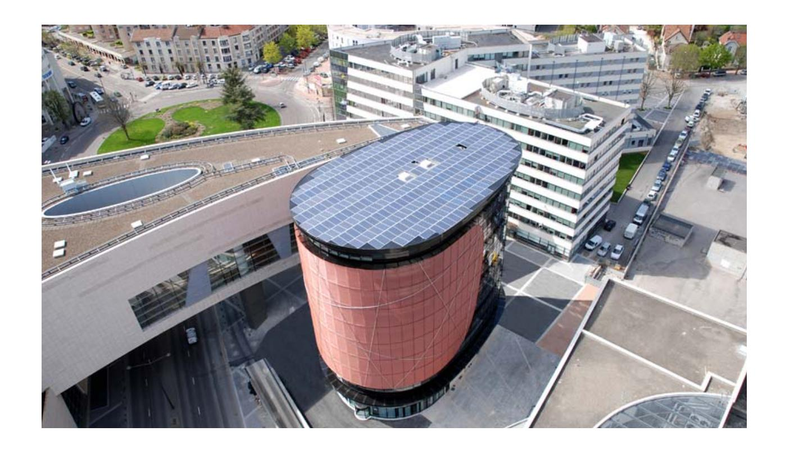

La Tour Elithis a été pensée, dès la conception du projet, dans le souci de concilier efficience énergétique, exigence esthétique et cohérence architecturale. Ce projet est le fruit d'une étroite concertation entre ingénieurs et architectes, permettant l'innovation et la mutualisation de connaissances. Le résultat est un bâtiment vertueux, intégré dans une logique d'urbanisation cohérente.

#### **Présentation de la tour Elithis**

#### **a. Présentation générale**

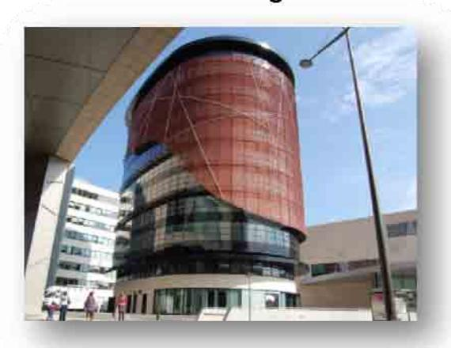

La ville de Dijon, une société d'ingénierie climatique et électrique, ainsi qu'un cabinet d'architectes se sont associés pour réaliser un bâtiment tertiaire à haute efficience énergétique dans le quartier Clémenceau à Dijon (21).

Pour leur nouveau siège social, les ingénieurs ont conçu un bâtiment révolutionnaire à très haute efficience énergétique, en limitant fortement les déperditions et les apports énergétiques.

Respectueux de l'environnement et producteur

d'énergie, ce bâtiment répond à une conception bioclimatique à la pointe de la recherche en matière d'énergie positive et vise le facteur 4 en termes de consommation équivalent carbone.

La tour, dont la construction a débuté en décembre 2007 et s'est achevée en avril 2009, sert de laboratoire. Elle est équipée de capteurs et de compteurs qui permettent de mesurer la performance des différents équipements (chauffage, rafraîchissement, ventilation, éclairage, ascenseurs...).

La tour d'une surface hors œuvre net (shon) de 4 921 m² s'échelonne sur 10 niveaux, parmi eux quatre sont occupés par la société d'ingénierie. Les autres sont accessibles à la commercialisation ; un radiologue, un dentiste, un restaurant et l'ADEME Bourgogne s'y sont installés.

Le bâtiment est de type ERP catégorie 5. L'étude thermique a été effectuée selon les critères de la RT 2005.

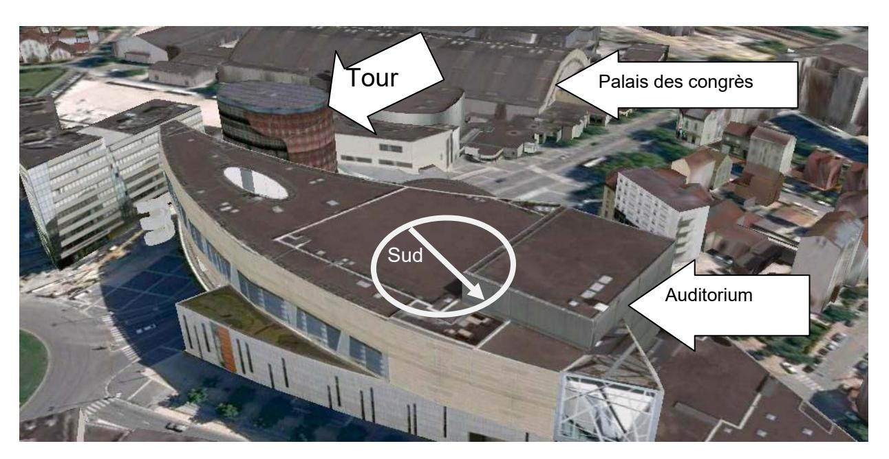

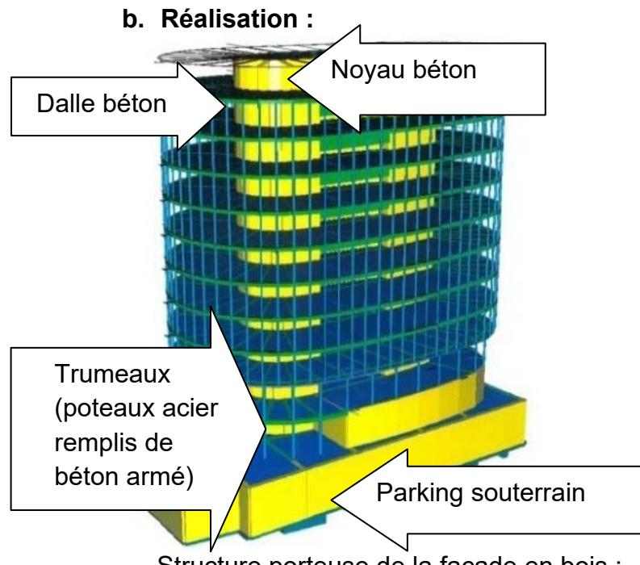

- Structure porteuse de la façade en bois :
  - o Pin lamellé collé
  - o Parement ext. aluminium
- Double vitrage: 8/20/6, argon 90 %, *Ug*=1,1 W·m-2·K-1, *g ou FS*=40 %
- Allège bois intérieur et aluminium extérieure
  - o Aluminium extérieur 1 mm et  $\lambda$ =200 W·m-1·K-1
  - o Isolant 120 mm ouate de cellulose :  $\lambda$ =0,035 W·m-1·K-1
  - Pare vapeur en aluminium d'épaisseur 0,1 mm
  - o 14 mm de pin int. :  $R=0.09 \text{ m}^2 \cdot \text{K} \cdot \text{W}^{-1}$

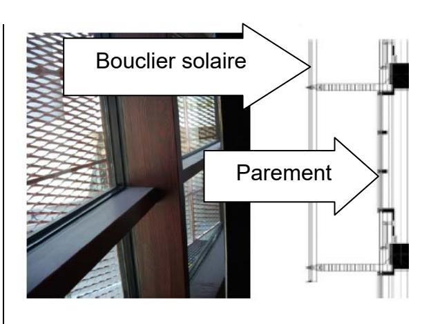

#### Production d'énergie

Deux chaudières bois de 100 kW chacune assurent les besoins en chauffage de la tour.

Les granulés bois sont livrés par camion et sont versés dans une trémie de 12 m3.

#### Données granulés bois :

Valeur énergétique PCI=4,9 kW·h·kg-1 40 % d'humidité

Masse volumique du pellet (compacté) = 1 100 kg·m-3

Masse volumique du pellet (vrac)=  $750 \text{ kg} \cdot \text{m}^{-3}$ 

# Synoptique des énergies : confort thermique

#### Schéma de principe : cf annexe 5

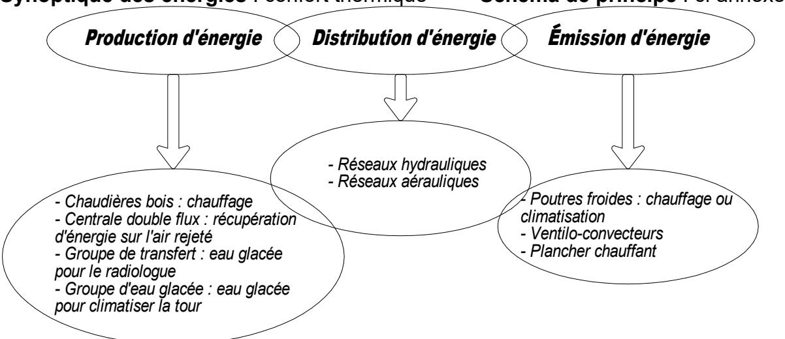

#### **Émission d'énergie**

Poutre froide : placée dans le plafond, elle émet la chaleur en hiver et le froid en été sans ventilateur.

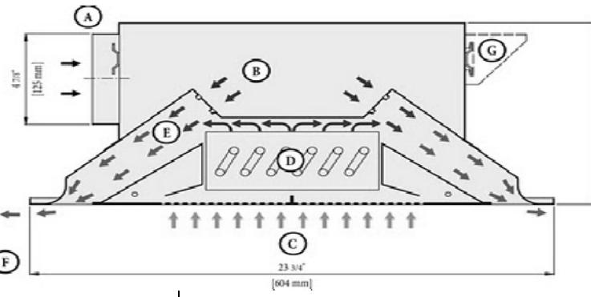

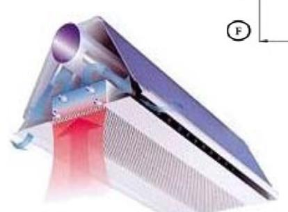

L'air neuf A circulant dans les poutres froides vient de la centrale double flux. (cf schéma de principe annexe 5).

La poutre active fermée est conçue pour rafraîchir ou chauffer l'air ambiant. Elle comprend un plénum d'air neuf B. L'air primaire est soufflé directement dans le plénum et propulsé au travers de buses d'induction. Le jet d'air des buses et l'effet d'induction (venturi) aspirent l'air secondaire ambiant par la sous - face de la poutre au travers de l'échangeur D.

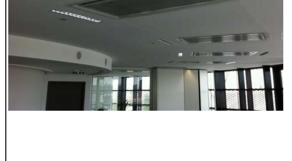

Le mélange E de l'air primaire et de l'air secondaire induit est pulsé dans la pièce par les fentes longitudinales sur chaque côté de la poutre, avec un jet d'air horizontal (effet coanda).

#### **Panneaux photovoltaïques**

La toiture est recouverte de panneaux photovoltaïques qui assurent une production annuelle d'électricité.

L'énergie électrique est produite par des panneaux solaires photovoltaïques intégrés à la couverture plane du bâtiment.

Elle est entièrement revendue.

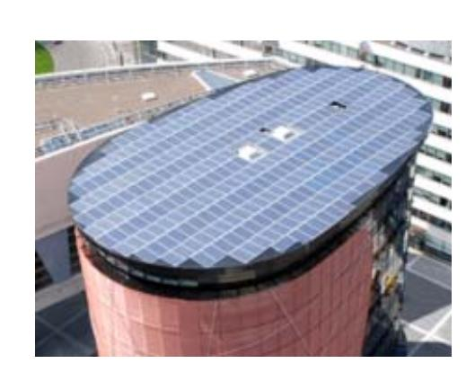

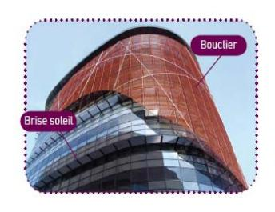

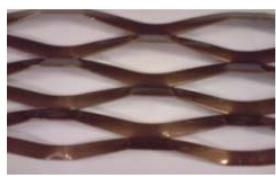

Un bouclier thermique de protection contre les rayonnements solaires en métal déployé cuivré conjugue le confort visuel et la diminution des apports solaires.

#### **c. Bilan énergétique annuel de la tour**

|                       | Coeff. ep/ef* | Consommations en énergie primaire mesurées en kW·hep·m-2shon·an-1 |
|-----------------------|---------------|----------------------------------------------------------------------|
| Rafraichissement      | 2,58          | 6,23                                                                 |
| Ventilation           | 2,58          | 14,08                                                                |
| Pompes et auxiliaires | 2,58          | 2,6                                                                  |
| Éclairage             | 2,58          | 9,5                                                                  |
| Ascenseurs            | 2,58          | 3,58                                                                 |
| Chauffage bois        | 1             | 36,5                                                                 |
| Photovoltaïque        | 2,58          | 40,24                                                                |

\*ep : énergie primaire ef : énergie finale

*L'objectif de cette étude est de justifier les choix faits par les concepteurs de cette tour à haute efficience énergétique et de vérifier les annonces du groupe d'ingénierie en termes de consommation et de respect de l'environnement.* 

Après un bilan carbone de la tour, l'étude portera sur les choix limitant la consommation en éclairage, ainsi que sur le bilan énergétique d'une salle de réunion. On s'intéressera ensuite à l'accroche du bouclier solaire sur la façade, puis on mettra en évidence les principes de pilotage de la tour pour optimiser l'efficience énergétique. On quantifiera enfin les apports énergétique et économique dus aux sources d'énergie renouvelable.

### **Partie A : Consommation carbone de la tour**

*L'objectif de cette partie est d'effectuer le bilan annuel de consommation en carbone de la tour.* 

**Question 1** : un facteur 4 de réduction de gaz à effet de serre est envisagé pour la France. **Expliquer** dans quel protocole, dans quelle échéance et par rapport à quelle émission de base sont inscrits ces objectifs.

**Question 2** : l'équivalent carbone est la mesure « officielle » des émissions des gaz à effet de serre. Souvent les entreprises ou les médias utilisent « l'équivalent CO2 », donnant des valeurs 3,67 fois supérieures. **Expliquer** d'où provient ce facteur en comparant les masses atomiques.

**Question 3** : **expliquer** la différence entre les « émissions de CO2» et « l'équivalent CO2» ?

**Question 4** : pour la tour, **lister** les sources d'émission de gaz à effet de serre.

#### *Les niveaux d'extraction selon les travaux ISO 14064*

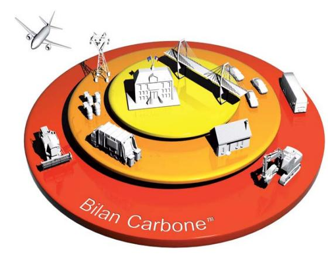

#### *ISO scope 1* :

Cette extraction se limite aux émissions dues aux sources directement possédées par l'entité, que ces sources soient fixes ou mobiles. La propriété de la source est déterminante. Cette extraction n'est pas appropriée pour avoir une vue large de la situation, pour du management environnemental ou une stratégie énergétique.

#### *ISO scope 2 :*

Cette extraction reprend les postes compris dans le scope 1 en ajoutant les émissions externes dues à l'achat de l'électricité, de la vapeur…

#### *ISO scope 3* :

Les émissions prises en compte dans le périmètre ISO scope 3 sont quasiment les mêmes que les émissions globales de la méthode Bilan Carbone™, à l'exception des émissions de gaz des avions.

#### **Question 5** : **déterminer** le niveau d'extraction de la tour.

**Question 6** : **remplir** le document réponse DR1 en prenant en compte les consommations du bâtiment dans le cadre de la réglementation thermique 2005. **Déterminer** la quantité de carbone consommée annuellement par la tour.

**Question 7** : le chef d'exploitation de cette entreprise reçoit la note de calcul relative à la consommation carbone. **Conclure** en cinq lignes maximum sur la stratégie d'entreprise à mettre en place par rapport à ce résultat.

# **Partie B : Étude de l'éclairage de la tour Elithis : « Allumer moins pour éclairer mieux »**

Dans un bâtiment tertiaire, la première dépense énergétique est l'éclairage, bien devant le chauffage ou la ventilation.

*L'objectif de cette partie est de déterminer comment les concepteurs de la tour Elithis ont réussi à diminuer considérablement la consommation électrique pour l'éclairage, si bien que la tour, ovoïde de verre avec une surface vitrée de 75%, est un des bâtiments les plus sobres au monde en ce qui concerne l'éclairage.* 

**Question 8** : **expliquer** les avantages et inconvénients dus au choix d'une surface vitrée à 75%. Répondre de manière synthétique (6 lignes maximum).

**Question 9 :** à partir de la forme générale du bouclier solaire (voir annexe 1) et des motifs de son treillis donnés ci-dessous, **expliquer** son impact en ce qui concerne l'éclairage, en fonction de la saison et de l'heure de la journée. Faire une réponse synthétique (8 lignes maximum).

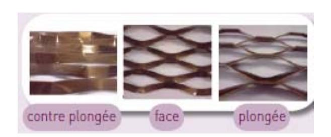

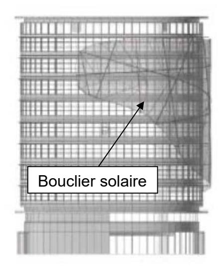

La contre plongée correspond à une vue vers le haut, de l'intérieur vers l'extérieur. La plongée correspond à une vue vers le bas, de l'intérieur vers l'extérieur.

**Question 10** : à partir de l'annexe 2, **donner** la valeur de l'éclairement nécessaire dans les bureaux de la tour. Puis à partir de l'annexe 3, **analyser** l'éclairement réel mesuré dans les différentes parties du bâtiment et **proposer** une solution pour assurer un éclairage correct des bureaux.

La solution choisie par les concepteurs de la tour est de régler un éclairement minimal de 300 lux au niveau des plans de travail des bureaux (ensemble de 2 bureaux de 1 m² chacun), ce qui est largement suffisant pour de la bureautique où les employés lisent parfaitement sur leur écran d'ordinateur. Ce réglage doit être automatisé.

En peignant la structure porteuse en bois de couleur foncée, la perception physiologique de l'éclairement reste bonne quel que soit le déplacement de la personne au sein des bureaux, ce qui évite d'avoir un nombre important de foyers lumineux.

Le ménage des bureaux est effectué à midi, plutôt que le soir, pour éviter une dépense d'éclairage supplémentaire, et aussi pour améliorer les comportements grâce au dialogue instauré entre les utilisateurs de la tour et le personnel d'entretien. Pour lire des plans ou autres besoins spécifiques, des éclairages nomades basse consommation sont mis à disposition pour assurer une certaine flexibilité.

**Question 11** : sachant que chaque ensemble de 2 bureaux est éclairé par 2 tubes fluorescents de 14 W, **calculer** la consommation énergétique *Wq* quotidienne pour l'éclairage de ces 2 bureaux installés dans un bâtiment classique et en fonctionnement 8 h par jour.

**Question 12** : les tubes sont alimentés par des ballasts dimmables (ou gradables) associés à un détecteur de présence et à un capteur de luminosité.

Cette automatisation doit permettre d'assurer un éclairement de 300 lux sur les bureaux. **Remplir** le document réponse DR2 à l'aide du diagramme ci-contre. On supposera que les deux éclairements (naturel et issu du luminaire) s'ajoutent simplement, ce qui n'est pas tout à fait le cas dans la réalité.

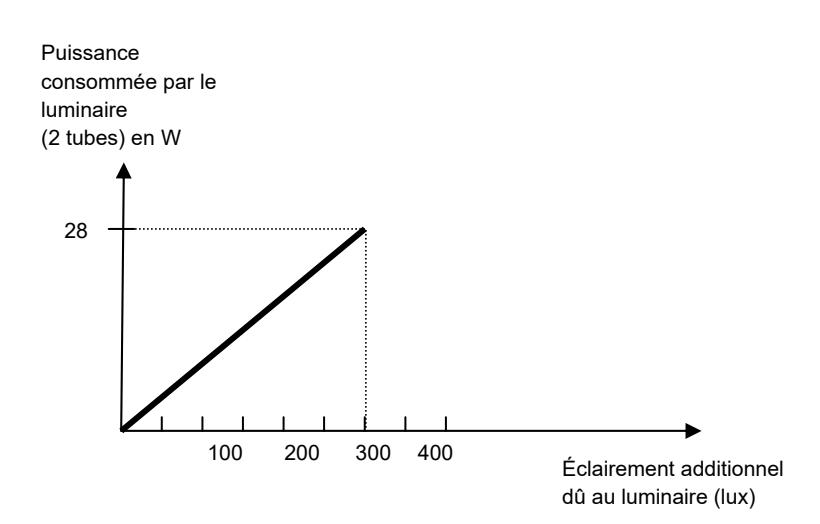

**Question 13** : en **déduire**  l'énergie quotidienne *Wq*

consommée pour éclairer un bloc de 2 bureaux (horaires de travail 8h-12h et 14h-18h) et donner le pourcentage d'économie énergétique réalisée pour l'éclairage.

**Question 14** : on se place à un moment de la journée où le luminaire doit fournir un éclairement de 200 lux sur le bloc bureau situé à 1,70 m sous le luminaire. À partir de l'annexe 4, **déterminer** le flux lumineux nécessaire par tube, puis **justifier** la référence du tube choisi : FH 14W/827HE. On supposera un rendement global de 0,8 (qui prend en compte le rendement du luminaire, l'utilance, le coefficient de réflexion…)

**Question 15** : la solution retenue pour faire varier le flux lumineux est de faire varier la fréquence du courant dans les tubes en fonction d'un signal 0-10 V issu du capteur de luminosité. D'après le schéma ci-dessous, qui représente les constituants d'un ballast électronique, **expliquer** sur quoi doit agir le signal 0-10 V pour faire varier l'intensité lumineuse.

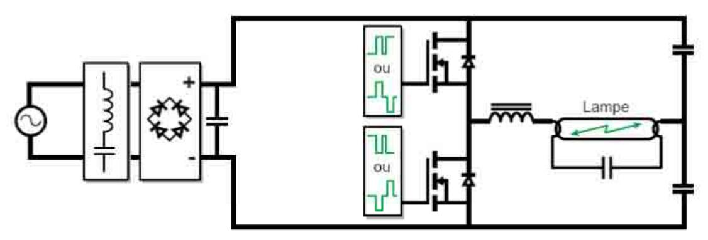

**Question 16** : **conclure** sur les choix faits par les concepteurs de la tour Elithis en ce qui concerne l'éclairage.

#### Partie C : Bilan énergétique partiel d'une salle de réunion en été

Le but de cette partie est d'effectuer le bilan énergétique partiel d'une salle de réunion.

#### Données complémentaires

Température extérieure de base à Dijon en été = 32°C

Température de confort intérieur = 26°C

#### Composition de l'allège

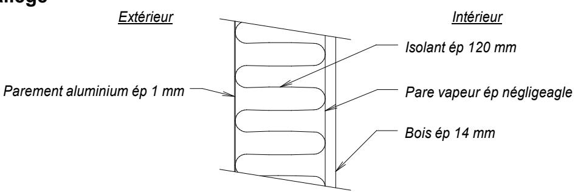

# Rappel: $U = \frac{1}{\sum R_{th} + \sum \frac{e}{\lambda}}$

#### avec

- *U* = Conductivité thermique en W·m-2·K-1
- **R**si = Résistance thermique superficielle int. en m²·K·W-1
- $\bar{R}_{se}$  = Résistance thermique superficielle ext. en m²·K·W-1
- **e** = épaisseur d'un des composants de la paroi en m
- $\lambda$  = coefficient de conduction thermique exprimé en W·m-1·K-1
- *Rth* = Résistance thermique d'un composant de la paroi en m²·K·W-1

| Paroi donnant sur : -l'extérieur                                          | R si m²·K·W -1 | R se (1) m²·K·W -1 | R si +R se m²·K·W -1 |
|------------------------------------------------------------------------------|-----------------------------------------|--------------------------------------------------------|----------------------------------------------------------|
| <ul> <li>un passage ouvert</li> <li>un local ouvert(2)</li> </ul> |                                         |                                                        |                                                          |
| Paroi verticale inclinaison ≥ 60°                                            | 0,13                                    | 0,04                                                   | 0,017                                                    |
| Paroi horizontale inclinaison < 60°                                          | 0,10                                    | 0,04                                                   | 0,14                                                     |
| Dessin descendant                                                            | 0,17                                    | 0,04                                                   | 0,21                                                     |

- (1) Si la paroi donne sur un local non chauffé, Rsi s'applique des deux côtés.
- (2) Un local est dit ouvert si le rapport de la surface totale de ses ouvertures permanentes sur l'extérieur, à son volume, est égal ou supérieur à  $0.005~\text{m}^2/\text{m}^3$ . Ce peut être le cas, par exemple, d'une circulation à l'air libre, pour des raisons de sécurité contre l'incendie.

**Question 17** : **déterminer** le flux thermique surfacique  $\varphi$  (en W/m²) dans l'allège de la salle de réunion en été à partir des données de la page 3.

Dans les deux questions suivantes, l'étude porte particulièrement sur le vitrage.

**Question 18** : les caractéristiques des vitrages sont : double vitrage 8/20/6, argon 90 %, *Ug*=1,1 W·m-2·K-1, *g ou FS*=40 %. **Donner** l'intérêt de différencier les épaisseurs de vitrage entre l'intérieur et l'extérieur.

Coupe vitrage

Intérieur Ar Extérieur

film solaire 34mm

**Question 19** : le film modifiant le facteur solaire est placé entre l'argon et le vitrage intérieur. **Expliquer** de quelle façon il augmente le confort hiver.

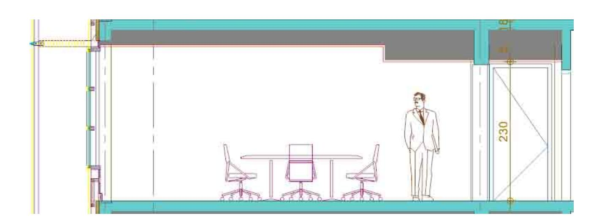

**Question 20**: à partir des courbes cumulées d'émission de chaleur d'un humain dans le cas d'une activité sédentaire (bureau, lecture, études) en fonction de la température ambiante, **donner** dans le cas d'une réunion de 12 personnes, la puissance totale dégagée.

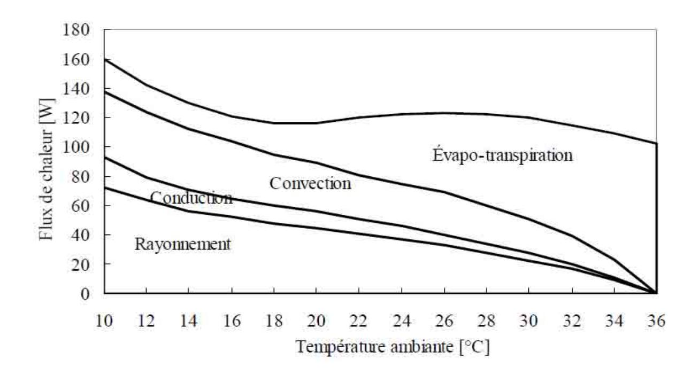

*Exemple : à une température ambiante de 10°C, le flux de chaleur totale est de 160 W. Ce flux comprend 73 W de rayonnement, 20 W de conduction, 45 W de convection et 22 W d'évapo-transpiration.* 

**Question 21** : **calculer** le débit horaire de vapeur d'eau dégagée par l'ensemble des participants à cette réunion, sachant que la chaleur latente de vaporisation *Lv* à 26°C a pour valeur 2430 kJ/kg.

**Question 22** : à l'aide du schéma de principe hydraulique et aéraulique simplifié de la tour donné en annexe 5, **retrouver** les systèmes mis en œuvre pour combattre les charges lors d'une réunion de 12 personnes en été. Plusieurs scénarios sont envisageables en fonction de conditions climatiques différentes : **remplir** le document réponse **DR3.** 

**Question 23 :** la mesure de la température sèche conditionne tout le raisonnement du pilotage. La température résultante sèche (ou opérative) pourrait nettement améliorer le confort thermique des occupants. **Conclure** sur sa mise en œuvre.

# **Partie D : Étude de l'accroche du bouclier solaire sur la façade.**

La tour Elithis est équipée d'un bouclier solaire, la description de cet élément est fournie en annexe 1.

*L'objectif de cette partie est de vérifier la résistance mécanique des pièces qui permettent de solidariser le bouclier à la structure du bâtiment.* 

Ces pièces sont fixées d'une part sur les dalles de chaque niveau et d'autre part sur les trumeaux acier laqué remplis de béton (reprise d'appui extérieur des dalles).

Les pièces, en plus de supporter le bouclier solaire, permettent la fixation des caillebotis constituant le brise soleil sur toute la périphérie de la tour.

Ce brise soleil a également comme fonction de permettre la circulation de personnes en cas d'opération de maintenance, de nettoyage de la paroi ou éventuellement le passage de services de secours.

On dénombre 230 pièces de fixation réparties uniformément sur la surface du bouclier.

La longueur de ces pièces est de 1 m.

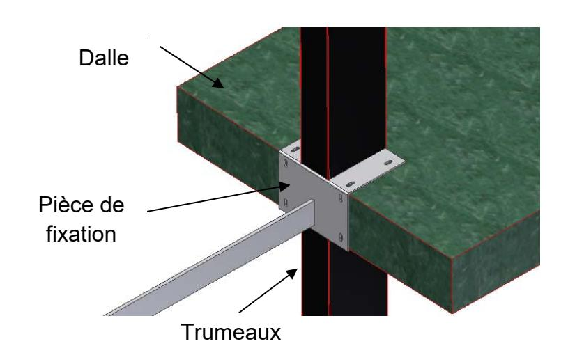

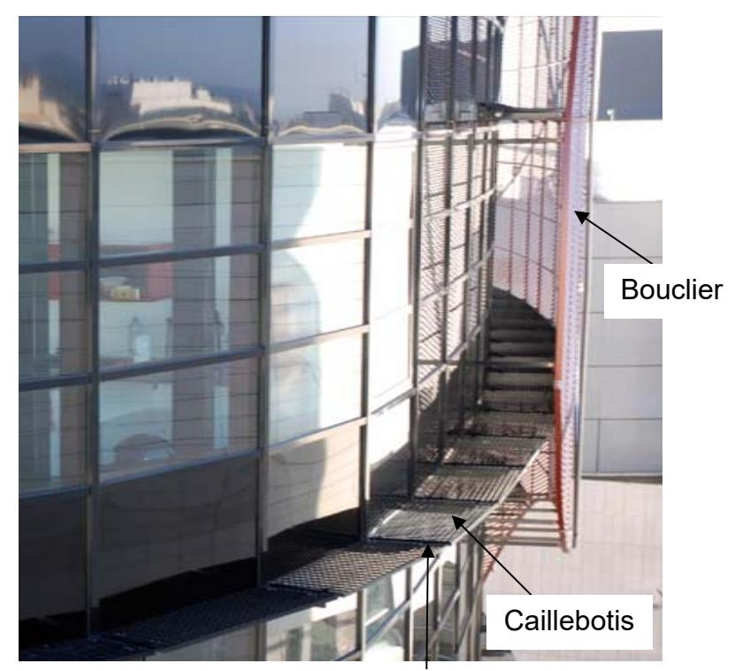

Pièce de fixation

La vérification de la résistance mécanique des fixations consistera en un calcul de résistance des matériaux en flexion simple ainsi qu'un calcul de vérification de non dépassement d'une valeur limite admissible de déformée.

#### **Données et hypothèses**

- poids propre des pièces de fixation : 40 daN (charge répartie sur la longueur de la poutre) ;
- caillebotis (acier thermo laqué de 1m2 ) de poids propre : 30 daN (charge répartie sur la surface) ;
- surcharge éventuelle sur 1 caillebotis (personne en circulation sur le brise soleil avec divers équipements) : 150 daN (charge répartie sur la surface) ;
- les pièces de fixations sont considérées comme des poutres de longueur 1 mètre encastrées dans la dalle ;
- bouclier solaire : tôle déployée d'aluminium de 3 mm d'épaisseur ;
- masse volumique de l'aluminium : 2,7 g·cm-3 ;
- masse volumique du givre : 917 kg·m-3.

#### **Détermination des efforts appliqués aux pièces de fixation**

Il est nécessaire de déterminer la surface du bouclier, on considèrera le modèle équivalent ci-dessous et le fait que le bouclier couvre 7 étages de 2,5 mètres chacun.

**Question 24** : **déterminer** la surface *S* équivalente du bouclier à l'aide du modèle cidessous, on exprimera *S* en fonction de *R, L ,l, α* et *β.*

On donne *R*=9 m, *L*=14 m, *l*=10 m, *α*=13°et *β*=10°. **Donner** la valeur numérique de *S*.

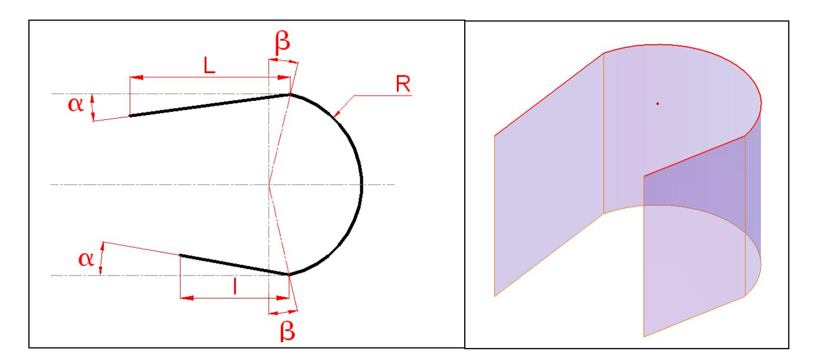

Les organismes de certifications préconisent pour ce type de calcul de se placer dans le cas extrême où le bouclier serait recouvert d'un centimètre de givre de chaque côté.

Une étude logicielle donne pour la surface précise du bouclier *S*= 812 m2 .

#### Question 25 : déterminer dans ces conditions la masse M du bouclier.

Chacune des 230 fixations supporte la même part de l'effort engendré par cette masse *M*, ainsi qu'un caillebotis du brise soleil avec sa surcharge éventuelle.

**Question 26** : **déterminer** pour le modèle ci-dessous les valeurs de *q* et de *P*.

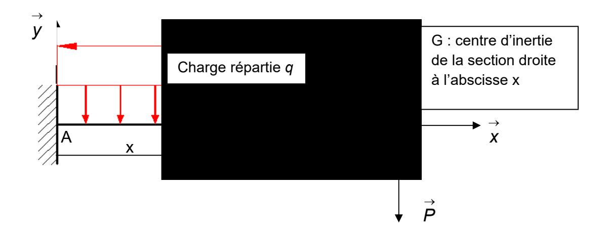

**Question 27**: **déterminer** les expressions de l'effort tranchant T et du moment fléchissant  $M_{fz}$  le long de la poutre AB, puis **tracer** les diagrammes et **donner** les valeurs remarquables de ces grandeurs.

Le matériau utilisé pour les fixations est un acier de type E30 (Résistance élastique  $R_e$  = 280 N·mm-2); la section des fixations est définie cicontre et le coefficient de sécurité à appliquer dans ce type d'ouvrage est s=2.

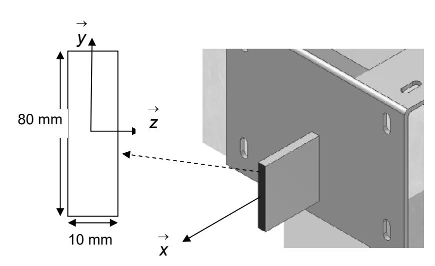

**Question 28**: **déterminer** la contrainte normale maximale  $\sigma_{max}$  dans cette section.

**Question 29** : **comparer** cette valeur à la contrainte admissible  $R_{pe}$ . **Conclure** quant au choix de la section des pièces.

**Question 30** : **déterminer** et **justifier** à l'aide du tableau ci-dessous le meilleur choix de poutrelle (profilé IPN) pouvant convenir.

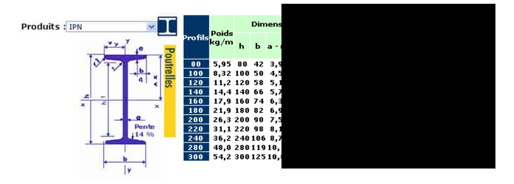

Le déplacement vertical maximal autorisé par les organismes de certification pour une construction du type bouclier solaire est de 5 mm.

**Question 31** : dans les conditions précédentes et en ayant remplacé la section rectangulaire par la poutrelle IPN80, **déterminer** la valeur maximale de la déformée dans une pièce de fixation.

On donne le tableau ci-dessous.

| Poutre                                                                                                                                                                                                                                                                                                                                                                                                                                                                                                                                                                                                                                                                                                                                                                                                                                                                                                                                                                                                                                                                                                                                                                                                                                                                                                                                                                                                                                                                                                                                                                                                                                                                                                                                                                                                                                                                                                                                                                                                                                                                                                                        | Pente maxi                              | Flèche                            | Équation                                                                                                                                  |
|-------------------------------------------------------------------------------------------------------------------------------------------------------------------------------------------------------------------------------------------------------------------------------------------------------------------------------------------------------------------------------------------------------------------------------------------------------------------------------------------------------------------------------------------------------------------------------------------------------------------------------------------------------------------------------------------------------------------------------------------------------------------------------------------------------------------------------------------------------------------------------------------------------------------------------------------------------------------------------------------------------------------------------------------------------------------------------------------------------------------------------------------------------------------------------------------------------------------------------------------------------------------------------------------------------------------------------------------------------------------------------------------------------------------------------------------------------------------------------------------------------------------------------------------------------------------------------------------------------------------------------------------------------------------------------------------------------------------------------------------------------------------------------------------------------------------------------------------------------------------------------------------------------------------------------------------------------------------------------------------------------------------------------------------------------------------------------------------------------------------------------|--------------------------------------------|-----------------------------------|-------------------------------------------------------------------------------------------------------------------------------------------|
| $\begin{array}{c c}  & F \\  & B \\  & B \\  & \Theta_{B} \end{array}$                                                                                                                                                                                                                                                                                                                                                                                                                                                                                                                                                                                                                                                                                                                                                                                                                                                                                                                                                                                                                                                                                                                                                                                                                                                                                                                                                                                                                                                                                                                                                                                                                                                                                                                                                                                                                                                                                                                                                                                                                                                        | $\theta_B = -\frac{FL^2}{2EI}$             | $f_B = -\frac{FL^3}{3EI}$         | $y' = -\frac{F.X}{2EI}(2L - x)$ $y = -\frac{F.X^2}{6EI}(3L - x)$                                                                          |
| A $C$ $B$ $A$ $C$ $B$ $A$ $C$ $B$ $A$ $A$ $B$ $A$ $A$ $B$ $A$ $A$ $B$ $A$ $A$ $B$ $A$ $A$ $B$ $A$ $A$ $B$ $A$ $A$ $A$ $B$ $A$ $A$ $A$ $A$ $A$ $A$ $A$ $A$ $A$ $A$                                                                                                                                                                                                                                                                                                                                                                                                                                                                                                                                                                                                                                                                                                                                                                                                                                                                                                                                                                                                                                                                                                                                                                                                                                                                                                                                                                                                                                                                                                                                                                                                                                                                                                                                                                                                                                                                                                                                                             | $\theta_{\mathcal{B}} = -\frac{Fa^2}{2EI}$ | $f_B = -\frac{Fa^2(3L - a)}{6EI}$ | $x \le a : y' = -\frac{Fx}{2EI}(2a - x)$ $y = -\frac{Fx^2}{6EI}(3a - x)$ $x > a : y' = -\frac{Fa^2}{2EI}$ $y = -\frac{Fa^2}{6EI}(3x - a)$ |
| y   q   B   X   A   B   X   B   X   B   X   B   X   B   X   B   X   B   X   B   X   B   X   B   X   B   X   B   X   B   X   B   X   B   X   B   X   B   X   B   X   B   X   B   X   B   X   B   X   B   X   B   X   B   X   B   X   B   X   B   X   B   X   B   X   B   X   B   X   B   X   B   X   B   X   B   X   B   X   B   X   B   X   B   X   B   X   B   X   B   X   B   X   B   X   B   X   B   X   B   X   B   X   B   X   B   X   B   X   B   X   B   X   B   X   B   X   B   X   B   X   B   X   B   X   B   X   B   X   B   X   B   X   B   X   B   X   B   X   B   X   B   X   B   X   B   X   B   X   B   X   B   X   B   X   B   X   B   X   B   X   B   X   B   X   B   X   B   X   B   X   B   X   B   X   B   X   B   X   B   X   B   X   B   X   B   X   B   X   B   X   B   X   B   X   B   X   B   X   B   X   B   X   B   X   B   X   B   X   B   X   B   X   B   X   B   X   B   X   B   X   B   X   B   X   B   X   B   X   B   X   B   X   B   X   B   X   B   X   B   X   B   X   B   X   B   X   B   X   B   X   B   X   B   X   B   X   B   X   B   X   B   X   B   X   B   X   B   X   B   X   B   X   B   X   B   X   B   X   B   X   B   X   B   X   B   X   B   X   B   X   B   X   B   X   B   X   B   X   B   X   B   X   B   X   B   X   B   X   B   X   B   X   B   X   B   X   B   X   B   X   B   X   B   X   B   X   B   X   B   X   B   X   B   X   B   X   B   X   B   X   B   X   B   X   B   X   B   X   B   X   B   X   B   X   B   X   B   X   B   X   B   X   B   X   B   X   B   X   B   X   B   X   B   X   B   X   B   X   B   X   B   X   B   X   B   X   B   X   B   X   B   X   B   X   B   X   B   X   B   X   B   X   B   X   B   X   B   X   B   X   B   X   B   X   B   X   B   X   B   X   B   X   B   X   B   X   B   X   B   X   B   X   B   X   B   X   B   X   B   X   B   X   B   X   B   X   B   X   B   X   B   X   B   X   B   X   B   X   B   X   B   X   B   X   B   X   B   X   B   X   B   X   B   X   B   X   B   X   B   X   B   X   B   X   B   X   B   X   B   X   B   X   A   X   B   X   A   X   B   X   A   X   B   X   A   X   A   X   A   X   A | $\theta_B = -\frac{qL^3}{6EI}$             | $f_B = -\frac{qL^4}{8EI}$         | $y' = \frac{-qx}{6EI} \left( 3L^3 - 3Lx + x^2 \right)$ $y = \frac{-qx^4}{24EI} \left( x^2 - 4Lx + 6L^2 \right)$                           |

Acier de type E30 : module d'Young *E* = 200 000 N·mm-2.

**Question 32** : **conclure** quant au respect du déplacement maximal autorisé ainsi que sur la conception des pièces de fixation.

**Question 33** : **proposer** un élément climatique qui a été négligé dans la notice de calcul et qui pourrait avoir une incidence sur la validité des résultats. **Indiquer** de quelles façons cet élément intervient sur le bouclier.

## **Partie E : optimisation de l'efficience énergétique de la tour**

*L'objectif de cette partie est d'analyser une partie du pilotage de la tour pour optimiser l'efficience énergétique.* 

#### **Principe des installations**

Données : schéma de principe annexe 5 et diagramme de pilotage annexe 6*.*

**Question 34 : compléter** le document réponse DR3 par un diagramme de régulation. **Indiquer** les plages de fonctionnement du « Change over » des poutres froides. Les 4 vannes deux voies motorisées sont régulées en mode P (proportionnel). La bande proportionnelle est de 2°C.

**Question 35 : donner** les situations de température où le bipasse de la centrale de traitement d'air double flux adiabatique doit s'ouvrir. **Décrire** le principe d'échange adiabatique dans la centrale.

**Question 36 : interpréter** l'ordre de passage des échangeurs « Groupe de transfert » puis « Échangeur chauffage » pour l'alimentation en eau chaude des poutres froides.

**Question 37 :** avant de mettre en marche les compresseurs frigorifiques, le groupe d'eau glacée adiabatique peut néanmoins refroidir l'eau des poutres froides. En fonction des besoins, **compléter** le document réponse DR3 et **donner** dans l'ordre de mise en route les éléments de refroidissement de l'eau.

#### **Étude du registre à volets de sur-ventilation nocturne**

Pour décharger énergétiquement le bâtiment en période d'été et abaisser la température, une surventilation nocturne a été prévue. Cette augmentation de débit d'air neuf dans les locaux permet d'enlever de l'énergie à la structure du bâtiment. L'air neuf arrive par les entrées d'air situées dans les allèges en façade.

Le basculement entre l'alimentation en air extrait pour la centrale double flux et la surventilation nocturne des locaux est assuré par deux registres à volets, motorisés par un servomoteur de type « Belimo ». On distingue un registre inférieur (gérant le passage de l'air extrait pour la surventilation) et un registre supérieur (gérant le passage de l'air pour la centrale double flux). Ces deux registres sont composés de 3 volets chacun et sont motorisés par un seul servomoteur.

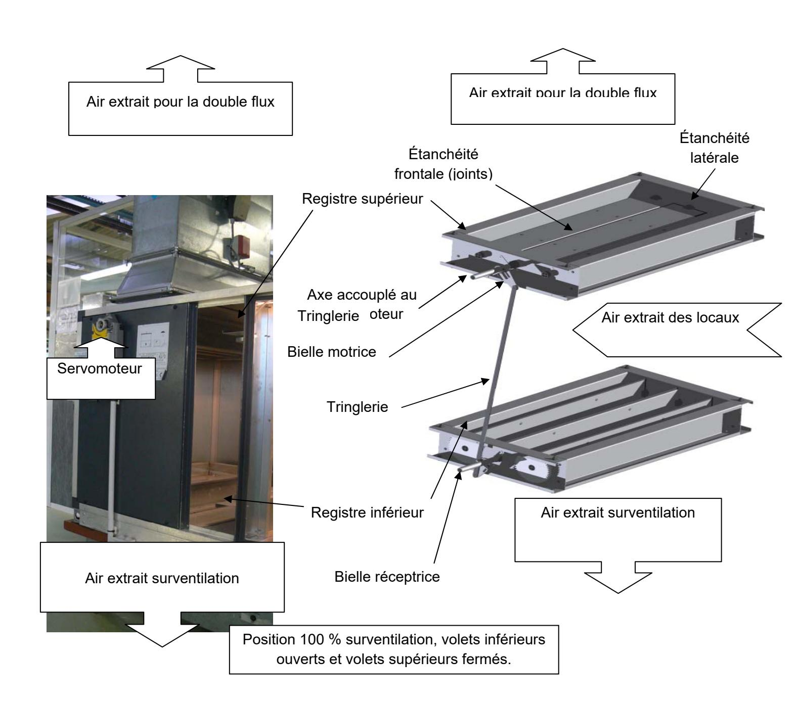

Les deux registres ont un fonctionnement en opposition : lorsque les 3 volets du registre inférieur sont fermés, les 3 volets du registre supérieur sont ouverts (décalage de 90°).

L'axe de rotation du volet central supérieur est accouplé à l'axe de sortie du réducteur du servomoteur ; il est également relié à l'axe de rotation du volet central inférieur par l'intermédiaire d'une tringlerie.

Chacun des volets est équipé de joints frontaux qui s'écrasent lors de la fermeture des registres au contact des autres volets.

L'emploi de ce genre de dispositif dans un milieu à atmosphère contrôlée nécessite la maitrise de l'étanchéité des volets par rapport au registre. L'étanchéité latérale par joint crée sur l'axe de manœuvre un couple de frottement constant *CL*. Pour obtenir l'étanchéité frontale lorsque le registre est fermé, il faut exercer un couple de fermeture *CF* bien supérieur au précédent. Ce couple doit permettre un écrasement suffisant du joint frontal.

Sur le servomoteur, un système de limitation d'intensité permet d'assurer la sécurité du moteur à courant continu en cas de surcharge (couple moteur demandé trop important). Pour régler l'angle de fermeture des volets on dispose d'un boitier de commande, néanmoins ce réglage n'est pas assez précis pour obtenir un écrasement du joint correctement dosé. On souhaite vérifier la possibilité d'utiliser la détection de surintensité *Ilim* dans le moteur comme capteur de fin de course en position fermée. Sens de rotation

**Question 38** : l'amplitude du mouvement de l'arbre de sortie du servomoteur est de 90°, l'amplitude du mouvement de la bielle réceptrice dépend du réglage de la position initiale des bielles et de la tringlerie.

Sur le document réponse DR4 on propose trois réglages de position de départ, **tracer** les épures des positions finales et **indiquer** la course angulaire de la bielle réceptrice.

**Indiquer** lequel de ces trois réglages convient, justifier votre réponse.

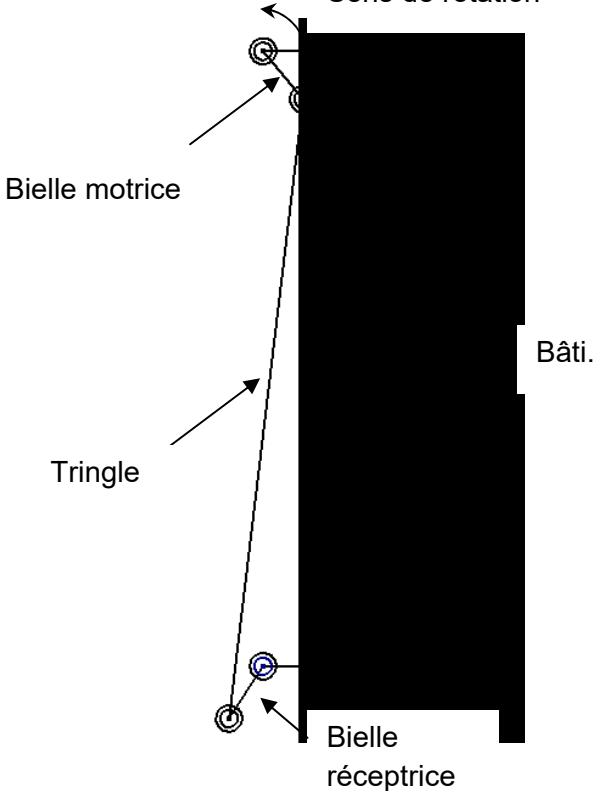

À partir d'une mesure des couples (*CL et CF*) nécessaires à la fermeture des volets (prenant en compte l'écrasement des joints) et d'une simulation logicielle on obtient la courbe de couple correspondant à appliquer sur la bielle motrice (figure cidessous).

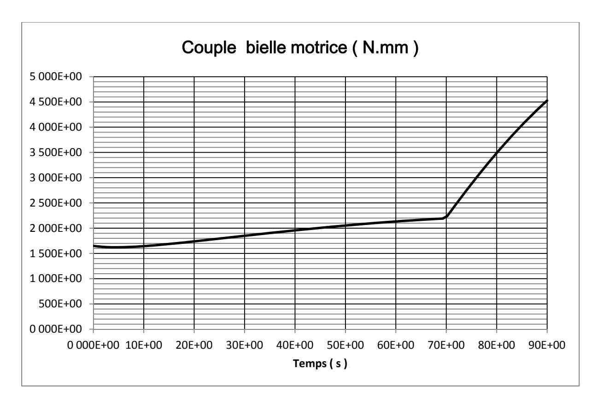

**Question 39** : **déterminer** le couple maximal au niveau de l'axe de la bielle motrice, puis à partir des éléments de l'annexe 7 concernant le réducteur du servomoteur, **calculer** le couple moteur nécessaire.

**Question 40** : la constante de couple du moteur est *K*=4,65.10-2 N·m/A, en **déduire** la valeur de l'intensité limite du courant circulant dans le moteur et correspondant au couple précédent.

**Question 41** : **conclure** quant à la faisabilité de la détection de fin de course par mesure de surintensité sachant que l'intensité maximale admissible par le moteur est de 63 mA.

#### **Acquisition des données de pilotage**

Pour être énergétiquement sobre, la tour nécessite un pilotage précis qui dépend de nombreux facteurs, comme les données climatiques extérieures, les températures intérieures…

Une station météo placée sur le toit donne en permanence des informations et les transmet à la GTC par liaison modbus.

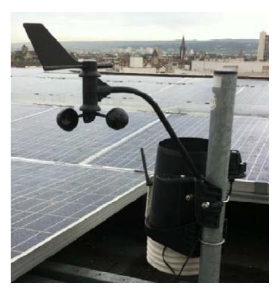

La station est équipée d'un anémomètre girouette, d'un pluviomètre au pas de 0,2 mm, d'un thermomètre hygromètre, d'un capteur de rayonnement solaire et d'un capteur de rayonnement UV.

**Question 42** : l'information de température extérieure est très importante pour la qualité du fonctionnement de la tour. La température est mesurée de -50 °C à +50 °C avec une précision de 0,1° C et le signal de sortie correspondant est une tension variable de 0 à 10 V qui est ensuite numérisée via un convertisseur analogiquenumérique. **Déterminer** le nombre de bits nécessaire du convertisseur pour obtenir la précision nécessaire.

**Question 43 : déterminer** la fonction entre la tension d'entrée *Ve* du CAN et la température et en **déduire** la valeur de cette tension pour une température de -5 °C. **Exprimer** le codage de sortie du CAN en hexadécimal, sachant que le convertisseur est de 12 bits.

**Question 44 :** en vous aidant de l'annexe 8, **compléter** la trame Modbus (en hexadécimal) de réponse de la station météo pour la température de -5 °C. Les CRC sont donnés : 06 27 pour la réponse.

Trame de réponse à compléter : ( 05 ?? 02 ?? ?? 06 27 )

**Question 45 : conclure** sur l'ensemble de la partie E quant aux moyens employés pour optimiser l'efficience énergétique de la tour.

## **Partie F : Utilisation des énergies renouvelables**

#### **Production photovoltaïque :**

Sur le toit de la tour Elithis, sont installés les 342 panneaux photovoltaïques ainsi qu'un système de récupération des eaux de pluie permettant l'alimentation en eau des toilettes.

L'objectif de cette partie est de calculer la production d'énergie renouvelable grâce aux panneaux photovoltaïques installés sur le toit afin de déterminer l'impact économique sur l'énergie électrique utilisée dans la tour.

**Question 46** : les panneaux solaires sont composés de cellules solaires élémentaires. **Expliquer** l'intérêt de relier entre elles ces cellules soit en série, soit en dérivation.

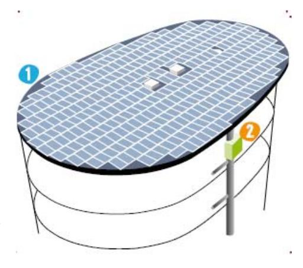

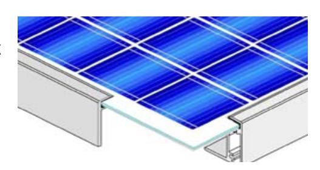

**Question 47 :** les panneaux photovoltaïques utilisés sont des TE2200 de 220 Wc (voir annexe 9). **Déterminer** la surface réelle totale des cellules photovoltaïques, **calculer** le rendement d'un panneau photovoltaïque à partir de leur documentation (voir annexe 9) puis à partir du document de calcul d'énergie solaire disponible à Dijon (voir annexe 10), **déterminer** l'énergie fournie par les 342 panneaux de l'installation.

**Question 48 :** à partir de l'annexe 11, **expliquer** le rôle de l'onduleur dans une installation photovoltaïque reliée au réseau et **donner** le type de commande des transistors de puissance. L'installation est composée de 24 onduleurs EI3300. **Justifier** le choix de cette référence d'onduleur, puis **donner** son rendement selon les normes européennes.

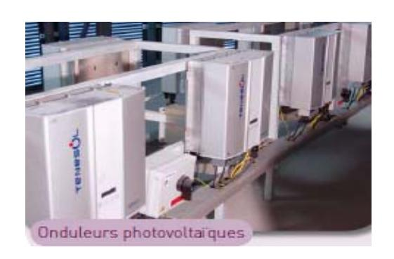

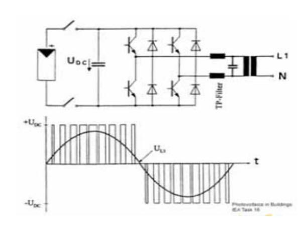

**Question 49 :** en supposant que les chutes de tension en ligne correspondent globalement à 6% de pertes, **estimer** l'énergie mesurée au niveau du compteur de revente à EDF et **comparer** à la valeur réelle mesurée (40,24 kW·h EP / m²shon).

La Tour Elithis est alimentée par un tarif jaune de 48 kVA. Cet abonnement sert aux équipements généraux de la Tour Elithis (CTA double flux, groupe Froid, chaufferie, ascenseurs, éclairage communs, parking…).

#### On considère que :

- les consommations électriques sont réparties à 80% en HP (heures pleines) et 20% en HC (heures creuses) ;
- la consommation électrique annuelle est répartie à 45% en été et 55% en hiver.

Ensuite chaque preneur dispose de son propre tarif électrique adapté à ses besoins (RdC restaurant : tarif jaune, 4e étage Ademe : tarif bleu, 7e à 9e étage Elithis : tarif jaune…)

**Question 50 :** sachant que le prix de revente du kW·h à EDF est de 0,58 €, **conclure** quant aux impacts énergétique et économique de la production d'énergie due aux panneaux photovoltaïques. **Discuter** également l'annonce du groupe Elithis de 4,29 €/m²shon de bénéfice pour les usagers.

| Tarif Jaune                             | Prime fixe | Prix de l'énergie HT ( c€/ kW·h ) |          |        |        |
|-----------------------------------------|------------|--------------------------------------|----------|--------|--------|
|                                         | annuelle   | Hiver HP                             | Hiver HC | Eté HP | Eté HC |
| Option Base                             | (€/kVA)    |                                      |          |        |        |
|                                         | 30,12      | 10,420                               | 7,288    | 4,212  | 2,958  |
| Hiver : novembre à mars inclus          |            |                                      |          |        |        |
| Eté : avril à octobre inclus            |            |                                      |          |        |        |
| HC : 8h tous les jours                  |            |                                      |          |        |        |
| Taxes : 19,6% avec TVA et taxes locales |            |                                      |          |        |        |

#### **Conclusion générale**

**Question 51 :** au regard de l'étude menée, **lister** les points essentiels à prendre en compte lors de la conception d'un bâtiment à haute efficience énergétique.

**Question 52 : imaginer** d'éventuelles solutions pour améliorer encore l'efficience énergétique de la tour Elithis.

## **DOCUMENT RÉPONSE DR1**

#### **Question 6**

Guide des facteurs d'émission V6.1 (Energie primaire) Source Ademe 2010

|                                                                                             | Facteurs d'émission Ep                                    | Compléments d'information    |
|---------------------------------------------------------------------------------------------|-----------------------------------------------------------|------------------------------|
| Granulés bois                                                                               | 4 kg éqC. MWh-1 PCI                                    | -                            |
| Électricité consommée (ou utile)                                                         | 25,3 g éqC. kWh-1                                         | -                            |
| Électricité (panneaux solaires PV de la tour)                                            | 15 g éqC. kWh-1                                           | -                            |
| Collecte des déchets                                                                        | 5 kg éqC. tonne-1                                         | Estimée à 31,5 tonnes par an |
| Eaux usées                                                                                  | 0 kg éqC. m-3 Station d'épuration eau non stagnante | -                            |
| Maintenance tertiaire (pertes fluide frigorigène, glycol eau glacée, encrassement) | 17 g éqC. m-2 Shon                                        | -                            |

|                                                                                          | Consommation annuelle de carbone |
|------------------------------------------------------------------------------------------|----------------------------------|
| Granulés bois                                                                            |                                  |
| Électricité consommée (ou utile)                                                      |                                  |
| Électricité (panneaux solaires PV de la tour)                                         |                                  |
| Collecte des déchets                                                                     |                                  |
| Eaux usées                                                                               |                                  |
| Maintenance tertiaire (pertes fluide frigorigène, glycol eau glacée, encrassement) |                                  |
| Bilan                                                                                    |                                  |

## **DOCUMENT RÉPONSE DR2**

#### **Question 12**

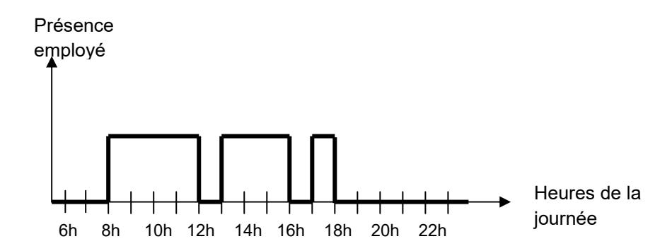

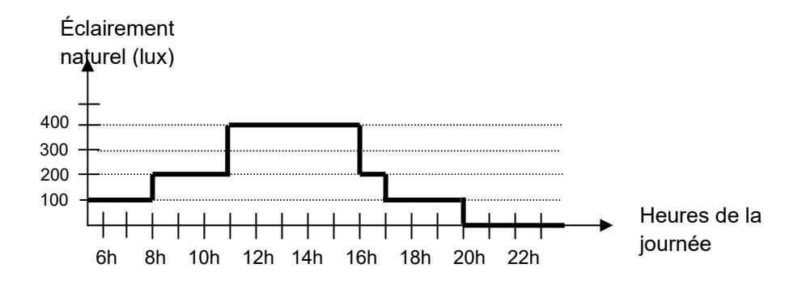

#### Éclairement additionnel dû aux tubes (lux)

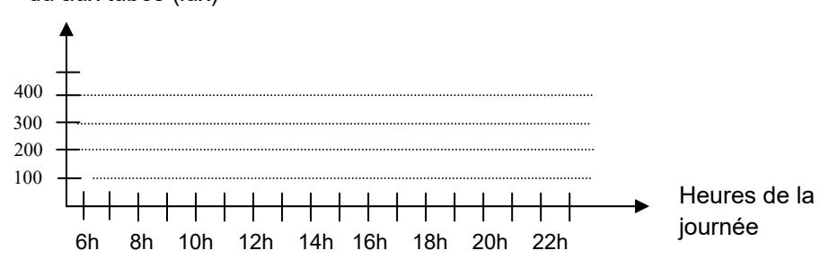

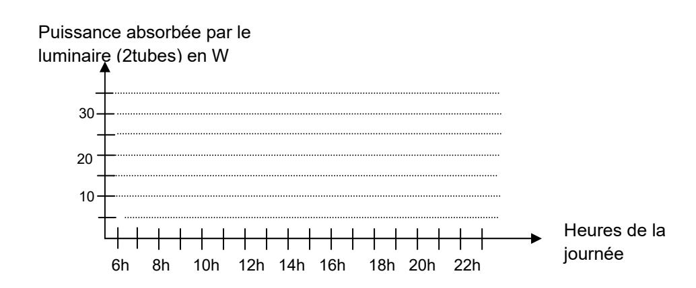

### **DOCUMENT RÉPONSE DR 3**

#### **Question 22**

| État                                                               | Hydraulique | Aéraulique |
|--------------------------------------------------------------------|-------------|------------|
| Tamb>Text                                                          |             |            |
| &                                                                  |             |            |
| Tamb>Consigne Tamb été                                             |             |            |
| Tamb>Text                                                          |             |            |
| &                                                                  |             |            |
| Tamb <consigne tamb="" td="" été<=""><td></td><td></td></consigne> |             |            |
| Tamb <text< td=""><td></td><td></td></text<>                       |             |            |
| &                                                                  |             |            |
| Tamb>Consigne Tamb été                                             |             |            |
| Tamb <text< td=""><td></td><td></td></text<>                       |             |            |
| &                                                                  |             |            |
| Tamb <consigne tamb="" td="" été<=""><td></td><td></td></consigne> |             |            |

#### **Question 34**

Sortie vanne en %

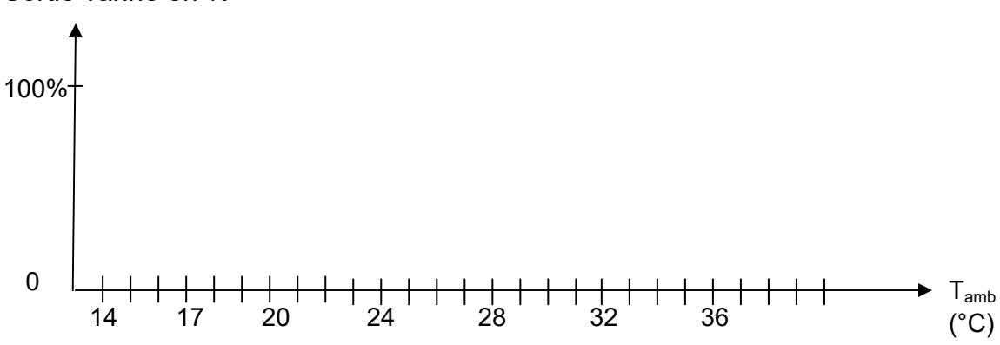

#### **Question 37**

En fonction des besoins, **donner** dans l'ordre de mise en route les éléments de refroidissement de l'eau.

|   | Ventilateur | Échangeur | Pompe d'aspersion | Groupe froid |
|---|-------------|-----------|-------------------|--------------|
| 1 |             |           |                   |              |
| 2 |             |           |                   |              |
| 3 |             |           |                   |              |
| 4 |             |           |                   |              |
| 5 |             |           |                   |              |

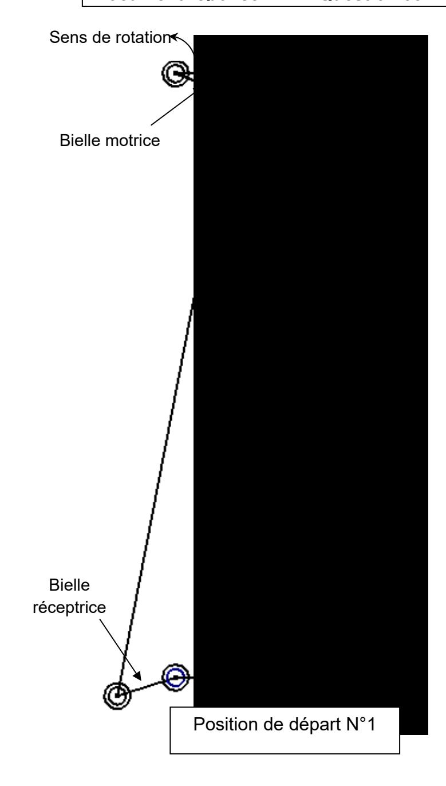

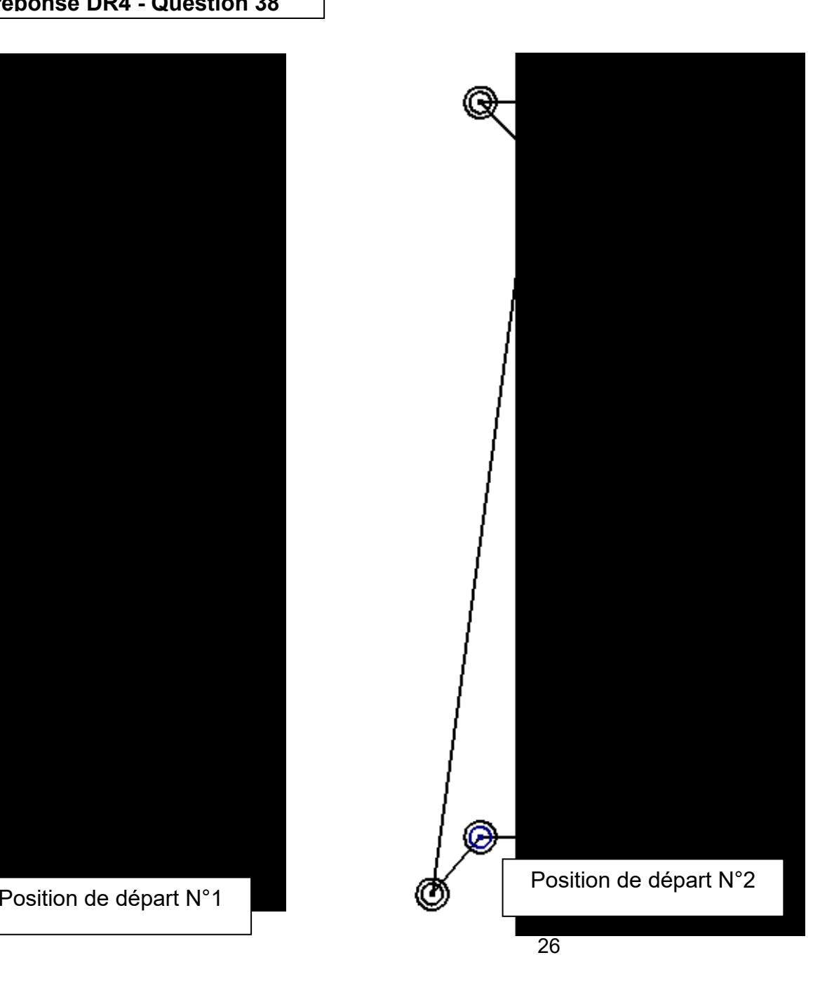

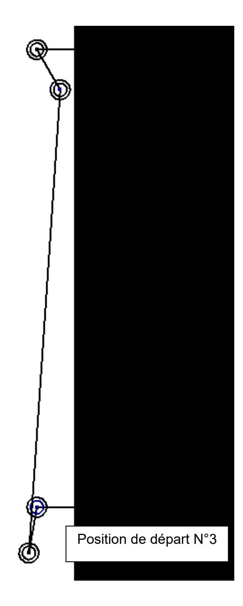

# **ANNEXES**

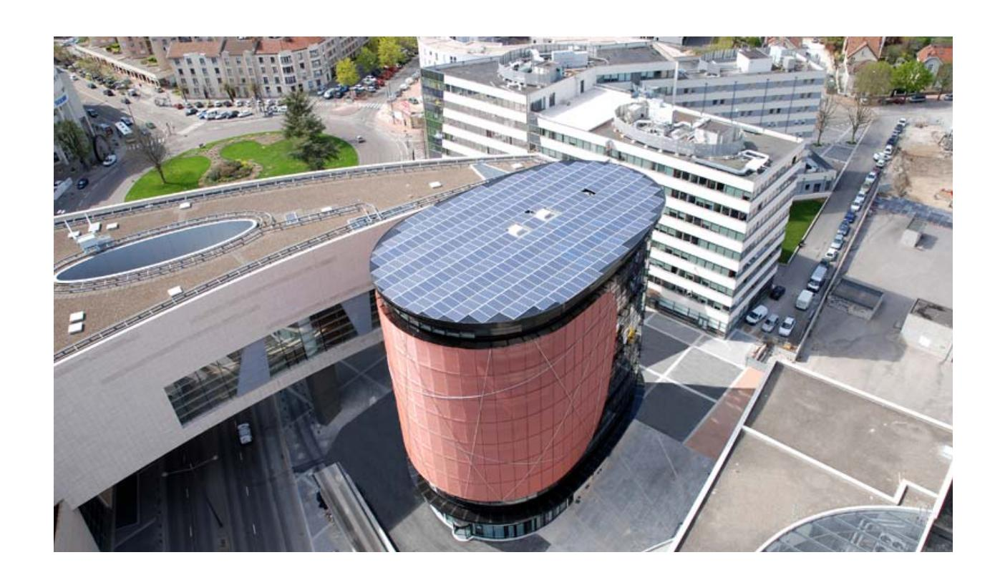

**Annexe 1 : Bouclier solaire** 

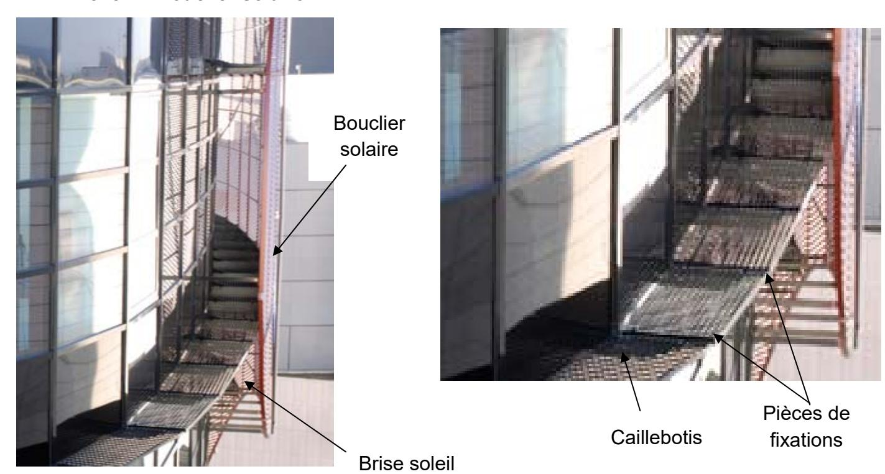

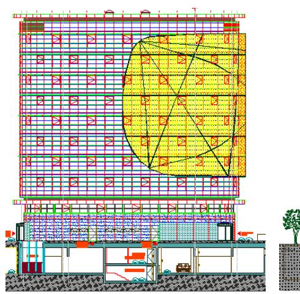

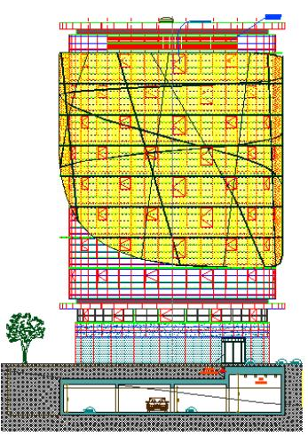

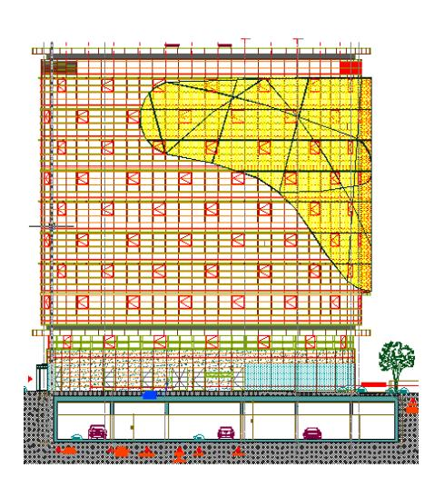

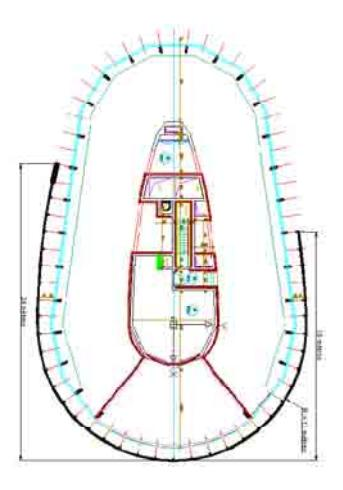

#### **Annexe 2 : Choisir le matériel d'éclairage**

#### **Les lampes**

Les performances d'une lampe sont déterminées par un certain nombre de caractéristiques.

- **La puissance,** exprimée en watts (W).
- **Le flux lumineux** exprimé en lumens (lm) : quantité de lumière émise par la lampe.
- **L'efficacité lumineuse** exprimée en lumens par watt (lm/W) : rapport entre le flux lumineux et la puissance consommée (peut être exprimée pour le couple lampe-ballast).
- **La durée de vie économique** (heures) : période au terme de laquelle la chute de flux d'une lampe ne permet plus d'atteindre les niveaux d'éclairement requis.
- **La température de couleur,** en kelvins (K) : qualifie l'ambiance lumineuse de l'espace éclairé. Elle varie des teintes chaudes, à dominante orangée (2 500 K) aux teintes froides, d'un aspect bleuté (5 300 K et plus), les teintes neutres se situent autour de 4 000 K.
- **L'indice de rendu des couleurs** (Ra ou IRC) : capacité d'une lampe à restituer fidèlement les couleurs telles qu'elles apparaissent sous la lumière naturelle. Le maximum est 100.
- **Sa forme ou sa taille :** les formes et dimensions de la lampe et de ses composants internes (brûleur ou nombre de LEDs, par exemple) auront une incidence sur les optiques qu'on pourra y associer.

#### **Les tubes fluorescents**

Ils sont souvent appelés, à tort, « néon ». Il existe plusieurs types de tubes, lampes fluorescentes rectilignes à double culot, que l'on distingue par leur diamètre (ne sont indiquées ici que les valeurs le plus couramment utilisées en éclairage général dans le tertiaire) :

- T8, tube de Ø 26 mm, appelé aussi T26, dont la durée de vie varie de 12 000 à 16 000 heures ;
- T5, tube de Ø 16 mm, appelé parfois aussi T16, qui peut atteindre 22 000 heures. Il est associé à un ballast électronique.

Leurs températures de couleurs varient de 2 700 à 6 000 K et les puissances de 10 W à 80 W, avec une efficacité lumineuse qui peut atteindre 104 lm/W.

Le marquage des lampes fluorescentes indique la puissance, l'IRC et la température de couleur. Par exemple 35/830 signifie qu'il s'agit d'une lampe d'une puissance de 35 W, dont la gamme d'IRC est supérieure à 80 (830) et dont la température de couleur est de 3 000 K (830).

#### **Les lampes fluocompactes**

Ce sont des tubes fluorescents « pliés » pour y adapter un culot unique. Elles sont disponibles dans une palette de puissances extrêmement étendue, allant de 5 W aux fortes puissances 70 W et 120 W. Elles offrent des durées de vie qui peuvent atteindre 16 000 heures et présentent un large choix de températures de couleur, de 2 700 K à 6 500 K. Leur efficacité lumineuse peut atteindre 90 lm/W.

#### **Les lampes et modules LEDs**

Une diode électroluminescente (LED) est un composant électronique permettant la transformation de l'électricité en lumière. Pour l'éclairage, on utilise des lampes constituées de plusieurs LED.

Les améliorations des performances des LED permettent aujourd'hui des durées de vie d'au moins 25 000 heures. Les performances des solutions LED sont en constante augmentation et pour certaines d'entre elles viennent concurrencer les solutions d'éclairage général classiques.

#### **Les auxiliaires d'alimentation**

Les lampes fluorescentes fonctionnent grâce à des ballasts, auxiliaires d'alimentation situés dans le luminaire, qui ont une consommation propre. Aujourd'hui le ballast électronique s'impose (type A1 et A2 selon les engagements de la Convention). En supprimant les pertes électriques dues au ballast ferromagnétique, un luminaire électronique consomme au minimum 20 % de moins pour un éclairage identique.

#### **Norme NF EN 12464-1 « Éclairage intérieur des lieux de travail »**

La norme indique des niveaux d'éclairements moyens « à maintenir », c'est-à-dire qui doivent pouvoir être atteints quel que soit l'âge de l'installation.

Les valeurs indiquées ci-dessous à titre d'exemple sont celles de la version de juillet 2011 :

- écriture, dactylographie, lecture, traitement de données 500 lux ;
- CAO 750 lux ;
- salles de conférence et de réunion 500 lux ;
- réception 300 lux ;

L'indice de rendu des couleurs doit être supérieur ou égal à 80.

#### **Annexe 3**

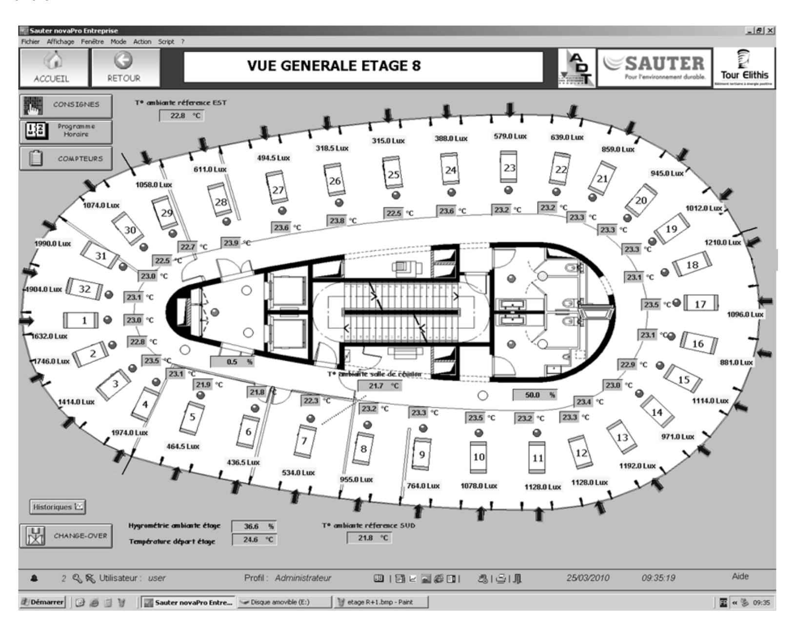

#### **Annexe 4 :**

L'éclairement (en lux) d'une surface est égal au flux lumineux (en lumen) tombant sur chaque m² de cette surface. Cet éclairement diminue avec le carré de la distance d séparant la source lumineuse de la surface à éclairer.

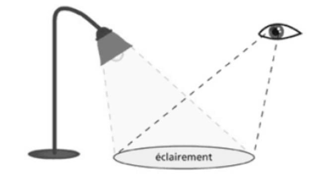

Donc: 
$$E = \frac{\varphi}{S \cdot d^2}$$
 avec

E : éclairement en lux d : distance en m

φ : flux émis par la source

S : surface en m²

| Désignation             | EAN                   | W  | lm 1)2) |                         | Ra   | Ø TUBE d [mm] | [mm] |    |
|-------------------------|-----------------------|----|---------|-------------------------|------|---------------------|------|----|
| Emballage individuel pa | r 20                  |    |         |                         |      |                     |      |    |
| 14 W                    |                       |    |         |                         |      |                     |      |    |
| FH 14W/827 HE           | 4050300 <b>645919</b> | 14 | 1200    | LUMILUX INTERNA         | 8089 | 16                  | 549  | 20 |
| FH 14W/830 HE           | 4050300 <b>591520</b> | 14 | 1200    | LUMILUX blanc chaud     | 8089 | 16                  | 549  | 20 |
| FH 14W/840 HE           | 4050300 <b>591384</b> | 14 | 1200    | LUMILUX blanc de luxe   | 8089 | 16                  | 549  | 20 |
| FH 14W/865 HE           | 4050300 <b>591544</b> | 14 | 1100    | LUMILUX lumière du jour | 8089 | 16                  | 549  | 20 |
| FH 14W/880 SKYWHITE HE  | 4050300 <b>225009</b> | 14 | 1050    | LUMILUX SKYWHITE        | 8089 | 16                  | 549  | 20 |
| 21 W                    |                       |    |         |                         |      |                     |      |    |
| FH 21W/827 HE           | 4050300 <b>645957</b> | 21 | 1900    | LUMILUX INTERNA         | 8089 | 16                  | 849  | 20 |
| FH 21W/830 HE           | 4050300 <b>591506</b> | 21 | 1900    | LUMILUX blanc chaud     | 8089 | 16                  | 849  | 20 |
| FH 21W/840 HE           | 4050300 <b>591407</b> | 21 | 1900    | LUMILUX blanc de luxe   | 8089 | 16                  | 849  | 20 |
| FH 21W/865 HE           | 4050300 <b>591322</b> | 21 | 1750    | LUMILUX lumière du jour | 8089 | 16                  | 849  | 20 |
| FH 21W/880 SKYWHITE HE  | 4008321 <b>224989</b> | 21 | 1700    | LUMILUX SKYWHITE        | 8089 | 16                  | 849  | 20 |

Annexe 6 : Diagramme de pilotage pour la ventilation (jour)

#### Abréviations:

EΑ = Entrée d'Air neuf dans l'allège

S = Soufflage poutre

Η = Hydraulique poutre

csg basse EA: Consigne Basse Entrée d'Air

ETE (21°C)

csg haute EA: Consigne Haute Entrée d'Air

ETE (24°C)

csg EA: Consigne Haute Entrée d'Air HIVER (22°C)

csg Hydro froid: Consigne d'irrigation poutre ETE (confort:24°C - réduit:28°C)

csg Hydro chaud: Consigne d'irrigation poutre HIVER (confort:20°C – réduit:17°C)

T°amb : Température ambiante niveau

T°ext : Température extérieure

xamb: Poids d'eau ambiance (reprise)

xext : T poids d'eau extérieur

Annexe 7:

**Servomoteur BELIMO** 

Plan du réducteur

Échelle 1:1

|                       | Liste de pièces                        |                                        |  |  |  |
|-----------------------|----------------------------------------|----------------------------------------|--|--|--|
| A Qté NUMERO DE PIECE |                                        |                                        |  |  |  |
| 2                     | 2 1 pignon roue Zg=78 m=0,7; Zh=14 m=1 |                                        |  |  |  |
| 3                     | 1                                      | pignon roue Ze=93 m=0,5; Zf=14 m=0,7   |  |  |  |
| 4                     | 1                                      | pignon roue Za=125 m=0,3; Zb=15 m=0,4  |  |  |  |
| 5                     | 1                                      | pignon roue Zc=102 m=0,4; Zd=14 m=0,5  |  |  |  |
| 26                    | 1                                      | pignon Z=56                            |  |  |  |
| 9                     | 1                                      | secteur denté Zj=29 dents sur 100° m=1 |  |  |  |
| 13                    | 1                                      | pignon moteur Zm=19;m=0,3              |  |  |  |

Rendement par étage de réduction  $\eta_1$ = 0,85

Rendement pour le secteur denté  $\eta_2$ = 0,8

#### **Annexe 8 : Protocole Modbus**

Le protocole MODBUS consiste en la définition de trames d'échange. Le maître envoie une **demande** et attend une **réponse**.

Les abonnés du bus sont identifiés par des adresses attribuées par l'utilisateur.

L'adresse de chaque abonné est indépendante de son emplacement physique. Les adresses vont de 1 à 64 et ne doivent pas obligatoirement être attribuées de manière séquentielle. Deux abonnés ne peuvent avoir la même adresse.

Deux fonctionnements sont possibles : le maître peut interroger un esclave de numéro unique sur le réseau et attendre de la part de cet esclave une réponse ou bien le maître diffuse un message à tous les esclaves présents sur le réseau, ceux-ci exécutent l'ordre du message sans émettre une réponse.

#### Question :

| N° d'esclave | Code fonction | Information spécifique concernant la demande | Mot de contrôle |
|-----------------|---------------|----------------------------------------------|-----------------|
| 1 octet         | 1 octet       | n octets                                     | 2 octets        |

La question posée par le maître contient un code fonction indiquant à l'esclave adressé quel type d'action est demandé. Les données contiennent des informations complémentaires dont l'esclave a besoin pour exécuter cette fonction (adresse du premier registre sur 2 octets puis nombre de registres sur 2 octets ). Le champ octets de contrôle permet à l'esclave de s'assurer de l'intégralité du contenu de la question.

#### Réponse

| N° d'esclave | Code fonction | Données reçues | Mot de contrôle |
|-----------------|---------------|----------------|-----------------|
| 1 octet         | 1 octet       | n octets       | 2 octets        |

Si une erreur apparaît, le code fonction est modifié pour indiquer que la réponse est une réponse d'erreur. Les données contiennent alors un code (code d'exception) permettant de connaître le type d'erreur. Le champ de contrôle CRC permet au maître de confirmer que le message est valide.

#### **Format général d'une trame**

Deux types de codage peuvent être utilisés pour communiquer sur un réseau Modbus. Tous les équipements présents sur le réseau doivent être configurés selon le même type. Dans notre cas la configuration est de type RTU (Unité terminale distante) : **chaque octet composant une trame est codé sur 2 caractères hexadécimaux** (2 fois 4 bits).

| START   | Adresse | Fonction | Données  | CRC      | END     |
|---------|---------|----------|----------|----------|---------|
| Silence | 1 octet | 1 octet  | n octets | 2 octets | Silence |

La taille maximale des données est de 256 octets. **Le maître** s'adresse à l'esclave dont l'adresse est donnée dans le champ prévu à cet effet et **l'esclave** renvoie sa réponse ; il place sa propre adresse dans le champ adresse afin que le maître puisse l'identifier. Il utilise ensuite le champ fonction pour indiquer si la réponse contient une erreur. Pour une réponse normale, l'esclave reprend le même code fonction que celui du message envoyé par le maître, sinon il renvoie un code erreur correspondant au code original avec son MSB à 1.

Le champ de données contient diverses informations dépendant du code fonction. Le champ contrôle d'erreur contient une valeur codée sur 16 bits. Cette valeur est le résultat d'un CRC (Cyclical Redundancy Check) calculé à partir d'un message.

#### **Support de transmission**

Chaque octet composant un message est transmis en mode RTU de la manière suivante

Avant et après chaque message, il doit y avoir un silence équivalent à 3,5 fois le temps de transmission d'un mot. Le protocole MODBUS ne définit que la structure des messages et leur mode d'échange. On peut utiliser n'importe quel support de transmission RS 232, RS 422 ou RS 485, mais la liaison RS 485 est la plus répandue car elle autorise le « multipoints ».

#### **Exemple d'échange entre un maitre et un esclave**

| Adresse esclave    |              | 02(H) |
|--------------------|--------------|-------|
| Code fonction      |              | 03(H) |
| Registre de départ | Poids fort   | 00(H) |
|                    | Poids faible | 20(H) |
| Quantité           | Poids fort   | 00(H) |
|                    | Poids faible | 04(H) |
| CRC-16             | Poids fort   | 45(H) |
|                    | Poids faible | F0(H) |

| Adresse esclave         |              | 02(H) |
|-------------------------|--------------|-------|
| Code fonction           |              | 03(H) |
| Nombre d'éléments (nbre | 08(H)        |       |
| Contenu du 1er registre | Poids fort   | 00(H) |
|                         | Poids faible | 85(H) |
| Registre suivant        | Poids fort   | 00(H) |
|                         | Poids faible | 00(H) |
| Registre suivant        | Poids fort   | 00(H) |
|                         | Poids faible | 00(H) |
| Registre suivant        | Poids fort   | 01(H) |
|                         | Poids faible | F4(H) |
| CRC-16                  | Poids fort   | 4E(H) |
|                         | Poids faible | 4C(H) |

#### **Services supportés par MODBUS**

MODBUS offre 19 fonctions différentes. Elles se caractérisent par un code fonction sur un octet (en hexadécimal).

| Code  |            |  |
|-------|------------|--|
| H'01' | Lo         |  |
| H'02' | Le         |  |
| H'03' | Le         |  |
| H'04' | L€         |  |
| H'05' |            |  |
| H'06' |            |  |
| H'07' |            |  |
| H'08' | ,          |  |
| H'09' | Télécharge |  |
| H'0A' | [          |  |
| H'0B' | I          |  |
| H'0C' | L€         |  |
| H'0D' | Télécharge |  |
| H'0E' |            |  |
| H'0F' |            |  |
| H'10' |            |  |
| H'11' |            |  |
| H'12' | Télécharge |  |
| H'13' | Reset      |  |

#### Annexe 9

# Modules photovoltaïques

TE 2000, TE 2200

180 à 240 Watts Crête Multicristallin, série verre/Tedlar

TENESOL fabrique ses modules photovoltaïques dans ses propres usines.

Les modules TENESOL utilisent la technologie des **cellules multicristallines à haut rendement**, qui sont mesurées individuellement et triées à 100% avant encapsulage.

La structure **Verre trempé / EVA / Tedlar** minimise le poids, assure une parfaite étanchéité et protège durablement les cellules.

Le cadre aluminium renforcé de 50 mm d'épaisseur permet une manutention aisée et un montage facile et rapide et très résistant.

Chaque module fait l'objet d'un contrôle qualité individuel et d'une fiche numérotée de test de performance.

| Caractéristiques électrique       | 5                                                                                                                                                                                                                                                                                                                                                                                                                                                                                                                                                                                                                                                                                                                                                                                                                                                                                                                                                                                                                                                                                                                                                                                                                                                                                                                                                                                                                                                                                                                                                                                                                                                                                                                                                                                                                                                                                                                                                                                                                                                                                                                             | TE 2        | 000            | 10.00                                                                                                                                                                                                                                                                                                                                                                                                                                                                                                                                                                                                                                                                                                                                                                                                                                                                                                                                                                                                                                                                                                                                                                                                                                                                                                                                                                                                                                                                                                                                                                                                                                                                                                                                                                                                                                                                                                                                                                                                                                                                                                                          |                      | S. 1-18-18-18                             | TE 2200        | Latter le   |         |
|-----------------------------------|-------------------------------------------------------------------------------------------------------------------------------------------------------------------------------------------------------------------------------------------------------------------------------------------------------------------------------------------------------------------------------------------------------------------------------------------------------------------------------------------------------------------------------------------------------------------------------------------------------------------------------------------------------------------------------------------------------------------------------------------------------------------------------------------------------------------------------------------------------------------------------------------------------------------------------------------------------------------------------------------------------------------------------------------------------------------------------------------------------------------------------------------------------------------------------------------------------------------------------------------------------------------------------------------------------------------------------------------------------------------------------------------------------------------------------------------------------------------------------------------------------------------------------------------------------------------------------------------------------------------------------------------------------------------------------------------------------------------------------------------------------------------------------------------------------------------------------------------------------------------------------------------------------------------------------------------------------------------------------------------------------------------------------------------------------------------------------------------------------------------------------|-------------|----------------|--------------------------------------------------------------------------------------------------------------------------------------------------------------------------------------------------------------------------------------------------------------------------------------------------------------------------------------------------------------------------------------------------------------------------------------------------------------------------------------------------------------------------------------------------------------------------------------------------------------------------------------------------------------------------------------------------------------------------------------------------------------------------------------------------------------------------------------------------------------------------------------------------------------------------------------------------------------------------------------------------------------------------------------------------------------------------------------------------------------------------------------------------------------------------------------------------------------------------------------------------------------------------------------------------------------------------------------------------------------------------------------------------------------------------------------------------------------------------------------------------------------------------------------------------------------------------------------------------------------------------------------------------------------------------------------------------------------------------------------------------------------------------------------------------------------------------------------------------------------------------------------------------------------------------------------------------------------------------------------------------------------------------------------------------------------------------------------------------------------------------------|----------------------|-------------------------------------------|----------------|-------------|---------|
| Puissance typique                 | 180                                                                                                                                                                                                                                                                                                                                                                                                                                                                                                                                                                                                                                                                                                                                                                                                                                                                                                                                                                                                                                                                                                                                                                                                                                                                                                                                                                                                                                                                                                                                                                                                                                                                                                                                                                                                                                                                                                                                                                                                                                                                                                                           | 190         | 200            | 210                                                                                                                                                                                                                                                                                                                                                                                                                                                                                                                                                                                                                                                                                                                                                                                                                                                                                                                                                                                                                                                                                                                                                                                                                                                                                                                                                                                                                                                                                                                                                                                                                                                                                                                                                                                                                                                                                                                                                                                                                                                                                                                            | 200                  | 210                                       | 220            | 230         | 240     |
| Puissance minimale                | 175                                                                                                                                                                                                                                                                                                                                                                                                                                                                                                                                                                                                                                                                                                                                                                                                                                                                                                                                                                                                                                                                                                                                                                                                                                                                                                                                                                                                                                                                                                                                                                                                                                                                                                                                                                                                                                                                                                                                                                                                                                                                                                                           | 185         | 195            | 205                                                                                                                                                                                                                                                                                                                                                                                                                                                                                                                                                                                                                                                                                                                                                                                                                                                                                                                                                                                                                                                                                                                                                                                                                                                                                                                                                                                                                                                                                                                                                                                                                                                                                                                                                                                                                                                                                                                                                                                                                                                                                                                            | 195                  | 205                                       | 215            | 225         | 235     |
| Puissance maximale                | 185                                                                                                                                                                                                                                                                                                                                                                                                                                                                                                                                                                                                                                                                                                                                                                                                                                                                                                                                                                                                                                                                                                                                                                                                                                                                                                                                                                                                                                                                                                                                                                                                                                                                                                                                                                                                                                                                                                                                                                                                                                                                                                                           | 195         | 205            | 215                                                                                                                                                                                                                                                                                                                                                                                                                                                                                                                                                                                                                                                                                                                                                                                                                                                                                                                                                                                                                                                                                                                                                                                                                                                                                                                                                                                                                                                                                                                                                                                                                                                                                                                                                                                                                                                                                                                                                                                                                                                                                                                            | 205                  | 215                                       | 225            | 235         | 245     |
| Limite de classe de puissance Wc  |                                                                                                                                                                                                                                                                                                                                                                                                                                                                                                                                                                                                                                                                                                                                                                                                                                                                                                                                                                                                                                                                                                                                                                                                                                                                                                                                                                                                                                                                                                                                                                                                                                                                                                                                                                                                                                                                                                                                                                                                                                                                                                                               | -5/-        | +5 Wc          |                                                                                                                                                                                                                                                                                                                                                                                                                                                                                                                                                                                                                                                                                                                                                                                                                                                                                                                                                                                                                                                                                                                                                                                                                                                                                                                                                                                                                                                                                                                                                                                                                                                                                                                                                                                                                                                                                                                                                                                                                                                                                                                                |                      |                                           | -5 / +5 Wc     |             |         |
| Limite de classe de puissance %   | ±2,78%                                                                                                                                                                                                                                                                                                                                                                                                                                                                                                                                                                                                                                                                                                                                                                                                                                                                                                                                                                                                                                                                                                                                                                                                                                                                                                                                                                                                                                                                                                                                                                                                                                                                                                                                                                                                                                                                                                                                                                                                                                                                                                                        | ±2,63%      | ±2,50%         | ±2,38%                                                                                                                                                                                                                                                                                                                                                                                                                                                                                                                                                                                                                                                                                                                                                                                                                                                                                                                                                                                                                                                                                                                                                                                                                                                                                                                                                                                                                                                                                                                                                                                                                                                                                                                                                                                                                                                                                                                                                                                                                                                                                                                         | ±2,50%               | ±2,38%                                    | ±2,27%         | ±2,17%      | ±2,089  |
| Tension à puissance max. Vpm (    | V) 26,3                                                                                                                                                                                                                                                                                                                                                                                                                                                                                                                                                                                                                                                                                                                                                                                                                                                                                                                                                                                                                                                                                                                                                                                                                                                                                                                                                                                                                                                                                                                                                                                                                                                                                                                                                                                                                                                                                                                                                                                                                                                                                                                       | 26,5        | 26,7           | 26,9                                                                                                                                                                                                                                                                                                                                                                                                                                                                                                                                                                                                                                                                                                                                                                                                                                                                                                                                                                                                                                                                                                                                                                                                                                                                                                                                                                                                                                                                                                                                                                                                                                                                                                                                                                                                                                                                                                                                                                                                                                                                                                                           | 29,3                 | 29,5                                      | 29,7           | 29,9        | 30,1    |
| Intensité à puissance max. Ipm (/ | A) 6,9                                                                                                                                                                                                                                                                                                                                                                                                                                                                                                                                                                                                                                                                                                                                                                                                                                                                                                                                                                                                                                                                                                                                                                                                                                                                                                                                                                                                                                                                                                                                                                                                                                                                                                                                                                                                                                                                                                                                                                                                                                                                                                                        | 7,2         | 7,5            | 7,8                                                                                                                                                                                                                                                                                                                                                                                                                                                                                                                                                                                                                                                                                                                                                                                                                                                                                                                                                                                                                                                                                                                                                                                                                                                                                                                                                                                                                                                                                                                                                                                                                                                                                                                                                                                                                                                                                                                                                                                                                                                                                                                            | 6,9                  | 7,2                                       | 7,5            | 7,8         | 8       |
| Tension circuit ouvert Voc (\     | 7) 32,5                                                                                                                                                                                                                                                                                                                                                                                                                                                                                                                                                                                                                                                                                                                                                                                                                                                                                                                                                                                                                                                                                                                                                                                                                                                                                                                                                                                                                                                                                                                                                                                                                                                                                                                                                                                                                                                                                                                                                                                                                                                                                                                       | 32,7        | 32,9           | 33,1                                                                                                                                                                                                                                                                                                                                                                                                                                                                                                                                                                                                                                                                                                                                                                                                                                                                                                                                                                                                                                                                                                                                                                                                                                                                                                                                                                                                                                                                                                                                                                                                                                                                                                                                                                                                                                                                                                                                                                                                                                                                                                                           | 35,9                 | 36,2                                      | 36,5           | 36,8        | 37      |
| Courant de court circuit lisc (A  | 7,6                                                                                                                                                                                                                                                                                                                                                                                                                                                                                                                                                                                                                                                                                                                                                                                                                                                                                                                                                                                                                                                                                                                                                                                                                                                                                                                                                                                                                                                                                                                                                                                                                                                                                                                                                                                                                                                                                                                                                                                                                                                                                                                           | 7,8         | 8              | 8,2                                                                                                                                                                                                                                                                                                                                                                                                                                                                                                                                                                                                                                                                                                                                                                                                                                                                                                                                                                                                                                                                                                                                                                                                                                                                                                                                                                                                                                                                                                                                                                                                                                                                                                                                                                                                                                                                                                                                                                                                                                                                                                                            | 7,6                  | 7,8                                       | 8              | 8,2         | 8,3     |
| Influence de la température       |                                                                                                                                                                                                                                                                                                                                                                                                                                                                                                                                                                                                                                                                                                                                                                                                                                                                                                                                                                                                                                                                                                                                                                                                                                                                                                                                                                                                                                                                                                                                                                                                                                                                                                                                                                                                                                                                                                                                                                                                                                                                                                                               | Marie San   | MARKET MARKET  |                                                                                                                                                                                                                                                                                                                                                                                                                                                                                                                                                                                                                                                                                                                                                                                                                                                                                                                                                                                                                                                                                                                                                                                                                                                                                                                                                                                                                                                                                                                                                                                                                                                                                                                                                                                                                                                                                                                                                                                                                                                                                                                                |                      | THE REAL PROPERTY.                        |                | MARKET SE   | 4.75    |
| Temp. Coeff. Tension              | AND PROPERTY.                                                                                                                                                                                                                                                                                                                                                                                                                                                                                                                                                                                                                                                                                                                                                                                                                                                                                                                                                                                                                                                                                                                                                                                                                                                                                                                                                                                                                                                                                                                                                                                                                                                                                                                                                                                                                                                                                                                                                                                                                                                                                                                 | - 116,1     | 1 mV/°C        | No. of Contract of Contract of Contract of Contract of Contract of Contract of Contract of Contract of Contract of Contract of Contract of Contract of Contract of Contract of Contract of Contract of Contract of Contract of Contract of Contract of Contract of Contract of Contract of Contract of Contract of Contract of Contract of Contract of Contract of Contract of Contract of Contract of Contract of Contract of Contract of Contract of Contract of Contract of Contract of Contract of Contract of Contract of Contract of Contract of Contract of Contract of Contract of Contract of Contract of Contract of Contract of Contract of Contract of Contract of Contract of Contract of Contract of Contract of Contract of Contract of Contract of Contract of Contract of Contract of Contract of Contract of Contract of Contract of Contract of Contract of Contract of Contract of Contract of Contract of Contract of Contract of Contract of Contract of Contract of Contract of Contract of Contract of Contract of Contract of Contract of Contract of Contract of Contract of Contract of Contract of Contract of Contract of Contract of Contract of Contract of Contract of Contract of Contract of Contract of Contract of Contract of Contract of Contract of Contract of Contract of Contract of Contract of Contract of Contract of Contract of Contract of Contract of Contract of Contract of Contract of Contract of Contract of Contract of Contract of Contract of Contract of Contract of Contract of Contract of Contract of Contract of Contract of Contract of Contract of Contract of Contract of Contract of Contract of Contract of Contract of Contract of Contract of Contract of Contract of Contract of Contract of Contract of Contract of Contract of Contract of Contract of Contract of Contract of Contract of Contract of Contract of Contract of Contract of Contract of Contract of Contract of Contract of Contract of Contract of Contract of Contract of Contract of Contract of Contract of Contract of Contract of Contract of Contract of Contract of Contract of |                      |                                           | - 129,0 mV/°C  | 28          |         |
| Temp. Coeff. Courant              | E 10 10 10 10 10 10 10 10 10 10 10 10 10                                                                                                                                                                                                                                                                                                                                                                                                                                                                                                                                                                                                                                                                                                                                                                                                                                                                                                                                                                                                                                                                                                                                                                                                                                                                                                                                                                                                                                                                                                                                                                                                                                                                                                                                                                                                                                                                                                                                                                                                                                                                                      | +4,4        | mA/°C          |                                                                                                                                                                                                                                                                                                                                                                                                                                                                                                                                                                                                                                                                                                                                                                                                                                                                                                                                                                                                                                                                                                                                                                                                                                                                                                                                                                                                                                                                                                                                                                                                                                                                                                                                                                                                                                                                                                                                                                                                                                                                                                                                |                      |                                           | +4,4 mA/°C     |             |         |
| Temp. Coeff. Puissance            |                                                                                                                                                                                                                                                                                                                                                                                                                                                                                                                                                                                                                                                                                                                                                                                                                                                                                                                                                                                                                                                                                                                                                                                                                                                                                                                                                                                                                                                                                                                                                                                                                                                                                                                                                                                                                                                                                                                                                                                                                                                                                                                               | - 0,46 %/°C |                |                                                                                                                                                                                                                                                                                                                                                                                                                                                                                                                                                                                                                                                                                                                                                                                                                                                                                                                                                                                                                                                                                                                                                                                                                                                                                                                                                                                                                                                                                                                                                                                                                                                                                                                                                                                                                                                                                                                                                                                                                                                                                                                                | -0,46 %/°C           |                                           |                |             |         |
| NOCT (°C)                         |                                                                                                                                                                                                                                                                                                                                                                                                                                                                                                                                                                                                                                                                                                                                                                                                                                                                                                                                                                                                                                                                                                                                                                                                                                                                                                                                                                                                                                                                                                                                                                                                                                                                                                                                                                                                                                                                                                                                                                                                                                                                                                                               | 4           | 15             | - 0,45 %g~C 45                                                                                                                                                                                                                                                                                                                                                                                                                                                                                                                                                                                                                                                                                                                                                                                                                                                                                                                                                                                                                                                                                                                                                                                                                                                                                                                                                                                                                                                                                                                                                                                                                                                                                                                                                                                                                                                                                                                                                                                                                                                                                                              |                      | 225                                       |                |             |         |
| Cellules                          |                                                                                                                                                                                                                                                                                                                                                                                                                                                                                                                                                                                                                                                                                                                                                                                                                                                                                                                                                                                                                                                                                                                                                                                                                                                                                                                                                                                                                                                                                                                                                                                                                                                                                                                                                                                                                                                                                                                                                                                                                                                                                                                               |             |                | SHEET                                                                                                                                                                                                                                                                                                                                                                                                                                                                                                                                                                                                                                                                                                                                                                                                                                                                                                                                                                                                                                                                                                                                                                                                                                                                                                                                                                                                                                                                                                                                                                                                                                                                                                                                                                                                                                                                                                                                                                                                                                                                                                                          |                      |                                           |                | de Koret    |         |
| Taille                            |                                                                                                                                                                                                                                                                                                                                                                                                                                                                                                                                                                                                                                                                                                                                                                                                                                                                                                                                                                                                                                                                                                                                                                                                                                                                                                                                                                                                                                                                                                                                                                                                                                                                                                                                                                                                                                                                                                                                                                                                                                                                                                                               | 156 x 1     | 156 mm         |                                                                                                                                                                                                                                                                                                                                                                                                                                                                                                                                                                                                                                                                                                                                                                                                                                                                                                                                                                                                                                                                                                                                                                                                                                                                                                                                                                                                                                                                                                                                                                                                                                                                                                                                                                                                                                                                                                                                                                                                                                                                                                                                |                      |                                           | 156 x 156 mm   |             |         |
| Disposition                       |                                                                                                                                                                                                                                                                                                                                                                                                                                                                                                                                                                                                                                                                                                                                                                                                                                                                                                                                                                                                                                                                                                                                                                                                                                                                                                                                                                                                                                                                                                                                                                                                                                                                                                                                                                                                                                                                                                                                                                                                                                                                                                                               | 54 celluir  | es/6x9         |                                                                                                                                                                                                                                                                                                                                                                                                                                                                                                                                                                                                                                                                                                                                                                                                                                                                                                                                                                                                                                                                                                                                                                                                                                                                                                                                                                                                                                                                                                                                                                                                                                                                                                                                                                                                                                                                                                                                                                                                                                                                                                                                | 60 cellules / 6 x 10 |                                           |                |             |         |
| Туре                              |                                                                                                                                                                                                                                                                                                                                                                                                                                                                                                                                                                                                                                                                                                                                                                                                                                                                                                                                                                                                                                                                                                                                                                                                                                                                                                                                                                                                                                                                                                                                                                                                                                                                                                                                                                                                                                                                                                                                                                                                                                                                                                                               | Multicr     | ristallin      | AND DESCRIPTION OF THE PERSON OF THE PERSON OF THE PERSON OF THE PERSON OF THE PERSON OF THE PERSON OF THE PERSON OF THE PERSON OF THE PERSON OF THE PERSON OF THE PERSON OF THE PERSON OF THE PERSON OF THE PERSON OF THE PERSON OF THE PERSON OF THE PERSON OF THE PERSON OF THE PERSON OF THE PERSON OF THE PERSON OF THE PERSON OF THE PERSON OF THE PERSON OF THE PERSON OF THE PERSON OF THE PERSON OF THE PERSON OF THE PERSON OF THE PERSON OF THE PERSON OF THE PERSON OF THE PERSON OF THE PERSON OF THE PERSON OF THE PERSON OF THE PERSON OF THE PERSON OF THE PERSON OF THE PERSON OF THE PERSON OF THE PERSON OF THE PERSON OF THE PERSON OF THE PERSON OF THE PERSON OF THE PERSON OF THE PERSON OF THE PERSON OF THE PERSON OF THE PERSON OF THE PERSON OF THE PERSON OF THE PERSON OF THE PERSON OF THE PERSON OF THE PERSON OF THE PERSON OF THE PERSON OF THE PERSON OF THE PERSON OF THE PERSON OF THE PERSON OF THE PERSON OF THE PERSON OF THE PERSON OF THE PERSON OF THE PERSON OF THE PERSON OF THE PERSON OF THE PERSON OF THE PERSON OF THE PERSON OF THE PERSON OF THE PERSON OF THE PERSON OF THE PERSON OF THE PERSON OF THE PERSON OF THE PERSON OF THE PERSON OF THE PERSON OF THE PERSON OF THE PERSON OF THE PERSON OF THE PERSON OF THE PERSON OF THE PERSON OF THE PERSON OF THE PERSON OF THE PERSON OF THE PERSON OF THE PERSON OF THE PERSON OF THE PERSON OF THE PERSON OF THE PERSON OF THE PERSON OF THE PERSON OF THE PERSON OF THE PERSON OF THE PERSON OF THE PERSON OF THE PERSON OF THE PERSON OF THE PERSON OF THE PERSON OF THE PERSON OF THE PERSON OF THE PERSON OF THE PERSON OF THE PERSON OF THE PERSON OF THE PERSON OF THE PERSON OF THE PERSON OF THE PERSON OF THE PERSON OF THE PERSON OF THE PERSON OF THE PERSON OF THE PERSON OF THE PERSON OF THE PERSON OF THE PERSON OF THE PERSON OF THE PERSON OF THE PERSON OF THE PERSON OF THE PERSON OF THE PERSON OF THE PERSON OF THE PERSON OF THE PERSON OF THE PERSON OF THE PERSON OF THE PERSON OF THE PERSON OF THE PERSON OF THE PERSON OF THE PERSON OF THE PERSON OF THE PERSON OF THE PERSON OF THE PERSON  | Multicristallin      |                                           |                |             |         |
| Informations générales            | 45 (6) (8) (7)                                                                                                                                                                                                                                                                                                                                                                                                                                                                                                                                                                                                                                                                                                                                                                                                                                                                                                                                                                                                                                                                                                                                                                                                                                                                                                                                                                                                                                                                                                                                                                                                                                                                                                                                                                                                                                                                                                                                                                                                                                                                                                                | 200/20      |                | 1000                                                                                                                                                                                                                                                                                                                                                                                                                                                                                                                                                                                                                                                                                                                                                                                                                                                                                                                                                                                                                                                                                                                                                                                                                                                                                                                                                                                                                                                                                                                                                                                                                                                                                                                                                                                                                                                                                                                                                                                                                                                                                                                           | 2000                 |                                           |                |             | 245     |
| Tension maximale du système (V)   |                                                                                                                                                                                                                                                                                                                                                                                                                                                                                                                                                                                                                                                                                                                                                                                                                                                                                                                                                                                                                                                                                                                                                                                                                                                                                                                                                                                                                                                                                                                                                                                                                                                                                                                                                                                                                                                                                                                                                                                                                                                                                                                               | 100         | 00 V           |                                                                                                                                                                                                                                                                                                                                                                                                                                                                                                                                                                                                                                                                                                                                                                                                                                                                                                                                                                                                                                                                                                                                                                                                                                                                                                                                                                                                                                                                                                                                                                                                                                                                                                                                                                                                                                                                                                                                                                                                                                                                                                                                |                      |                                           | 1000 V         |             |         |
| Diodes                            | CONTRACTOR OF THE PARTY OF THE PARTY OF THE PARTY OF THE PARTY OF THE PARTY OF THE PARTY OF THE PARTY OF THE PARTY OF THE PARTY OF THE PARTY OF THE PARTY OF THE PARTY OF THE PARTY OF THE PARTY OF THE PARTY OF THE PARTY OF THE PARTY OF THE PARTY OF THE PARTY OF THE PARTY OF THE PARTY OF THE PARTY OF THE PARTY OF THE PARTY OF THE PARTY OF THE PARTY OF THE PARTY OF THE PARTY OF THE PARTY OF THE PARTY OF THE PARTY OF THE PARTY OF THE PARTY OF THE PARTY OF THE PARTY OF THE PARTY OF THE PARTY OF THE PARTY OF THE PARTY OF THE PARTY OF THE PARTY OF THE PARTY OF THE PARTY OF THE PARTY OF THE PARTY OF THE PARTY OF THE PARTY OF THE PARTY OF THE PARTY OF THE PARTY OF THE PARTY OF THE PARTY OF THE PARTY OF THE PARTY OF THE PARTY OF THE PARTY OF THE PARTY OF THE PARTY OF THE PARTY OF THE PARTY OF THE PARTY OF THE PARTY OF THE PARTY OF THE PARTY OF THE PARTY OF THE PARTY OF THE PARTY OF THE PARTY OF THE PARTY OF THE PARTY OF THE PARTY OF THE PARTY OF THE PARTY OF THE PARTY OF THE PARTY OF THE PARTY OF THE PARTY OF THE PARTY OF THE PARTY OF THE PARTY OF THE PARTY OF THE PARTY OF THE PARTY OF THE PARTY OF THE PARTY OF THE PARTY OF THE PARTY OF THE PARTY OF THE PARTY OF THE PARTY OF THE PARTY OF THE PARTY OF THE PARTY OF THE PARTY OF THE PARTY OF THE PARTY OF THE PARTY OF THE PARTY OF THE PARTY OF THE PARTY OF THE PARTY OF THE PARTY OF THE PARTY OF THE PARTY OF THE PARTY OF THE PARTY OF THE PARTY OF THE PARTY OF THE PARTY OF THE PARTY OF THE PARTY OF THE PARTY OF THE PARTY OF THE PARTY OF THE PARTY OF THE PARTY OF THE PARTY OF THE PARTY OF THE PARTY OF THE PARTY OF THE PARTY OF THE PARTY OF THE PARTY OF THE PARTY OF THE PARTY OF THE PARTY OF THE PARTY OF THE PARTY OF THE PARTY OF THE PARTY OF THE PARTY OF THE PARTY OF THE PARTY OF THE PARTY OF THE PARTY OF THE PARTY OF THE PARTY OF THE PARTY OF THE PARTY OF THE PARTY OF THE PARTY OF THE PARTY OF THE PARTY OF THE PARTY OF THE PARTY OF THE PARTY OF THE PARTY OF THE PARTY OF THE PARTY OF THE PARTY OF THE PARTY OF THE PARTY OF THE PARTY OF THE PARTY OF THE PARTY OF THE PARTY OF THE | 3 by        | -pass          |                                                                                                                                                                                                                                                                                                                                                                                                                                                                                                                                                                                                                                                                                                                                                                                                                                                                                                                                                                                                                                                                                                                                                                                                                                                                                                                                                                                                                                                                                                                                                                                                                                                                                                                                                                                                                                                                                                                                                                                                                                                                                                                                |                      |                                           | 3 by-pass      |             |         |
| Connectique                       |                                                                                                                                                                                                                                                                                                                                                                                                                                                                                                                                                                                                                                                                                                                                                                                                                                                                                                                                                                                                                                                                                                                                                                                                                                                                                                                                                                                                                                                                                                                                                                                                                                                                                                                                                                                                                                                                                                                                                                                                                                                                                                                               | Connecto    | eurs Tyco      |                                                                                                                                                                                                                                                                                                                                                                                                                                                                                                                                                                                                                                                                                                                                                                                                                                                                                                                                                                                                                                                                                                                                                                                                                                                                                                                                                                                                                                                                                                                                                                                                                                                                                                                                                                                                                                                                                                                                                                                                                                                                                                                                |                      | 0                                         | onnecteurs Tyc | 00          |         |
| Poids (kg)                        |                                                                                                                                                                                                                                                                                                                                                                                                                                                                                                                                                                                                                                                                                                                                                                                                                                                                                                                                                                                                                                                                                                                                                                                                                                                                                                                                                                                                                                                                                                                                                                                                                                                                                                                                                                                                                                                                                                                                                                                                                                                                                                                               | 1           | 18             |                                                                                                                                                                                                                                                                                                                                                                                                                                                                                                                                                                                                                                                                                                                                                                                                                                                                                                                                                                                                                                                                                                                                                                                                                                                                                                                                                                                                                                                                                                                                                                                                                                                                                                                                                                                                                                                                                                                                                                                                                                                                                                                                |                      |                                           | 19             |             |         |
| Certifications                    | A PASSES OF                                                                                                                                                                                                                                                                                                                                                                                                                                                                                                                                                                                                                                                                                                                                                                                                                                                                                                                                                                                                                                                                                                                                                                                                                                                                                                                                                                                                                                                                                                                                                                                                                                                                                                                                                                                                                                                                                                                                                                                                                                                                                                                   |             | <b>SERVICE</b> | EXCESSES.                                                                                                                                                                                                                                                                                                                                                                                                                                                                                                                                                                                                                                                                                                                                                                                                                                                                                                                                                                                                                                                                                                                                                                                                                                                                                                                                                                                                                                                                                                                                                                                                                                                                                                                                                                                                                                                                                                                                                                                                                                                                                                                      | 2,632,62             | SALE NO.                                  | SERVICE V      | (2.5 ft V.) | AVENEY. |
|                                   |                                                                                                                                                                                                                                                                                                                                                                                                                                                                                                                                                                                                                                                                                                                                                                                                                                                                                                                                                                                                                                                                                                                                                                                                                                                                                                                                                                                                                                                                                                                                                                                                                                                                                                                                                                                                                                                                                                                                                                                                                                                                                                                               |             |                | IEC61215 + Pr                                                                                                                                                                                                                                                                                                                                                                                                                                                                                                                                                                                                                                                                                                                                                                                                                                                                                                                                                                                                                                                                                                                                                                                                                                                                                                                                                                                                                                                                                                                                                                                                                                                                                                                                                                                                                                                                                                                                                                                                                                                                                                                  | rotection électr     | ique Classe II                            | 3 3 3 3 3 3    |             |         |
| Garantie                          |                                                                                                                                                                                                                                                                                                                                                                                                                                                                                                                                                                                                                                                                                                                                                                                                                                                                                                                                                                                                                                                                                                                                                                                                                                                                                                                                                                                                                                                                                                                                                                                                                                                                                                                                                                                                                                                                                                                                                                                                                                                                                                                               |             |                | SMESS                                                                                                                                                                                                                                                                                                                                                                                                                                                                                                                                                                                                                                                                                                                                                                                                                                                                                                                                                                                                                                                                                                                                                                                                                                                                                                                                                                                                                                                                                                                                                                                                                                                                                                                                                                                                                                                                                                                                                                                                                                                                                                                          | 20000000             | F1 10 10 10 10 10 10 10 10 10 10 10 10 10 | S/I Walls      | Was series  |         |
| Garantie produit                  | The Park of the St                                                                                                                                                                                                                                                                                                                                                                                                                                                                                                                                                                                                                                                                                                                                                                                                                                                                                                                                                                                                                                                                                                                                                                                                                                                                                                                                                                                                                                                                                                                                                                                                                                                                                                                                                                                                                                                                                                                                                                                                                                                                                                            |             |                |                                                                                                                                                                                                                                                                                                                                                                                                                                                                                                                                                                                                                                                                                                                                                                                                                                                                                                                                                                                                                                                                                                                                                                                                                                                                                                                                                                                                                                                                                                                                                                                                                                                                                                                                                                                                                                                                                                                                                                                                                                                                                                                                | 2 ans                |                                           |                |             | 2017    |
| Garantie de production            |                                                                                                                                                                                                                                                                                                                                                                                                                                                                                                                                                                                                                                                                                                                                                                                                                                                                                                                                                                                                                                                                                                                                                                                                                                                                                                                                                                                                                                                                                                                                                                                                                                                                                                                                                                                                                                                                                                                                                                                                                                                                                                                               | 25          | 5 ans - 80 %   | de la puissan                                                                                                                                                                                                                                                                                                                                                                                                                                                                                                                                                                                                                                                                                                                                                                                                                                                                                                                                                                                                                                                                                                                                                                                                                                                                                                                                                                                                                                                                                                                                                                                                                                                                                                                                                                                                                                                                                                                                                                                                                                                                                                                  | ce minimale          | / 10 ans en                               | milieu maritin | me          |         |

#### Annexe 10

Irradiation sur un plan d'inclinaison 5° et d'orientation -30°

L'irradiation globale maximale est de 1275 kWh pour une orientation sud et une inclinaison optimum de 30°, le rapport entre l'irradiation globale d'inclinaison 5° et d'orientation -30° sur l'irradiation globale maximale est de 94 %.

# **Onduleurs Connectis**

# **Energrid Inverter**

#### Du soleil au réseau...

La gamme d'onduleurs **Energrid Inverter** de **TENESOL** convertit l'énergie électrique issue des modules en courant alternatif adapté au réseau électrique. C'est un **onduleur de connexion réseau à injection directe** développé pour les générateurs photovoltaïques.

#### **CARACTERISTIQUES**

- Large plage de tension d'entrée avec adaptation automatique au générateur solaire; aucune configuration manuelle n'est nécessaire.
- Recherche du point de puissance maximale du générateur solaire PV (MPPT) avec une grande précision, même par temps voilé.
- **Fonctionnement stable** lors de rapides changements d'irradiation solaire (passages nuageux).
- Courant de sortie sinusoïdal indépendant de la forme du courant réseau.
- Synchronisation au réseau grâce à une référence interne sinusoïdale parfaite.
- Rendement de conversion énergétique très élevé.

|                                               | EI2000                              | EI2500        | EI3300        | EI5000        |  |  |
|-----------------------------------------------|-------------------------------------|---------------|---------------|---------------|--|--|
| Caractéristiques d'entrée                     |                                     |               |               |               |  |  |
| Puissance maximale (DC)                       | 2200 Wc                             | 2750 Wc       | 3630 Wc       | 5500 Wc       |  |  |
| Plage de tension photovoltaïque MPPT (*) (DC) | 150 V - 450 V                       | 150 V - 450 V | 150 V - 450 V | 150 V - 450 V |  |  |
| Tension nominale (DC)                         | 270 V                               | 270 V         | 270 V         | 270 V         |  |  |
| Tension de démarrage (DC)                     | 150 V                               | 150 V         | 150 V         | 150 V         |  |  |
| Tension modules maximale (DC)                 | 540 V                               | 540 V         | 540 V         | 540 V         |  |  |
| Plage de courant modules (DC)                 | 0 à 15 A                            | 0 à 18,3 A    | 0 à 24 A      | 0 à 36,6 A    |  |  |
| Courant nominal (DC)                          | 6,9 A                               | 8,6 A         | 13 A          | 17,2 A        |  |  |
| Caractéristiques de sortie                    |                                     |               |               |               |  |  |
| Puissance nominale (AC)                       | 2000 W                              | 2500 W        | 3300 W        | 5000 W        |  |  |
| Puissance maximale (AC)                       | 2100 W                              | 2620 W        | 3485 W        | 5240 W        |  |  |
| Tension nominale (AC)                         | 230 V, - 15%, + 10%                 |               |               |               |  |  |
| Plage de tension réseau (AC)                  | 230 V, - 15%, + 10%                 |               |               |               |  |  |
| Réglage tension réseau                        | plage programmable de - 20% à + 15% |               |               |               |  |  |
| Courant nominal (AC)                          | 8,7 A 10,9 A 14,4 A                 |               | 14,4 A        | 22 A          |  |  |
| Plage de courant réseau (AC)                  | 0 à 10,5 A                          | 0 à 12,8 A    | 0 à 17 A      | 0 à 27,2 A    |  |  |
| Fréquence                                     |                                     | 50            | Hz            |               |  |  |
| Réglage de fréquence réseau                   | 49,0 Hz à 50,2 Hz                   |               |               |               |  |  |
| Autres paramètres                             | programmable de 48 Hz jusqu'à 52 Hz |               |               |               |  |  |
| Facteur de puissance                          | ~1                                  |               |               |               |  |  |
| Facteur de distorsion                         | < 3%                                |               |               |               |  |  |
| Rendement                                     | > 95,5%                             | > 95,6%       | > 96,0%       | > 95,6%       |  |  |
| Rendement normes européennes                  | > 93,8%                             | > 94,6%       | > 94,8%       | > 94,6%       |  |  |
| Rendement entre 20% et puissance nominale     | > 91,5%                             | > 92,0%       | > 94,0%       | > 94,0%       |  |  |