# **Correction Capet 2014**

### **1. Présentation générale**

## **2. Contexte d'utilisation du pont CHABAN DELMAS**

**Question 1 : déterminer** la durée d'interruption du trafic des transports lors de la procédure de montée.

D'après le diagramme SysML, 30 min de fermeture à la circulation + 11 min de levée = 41 min de fermeture à la circulation lors de la levée.

L'armement n'interrompt pas la circulation du trafic.

**Question 2 : déterminer** la durée de la procédure de descente du pont et de réouverture à la circulation.

11 min de descente + 5 min ouverture barrière intérieur + 5 min 30 sec barrière extérieur = 21 min 30 sec.

Le désarmement du pont n'intervient pas dans le calcul de la durée d'interruption du trafic.

**Question 3 : déduire** les durées d'interruption minimal et maximal de la circulation en considérant que le bateau met de 5 à 10 minutes pour franchir le pont.

41 min + 21 min 30 sec + 5 ou 10 min

Entre 1 h 12 min 30 sec et 1 h 07 min 30 sec d'interruption totale de la circulation.

**Question 4 : vérifier** le respect des conditions imposées par le cahier des charges.

Le cahier des charges est respecté car l'interruption du trafic est inférieur à 2 h 30 min.

**Question 5 :** en analysant la figure 2-2, **donner** les plages horaires préférentielles pour le passage des bateaux afin de limiter la perturbation du trafic routier.

De 10 h à 16 h et de 20 h à 7 h, ces plages horaires sont données de manière qualitative, mais au nombre de deux et en excluant les extremums de circulation.

## **3. Présentation technique des éléments du pont**

## **4. Système d'entrainement du pont**

## **4.1. Système d'entrainement du pont**

**Question 6 : exprimer** les hypothèses permettant de réduire l'étude de quatre sous systèmes de levage identiques de la travée levante à un seul.

Il y a présence d'un plan de symétrie longitudinale et transversale pour la géométrique et les actions mécaniques.

**Question 7 :** à partir des données fournies, **calculer**,

- la masse *Mcm* de câble de suspension (4) déplacée (longueur *Hl*) entre les positions abaissée et levée de la travée ;
- la masse *Mccp* du câble de suspension (4) entre les points *D* et *F2* lorsque la travée est abaissée ;
- la masse *Mct* du câble de suspension (4) entre les points *H* et *F1* lorsque la travée est en position levée.

$$M_{cm} = H_l \cdot \mu_c \cdot N_s = 47,166 \times 28,8 \times 40 = 54,335 \cdot 10^3 \text{ kg}$$
  
 $M_{ccp} = H_{cp} \cdot \mu_c \cdot N_s = 8,996 \times 28,8 \times 40 = 10,363 \cdot 10^3 \text{ kg}$ 

$$M_{ct} = (L_c - H_l - H_{cp} - \pi \cdot \frac{D_p}{2}) \cdot \mu_c \cdot N_s = (71,71 - 47,166 - 8,996 - \pi \times 2) \times 28,8 \times 40 = 10,673 \cdot 10^3 \text{ kg}$$

**Question 8 :** en isolant l'ensemble {contrepoids (2), câble de suspension (4), travée (1), poulie principale (3)}, **calculer** la masse du contrepoids (2) pour respecter les conditions du cahier des charges dans le cas du système de levage à deux brins et simple entrainement (solution n°2). **En déduire** la prépondérance pour ce système de levage.

On isole l'ensemble contrepoids (2), câble de suspension (4), travée (1) et la poulie principale (3) } et on applique le PFS au point O, centre de la poulie (3) :

## • BAME

Poids travée (1): 
$$P_t = -2850 \times 9.81 \text{ y} = -27958.5 \text{ kN y}$$

Poids contrepoids (2): 
$$P_{Cp}^{\text{LEAM}} = -M_{Cp} \times 9.81 \text{ y}$$

Poids du câble (4) mobile : 
$$P_{cm} = -54,335 \times 9,81 \overset{r}{y} = -533 \text{ kN } \overset{r}{y}$$

Poids du câble (4) côte contrepoids : 
$$\overrightarrow{\textit{P_{CCP}}} = -10,363 \times 9,81 \, \overset{\rho}{y} = -101,7 \, \text{kN} \, \overset{\rho}{y}$$

Poids du câble (4) côte travée : 
$$\overrightarrow{P_{ct}} = -10,673 \times 9,81\% = -104,7 \text{ kN } \%$$

Force vent ascendant : 
$$\overrightarrow{F_{Vasc} \rightarrow 1} = 795 \text{ kN } \overset{\circ}{y}$$

$$\underbrace{\sum M_{O}(\overrightarrow{F_{ext}}_{\to s})}_{M_{O}(\overrightarrow{P_{t}}) + M_{O}(\overrightarrow{P_{cp}}) + M_{O}(\overrightarrow{P_{cm}})}^{\rho} + \underbrace{M_{O}(\overrightarrow{P_{ccp}})}_{M_{O}(\overrightarrow{P_{ct}}) + M_{O}(\overrightarrow{P_{ct}}) + M_{O}(\overrightarrow{F_{vasc}}_{\to 1})}^{\rho} = \overrightarrow{O}$$

$$R \times 9.81 \times (-M_{t} - M_{ct} + M_{cp} + M_{ccp} + M_{cm}) + R \times F_{vasc}_{\to 1} = 0$$

$$9.81 \times (-2850 - 10.673 + M_{cp} + 10.363 + 54.335) + 795 = 0$$

Masse du contrepoids (2), 
$$M_{cp} = 2714,94 \cdot 10^3$$
 kg  
Prépondérance =  $Mt$  -  $Mcp$  = 2850 - 2714,94 = 135,1·103 kg

**Question 9 : expliquer** en quoi, dans cette configuration, l'action du moteur sur le contrepoids, par l'intermédiaire du câble de manœuvre (6), permet de compenser les actions du vent.

L'action du moteur compense les actions du vent en tirant le contrepoids vers le haut.

**Question 10**: à partir de la masse du contrepoids dans le cas d'un système à double entrainement et brin unique (solution n°1), **vérifier** à l'aide du graphique 4-3 que le cahier des charges est respecté pour ce système de levage. **Calculer** la prépondérance pour ce système de levage.

La masse  $M_{cp}$  indiquée dans le texte est en kg et non en kN L'unité de l'ordonnée du graphique doit être lu  $10^3$  kg.

Pour la masse du contrepoids (2)  $M_{cp}$  = 2783,63·103 kg, la hauteur d'équilibre se situe à 52 m. Sachant que la hauteur max est de 47,166 m, la différence de hauteur permet une marge de sécurité par rapport à la condition du cahier des charges.

$$Prépondérance = M_t - M_{cp} = 2850 - 2783,63 = 66,37 \cdot 10^3 \text{ kg}$$

**Question 11 : comparer** la vitesse d'enroulement du tambour entre le système de levage à deux brins (solution  $n^{\circ}2$ ) et brin unique (solution  $n^{\circ}1$ ).

Dans le cas de la solution n°2, pour que le contrepoids descende d'une hauteur h, il faut enrouler une longueur  $2 \cdot h$  de câble d'entrainement. Donc pour conserver la même vitesse de levée de la travée sur la même durée, il faut augmenter la vitesse du tambour par deux.

Question 12 : à partir des résultats aux questions précédentes, conclure en deux lignes maximum quant aux choix du constructeur pour un système à double entrainement et brin unique.

Compte-tenu de la nature de l'ouvrage et de l'usage qui en sera fait, et sur la base d'un retour d'expérience important, le système à double entraînement représente la meilleure solution en termes de conception, de fiabilité et de sécurité.

Un système à double entraînement permet en effet de manœuvrer la travée dans les deux directions, à la montée comme à la descente. Ce système est intrinsèquement plus fiable et plus sûr qu'un système à simple entraînement et deux brins, qui passe par une prépondérance plus forte (135,1·10³ kg) et génère de ce fait des risques plus importants de descente non maîtrisée de la travée, voire de chute.

Si le système à double entraînement était à deux brins, alors il nécessiterait pour une hauteur de levage équivalente plus de longueur de câbles qu'un système à brin unique ; le tambour serait de ce fait plus long et plus encombrant. En parallèle, le système de motorisation devrait fonctionner plus vite pour garantir le même temps de levage.

Un système à double entraînement avec brin unique, qui ne fait pas appel à une amplification de la force mécanique par mouflage des câbles de manœuvre, est sélectionné.

## 4.2. Efforts supportés par les câbles de suspension (4) et les câbles de manœuvre (6)

**Question 13**: en isolant l'ensemble  $\{\text{travée (1)} + \text{câble } HF_1\}$  et dans un deuxième temps l'ensemble  $\{\text{contrepoids (2)} + \text{câble } DF_2\}$ , **calculer** l'effort  $F_{cs}$  exercé par les câbles de suspension (4) sur la travée (1) et l'effort  $F_{cm}$  exercé par les câbles de manœuvre (6) sur les contrepoids (2) lors de la phase de démarrage.

On isole la travée (1) et on applique le PFD :

#### BAME

Poids travée (1):  $P_{t}^{r} = -2850 \times 9,81 \text{ y}^{r} = -27958,5 \text{ kN y}^{r}$ 

Poids du câble (4) côte travée :  $P_{ct}^{1} = -637.7 \text{ kN y}^{\text{r}}$ 

Poids eau : 
$$F_{eau \rightarrow 1}^{cut} = -490.5 \text{ kN y}$$

Force vent : 
$$\overrightarrow{F_{Velu\rightarrow 1}} = -1677,5 \text{kN y}^{\rho}$$

Force de frottement guidage travée :  $\overrightarrow{F_{fgt \rightarrow 1}} = -50 \text{ kN } \overset{\circ}{y}$ 

Tension des câbles de suspension (4) sur la travée (1) :  $\overrightarrow{F_{CS}}$ 

• PFS  

$$\sum \overrightarrow{Fext} \rightarrow \overrightarrow{s} = 0$$
  
 $\overrightarrow{P_{ct}} + \overrightarrow{P_t} + \overrightarrow{P_{eau}} + \overrightarrow{F_{velu}} \rightarrow 1 + \overrightarrow{F_{fgt}} \rightarrow 1 + \overrightarrow{F_{cs}} = 0$   
-637,7-27958,5-490,5-1677,5-50+ $F_{cs}$  = 0  
 $F_{cs}$  = 30814,2 kN

On isole le contrepoids (2) et on applique le PFD :

#### BAME

Poids contrepoids (2): 
$$\overrightarrow{P_{CP}} = -2783,63 \times 9,81 \vec{y} = -27307,4 \vec{y}$$
 en kN

Poids du câble (4) côte contrepoids : 
$$\overrightarrow{P_{CCP}} = -10.363 \times 9.81 \overset{0}{y} = -101.7 \overset{0}{y}$$
 en kN

Tension des câbles de suspension (4) sur le contrepoids (2) : 
$$\overline{T_{4 \to 2}} = \overline{F_{cs}}$$

Tension des câbles d'entrainement sur les contrepoids :  $\overrightarrow{F_{cm}}$ 

• PFS  

$$\sum \overrightarrow{Fext} \rightarrow \overrightarrow{s} = 0$$
  
 $P_{ccp} + \overrightarrow{P_{cp}} + \overrightarrow{T_{4 \rightarrow 2}} + \overrightarrow{F_{cm}} = 0$   
-101,7-27307,4+30814,2+ $F_{cm} = 0$   
 $F_{cm} = -3405,1 \stackrel{\Gamma}{y} \text{ en kN}$ 

Question 14 : comparer les écarts entre les résultats de la simulation réalisée sans négliger l'accélération de la travée durant la phase de démarrage (graphique 4-6) et les résultats de la question précédente. Conclure sur la pertinence des hypothèses de l'étude.

| question procedenter contraine out la pertinence des nypouresse de retaile. |                                       |
|-----------------------------------------------------------------------------|---------------------------------------|
| F cs calcul = 30814,2kN                                          | F cs simulation= 30835,8kN |
| $F_{cm}$ calcul = 3405,1kN                                                  | F cm simulation=3447,38kN  |

$$\varepsilon F_{CS} = \frac{30835,8-30814,2}{30835.8} = 0.07\%$$

$$\varepsilon F_{cm} = \frac{3447,38-3405,1}{3447,38} = 1,23\%$$

L'erreur entre la simulation numérique et le calcul simplifié reste faible.

Négliger l'accélération de la travée durant la phase de démarrage reste pertinent.

**Question 15**: à partir des tensions exercées sur les câbles de suspension (4) et les câbles de manœuvre (6) lors de la phase d'accélération, **calculer** les contraintes  $\sigma_4$  et  $\sigma_6$  soumises respectivement à ces câbles. **Vérifier** que ces câbles résistent aux tensions qui leur sont appliquées sans subir de déformation permanente en prenant en compte le coefficient de sécurité K.

$$F_{CS} = 30835,8 \text{kN}$$

$$\sigma_{4} = \frac{F_{cs}}{S} = \frac{30835,8 \times 10^{3}}{4 \times 10 \times \pi \times \left(\frac{Dc}{2}\right)^{2}} = \frac{30835,8 \times 10^{3}}{4 \times 10 \times \pi \times \left(\frac{76}{2}\right)^{2}} = 169,93 \text{MPa}$$

$$F_{cm} = 3447,38 \text{kN}$$

$$\sigma_6 = \frac{F_{cm}}{S} = \frac{3447,38 \times 10^3}{4 \times \pi \times \left(\frac{Dc}{2}\right)^2} = \frac{3447,38 \times 10^3}{4 \times \pi \times \left(\frac{76}{2}\right)^2} = 190 \text{ MPa}$$

$$\sigma \leq \frac{Re}{K} \leq \frac{1200}{5} \leq 240 \, \text{MPa}$$

## 4.3. Chaine d'énergie de manœuvre de la travée

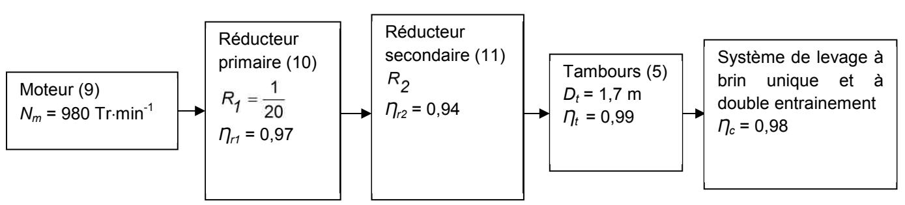

Figure 1 : Chaine d'énergie du système de manœuvre de la travée

**Question 16**: à partir de la vitesse maximal de la travée (1) et de la fréquence de rotation du moteur (9), **calculer** le rapport de réduction total,  $R_{tot}$ , de la chaine d'énergie du système de manœuvre de la travée. **Calculer** le rapport de réduction,  $R_2$ , du réducteur secondaire (11).

$$R_{tot} = \frac{N_t}{N_m} = \frac{V_{max} \times 2 \times 60}{N_m \times D_t \times 2 \times \pi} = \frac{0.074 \times 2 \times 60}{980 \times 1.7 \times 2 \times \pi} = \frac{1}{1178.8}$$

$$R_{tot} = R_1 \cdot R_2$$

$$R_2 = \frac{R_{tot}}{R_1} = \frac{20}{1178.8} = \frac{1}{58.94}$$

**Question 17 :** à partir des données de la chaine d'énergie du système de manœuvre, **calculer** le rendement total,  $\Pi_{tot}$ , de cette chaine d'énergie.

$$\eta_{tot} = \eta_{r1} \cdot \eta_{r2} \cdot \eta_c \cdot \eta^2 t$$

Dans le calcul du rendement total  $\eta_{tot}$ ,  $\eta_t^2$  correspond au rendement total des deux tambours d'entrainement d'une chaine d'énergie. Sachant que  $\eta_t$  est le rendement d'un tambour d'entrainement.

$$\eta_{tot} = 0.97 \times 0.94 \times 0.98 \times 0.99^2 = 0.88$$

**Question 18**: exprimer  $C_m$ , le couple moteur (9), en fonction de  $F_{cm}$ ,  $D_t$ ,  $R_{tot}$ ,  $\Pi_{tot}$  et f.

 $F_{cm}$  correspond à l'effort total exercé par le câble de manœuvre (6) sur le contrepoids (2). Sachant qu'il y a deux chaines d'énergies, il faut prendre en compte  $\frac{F_{cm}}{2}$  pour le calcul du couple d'un moteur

$$C_{m} = \frac{F_{cm} \cdot D_{t} \cdot f \cdot R_{tot}}{2 \cdot \eta_{tot} \cdot 2}$$

## 4.4. Moteur d'entrainement (9)

Question 19 : calculer le couple moteur utile maximal répondant à la condition 1. Parmi les moteurs proposés dans le document technique DT5, donner les moteurs répondant à l'exigence de la condition 1.

$$C_{mmax} = 2 \cdot \frac{F_{cm} \cdot D_t \cdot f \cdot R_{tot}}{2 \times \eta_{tot} \times 2}$$

$$C_{mmax} = 2 \times \frac{3116,2 \times 10^3 \times 1,7 \times 1,16}{2 \times 0.88 \times 2 \times 1200} = 2909,63 \text{Nm}$$

Donc, en cas d'une défaillance de contrôle moteur ou une surcharge accidentelle, les moteurs ne devront pas excéder 2909,63 Nm.

Moteur1 110kw, 
$$Cm/Cn = 220 \%$$
  
 $M_{110max} = 2.2 \times 1067 = 2347 \text{ Nm}$   
Moteur2 132kw,  $Cm/Cn = 200 \%$   
 $M_{132max} = 2 \times 1287 = 2574 \text{ Nm}$   
Moteur3 160kw,  $Cm/Cn = 190 \%$   
 $M_{160max} = 1.9 \times 1544 = 2934 \text{ Nm}$ 

Seuls les moteurs 1 et 2 satisfassent la 1ère condition.

**Question 20 : calculer** le couple moteur nominal répondant à la condition 2. Parmi les moteurs proposés dans les documents techniques DT5, **donner** les moteurs répondant à l'exigence de la condition 2.

$$C_{mn} = \frac{F_{cm} \cdot D_t \cdot R_{tot}}{2 \times \eta_{tot} \times 2}$$

$$C_{mn} = \frac{3116,2 \times 10^3 \times 1,7}{2 \times 0.88 \times 2 \times 1200} = 1254,15 \text{Nm}$$

Le couple nominal du moteur sans le coefficient d'amplification f = 1,16 dans le cas avec vent ELS est  $C_{mn}$  = 1254,15 Nm

- moteur 1 110kw, *Cn* = 1067 Nm;
- moteur 2 132kw, *Cn* = 1287 Nm;
- moteur 3 160kw, *Cn* = 1544 Nm.

Seuls les moteurs 2 et 3 satisfassent la 2ème condition.

Question 21: conclure quant aux choix du moteur d'entrainement (9).

D'après la condition 2 sur le couple nominal, les moteurs les moteurs 2 et 3 peuvent délivrer un couple suffisant. Cependant le couple max du moteur 3 est au-dessus du couple maximum permis d'après la condition 1.

Nous pouvons limiter la puissance du moteur 3 mais comme le moteur 2 remplit toutes les conditions nous prendrons le moteur à 132 KW.

#### 4.5. Variateur de vitesse

Question 22 : calculer la fréquence de rotation du champ tournant du moteur choisi par le constructeur. Calculer le glissement de ce moteur.

$$N = \frac{f \times 60}{P} = \frac{50 \times 60}{3} = 1000 \,\text{Tr} \cdot \text{min}^{-1}$$
$$g = \frac{N - N'}{N} \times 100 = \frac{1000 - 980}{1000} \times 100 = 2^{\%}$$

**Question 23 :** à partir du couple de charge maximal  $C_{MElu}$ , calculer la puissance utile que devra fournir ce moteur. Calculer l'intensité absorbée par ce moteur.

$$\begin{aligned} Pu &= Cmelu \cdot N \cdot \frac{2 \cdot \pi}{60} = 1479, 7 \times 980 \times \frac{2\pi}{60} = 151, 9 \, \text{kW} \\ \eta &= \frac{P_{umax}}{P_{a}} \\ P_{a} &= U \cdot I \cdot \sqrt{3} \cdot \cos(\varphi) \\ I &= \frac{P_{umax}}{\eta \cdot U \cdot \sqrt{3} \cdot \cos(\varphi)} = \frac{151, 9 \times 10^{3}}{0,944 \times 400 \times \sqrt{3} \times 0,86} = 270, 1 \, \text{A} \end{aligned}$$

Question 24 : à partir des données du document technique DT6, conclure quant au choix du variateur répondant à la contrainte du cahier des charges.

VariateurAltivar71: ATV71EXS5C16N4

Pumax = 160 kW et I = 314 A

### 5. Commande dynamique de la travée mobile

Question 25 : identifier, à l'aide de la figure 5-1, la fonction de transfert  $T_s(p)$  associée à la réponse temporelle liant la hauteur réelle  $h_s(t)$  de la travée et la hauteur indiquée par les capteurs h(t) et déterminer les valeurs numériques de la période  $T_0$ , du gain statique k ainsi que du facteur d'amortissement  $\xi$ .

$$T_{S} = \frac{h_{S}(p)}{h(p)} = \frac{\omega_{0}^{2}}{p^{2} + 2 \cdot \xi \cdot \omega_{0} \cdot p + \omega_{0}^{2}}.$$

La période  $T_0$  ( $T_0 = \frac{2 \cdot \pi}{\omega_0}$ ) mesurée sur la courbe fournie est de 2,4 s.

Le gain statique k est égal à 1.

La réponse pouvant être assimilée à celle de la solution d'un système régit par une équation différentielle du second ordre à coefficient constant et soumis à un échelon.

$$\frac{-\xi\cdot\pi}{\sqrt{1-\xi^2}}$$
 Le premier dépassement  $D_{1\%}=e^{\sqrt{1-\xi^2}}$  d'où  $D_{1\%}=73$  %, on déduit  $\xi=0,1$  .

**Question 26 :** compte tenu des valeurs imposées par le constructeur, **donner** sur la figure 5-2a, 5-2b et 5-2c du document réponse DR1, les profils de l'accélération, de la vitesse et de l'élévation de la travée.

Nous faisons l'hypothèse d'une accélération constante lorsque celle-ci est non nulle.

#### Pour 0 < t ≤ 10 s</li>

| $a = a_0$                                          | d'où $a = \frac{V_{max}}{10}$                                 |
|----------------------------------------------------|---------------------------------------------------------------|
| $v(t) = a \cdot t + V_0$                           | $v(t) = a \cdot t = \frac{V_{max}}{10} \cdot t$               |
| $h(t) = \frac{a}{2} \cdot t^2 + V_0 \cdot t + h_0$ | $h(t) = \frac{a}{2} \cdot t^2 = \frac{V_{max}}{20} \cdot t^2$ |

#### - Pour 10 s < t ≤ 650 s

| a = 0                      | d'où a=0                                   |
|----------------------------|--------------------------------------------|
| $v(t) = V_1$               | $v(t) = V_{max}$                           |
| $h(t) = V_1 \cdot t + h_1$ | $h(t) = V_{max} \cdot t - 5 \cdot V_{max}$ |

#### - Pour 650 s < t ≤ 660 s

| $a = -a_0$                                         | d'où $a = -a_0$                                                                         |
|----------------------------------------------------|-----------------------------------------------------------------------------------------|
| $v(t) = a \cdot t + V_2$                           | $v(t) = -a \cdot t + V_2 = -\frac{V_{max}}{10} \cdot t + 66 \cdot V_{max}$              |
| $h(t) = \frac{a}{2} \cdot t^2 + V_2 \cdot t + h_2$ | $h(t) = -\frac{V_{max}}{20} \cdot t^2 + 66 \cdot V_{max} \cdot t - 21130 \cdot V_{max}$ |

En exploitant le résultat h(660) = 47,166 m

Nous obtenons : *Vmax* = 7,25610-2 ms -1 et *a0* = 7,256 10-3 ms -2

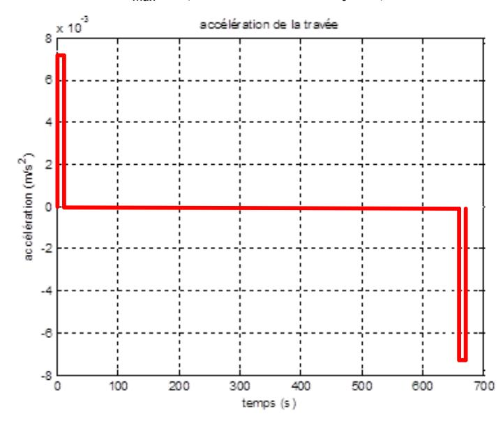

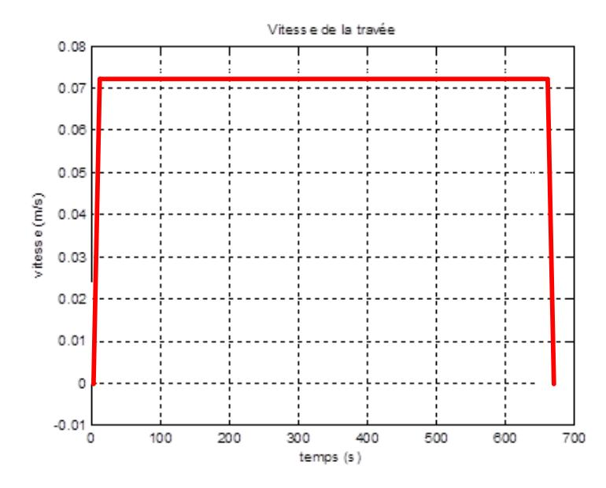

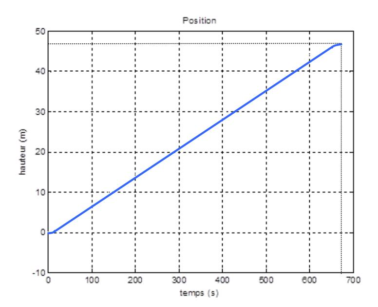

Question 27 : calculer la valeur de  $C_V$ , exprimer la fonction de transfert  $T_V(p) = \frac{V(p)}{F(p)}$  et exprimer la relation entre la vitesse V et la position de la travée h (mesurée au travers des capteurs absolus)  $T_p = \frac{h(p)}{V(p)}$ .

Dans cette partie, on néglige le facteur de surdimensionnement f de la chaine d'énergie.

$$C_{m}(t) = \frac{R_{1} \cdot R_{2}}{\eta_{R1} \cdot \eta_{R2} \cdot \eta_{t} \cdot \eta_{c}} \cdot \frac{D_{t}}{2} \cdot \frac{F(t)}{2} \quad \text{dans} \quad \text{le lieu de Laplace nous obtenons}$$

$$C_{m}(p) = \frac{R_{1} \cdot R_{2}}{\eta_{R1} \cdot \eta_{R2} \cdot \eta_{t} \cdot \eta_{c}} \cdot \frac{D_{t}}{2} \cdot \frac{F(p)}{2} \quad \text{avec} \quad C_{v} \cdot C_{m}(p) = F(p) \quad \text{d'où} \quad C_{v} = \frac{1}{\frac{R_{1} \cdot R_{2}}{\eta_{R1} \cdot \eta_{R2} \cdot \eta_{t} \cdot \eta_{c}} \cdot \frac{D_{t}}{2} \cdot \frac{1}{2}} \quad \text{soit}$$

 $C_V = \frac{4 \cdot \eta_{R1} \cdot \eta_{R2} \cdot \eta_t \cdot \eta_c}{R1 \cdot R2 \cdot D_t} \quad \text{si on néglige les pertes par frottement mécanique nous obtenons}$   $C_V = \frac{4}{R_1 \cdot R_2 \cdot D_t}$ 

En ne tenant compte que de la masse de la travée et en négligeant le frottement des parties mécaniques :

 $M \cdot \Gamma(t) = F(t)$  avec  $\Gamma(t) = \frac{\mathrm{d}}{\mathrm{d}t}V(t)$  on a  $M \cdot \frac{\mathrm{d}}{\mathrm{d}t}V(t) = F(t)$  dans le lieu de Laplace avec des CI nulles  $M \cdot \mathrm{p} \cdot V(p) = F(p)$  d'où  $T_V(p) = \frac{V(p)}{F(p)} = \frac{1}{M \cdot \mathrm{p}}$ .

 $V(t) = \frac{d}{dt}h(t)$  on a  $V(p) = p \cdot h(p)$  dans le lieu de Laplace avec des CI nulles  $T_p(p) = \frac{h(p)}{V(p)} = \frac{1}{p}$ 

**Question 28 : exprimer** la fonction de transfert entre la position indiquée par les capteurs absolus h et l'accélération référence  $\Gamma_{ref}$ ,  $T = \frac{h(p)}{\Gamma_{ref}(p)}$ .

La lecture du schéma bloc permet d'écrire :

$$\begin{split} \left( \left[ \left( \Gamma_{ref}(p) \cdot \frac{1}{p^2} - h(p) \right) \cdot C_p + \Gamma_{ref}(p) \cdot \frac{1}{p} \cdot K_{FV} - p \cdot h(p) \right] \cdot C_V + \Gamma_{ref}(p) \cdot K_{Fa} \right) \cdot \frac{1}{M \cdot p^2} = h(p) \\ \frac{1}{p^2} \cdot C_p \cdot C_V \cdot \Gamma_{ref}(p) + \frac{1}{p} \cdot K_{FV} \cdot C_V \cdot \Gamma_{ref}(p) + \Gamma_{ref}(p) \cdot K_{Fa} = M \cdot p^2 \cdot h(p) + C_V \cdot p \cdot h(p) + C_V \cdot C_p \cdot h(p) \\ \frac{1}{p^2} \cdot \Gamma_{ref}(p) \cdot \left( C_p \cdot C_V + p \cdot K_{FV} \cdot C_V + p^2 \cdot K_{Fa} \right) = h(p) \cdot \left( M \cdot p^2 + C_V \cdot p + C_V \cdot C_p \right) \\ T(p) = \frac{h(p)}{\Gamma_{ref}(p)} = \frac{1}{p^2} \cdot \frac{C_p \cdot C_V + K_{FV} \cdot C_V \cdot p + K_{Fa} \cdot p^2}{C_p \cdot C_V + C_V \cdot p + M \cdot p^2} \end{split}$$

**Question 29: indiquer** les valeurs des coefficients *KFa* et *KFv* pour que la fonction de transfert puisse se simplifier,  $T = \frac{h(p)}{\Gamma_{ref}(p)} = \frac{1}{n^2}$ .

Par identification du dénominateur et du numérateur de T(p) nous obtenons  $K_{F_V} = 1$  et  $K_{F_A} = M$ 

**Question 30 : expliciter** le fonctionnement de l'algorithme à partir de l'accélération représentée sur la figure 5-5

Entre les dates 0 et 10 s :

- l'entrée vitesse étant non nulle et positive, l'interrupteur délivre une consigne d'accélération "n" ·
- la hauteur de la travée est inférieure à la distance minimum d'accélération. On a : d\_min entrée position ≥ 0. L'interrupteur délivre la consigne d'accélération "am";
- la hauteur de la travée est hors de la distance de freinage. On a entrée position -C < 0.</li>
   L'interrupteur délivre une consigne d'accélération "0".

Ceci génère une accélération en sortie de référence égale à "am".

#### Entre 10 s et 650 s:

- l'entrée vitesse est non nulle et positive. L'interrupteur associé délivre une consigne d'accélération "0";
- la hauteur de la travée est supérieure à la distance minimum d'accélération. On a "d\_min entrée position < "0". L'interrupteur délivre une consigne d'accélération "0".
- la hauteur de la travée est hors distance de freinage. On a "entrée position -C < 0".</li>
   L'interrupteur délivre une consigne d'accélération "0".

Ceci génère une accélération en sortie de référence égale à "0".

### Entre 650 s et 660 s :

- l'entrée vitesse est non nulle et positive, l'interrupteur associé délivre une consigne d'accélération "0" :
- la hauteur de la travée est supérieure à la distance minimum d'accélération, on a : d\_min entrée position > 0 l'interrupteur délivre une consigne d'accélération "0".
- la hauteur de la travée est à distance de freinage entrée position -C ≥ 0 l'interrupteur délivre une consigne d'accélération "-am".

Ceci génère une accélération en sortie de référence égale à "-am".

## Au-delà 660 s :

La position reste maintenue.

 l'entrée vitesse est négative, l'interrupteur associé délivre une consigne d'accélération est "am";

- la hauteur de la travée est supérieure à la distance minimum d'accélération, on a : d\_min entrée position > 0 l'interrupteur délivre une consigne d'accélération "0";
- la hauteur de la travée est à distance de freinage entrée position -C ≥0 l'interrupteur délivre une consigne d'accélération "-am".

Ceci génère une accélération en sortie de référence égale à "0".

#### 6. Codeur absolus multitours

## 6.1. Analyse du guidage

Question 31 : à partir des figure 6-1, figure 6-2, et figure 6-3, proposer une liaison modélisant les guidages de la travée réalisés pour chaque pylône (1, 2 et 4). En **déduire** la liaison équivalente liant la travée à l'ensemble des pylônes. **Justifier** l'absence de guidage entre la travée et le pylône 3 aval (P3) en vous appuyant sur une étude succincte de l'isosatisme ou de l'hyperstatisme de la liaison équivalente entre la travée et les pylônes.

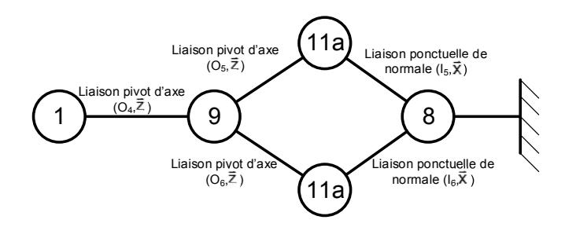

Une étude cinématique nous permet d'obtenir pour une des branches en parallèle:

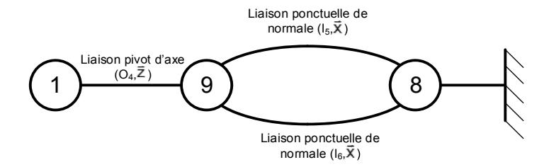

L'étude des deux liaisons ponctuelles en parallèle permet d'obtenir le graphe suivant :

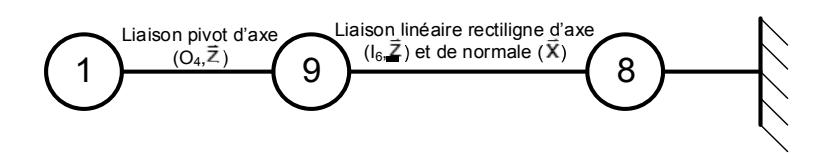

Puis:

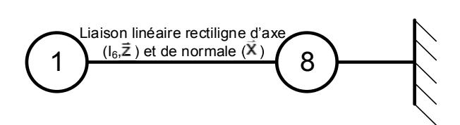

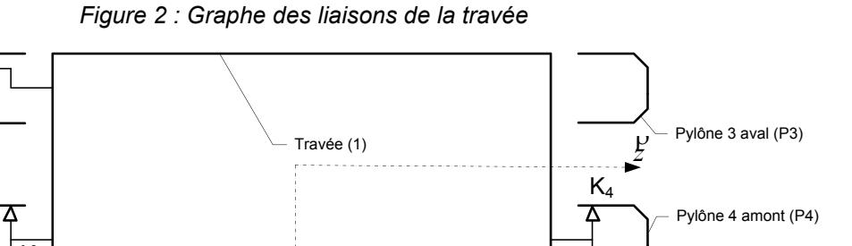

Figure 3 : schéma cinématique de la travée

٧Ł

On déduit que :

Pvlône 1 aval (P1)

Pylône 2 amont (P2)

- la liaison entre la travée 1 et le pylône  $P_2$  est une liaison pivot glissant d'axe  $(K_2, \frac{1}{V})$ ;
- la liaison entre la travée 1 et le pylône  $P_1$  est une liaison linéaire rectiligne d'axe  $(K_1, \mathcal{Y})$  et de normale  $\mathcal{Y}$ :
- la liaison entre la travée 1 et le pylône  $P_4$  est une liaison linéaire rectiligne d'axe  $(K_4, \frac{t}{y}')$  et de normale  $\frac{t}{x}'$ :
- En conclusion la liaison entre la travée 1 et les pylônes est une liaison glissière de direction  ${}^{t}\!\!\!/$  .

Le manque de guidage entre la travée et le pylône P3 amont permet d'éviter un degré d'hyperstatisme du système trop élevé.

Un degré d'hyperstatisme trop élevé pour le guidage en translation de la travée aura pour conséquence de bloquer la travée par un phénomène d'arcboutement lors d'un décalage en altitude des quatre coins de la travée.

## 6.2. Vérification de la précision du codeur

**Question 32 : calculer** le défaut d'altitude de la travée pour les deux seuils d'inclinaisons. **Exprimer** la conséquence d'un décalage d'altitude des quatre coins de la travée sur le levage du pont.

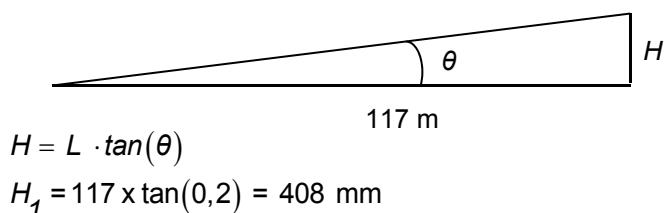

$$H_1 = 117 \times tall(0,2) = 400 \text{ Hills}$$

 $H_4 = 117 \text{ x} \tan(0.27) = 551 \text{ mm}$ 

Une inclinaison trop importante de la travée aurait pour conséquence de bloquer la travée par un phénomène d'arcboutement.

**Question 33 : calculer** la résolution minimale du codeur afin de détecter un défaut d'altitude de 400 mm. **Calculer** le nombre minimal de tours du codeur pour contrôler la hauteur de la levée. **Valider** le codeur choisi par le constructeur en fonction des données du document technique DT7.

$$N_{impul} = \frac{2 \cdot \pi \cdot R}{400} = \frac{2 \cdot \pi \cdot 2 \cdot 10^3}{400} = 31,4$$

$$2^{n} > 31,4$$

Il faut que la résolution soit supérieure à n > 5

$$N_{tours} = \frac{47,17}{2 \cdot \pi \cdot 2} = 3,75 \text{ tours}$$

$$2^n > 3.75$$

Il faut que le nombre de tours soit supérieur à n > 2

Nb de tours : 12 bits Résolution : 13 bits

$$P_{th\acute{e}orique} = \frac{2 \cdot \pi \cdot R}{N_{impul}} = \frac{2 \cdot \pi \cdot 2 \cdot 10^3}{2^{13}} = 1,53 \text{ mm}$$

## 7. Communication entre les éléments pour la levée du pont

## 7.1. Le codeur BEI DEACOD

Question 34 : à l'aide du document technique DT7, déterminer la précision minimale et donc le nombre de pistes que doit avoir le codeur fixé sur le tambour. Justifier le choix du constructeur en donnant la précision du codeur du constructeur.

Hypothèse : le contrepoids se déplace en même temps que la travée

 $N_d$  = nombre division par tour

$$N_d = \frac{1700 \cdot \pi}{1}$$

$$2^n = 1700 \cdot \pi$$

$$n = \frac{\ln(1700 \cdot \pi)}{\ln(2)}$$

$$n = 12.38$$

Donc n = 13 pistes de résolutions le codeur est bien dimensionné.

**Question 35**: le codeur de poulie envoie une impulsion de valeur 100 352 à l'automate programmable de commande. **Calculer** la hauteur du pont pour cette valeur. Sachant qu'au même moment le codeur tambour envoie la valeur 100 570. **Déterminer** l'action du conducteur.

#### Codeur poulie:

position réel - position initiale = 100352 - 81920 = 18432

Rappel question 24. Résolution codeur poulie = 1.53 mm

$$h_p = 18432 \text{ x } 1,53 = 28,2 \text{ m}$$

### Codeur tambour :

position réel - position initiale = 100570 - 81920 = 18650

$$P_{th\acute{e}orique} = \frac{2 \cdot \pi \cdot R}{N_{impul}} = \frac{\pi \cdot 1.7 \cdot 10^3}{2^{13}} = 0.65 \text{ mm}$$

$$h_t = 18650 \times 0.65 = 12.1 \text{ m}$$

$$h_p - h_t > 800 \text{ mm}$$

Le conducteur reçoit donc un message d'alerte.

**Question 36 : retrouver** à partir de la trame figure 7-1, de quel élément a été réalisée la requête et **donner** l'information recherchée. Donner le type IP de la trame Ethernet 2. **Vérifier** que la longueur du datagramm IP de la trame correspond à celui inscrit dans la trame.

Elément qui a fait la requête : 172.28.1.19 Information cherché : capet\_SII\_2014

Cadres IPv4

Longueur totale du datagramme IP: 00 2a soit 42 octets (45 00....31 34) et il y a bien 42 octets dans la trame IP.

**Question 37 : énumérer** les paramètres qui seraient modifiés si l'on lisait les données sur le réseau principal et non plus sur le réseau redondant. **Justifier** l'utilisation d'un réseau redondant.

ac 1c 01 13→Source: 172.28.1.19

à remplacer par

ac 1c 01 12→Source: 172.28.1.18

La redondance permet de sécurisation les données, de pouvoir confronter les données, d'avoir un taux de défaillance réduit et enfin il est utile lors de la maintenance.

Question 38 : déterminer les durées nécessaires pour recevoir, à l'extrémité du câble, le dernier octet d'un paquet de 256 octets dans un câble en fibre optique et dans un câble en cuivre torsadé. On néglige la perte de débit due à la longueur des câbles. Comparer les résultats obtenus et justifier l'utilisation de la fibre optique en fonction des résultats obtenus avec l'utilisation paramétrée sur les codeurs

1) N = 256 octets = 2048 bits.

Il faut donc  $\frac{N}{d\acute{e}bit} = \frac{2048}{1000 \times 10^6} = 2,048 \times 10^{-6} \text{ s}$  pour inscrire les bits sur la ligne.

La ligne mesure d = 550 m. Il faudra donc  $\frac{d}{v} = \frac{550}{3 \cdot 10^8} = 1,83 \cdot 10^{-6}$  s pour que le signal arrive de l'autre côté de la rive, soit au total  $2,048 \cdot 10^{-6} + 1,83 \cdot 10^{-6} = 3,881 \cdot 10^{-6}$  s.

2) A présent, on utilise une paire torsadée de débit moyen incluant la perte de débit sur la longueur de  $D = 2 \text{ Mb·s}^{-1} \text{ sur } 550 \text{ m}$ .

Le temps d'inscription des bits sur la ligne est de 1,024 ms.

$$\frac{N}{d\acute{e}bit} = \frac{256 \times 8}{2 \cdot 10^{6}} = 1024 \cdot 10^{-6} \text{ s}$$

$$\frac{d}{v} = \frac{550}{2,26 \cdot 10^{8}} = 2,434 \cdot 10^{-6} \text{ s}$$

$$t_{total} = 1024 \cdot 10^{-6} + 2,434 \cdot 10^{-6} = 1,026 \text{ ms}$$

Si le câble était en cuivre le temps de parcours serait de 1,026 ms alors qu'avec la fibre optique nous sommes à  $4 \mu s$ .

La fibre optique a un temps de réponse inférieur au cylcetimer. Elle est donc obligatoire pour ne pas avoir d'interférence. Il faut relativiser cette valeur car 1 ms est très petit face à la vitesse de déplacement de la travée.

**Question 39 : comparer** les trois types de supports de transmission, représenté figure 7-2, en termes de vitesse de transmission, de facilité de mise en œuvre dans le cadre d'un usage de cet ouvrage d'art.

|               | Avantages         | inconvénients |
|---------------|-------------------|---------------|
| Cuivre        | cout raccordement | vitesse       |
| Ethernet      | cout              | vitesse       |
| Fibre optique | vitesse           | cout          |

**Question 40 :** à l'aide de la structure du réseau de la figure 7-2, **déterminer** le nombre de machines connectées au travers du réseau. **Donner** le nombre maximal de machines pouvant être gérées par ce réseau et **valider** le dimensionnement du réseau pour cette utilisation.

Classe B = IDR : identification réseau 1.1 à 255 = IDH : identification hotes

Comme toutes les machines ont la même identification réseau, elles peuvent communiquer naturellement entre elles.

La première valeur des identifications des hôtes est bloqué dans ce réseau, nous avons donc comme possibilité :

 $2^8 - 2 = 256 - 2 = 254$  car l'octet 0000000 et l'octet 1111111 sont réservés à l'adresse réseau et l'adresse broadcast.

Le réseau est bien dimensionné car nous avons seulement que 46 modules avec la redondance.

Lorsque l'on utilise de la fibre optique, le débit est si important que le temps nécessaire à mettre les bits en ligne devient négligeable devant le temps de propagation, ce qui n'est plus le cas avec l'utilisation du cuivre.

## 8. L'influence des utilisateurs sur le pont

**Question 41 : donner** et **justifier** les hypothèses permettant de réduire ce problème à 2 dimensions. **Réaliser** un schéma modélisant la travée, les charges appliquées sur celle-ci et ses appuis sur les deux embases. L'appui de gauche sera noté A et celui de droite B.

La symétrie du pont permet de réduire le problème à 2 dimensions

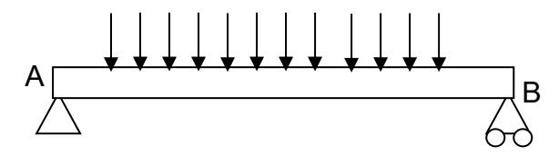

**Question 42 :** à partir des données précédentes, **calculer** la charge répartie équivalente  $q_{eq}$  (en kg·m-1) sur la travée levante, en **déduire** q en N·m-1 le poids équivalent de la travée.

$$q_{eq} = 24,359 + 1,8 = 26,159 \cdot 10^3 \text{ kg m}^{-1}$$
  
 $q = 26,159 \cdot 10^3 \text{ x } 9,81 = 256,6 \cdot 10^3 \text{ N·m}^{-1}$ 

Question 43: déterminer les expressions du moment fléchissant  $M_{fz}(x)$  et de la contrainte  $\sigma$  le long de la poutre AB. Tracer les diagrammes du moment fléchissant  $M_{fz}(x)$  et de la contrainte  $\sigma$  le long de la poutre AB et donner les valeurs remarquables de ces grandeurs. Déterminer la contrainte normale maximale  $\sigma_{max}$ .

$$Mfz = \frac{q \cdot l \cdot x}{2} - \frac{q \cdot x^2}{2}$$

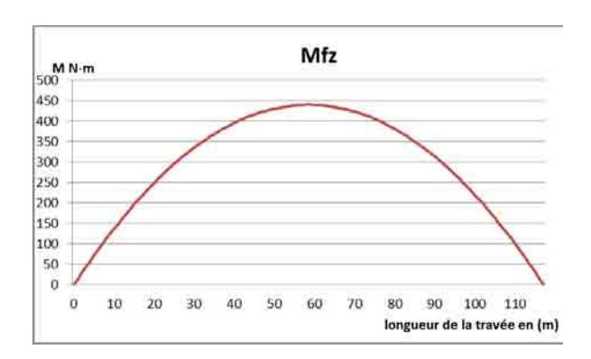

$$Mfz_{max} = 439 \cdot 10^6 \text{ N·m}$$

$$|\sigma| = \left| \frac{Mfz}{Igz} \cdot y \right| \text{ avec } y = \frac{h_t}{2} \text{ et } Igz = \frac{b \cdot h_t^3}{12}$$

$$\sigma_{max} = \frac{6 \times 439 \times 10^6}{27 \times 6.5^2} = 2.3 \text{ Mpa}$$

Le résultat de nos calculs est vraiment en dessous des simulations. Des pré-calculs aussi approximatifs ne sont donc pas utiles à des ouvrages aussi importants.

**Question 44 : comparer** et **interpréter** les courbes de la contrainte normale par rapport aux hypothèses des deux cas. **Conclure** quant au choix du modèle pour la suite de l'étude.

*max modèle1* = 2,3 MPa

*max modèle2* = 350 MPa

La structure utilisée pour le modèle 1 ne permet pas de retrouver les valeurs de contraintes du modèle 2.

De plus au niveau des appuis, le modèle 1 a des contraintes nulles contrairement au modèle 2 qui a des contraintes égales à 300 MPa. Le modèle 1 ne permet pas de modéliser les appuis de la travée. Le résultat de nos calculs est vraiment en dessous des simulations. Des pré-calculs aussi approximatifs ne sont donc pas utiles à des ouvrages aussi importants.

**Question 45 : comparer** le modèle simulé à la résistance élastique *Rpe* et **conclure** sur la résistance de la travée levante.

*max* = 350 MPa

*Rpe* = 375 MPa

*max* < *Rpe*. La travée levante ne subit pas de déformation permanente

## **9. Conclusion générale**

**Question 46 : comparer** la réduction d'émissions en CO2 des automobilistes obtenue grâce à la construction de ce pont avec l'équivalent en CO2 de la consommation électrique due à la manœuvre du pont. À l'aide de l'étude réalisée et sans tenir compte du bilan carbone lié à la construction, **proposer** des éléments permettant d'affiner le bilan carbone de cet ouvrage.

$$R_{emis} = 130 \cdot 10^{-3} \text{ x } 29 \cdot 10^{6} = 3,77 \cdot 10^{6} \text{ kg de CO}_{2}$$
  
 $C_{elect} = 309 \text{ x } 0,09 = 27,81 \text{ kg de CO}_{2}$ 

Réduction d'émissions en CO2 due à la construction du pont = *Celect* - *Remis* = -3,77106 kg de CO2. Le bilan carbone du pont est surtout lié au détour que ne feront plus les automobilistes. Pour affiner le bilan carbone, nous devons mesurer réellement les détours fait par les usagers, le nombre de bateaux passant le pont, les couts énergétiques des montées, etc…

**Question 47 :** à partir de l'étude réalisée, **exprimer** la pertinence d'un pont à travée levante en fonction de la fréquence d'utilisation du système de levage.

La pertinence d'un pont à travée levante ne sera plus un choix judicieux si les données suivantes augmentent trop :

- le nombre de levée ;
- la maintenance associée ;
- le temps d'interruption de la circulation ;
- la consommation et/ou le prix de l'énergie.