#### **SESSION 2014**

# CAPET CONCOURS EXTERNE ET CAFEP

Section : SCIENCES INDUSTRIELLES DE L'INGÉNIEUR Option : ARCHITECTURE ET CONSTRUCTION

**Option: ÉNERGIE** 

Option: INFORMATION ET NUMÉRIQUE Option: INGÉNIERIE MÉCANIQUE

# ANALYSE D'UN SYSTÈME PLURITECHNIQUE

Durée : 4 heures

Calculatrice électronique de poche - y compris calculatrice programmable, alphanumérique ou à écran graphique — à fonctionnement autonome, non imprimante, autorisée conformément à la circulaire n° 99-186 du 16 novembre 1999.

L'usage de tout ouvrage de référence, de tout dictionnaire et de tout autre matériel électronique est rigoureusement interdit.

Dans le cas où un(e) candidat(e) repère ce qui lui semble être une erreur d'énoncé, il (elle) le signale très lisiblement sur sa copie, propose la correction et poursuit l'épreuve en conséquence.

De même, si cela vous conduit à formuler une ou plusieurs hypothèses, il vous est demandé de la (ou les) mentionner explicitement.

NB: La copie que vous rendrez ne devra, conformément au principe d'anonymat, comporter aucun signe distinctif, tel que nom, signature, origine, etc. Si le travail qui vous est demandé comporte notamment la rédaction d'un projet ou d'une note, vous devrez impérativement vous abstenir de signer ou de l'identifier.

# Sujet Analyse d'un système pluritechnique

Documents remis

Sujet pages 2 à 29

Documents techniques pages 31 à 38

Document réponse page 40

# Le pont Chaban-Delmas

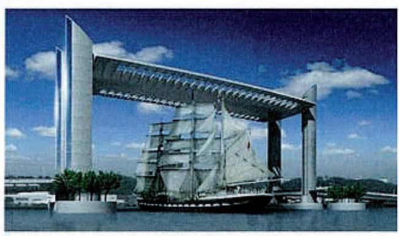

Pont Chaban-Delmas

Le pont Jacques Chaban-Delmas de Bordeaux relie les quartiers de Bastide et de Bacalan en enjambant la Garonne à 2 km en aval du centre-ville. Il se situe entre le pont d'Aquitaine et le pont de Pierre. Le comité d'urbanisation de Bordeaux a choisi un pont levant afin de maintenir l'activité du port de la Lune situé en amont du pont d'Aquitaine tout en intégrant le projet technique et architectural dans l'environnement, le paysage et le patrimoine urbain.

## 1. Présentation générale

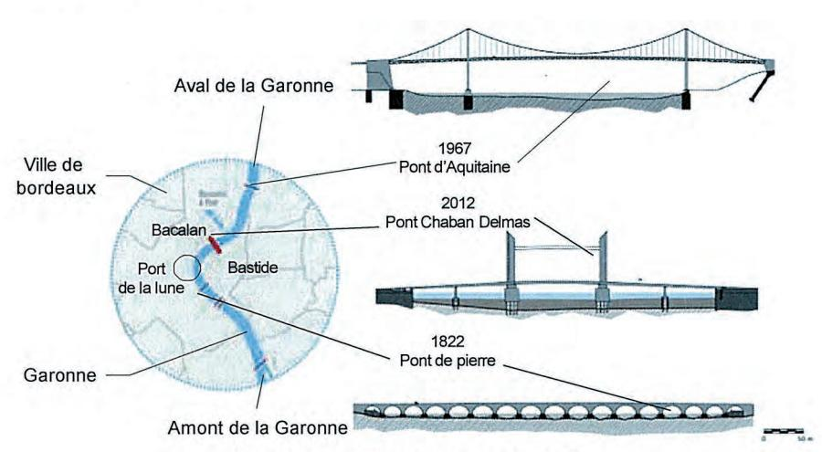

Figure 1-1: position des ponts sur la Garonne

Grâce à son emplacement (figure 1-1), il permet également de boucler les boulevards urbains de Bordeaux. Il évite aux automobilistes de parcourir 29 millions de kilomètres par an soit un gain de temps d'environ 5 millions d'heures de transport. Le comité d'urbanisation de Bordeaux (cub) prévoit un trafic journalier de 28 000 véhicules par jour.

L'ouvrage est dimensionné et conçu pour la traversée simultanée de véhicules légers et poids lourds en desserte locale sur 2 x 2 voies, de transports en commun en site propre sur 2 x 1 voie, de deux roues sur pistes cyclables et de passants sur chemins piétonniers. Le pont constitue l'interconnexion des réseaux de transport en commun

(bus, tram ou tram-train) entre les rives. Les circulations piétonnes et cyclables sont effectuées à l'extérieur des quatre pylônes principaux par de larges passerelles courbes séparées de la chaussée routière (voir figure 1-2).

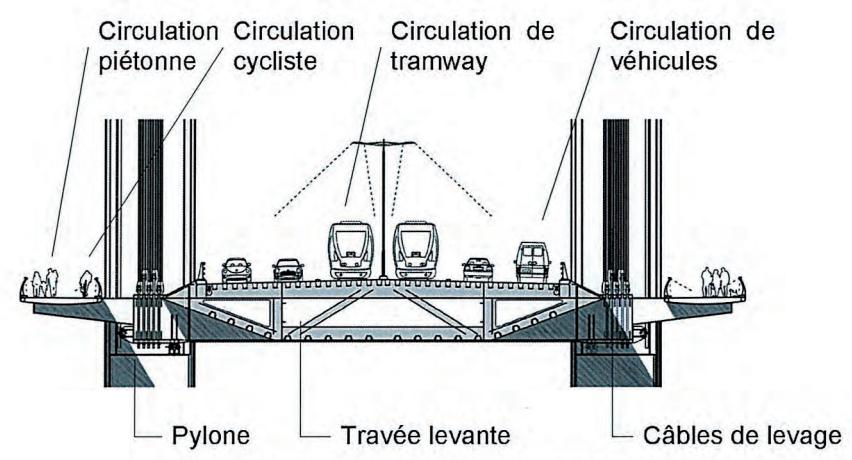

Figure 1-2: répartition des usagers

Le pont à travée levante permet de laisser passer les plus gros bateaux (de croisière et autres bateaux d'exception) environ soixante fois par an. Il immobilise la circulation pendant deux heures environ. La mise en service de l'ouvrage a été réalisée en mars 2013.

À cause de ses dimensions, le pont est une vitrine technologique pour la ville de Bordeaux :

- largeur 45 m avec 17 m de largeur utile;
- longueur 433 m;
- travée levante centrale de 117 m de long ;
- 4 pylônes hauts de 80 m;
- passe maritime navigable
   de 106 m de large et
   53 m de haut.

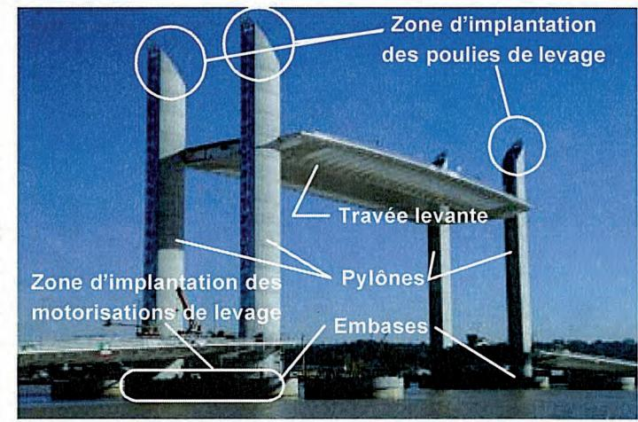

Figure 1-3 : éléments caractéristiques du pont

Lors de la conception du pont, le bureau d'études EGIS a pris en compte de nombreux facteurs en particulier météorologiques, vibratoires et technologiques.

Après l'introduction présentant le besoin de cet ouvrage d'art, l'étude se concentre sur la problématique liée à l'usage de la travée mobile. On s'attache à étudier les systèmes de mise en mouvement de la travée mobile, le comportement dynamique lors des manœuvres, les systèmes d'informations permettant son pilotage et l'influence des utilisateurs sur la résistance de la travée.

# 2. Contexte d'utilisation du pont Chaban-Delmas

#### 2.1. Présentation du service attendu

La traversée de la Garonne par le pont Chaban-Delmas permet de diminuer le nombre de kilomètres parcourus par les automobilistes. Le service attendu par l'agglomération de la ville de Bordeaux peut être représenté graphiquement en SysML avec le diagramme des cas d'utilisation (figure 2-1).

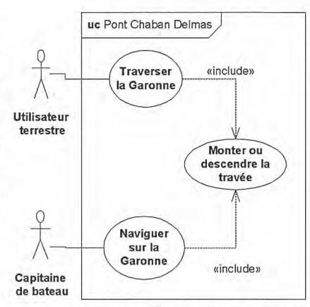

# 2.2. Impact du pont levant sur la circulation

Figure 2-1 : diagramme des cas d'utilisation

Objectif : déterminer la durée d'interruption du trafic et son incidence sur le trafic automobile.

La séquence de levée du pont est décrite en langage SysML dans le document technique DT1.

Le conducteur du pont apprécie, en fonction des conditions météorologiques, la possibilité de lancer la procédure de déplacement du pont.

Question 1 : déterminer la durée d'interruption du trafic des transports lors de la procédure de montée.

La manœuvre de descente s'effectue à la demande de la capitainerie. Le descriptif proposé est réalisé en fonctionnement normal. La procédure de descente diffère de la procédure de montée.

Le conducteur du pont met en œuvre la procédure de descente de la travée à la date  $H_d$ .

Un message annonce la descente imminente de la travée et le déclenchement de la procédure suivante :

- à  $H_d$ , les ascenseurs sont verrouillés et les moteurs sont alimentés ;
- la durée de la descente de la travée est de 11 minutes. En position basse celle-ci est verrouillée. Les ascenseurs sont déverrouillés et les enrouleurs (moteurs) sont désactivés;
- la durée d'ouverture des barrières intérieures est de 5 minutes ;

- la durée d'ouverture des barrières extérieures est de 5 minutes et 30 secondes :
- la durée du désarmement du pont est de10 minutes.

Question 2 : déterminer la durée de la procédure de descente du pont et de réouverture à la circulation.

Question 3 : déduire les durées d'interruption minimale et maximale de la circulation en considérant que le bateau met de 5 à 10 minutes pour franchir le pont.

Le cahier des charges impose une durée totale de fermeture au trafic d'un maximum de 2h30.

Question 4 : vérifier le respect des conditions imposées par le cahier des charges.

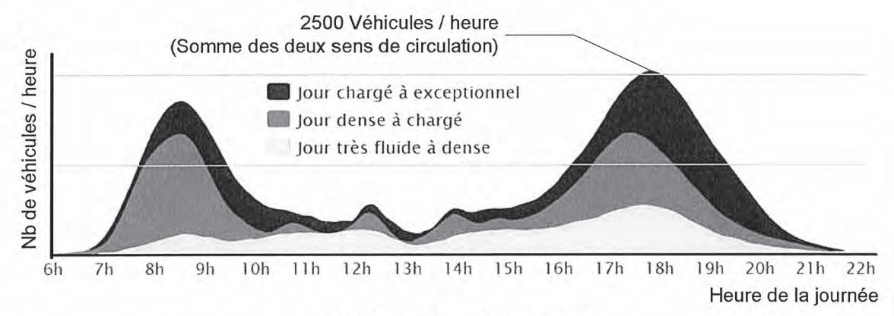

Figure 2-2: trafic routier journalier

Question 5 : en analysant la figure 2-2, donner les plages horaires préférentielles pour le passage des bateaux afin de limiter la perturbation du trafic routier.

## 3. Présentation technique des éléments du pont

La figure 3-1 présente la vue d'ensemble du pont avec les 4 blocs de protection des embases. Les quatre pylônes sont répartis symétriquement par rapport à l'axe transversal et longitudinal du pont. Dans chaque embase se trouve un mécanisme de manœuvre du pont comme indiqué sur la figure 3-2.

#### Architecture des mécanismes

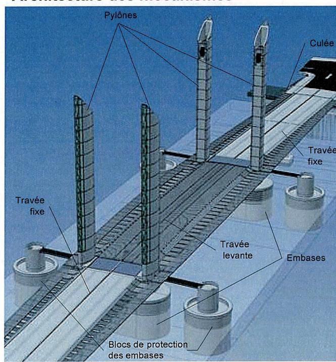

Figure 3-1: vue d'ensemble du pont

La montée et la descente de la travée sont assurées par deux mécanismes de manœuvre (un mécanisme sur chaque embase). Un mécanisme de manœuvre est composé d'un moteur, d'un réducteur primaire, des deux réducteurs secondaires, de deux tambours d'entrainement, de deux contrepoids, de quatre poulies secondaires et de deux poulies principales (voir figure 3-2).

Un système de poulies – contrepoids transforme le mouvement de rotation des tambours d'entrainement en un déplacement linéaire de la travée.

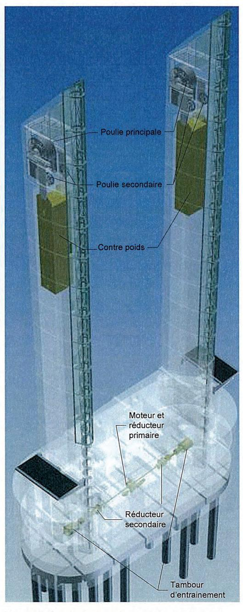

Figure 3-2 : mécanisme de manœuvre du pont

# Les poulies principales en tête des pylônes

Quatre poulies permettent de soulever la travée levante de 47,1 mètres (figure 3-3). Une poulie manœuvre 10 brins en même temps reliant le contrepoids à la travée levante. Le diamètre des poulies principales est de 4 m.

## Les poulies secondaires

Quatre poulies secondaires servent aux déplacements des contrepoids (figure 3-4). Dans chaque pylône, une poulie manœuvre le brin reliant le contrepoids au tambour d'entrainement. Le diamètre des poulies secondaires est de 1,7 m.

#### Les tambours d'entrainement

Ils sont au nombre de 4, un dans chaque pylône (figure 3-5). Leur diamètre est de 1,68 m. Ils enroulent les câbles de manœuvre provenant directement des poulies secondaires et des contrepoids.

#### Les contrepoids

Ils sont au nombre de 4, un dans chaque pylône (figure 3-6). La masse totale des contrepoids est au minimum inférieure de 50 tonnes à la masse de la travée levante. Ils permettent à celle-ci de rester immobile lorsque la travée repose sur ses appuis en position basse.

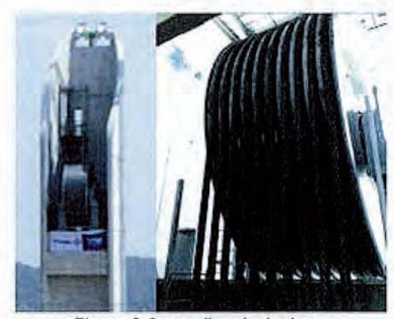

Figure 3-3: poulie principale

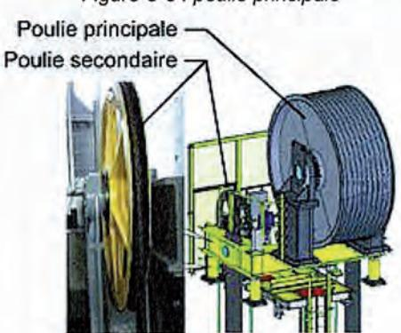

Figure 3-4: poulie secondaire

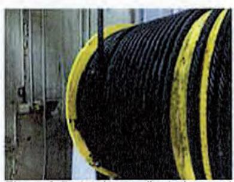

Figure 3-5: tambours d'entrainement

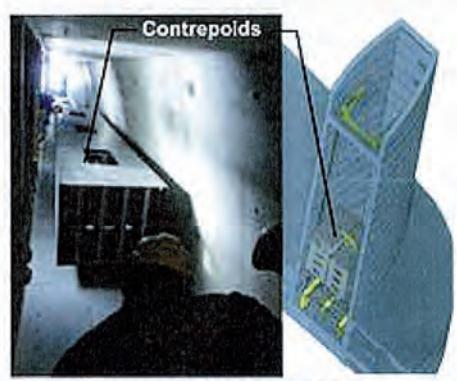

Figure 3-6: contrepoids

#### Système de guidage de la travée

Le guidage de la travée est réalisé par deux guidages longitudinaux et deux guidages transversaux (figure 3-7). Le guidage longitudinal est obtenu par des galets roulants sur les ailes des rails de guidage. Le guidage transversal est obtenu par des galets roulant sur l'âme des rails.

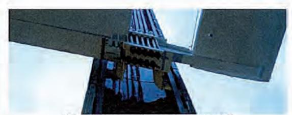

Figure 3-7: guidage transversal

# 4. Système d'entrainement et de manœuvre du pont

Objectif : choisir un moteur et un variateur répondant aux contraintes du cahier des charges pour la levée de la travée.

## 4.1. Système d'entrainement du pont

Objectif : déterminer la meilleure configuration pour le système d'entrainement de la travée à partir du pré-dimensionnement des principaux composants du système de levage.

Le premier critère de choix pour le constructeur est de minimiser la prépondérance. La prépondérance est définie par la différence entre la masse de la travée et celle des quatre contrepoids. Plus la prépondérance est faible plus la puissance du moteur nécessaire au déplacement de la travée est faible.

Le second critère de choix est la vitesse de levée du tablier qui dépend en partie de la solution constructive adoptée.

Question 6 : exprimer les hypothèses permettant de réduire l'étude de quatre soussystèmes de levage identiques de la travée levante à un seul.

Pour l'étude du système d'entrainement de la travée, figure 4-1 et figure 4-2, on considère que :

- les quatre pylônes sont modélisés par un pylône équivalent (pylône 8) ;
- la travée est modélisée par une masse (travée 1) ;
- les quatre contrepoids sont modélisés par un contrepoids équivalent (contrepoids 2);
- les quatre systèmes de levage (poulies, câbles) sont modélisés par un système de levage équivalent.

Dans cette étude, deux configurations sont abordées.

Solution n° 1 : la manœuvre de la travée (1) est réalisée par un système à brin unique et à double entrainement (figure 4-1 et document technique DT2). Le brin unique est représenté par le câble de manœuvre (6).

Le câble de manœuvre est disposé de façon à :

- lever la travée en tirant le contrepoids par sa base et vers le bas ;
- abaisser la travée en tirant le contrepoids par son sommet et vers le haut.

Le câble de manœuvre forme une boucle fermée s'enroulant autour du tambour de manœuvre.

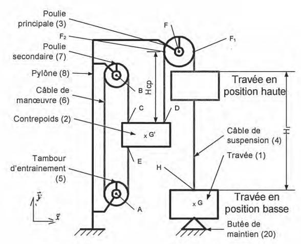

Figure 4-1 : solution n°1, système de levage à brin unique et à double entrainement, travée en position basse

Solution n° 2 : la manœuvre de la travée (1) est réalisée par un système à deux brins et à simple entrainement (figure 4-2 et document technique DT3). Ces brins sont représentés par le câble de manœuvre (6 bis).

Dans un système à simple entrainement, le câble de manœuvre est disposé de telle façon qu'il lève la travée en tirant le contrepoids par sa base et vers le bas. La descente de la travée s'effectue en relâchant le câble de manœuvre de façon contrôlée de sorte que le contrepoids retourne en position haute (travée en position basse).

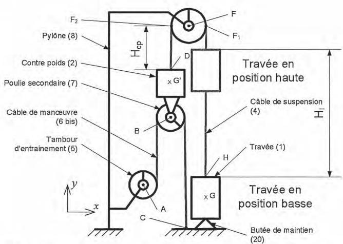

Figure 4-2 : solution n°2, système de levage à deux brins et simple entrainement, travée en position basse

#### Étude de la solution n°2

#### Hypothèses de l'étude :

- le repère de calcul est considéré comme galiléen ;
- le câble de suspension (4) et le câble de manœuvre (6 bis) sont considérés comme des liens inextensibles.

#### Données pour les questions 7 à 15 :

| système de levage à deux brins et simple entrainement - s | solution n°2                                  |
|-----------------------------------------------------------|-----------------------------------------------|
| document technique DT3                                    |                                               |
| masse de la travée (1)                                    | $M_t = 2.850 \cdot 10^3 \text{ kg}$           |
| hauteur maximum de levée de la travée (1)                 | $H_{l}$ = 47,166 m                            |
| longueur totale du câble de suspension (4) de H à D       | $L_c = 71,71 \text{ m}$                       |
| masse linéique d'un brin du câble de suspension (4)       | $\mu_c = 28.8 \text{ kg} \cdot \text{m}^{-1}$ |
| diamètres primitifs des poulies principales (3)           | $D_p = 4 \text{ m}$                           |
| nombre de brins du câble de suspension (4) du système de  | N s = 40                           |
| levage équivalent                                         |                                               |
| hauteur du contrepoids (2) (travée en position basse)     | $H_{cp}$ = 8,996 m                            |
| masse du contrepoids (2) (contrepoids équivalent)         | M cp                               |
| accélération de pesanteur avec $g = -g \cdot y$           | $g = 9.81 \text{ m}\cdot\text{s}^{-2}$        |

La masse du câble de manœuvre (6 bis) est négligée devant celle du câble de suspension (4).

Cahier des charges pour le choix de la prépondérance du système de levage à deux brins et simple entrainement (solution n°2) :

- la travée est équilibrée de sorte que le vent ascendant dans la position haute ne provoque pas de mou dans les câbles ;
- la prépondérance a été déterminée en prenant en compte un vent maximal accidentel ascendant  $F_{vasc}$  de 795 kN appliqué au centre de gravité G de la travée (1) avec  $\overrightarrow{F_{vasc}} = 795 \cdot 10^3 \ y$  (en N);
- la position d'équilibre statique de l'ensemble {contrepoids (2), câble de suspension (4), travée (1), poulie principale (3)}, travée en position haute et sans action du moteur, constitue le minimum de la prépondérance pour la solution n°2.

#### Question 7: à partir des données fournies, calculer,

- la masse  $M_{cm}$  de câble de suspension (4) déplacée (longueur  $H_l$ ) entre les positions basse et haute de la travée ;
- la masse  $M_{ccp}$  du câble de suspension (4) entre les points D et  $F_2$  lorsque la travée est en position basse ;

— la masse  $M_{ct}$  du câble de suspension (4) entre les points H et  $F_1$  lorsque la travée est en position haute.

Question 8 : en isolant l'ensemble {contrepoids (2), câble de suspension (4), travée (1), poulie principale (3)}, calculer la masse du contrepoids (2) pour respecter les conditions du cahier des charges dans le cas du système de levage à deux brins et simple entrainement (solution n°2). En déduire la prépondérance pour ce système de levage.

#### Étude de la solution n°1

Cahier des charges pour le choix de la prépondérance du système à double entrainement et brin unique (solution n°1, document technique DT2) :

- l'ensemble contrepoids, câble de suspension et travée doit être équilibré sans action du moteur lorsque la travée est en position haute afin que la travée ne subisse plus de soulèvement en position haute;
- l'effet du vent maximum accidentel ascendant  $F_{vasc}$  est compensé, si nécessaire, par l'action du moteur sur le contrepoids.  $F_{vasc}$  n'est pas pris en compte dans cette étude.

**Question 9 : expliquer** en quoi, dans cette configuration, l'action du moteur sur le contrepoids, par l'intermédiaire du câble de manœuvre (6), permet de compenser les actions du vent, ce qui justifie que  $F_{vasc}$  ne soit pas pris en compte dans cette étude.

Pour le système de levage à double entrainement et à brin unique (solution n°1), la masse du contrepoids (2) est  $M_{cp}$  = 2783,63·103 kg.

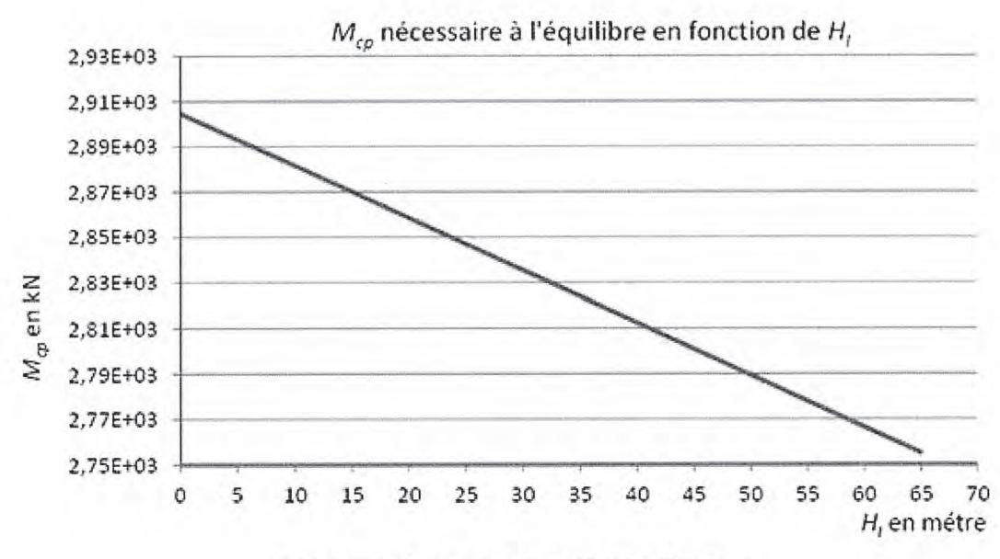

Graphique 4-3 : Mo en fonction de Hi à l'équilibre

Question 10 : à partir de la masse du contrepoids dans le cas d'un système à double entrainement et brin unique (solution n°1), vérifier à l'aide du graphique 4-3 que le cahier des charges est respecté pour ce système de levage. Calculer la prépondérance pour ce système de levage.

#### Bilan et analyse des solutions

Question 11 : comparer la vitesse d'enroulement du tambour entre le système de levage à deux brins (solution n°2) et brin unique (solution n°1).

Question 12 : à partir des résultats aux questions précédentes, conclure en deux lignes maximum quant aux choix du constructeur pour un système à double entrainement et brin unique.

# 4.2. Efforts supportés par les câbles de suspension (4) et les câbles de manœuvre (6)

Objectif: calculer les efforts supportés par le câble de suspension (4) et le câble de manœuvre (6) dans le cas du système de levage à double entrainement et à brin unique (solution n°1). Vérifier la résistance du câble de suspension (4) et du câble de manœuvre (6) lorsqu'ils subissent ces efforts.

Pour les questions de 13 à 15 :

- les quatre pylônes sont modélisés par un pylône équivalent :
- la travée est modélisée par une masse ;
- les quatre contrepoids sont modélisés par une masse équivalente :
- les quatre systèmes de levage (poulies, câbles) sont modélisés par un système de levage équivalent.

Le client impose un temps de manœuvre de la position basse à la position haute de 11 minutes et une hauteur de manœuvre de 47,166 m. Cette contrainte aboutit au graphe de vitesse suivant :

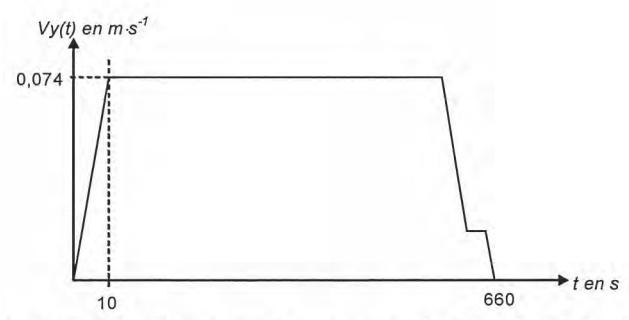

Figure 4-4 : graphe de vitesse pour la manœuvre de la travée en phase de levée

L'étude s'effectue en phase de levée avec pour origine la travée en position basse.

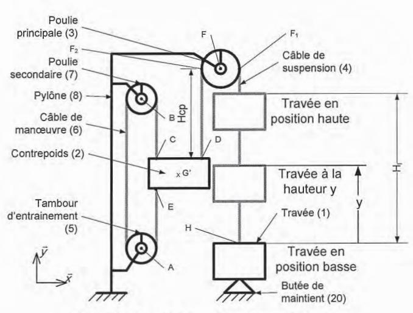

Figure 4-5 : schéma d'étude dynamique

Lors des mouvements de la travée, les actions mécaniques liées aux conditions météorologiques agissant sur la travée sont :

- l'effet du vent, état limite de service (ELS), basé sur une vitesse de vent de 12 m·s-1. Le constructeur définit l'état limite ultime (ELU) correspondant à une charge de vent d'une amplitude égale à 150 % de celle du vent à l'état limite de service (ELS);
- l'accumulation d'eau (neige et glace) sur la travée qui augmente le poids de celle-ci.

On néglige l'inertie de la poulie principale (3), le frottement des roulements situés entre la poulie principale (3) et le pylône. On effectue l'approximation que la tension dans le câble en  $F_2$  et identique à celle en  $F_1$ .

Données pour la question 13 :

| système à double entrainement et à brin unique - document te                                                                                                                     | chnique DT2                                            |
|----------------------------------------------------------------------------------------------------------------------------------------------------------------------------------|--------------------------------------------------------|
| hauteur de la travée en mètre                                                                                                                                                    | У                                                      |
| action du vent descendant sur la travée pendant la phase de levée appliquée au centre de gravité G de la travée (1) avec $\overrightarrow{F_{velu \to 1}} = -F_{velu} \vec{y}$ . | $F_{velu} = 1677,5 \text{ kN}$                         |
| action de l'eau sur la travée appliquée au centre de gravité G de la travée (1) avec $\overrightarrow{F_{eau \to 1}} = -F_{eau} \vec{y}$                                         | F eau = 490,5 kN                            |
| force de frottement due au guidage de la travée (1) appliquée au point G avec $\overrightarrow{F_{fgt \to 1}} = -F_{fgt} \ \vec{y}$                                              | $F_{fgt} = 50 \text{ kN}$ $P_{ccp} = 101,7 \text{ kN}$ |
| poids du câble de suspension (4) entre les points D et $F_2$ au centre de masse de la longueur de câble $DF_2$ avec $\vec{P} = -P_{ccp} \cdot \vec{y}$                           |                                                        |
| poids du câble de suspension (4) entre les points H et $F_1$ au centre de masse de la longueur de câble $HF_1$ avec $\vec{P} = -P_{ct} \cdot \vec{y}$                            | $P_{ct} = 637,7 \text{ kN}$                            |
| accélération de pesanteur avec $\vec{g} = -g \cdot \vec{y}$                                                                                                                      | $g = 9.81 \text{ m} \cdot \text{s}^{-2}$               |

Hypothèses pour la question 13 :

- la travée est en phase de montée ;
- la travée est positionnée à une hauteur y = 0 m;
- on néglige l'accélération de la travée durant la phase de démarrage.

**Question 13 :** en isolant l'ensemble  $\{travée (1) + câble HF_1\}$  et dans un deuxième temps l'ensemble  $\{contrepoids (2) + câble DF_2\}$ , **calculer** l'effort  $F_{cs}$  exercé par le câble de suspension (4) sur la travée (1) et l'effort  $F_{cm}$  exercé par le câble de manœuvre (6) sur le contrepoid (2) lors de la phase de démarrage.

Question 14 : comparer les écarts entre les résultats de la simulation réalisée sans négliger l'accélération de la travée durant la phase de démarrage (graphique 4-6) et les résultats de la question précédente. Conclure sur la pertinence des hypothèses de l'étude.

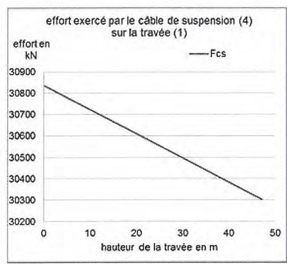

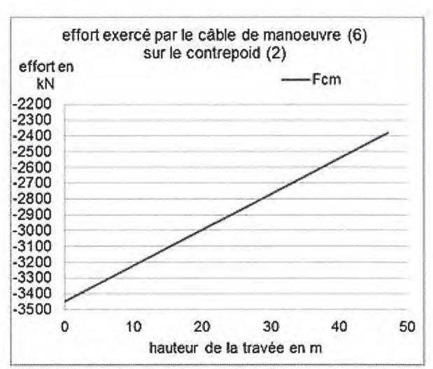

Graphique 4-6 : simulation des efforts Fcs et Fcm en fonction de la hauteur de la travée

#### Données pour la question 15 :

| données du câble de suspension (4) et du câble de manœu                         | vre (6)                   |
|---------------------------------------------------------------------------------|---------------------------|
| contrainte normale à la section du câble de suspension (4)                      | $\sigma_4$                |
| contrainte normale à la section du câble de manœuvre (6)                        | $\sigma_6$                |
| limite élastique des câbles                                                     | R e = 1200 MPa |
| diamètre des brins des câbles                                                   | $D_c = 76 \text{ mm}$     |
| coefficient de sécurité                                                         | K = 5                     |
| nombre de brins du câble de suspension (4) pour le système de levage équivalent | N s = 40       |
| nombre de brins du câble de manœuvre (6) pour le système de levage équivalent   | $N_{ma} = 4$              |

Question 15 : à partir des tensions exercées sur les câbles de suspension (4) et les câbles de manœuvre (6) lors de la phase d'accélération, calculer les contraintes  $\sigma_4$  et  $\sigma_6$  soumises respectivement à ces câbles. Vérifier que ces câbles résistent aux tensions qui leur sont appliquées sans subir de déformation permanente en prenant en compte le coefficient de sécurité K.

## 4.3. Chaine d'énergie du système de manœuvre de la travée

Objectif: exprimer le couple du moteur d'entrainement (9) en fonction des paramètres de la chaine d'énergie de manœuvre de la travée et des efforts exercés sur le câble de manœuvre (6).

L'étude se fera en phase de levée. Le pont est constitué de deux chaines d'énergies de manœuvre (voir figure 3-1, figure 3-2 et figure 4-7) relatives au levage (et descente) de la travée comprenant chacune :

- un moteur d'entrainement (9);
- un réducteur primaire (10);
- deux réducteurs secondaires (11) ;
- deux tambours d'entrainement (5).

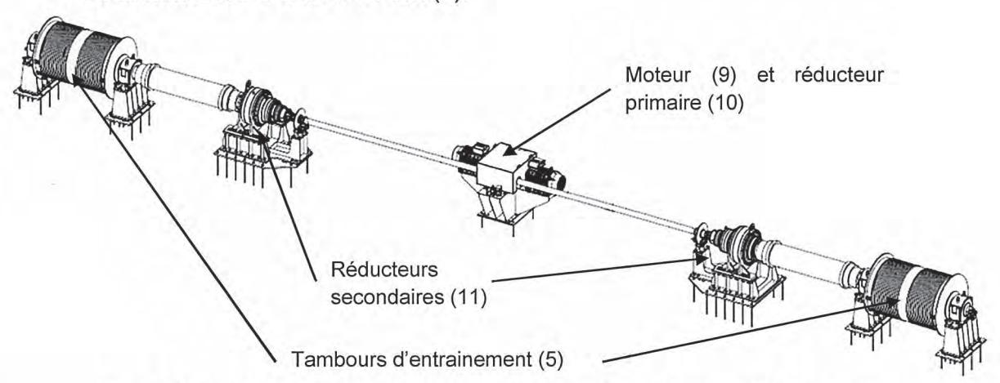

Figure 4-7 : une chaine d'énergie de manœuvre relative au levage (et descente) de la travée Données pour les questions 16 et 17 :

| chaine d'énergie de manœuvre                                  |                                                 |
|---------------------------------------------------------------|-------------------------------------------------|
| valeurs numériques sur le document technique D                | OT 4                                            |
| vitesse maximale de la travée (1) en phase de levée           | $V_{max} = 0.074 \text{ m} \cdot \text{s}^{-1}$ |
| diamètre du tambour d'entrainement (5)                        | $D_t$                                           |
| rendement total dû au fléchissement du câble de manœuvre (6)  | $ \eta_c = 0.98 $                               |
| rendement d'un tambour (5) de la chaine d'énergie de manœuvre | Ŋt                                              |
| rapport de réduction du réducteur secondaire (11)             | R 2                                  |
| rendement total du réducteur secondaire (11)                  | $\eta_{R2}$                                     |
| rapport de réduction du réducteur primaire (10)               | R 1                                  |
| rendement total du réducteur primaire (10)                    | $\eta_{R1}$                                     |
| fréquence de rotation du moteur (9)                           | N m                                  |
| facteur de surdimensionnement de la chaine d'énergie          | f = 1,16                                        |

**Question 16 :** à partir de la vitesse maximale de la travée (1) et de la fréquence de rotation du moteur (9), **calculer** le rapport de réduction total,  $R_{tot}$ , de la chaine d'énergie du système de manœuvre de la travée. **Calculer** le rapport de réduction,  $R_2$ , du réducteur secondaire (11).

**Question 17:** à partir des données de la chaine d'énergie du système de manœuvre, **calculer** le rendement total,  $\eta_{tot}$ , de cette chaine d'énergie.

Pour la suite de l'étude, on utilise les données suivantes :

- rapport de réduction du réducteur secondaire (11)  $R_2 = \frac{1}{60}$ ;
- rendement total d'une chaine d'énergie du système de manœuvre  $\Omega_{tot}$  = 0,88 ;
- l'effort total du câble de manœuvre (6) sur la masse équivalente du contrepoid (2) est modélisé par une force  $\vec{F}_{cm} = F_{cm} \vec{y}$ ;
- le pont est constitué de deux chaines d'énergies de manœuvre identiques.

**Question 18: exprimer**  $C_m$ , le couple moteur (9), en fonction de  $F_{cm}$ ,  $D_t$ ,  $R_{tot}$ ,  $R_{tot}$  et f.

# 4.4. Moteur d'entrainement (9)

Objectif : choisir le moteur d'entrainement (9) répondant aux conditions d'utilisations du cahier des charges.

L'étude est réalisée en début de levage avec un vent descendant. Les conditions d'utilisation du moteur d'entrainement (9) établies dans le cahier des charges du cabinet d'architecte sont :

- condition 1, le couple utile maximal du moteur d'entrainement (9)  $C_{mmax}$  est estimé à 200% de son couple nominal dans le cas d'un vent à l'état limite de service (ELS);
- condition 2, le couple nominal du moteur d'entrainement (9)  $C_{mn}$  correspond à son couple nominal sans le coefficient de surdimensionnement f dans le cas d'un vent à l'état limite de service (ELS).

Les différents efforts supportés par les câbles de manœuvre (6) pour différents états du vent sont les suivants.

| Effort total des câbles de manœuvre (6) sur les contrepoids (2) $F_{cm}$ en kN |        | Vent de levage Vitesse du vent 12 m⋅s -1 |        |
|--------------------------------------------------------------------------------|--------|--------------------------------------------------------|--------|
|                                                                                |        |                                                        |        |
|                                                                                |        | Vent ascendant                                         | ELS    |
| ELU                                                                            | 3292,8 |                                                        | 2517,8 |
| Vent descendant                                                                | ELS    | 3116,2                                                 | 2606,1 |
|                                                                                | ELU    | 3675,4                                                 | 2920   |

Figure 4-8 : effort total supporté par les câbles de manœuvre (6) en fonction des différents états du vent sur la travée (1)

**Question 19 : calculer** le couple moteur utile maximal répondant à la condition 1. Parmi les moteurs proposés dans le document technique DT5, **donner** les moteurs répondant à l'exigence de la condition 1.

**Question 20 : calculer** le couple moteur nominal répondant à la condition 2. Parmi les moteurs proposés dans les documents techniques DT5, **donner** les moteurs répondant à l'exigence de la condition 2.

**Question 21 : conclure** quant aux choix du moteur d'entrainement (9).

### **4.5. Variateur de vitesse**

*Objectif :* choisir le variateur de vitesse répondant aux conditions d'utilisations du cahier des charges.

Indépendamment des résultats précédents, le moteur d'entrainement (9) choisi pour la suite de l'étude sera le moteur WEG 132 kW du document technique DT5.

Le choix du variateur s'appuie sur le courant fourni par celui-ci. Ce courant devra être au moins égal au courant nécessaire au moteur au moment du couple de charge maximum.

Le couple de charge maximal *CMElu* supporté par le moteur correspond à l'état de vent descendant limite ultime (ELU), *CMElu* = 1479,7 N!m.

**Question 22 : calculer** la fréquence de rotation du champ tournant du moteur choisi par le constructeur. **Calculer** le glissement de ce moteur.

**Question 23 :** à partir du couple de charge maximal *CMElu*, **calculer** la puissance utile que devra fournir ce moteur. **Calculer** l'intensité absorbée par ce moteur.

**Question 24 :** à partir des données du document technique DT6, **conclure** quant au choix du variateur répondant à la contrainte du cahier des charges.

# **5. Commande dynamique de la travée mobile**

*Objectif : commander la travée du pont sans solliciter de vibrations dues à la flexibilité de la structure et des câbles de suspension.* 

Un essai est réalisé sur la structure en appliquant un échelon d'amplitude *h* = 20 mm . La réponse temporelle est représentée sur la figure 5-1.

**Question 25 : identifier**, à l'aide de la figure 5-1, la fonction de transfert  $T_s(p)$  associée à la réponse temporelle liant la hauteur réelle  $h_s(t)$  de la travée et la hauteur indiquée par les capteurs h(t) et **déterminer** les valeurs numériques de la période  $T_0$ , du gain statique k ainsi que du facteur d'amortissement  $\xi$ .

$$T_s(p) = \frac{h_s(p)}{h(p)} = \frac{\omega_0^2}{p^2 + 2 \cdot \xi \cdot \omega_0 \cdot p + \omega_0^2}.$$

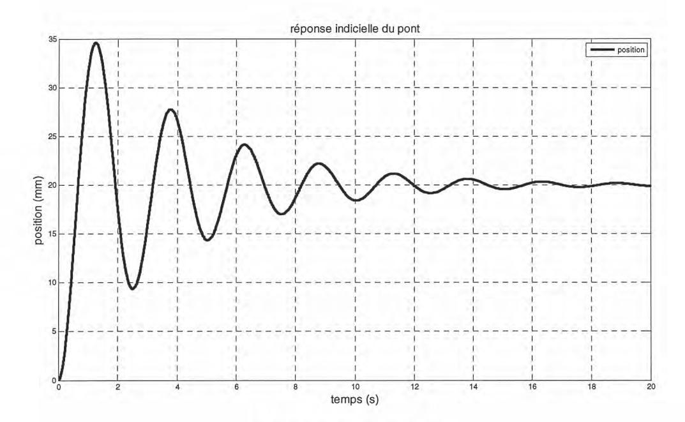

Figure 5-1: essai vibrations

La travée doit monter sur une hauteur de  $H_{max}$  = 47,166 m, la phase d'accélération a une durée de  $T_f$  = 10 s, cette durée est identique pour le freinage. Le temps de manœuvre de la position basse à la position haute est de  $T_{max}$  = 11 min. Il est indispensable d'éviter les vibrations dues à une commande trop brutale. Pour éviter les vibrations de la travée, nous sommes contraints d'imposer la trajectoire de la travée, c'est-à-dire de contrôler l'accélération du mouvement d'élévation et de descente.

**Question 26 :** compte tenu des valeurs imposées par le constructeur, **donner** sur la figure 5-2a, 5-2b et 5-2c du document réponse DR1, les profils de l'accélération, de la vitesse et de l'élévation de la travée.

La commande de la travée va se faire à partir d'une trajectoire imposée par l'accélération. Pour mettre en place l'algorithme de l'asservissement de position de la hauteur de la travée, il est nécessaire d'établir les fonctions de transfert des différents constituants de la chaîne d'énergie.

On suppose qu'à l'échelle de temps de la trajectoire imposée, la relation entre la commande en couple des moteurs de levage et la force de levage exercée par les câbles est un gain pur de valeur  $C_V$ . Pour établir la relation entre la vitesse d'élévation de la travée V(t) et la force d'élévation exercée par les moteurs au travers

des câbles F(t), le frottement des parties mécaniques est négligé, et seule la masse de la travée est prise en compte.

Question 27: calculer la valeur de  $C_V$ , exprimer la fonction de transfert  $T_V(p) = \frac{V(p)}{F(p)}$  et exprimer  $T_P(p) = \frac{h(p)}{V(p)}$ , relation entre la vitesse V et la position de la travée h (mesurée au travers des capteurs absolus)

La commande en position est proposée sur la figure 5-3.

**Question 28 :** exprimer, à partir du schéma-bloc, la fonction de transfert  $T(p) = \frac{h(p)}{\Gamma_{ref}(p)}$  entre la position indiquée par les capteurs absolus h et l'accélération référence  $\Gamma_{ref}$ .

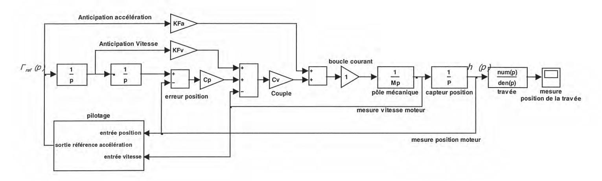

Figure 5-3 – asservissement en position du pont

On admet que pour une période d'accélération ou de freinage de l'ordre de  $T_f \ge 4 \cdot T_0$  il n'y a pas de vibration sur la travée avec :

$$T(p) = \frac{h(p)}{\Gamma_{ref}(p)} = \frac{1}{p^{2}} \cdot \frac{C_{p} \cdot C_{V} + K_{Fv} \cdot C_{V} \cdot p + K_{Fa} \cdot p^{2}}{C_{p} \cdot C_{v} + C_{V} \cdot p + M \cdot p^{2}}$$

**Question 29 : indiquer** les valeurs des coefficients *KFa* et *KFv* pour que la fonction de transfert puisse se simplifier sous la forme T  $(p) = \frac{h}{\Gamma_{ref}} \frac{(p)}{(p)} = \frac{1}{p^2}$ .

L'algorithme du pilotage de l'accélération est représenté à la figure 5-6, les organes de test sont représentés par un interrupteur à la figure 5-4 :

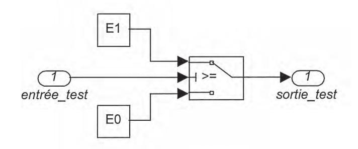

Figure 5-4 : organe de test

la sortie du test est sortie\_test = E0 si entrée\_test < 0 la sortie du test est sortie\_test = E1 si entrée\_test  $\ge 0$ 

Question 30 : expliciter le fonctionnement de l'algorithme du pilotage de l'accélération figure 5-6 à partir de l'accélération représentée sur la figure 5-5.

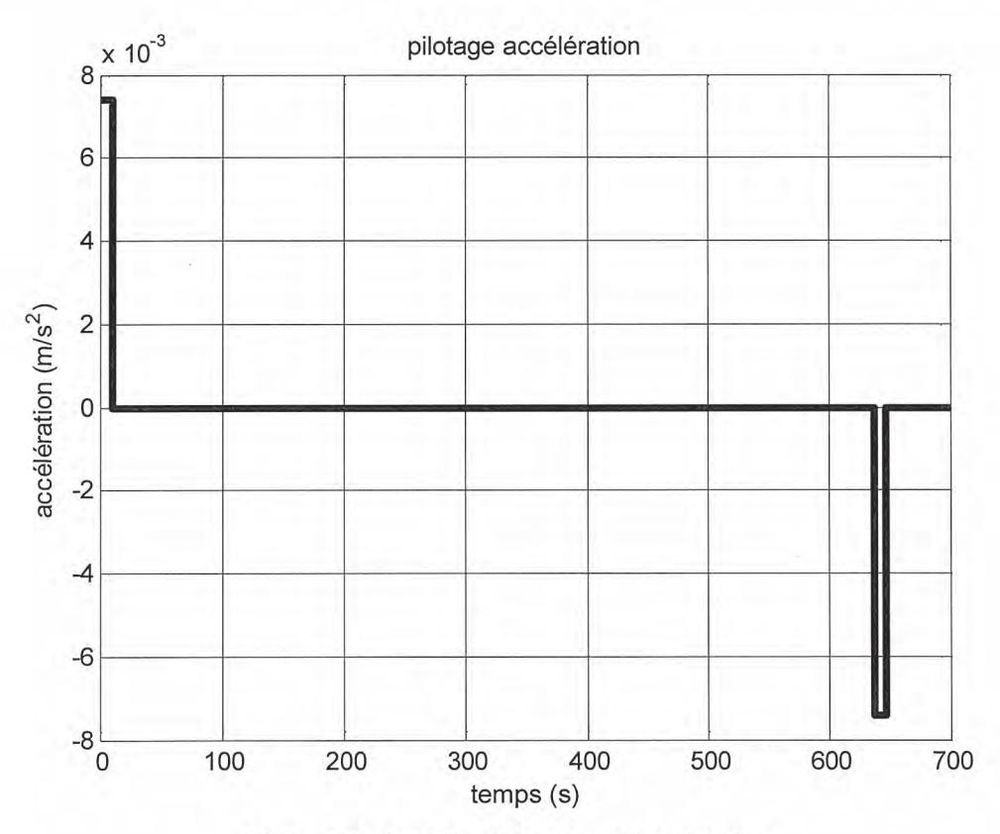

Figure 5-5 : simulation du pilotage de l'accélération

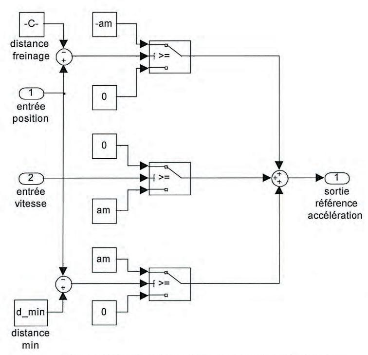

Figure 5-6 : algorithme du pilotage de l'accélération.

#### 6. Codeur absolu multitours

Objectif: analyser le guidage travée – pylônes et vérifier la résolution du codeur gérant l'altitude des quatre coins de la travée afin de contrôler la montée de la travée en évitant un décalage d'altitude des quatre coins de celle-ci.

## 6.1. Analyse du guidage

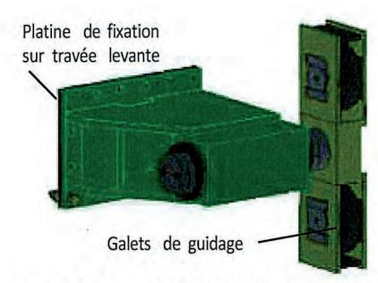

Figure 6-1: guidage longitudinal

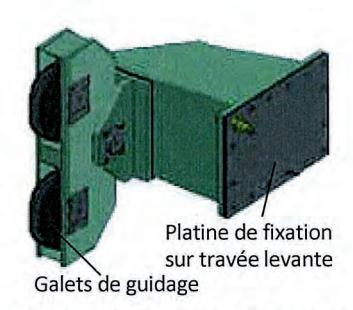

Figure 6-2: guidage transversal

La travée (1) est positionnée lors de ses mouvements par des guidages transversaux et longitudinaux représentés figures 6-1, 6-2 et 6-3.

Les guidages sont répartis de la manière suivante (figure 6-3) :

— dans le pylône 1 aval (P1) présence d'un unique guidage longitudinal ;

- dans le pylône 2 amont (P2) présence d'un guidage longitudinal et d'un guidage transversal;
- dans le pylône 3 aval (P3) absence de guidage ;
- dans le pylône 4 amont (P4) présence d'un unique guidage transversal ;
- les contacts entre les roues 10a et 11a et les rails de guidage ou les surfaces sont modélisées par des liaisons ponctuelles parfaites.

Question 31 : à partir des figure 6-1, figure 6-2, et figure 6-3, proposer une liaison modélisant les guidages de la travée réalisés pour chaque pylône (1, 2 et 4). En déduire la liaison équivalente liant la travée à l'ensemble des pylônes. Justifier l'absence de guidage entre la travée et le pylône 3 aval (P3) en vous appuyant sur une étude succincte de l'isosatisme ou de l'hyperstatisme de la liaison équivalente entre la travée et les pylônes.

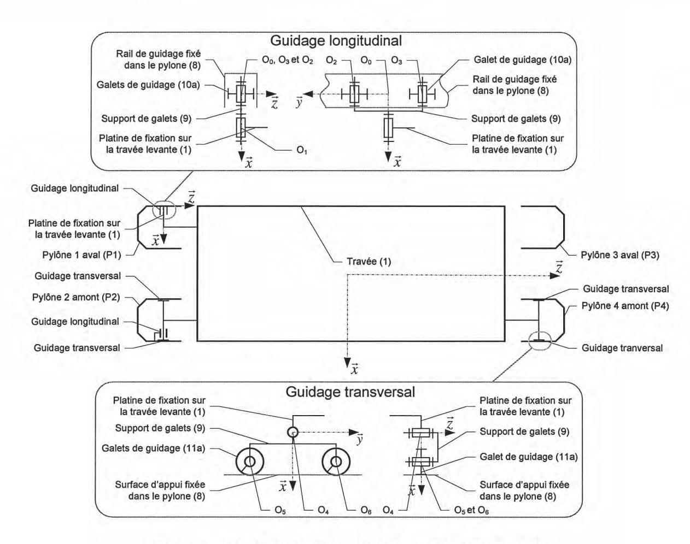

Figure 6-3 : représentation du guidage de la travée par les pylônes

# 6.2. Vérification de la précision du codeur

Quatre codeurs absolus multitours série MHM5 sont disposés sur les quatre poulies principales (3) en interface avec la travée levante permettant de mesurer directement l'altitude de chacun des quatre coins de la travée.

Ce système permet de mesurer en permanence la position de la travée afin de la maintenir sur un plan horizontal durant son déplacement.

Les seuils d'inclinaison déclenchant les sécurités de l'ouvrage sont de 0,2° lors d'un arrêt normal (niveau 1) et de 0,27° lors d'un arrêt de sécurité (niveau 4).

Données pour les questions 32 et 33 :

| résolution du codeur             | 13 bits |
|----------------------------------|---------|
| diamètre des poulies principales | 4 m     |
| longueur de la travée            | 117 m   |
| hauteur de levée de la travée    | 47,17 m |

Question 32 : calculer le défaut d'altitude de la travée pour les deux seuils d'inclinaison. Exprimer la conséquence d'un décalage d'altitude des quatre coins de la travée sur le levage du pont.

Question 33 : calculer la résolution minimale du codeur afin de détecter un défaut d'altitude de 400 mm. Calculer le nombre minimal de tours du codeur pour contrôler la hauteur de la levée. Valider le codeur choisi par le constructeur en fonction des données du document technique DT7.

# 7. Communication entre les éléments pour la levée du pont

La fiabilité des informations repose sur la connaissance en temps réel de la position de la travée levante lors de la phase de montée. L'automate programmable industriel de levée (APIL) compare les informations des codeurs situés sur les tambours d'entrainement (5) et des codeurs situés sur les poulies principales (3) de la travée pour en déduire la hauteur instantanée.

Les choix des composants et leur architecture assurent la fiabilité des informations et leur authenticité.

#### 7.1. Le codeur BEI DEACOD

Objectif: vérifier la fiabilité des informations issues des codeurs tambours d'entrainement (5) et des poulies principales (3) au poste de commande pour ne pas confondre une erreur du système de mesure avec un défaut sur la levée du pont.

Les codeurs PHU9 utilisés sur les tambours sont montés en prise directement sur le tambour d'entrainement (5). Le codeur doit être capable de mesurer 1 mm de déplacement de la travée.

Question 34 : à l'aide du document technique DT7, déterminer la précision minimale et donc le nombre de pistes que doit avoir le codeur fixé sur le tambour. Justifier le choix du constructeur en donnant la précision du codeur du constructeur.

Un message d'alerte est envoyé au conducteur lorsque sur un même pylône il y a un écart de plus de 800 mm entre les informations données par le codeur de poulie

principale (3) et le codeur de tambours d'entrainement (5). À chaque message d'alerte, le conducteur immobilise le pont. Pour des questions de sécurité, les deux codeurs commencent leur incrémentation à 10 tours, soit à l'impulsion 81 920.

Question 35: le codeur de poulie envoie une impulsion de valeur 100 352 à l'automate programmable de commande. Calculer la hauteur du pont pour cette valeur. Sachant qu'au même moment le codeur tambour envoie la valeur 100 570. Déterminer l'action du conducteur.

Les informations issues des codeurs sont envoyées à l'automate programmable industriel de levée (APIL) avec le protocole CANopen qui se situe en couche 7 « application » dans l'architecture des couches.

Une trame de communication du codeur après une écoute sur le réseau secondaire a été extraite lors des essais du pont. Le protocole est décrit en annexe dans le document technique DT8.

| 0000 | 02 | 1a | 11 | f5 | 86 | 67 | e8 | 39 | df | 93 | 1c | c2 | 80 | 00 | 45 | 00 | g.9     | E.       |
|------|----|----|----|----|----|----|----|----|----|----|----|----|----|----|----|----|---------|----------|
| 0010 | 00 | 2a | bf | 4c | 00 | 00 | 80 | 01 | 20 | fb | ac | 1c | 01 | 13 | ac | 1c | .*.L    |          |
| 0020 | 01 | 40 | 80 | 00 | a8 | 88 | b9 | 48 | ae | 3b | 43 | 41 | 50 | 45 | 54 | 5f | .@H     | .;CAPET_ |
| 0030 | 53 | 49 | 49 | 5F | 32 | 30 | 31 | 34 |    |    |    |    |    |    |    |    | SII_201 | 4        |

Figure 7-1 : extrait de trame Ethernet

Question 36 : retrouver, grâce à la trame de la figure 7-1, à partir de quel élément a été réalisé la requête et donner l'information recherchée. Donner le type IP de la trame Ethernet 2. Vérifier que la longueur du datagramm IP de la trame correspond à celui inscrit dans la trame.

Question 37 : énumérer les paramètres qui seraient modifiés si l'on lisait les données sur le réseau principal et non plus sur le réseau redondant. Justifier l'utilisation d'un réseau redondant.

Le réseau redondant est lu et utilisé en même temps que le réseau principal, mais avec un temps de décalage dû au temps de transport de l'information. Un mauvais choix technique peut mettre le pont en défaut.

#### Données pour la question 38 :

| vitesse de transmission dans la fibre optique             | 3·10 8 m·s -1               |
|-----------------------------------------------------------|---------------------------------------------------|
| vitesse de transmission dans le cuivre                    | 2,26·10 8 m·s -1            |
| débit moyen de la fibre optique                           | $D_{fibre} = 1000 \text{ Mb} \cdot \text{s}^{-1}$ |
| débit moyen un réseau cuivré composé d'une paire torsadée | D cuivre = 2 Mb·s -1        |
| distance entre les deux automates de gestion APIG         | 550 m                                             |

Question 38 : déterminer les durées nécessaires pour recevoir, à l'extrémité du câble, le dernier octet d'un paquet de 256 octets dans un câble en fibre optique et dans un câble en cuivre torsadé. On néglige la perte de débit due à la longueur des câbles. Comparer les résultats obtenus et justifier l'utilisation de la fibre optique en fonction des résultats obtenus avec l'utilisation paramétrée sur les codeurs.

#### 7.2. Le réseau de communication

Objectif : vérifier que la structure du réseau est adaptée à la manœuvre de la travée.

La communication entre chaque élément du système est gérée avec un réseau local. Le réseau possède trois types de supports de transmission qui sont la fibre optique, les câbles Ethernet et les câbles cuivres CanOpen.

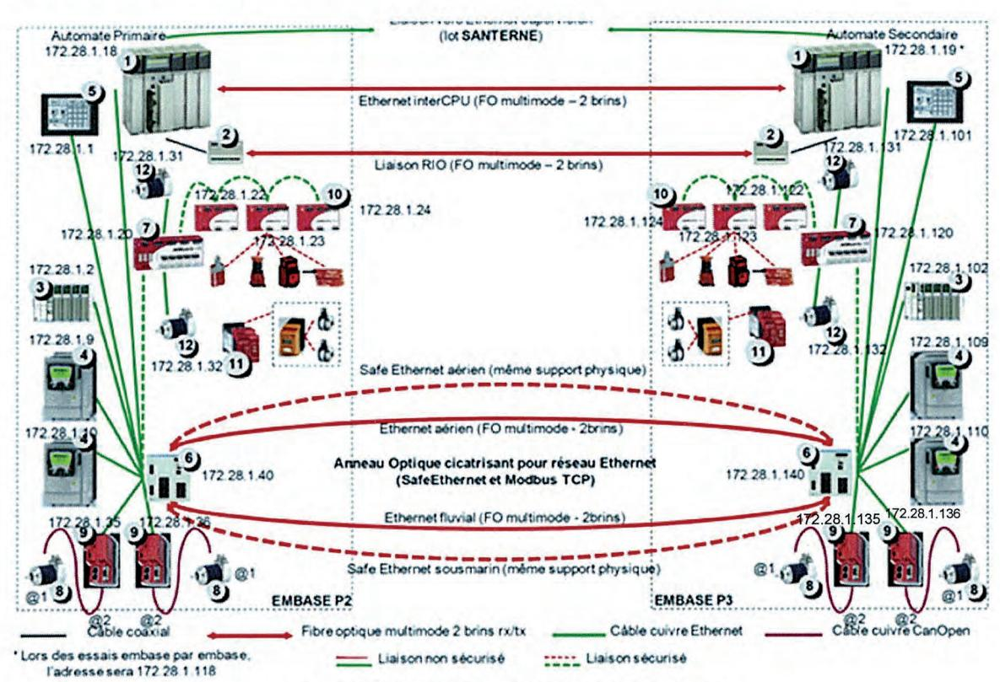

Figure 7-2 : structure du réseau de levée du pont

| détail des élér                    | nents de la figure 7-2          |  |  |
|------------------------------------|---------------------------------|--|--|
| 1- API redondant                   | 7- automates de sécurité        |  |  |
| 2- convertisseur coaxial / optique | 8- codeurs absolus multitours   |  |  |
| 3- ilot E/S TOR 5 (tout ou rien)   | 9- passerelle Ethernet/CANopen  |  |  |
| 4- variateur de vitesse asynchrone | 10- module d'extension E/S      |  |  |
| 5- terminal graphique tactile      | 11- module de sécurité Préventa |  |  |
| 6- switch                          | 12- codeurs absolus multitours  |  |  |

Question 39 : comparer les trois types de supports de transmission, représenté figure 7-2, en termes de vitesse de transmission, de facilité de mise en œuvre dans le cadre d'un usage de cet ouvrage d'art.

Question 40 : à l'aide de la structure du réseau de la figure 7-2, déterminer le nombre de machines connectées au travers du réseau. Donner le nombre maximal de machines pouvant être gérées par ce réseau et valider le dimensionnement du réseau pour cette utilisation.

# 8. L'influence des utilisateurs sur le pont

La sollicitation quotidienne de la travée et les conséquences d'une rupture de celle-ci amènent le concepteur à comparer différents modèles de calculs et de vérifier que la travée résiste aux sollicitations sans subir de déformations permanentes.

Objectif : vérifier la résistance de la travée levante en comparant deux modèles de calculs avec le gabarit de limite élastique de la structure.

Lors de la mise en service du pont, la travée est soumise aux actions mécaniques associées à la foule et au trafic routier. Afin d'éviter un effondrement du pont, le bureau d'étude a réalisé plusieurs simulations.

Pour définir les charges à appliquer sur la travée, le bureau d'étude s'est appuyé sur la norme expérimentale P06-103 d'octobre 1997 de l'eurocode 1 et en particulier sur la partie 3 (charges sur les ponts dues au trafic).

#### 8.1. Modélisation de la foule et du trafic routier

#### Modèle de calcul n°1

Lorsque le pont est en position basse, la travée du pont repose sur quatre appuis sur les deux embases :

- deux appuis fixes sur l'embase de gauche permettant un degré de liberté dans le sens transversal;
- deux appuis mobiles sur l'embase de droite permettant un degré de liberté dans le sens longitudinal et dans le sens transversal; la travée est soumise aux actions mécaniques associées à la foule et au trafic routier uniformément réparties sur toute sa longueur.

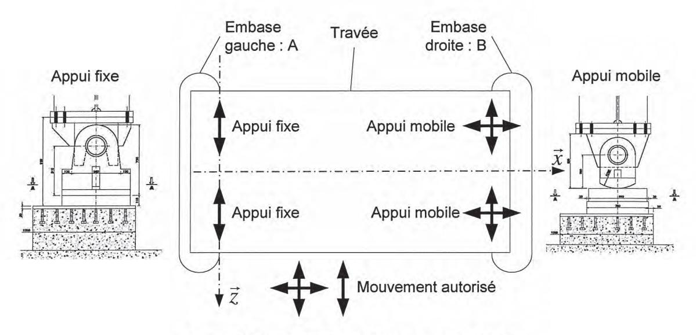

Figure 8-1 positionnements des appuis sur la travée

Question 41 : donner et justifier les hypothèses permettant de réduire ce problème à 2 dimensions. Réaliser un schéma modélisant la travée, les charges appliquées sur celle-ci et ses appuis sur les deux embases. L'appui de gauche sera noté A et celui de droite B.

#### Hypothèse de l'étude :

- la travée est considérée comme une poutre d'une longueur de 117 m ;
- la section de la poutre est une section pleine rectangulaire.

#### Données:

| masse linéique de la travée levante            | 24,359·10 3 kg·m -1 |  |  |
|------------------------------------------------|-------------------------------------------|--|--|
| masse linéique des utilisateurs et intempéries | 1800 kg·m -1                   |  |  |
| longueur de la travée                          | 117 m                                     |  |  |
| largeur de la travée b                         | 27 m                                      |  |  |
| hauteur de la travée $h_t$                     | 6,5 m                                     |  |  |
| $\sigma_{max}$                                 | $\frac{6 \cdot Mf_{max}}{b \cdot h_t^2}$  |  |  |

**Question 42 :** à partir des données précédentes, **calculer** la charge répartie équivalente  $q_{eq}$  (en kg·m-1) sur la travée levante, en **déduire** q en N·m-1 le poids équivalent de la travée.

Question 43: déterminer les expressions du moment fléchissant  $M_{fz}(x)$  et de la contrainte  $\sigma$  le long de la poutre AB. **Tracer** les diagrammes du moment fléchissant  $M_{fz}(x)$  et de la contrainte  $\sigma$  le long de la poutre AB et donner les valeurs remarquables de ces grandeurs. **Déterminer** la contrainte normale maximale  $\sigma_{max}$ .

#### Modèle de calcul n°2

#### Hypothèse de l'étude :

- la travée est considérée comme un assemblage d'excentrements rigides, de barres et de nœuds comme indiqué sur la figure 8-2;
- chaque barre est considérée comme un caisson ;
- la travée est décomposée en 20 caissons de taille identique.

#### Donnée pour la question 45 :

| résistance élastique (Rpe) | 375 MPa |  |
|----------------------------|---------|--|
|----------------------------|---------|--|

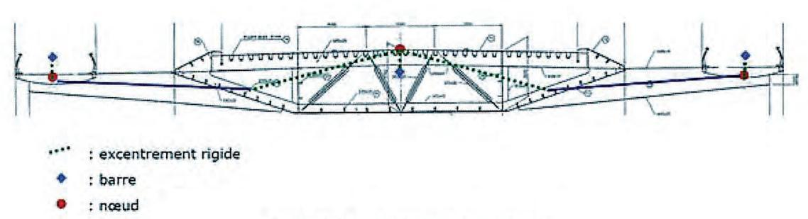

Figure 8-2: modélisation d'un caisson

Une modélisation de la structure du pont au plus proche du réel a permis d'obtenir la courbe de contrainte de la travée de la figure 8-3.

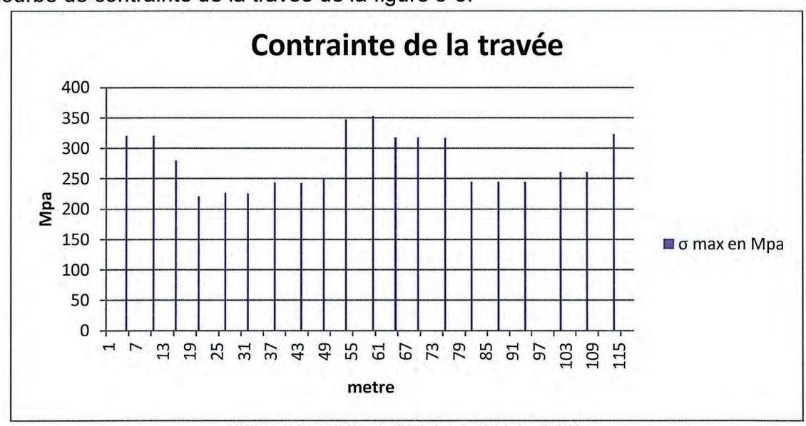

Figure 8-3: courbe réalisée par le bureau d'étude

Question 44 : comparer et interpréter les courbes de la contrainte normale par rapport aux hypothèses des deux cas. Conclure quant au choix du modèle pour la suite de l'étude.

On choisit le modèle de calcul n°2.

**Question 45 : comparer** le modèle simulé à la résistance élastique  $R_{pe}$  et **conclure** sur la résistance de la travée levante.

#### 9. Conclusion générale

Données pour la question 46 :

| gain kilométrique des automobilistes par an                              | 29 millions km·an -1 |
|--------------------------------------------------------------------------|---------------------------------|
| émission de CO 2 d'une voiture                                | 130 g·km -1          |
| production de CO 2 pour 1 kW·h d'énergie électrique consommée | 0,09 kg de CO 2      |
| consommation électrique annuelle due à la manœuvre du pont               | 309 kW·h                        |

Question 46 : comparer la réduction d'émissions en CO2 des automobilistes obtenue grâce à la construction de ce pont avec l'équivalent en CO2 de la consommation électrique due à la manœuvre du pont. À l'aide de l'étude réalisée et sans tenir compte du bilan carbone lié à la construction, proposer des éléments permettant d'affiner le bilan carbone de cet ouvrage.

Question 47 : à partir de l'étude réalisée, exprimer la pertinence d'un pont à travée levante en fonction de la fréquence d'utilisation du système de levage.

# **DOCUMENTS TECHNIQUES**

# Document technique DT1 : diagramme de séquence « montée de la travée »

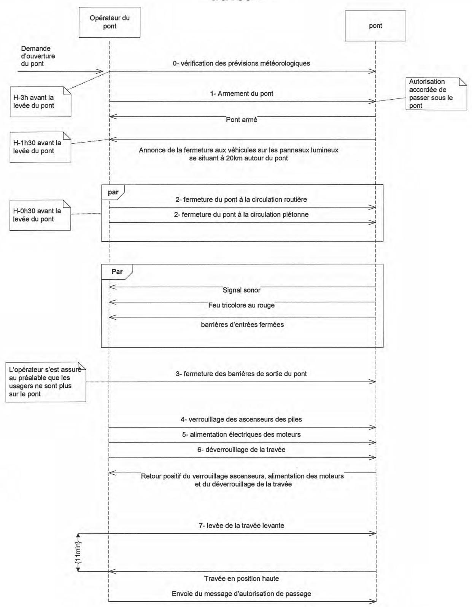

Lexique : L'armement du pont est la mise en énergie des différents systèmes permettant sa manœuvre.

# Document technique DT2 : solution n°1, système de levage à brin unique et à double entrainement

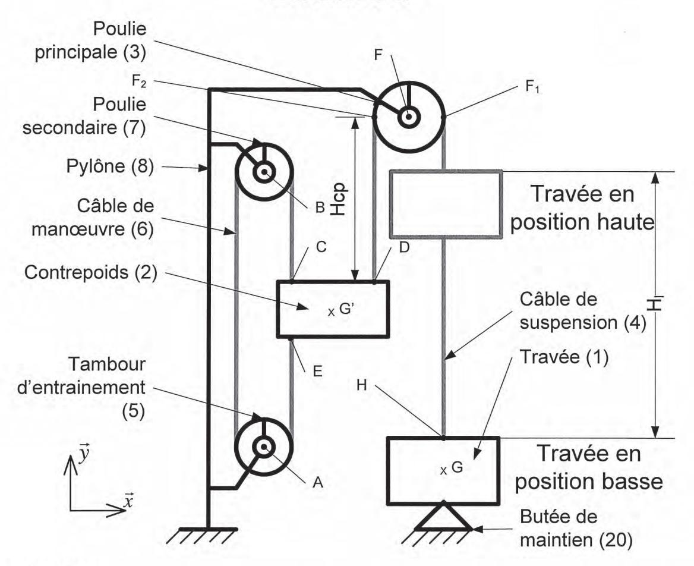

#### **Descriptions:**

- la poulie secondaire (7) et le pylône (8) sont en liaison pivot parfaite d'axe  $(B,\vec{z})$ ;
- le tambour d'entrainement (5) et le pylône (8) sont en liaison pivot parfaite d'axe  $(A,\vec{z})$ ;
- la poulie (3) et le pylône (8) sont en liaison pivot parfaite d'axe  $(F, \vec{z})$ ;
- le câble de suspension (4) est en liaison complète au point D avec le contrepoids (2) et au point H avec la travée (1);
- le câble de manœuvre (6) est en liaison complète aux points C et E avec le contrepoids (2).

# Document technique DT3 : solution n°2, système de levage à deux brins et simple entrainement

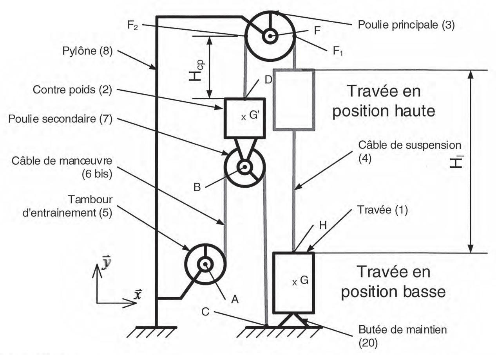

#### **Description:**

- la poulie secondaire (7) et le contre poids (2) sont en liaison pivot parfaite d'axe  $(B,\vec{z})$ ;
- le tambour d'entrainement (5) et le pylône (8) sont en liaison pivot parfaite d'axe  $(A,\vec{z})$ ;
- la poulie (3) et le pylône (8) sont en liaison pivot parfaite d'axe  $(F, \vec{z})$ ;
- le câble de suspension (4) est en liaison complète au point D avec le contrepoids (2) et au point H avec la travée (1);
- le câble de manœuvre à deux brins (6 bis) est en liaison rotule de centre C avec le pylône (8).

# Document technique DT4 : diagramme de bloc interne d'une des deux chaines d'énergie de manoeuvre

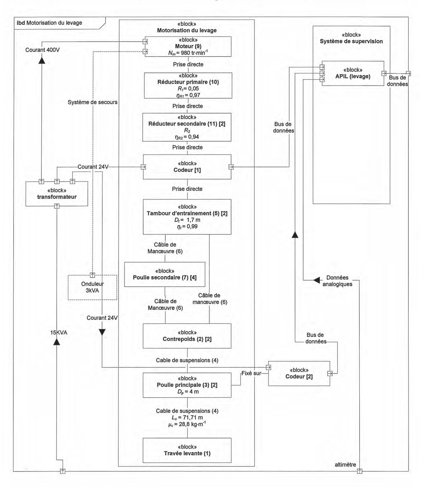

# **Document technique DT5: Moteur**

| Characte  | eristic |                                                                                                                                                                                                                                                                                                                                                                     |                  | шед     |         |  |
|-----------|---------|---------------------------------------------------------------------------------------------------------------------------------------------------------------------------------------------------------------------------------------------------------------------------------------------------------------------------------------------------------------------|------------------|---------|---------|--|
|           |         | Moteur 110                                                                                                                                                                                                                                                                                                                                                          | kW               |         |         |  |
|           |         | <ul> <li>Output: 110 kW</li> <li>Poles: 6</li> <li>Frequency: 50 Hz</li> <li>Torque: 1067 Nm</li> <li>Voltage: 380/660 V</li> <li>Frame: 315S/M</li> <li>RPM: 985</li> <li>In: 208/120 A</li> <li>Efficiency (100%): 9</li> <li>Power factor (100%)</li> <li>Insulation: F</li> <li>Noise: 69 dB(A)</li> <li>No load current: 75.0</li> <li>Il / In: 6.4</li> </ul> | 4.3 : 0.85    |         |         |  |
| Output HP | Frame   | In (A)                                                                                                                                                                                                                                                                                                                                                              | Il / In          | Cp / Cn | Cm / Cn |  |
| 110 kW    | 315S/M  | 380/660 V 208/120 A                                                                                                                                                                                                                                                                                                                                              | 6.4              | 210 %   | 220 %   |  |
|           |         | <ul> <li>Voltage: 380/660 °</li> <li>Frame: 3155/M</li> <li>RPM: 980</li> <li>In: 247/142 A</li> <li>Efficiency (100%): 9</li> <li>Power factor (100%</li> <li>Insulation: F</li> <li>Noise: 69 dB(A)</li> <li>No load current: 95</li> <li>Il / In: 6.3</li> </ul>                                                                                                 | 94.4 ·): 0.86 |         |         |  |
| Output HP | Frame   | In (A) 380/660 V                                                                                                                                                                                                                                                                                                                                                 | II / In          | Cp / Cn | Cm / Cı |  |
| 132 kW    | 315S/M  | 247/142 A                                                                                                                                                                                                                                                                                                                                                           | 6.3              | 190 %   | 200 %   |  |
|           |         | Moteur 160  Output: 160 kW  Poles: 6  Frequency: 50 Hz  Torque: 1544 Nm  Voltage: 380/660 V  Frame: 355M/L  RPM: 990                                                                                                                                                                                                                                                |                  |         |         |  |
|           |         | <ul> <li>In: 304/175 A</li> <li>Efficiency (100%): S</li> <li>Power factor (100%)</li> <li>Insulation: F</li> <li>Noise: 73 dB(A)</li> <li>No load current: 11</li> </ul>                                                                                                                                                                                           | ); 0.84          |         |         |  |
| Output HP | Frame   | <ul> <li>Efficiency (100%): \$</li> <li>Power factor (100%)</li> <li>Insulation: F</li> <li>Noise: 73 dB(A)</li> </ul>                                                                                                                                                                                                                                              | ); 0.84          | Cp / Cn | Cm / Cn |  |

# Document technique DT6: variateur Altivar 71

| Données techniques pour les armoires ATV Type          | ATV71EX++ D90N4     | C11N4           |  |  |  |  |
|-----------------------------------------------------------|------------------------|-----------------|--|--|--|--|
| Dispositif standard intégré                               | ATV71HD90N4            | ATV71HC11N4     |  |  |  |  |
| Données nominales                                         |                        |                 |  |  |  |  |
| Puissance moteur                                          |                        |                 |  |  |  |  |
| $P_N[kW]$ $U_N = 400 \text{ V}$                           | 90                     | 110             |  |  |  |  |
| Courant de sortie continu                                 |                        |                 |  |  |  |  |
| $I_N[A]$ $U_N = 400 \text{ V}$                            | 179                    | 215             |  |  |  |  |
| Courant maximum pendant 60 s toutes les 10 min            |                        |                 |  |  |  |  |
| I exx [A] U ii = 400 V              | 269                    | 323             |  |  |  |  |
| Entrée                                                    |                        |                 |  |  |  |  |
| Courant d'entrée                                          |                        | •               |  |  |  |  |
| $I_{\text{DATRCE}}[A]$ $U_{\text{N}} = 400 \text{ V}$     | 159                    | 194             |  |  |  |  |
| Puissance apparente continue                              |                        |                 |  |  |  |  |
| $S_N[kVA]$ $U_N = 400 V$                                  | 109                    | 133             |  |  |  |  |
| Résistance de freinage externe                            |                        |                 |  |  |  |  |
| Pcox/Puux [kW]                                            | 70/135                 | 85/165          |  |  |  |  |
| $R_{MN}[\Omega]$                                          | 2,5                    | 2,1             |  |  |  |  |
| Caractéristiques                                          | · Propose              |                 |  |  |  |  |
| Efficacité (%)                                            | ≥ 97,0                 | ≥ 97,0          |  |  |  |  |
| Pertes de puissance [W] à l.,                             | 2590                   | 2950            |  |  |  |  |
| Masse nette/brute [kg]                                    |                        |                 |  |  |  |  |
| ATV71EXC2+++N4                                            | 275/315                | 275/315         |  |  |  |  |
| ATV71EXC5***N4                                            | 285/325                | 285/325         |  |  |  |  |
| ATV71EXS5•••N4                                            | 270/310                | 270/310         |  |  |  |  |
| Conditions ambiantes                                      | NAME OF TAXABLE PARTY. |                 |  |  |  |  |
| Volume d'air de refroidissement [m³/h] EXC2 / EXC5 / EXS  |                        | 600 / 600 / 700 |  |  |  |  |
| Niveau de pression sonore [dB(A)] EXC2 / EXC5 / EXS       | 64 / 65 / 64           | 64 / 65 / 64    |  |  |  |  |
| Courant de court-circuit réseau [kA] ") EXC2 / EXC5 / EXS | 100 / 100 / 50         | 100 / 100 / 50  |  |  |  |  |

η ... Ces valeurs sont uniquement valides si le dispositif est équipé de fusibles d'entrée, voir le chapitre « Fusibles et sections de câble ».

| Туре                                                 | ATV71EX++ C13N4                                                                                                                                                                                                                                                                                                                                                                                                                                                                                                                                                                                                                                                                                                                                                                                                                                                                                                                                                                                                                                                                                                                                                                                                                                                                                                                                                                                                                                                                                                                                                                                                                                                                                                                                                                                                                                                                                                                                                                                                                                                                                                             | C16N4           |
|------------------------------------------------------|--------------------------------------------------------------------------------------------------------------------------------------------------------------------------------------------------------------------------------------------------------------------------------------------------------------------------------------------------------------------------------------------------------------------------------------------------------------------------------------------------------------------------------------------------------------------------------------------------------------------------------------------------------------------------------------------------------------------------------------------------------------------------------------------------------------------------------------------------------------------------------------------------------------------------------------------------------------------------------------------------------------------------------------------------------------------------------------------------------------------------------------------------------------------------------------------------------------------------------------------------------------------------------------------------------------------------------------------------------------------------------------------------------------------------------------------------------------------------------------------------------------------------------------------------------------------------------------------------------------------------------------------------------------------------------------------------------------------------------------------------------------------------------------------------------------------------------------------------------------------------------------------------------------------------------------------------------------------------------------------------------------------------------------------------------------------------------------------------------------------------------|-----------------|
| Dispositif standard intégré                          | ATV71HC13N4                                                                                                                                                                                                                                                                                                                                                                                                                                                                                                                                                                                                                                                                                                                                                                                                                                                                                                                                                                                                                                                                                                                                                                                                                                                                                                                                                                                                                                                                                                                                                                                                                                                                                                                                                                                                                                                                                                                                                                                                                                                                                                                    | ATV71HC16N4     |
| Données nominales                                    |                                                                                                                                                                                                                                                                                                                                                                                                                                                                                                                                                                                                                                                                                                                                                                                                                                                                                                                                                                                                                                                                                                                                                                                                                                                                                                                                                                                                                                                                                                                                                                                                                                                                                                                                                                                                                                                                                                                                                                                                                                                                                                                                |                 |
| Puissance moteur                                     |                                                                                                                                                                                                                                                                                                                                                                                                                                                                                                                                                                                                                                                                                                                                                                                                                                                                                                                                                                                                                                                                                                                                                                                                                                                                                                                                                                                                                                                                                                                                                                                                                                                                                                                                                                                                                                                                                                                                                                                                                                                                                                                                |                 |
| $P_N[kW]$ $U_N = 4$                                  | 100 V 132                                                                                                                                                                                                                                                                                                                                                                                                                                                                                                                                                                                                                                                                                                                                                                                                                                                                                                                                                                                                                                                                                                                                                                                                                                                                                                                                                                                                                                                                                                                                                                                                                                                                                                                                                                                                                                                                                                                                                                                                                                                                                                                      | 160             |
| Courant de sortie continu                            |                                                                                                                                                                                                                                                                                                                                                                                                                                                                                                                                                                                                                                                                                                                                                                                                                                                                                                                                                                                                                                                                                                                                                                                                                                                                                                                                                                                                                                                                                                                                                                                                                                                                                                                                                                                                                                                                                                                                                                                                                                                                                                                                |                 |
| 1, [A] U N = 4                            | 100 V 259                                                                                                                                                                                                                                                                                                                                                                                                                                                                                                                                                                                                                                                                                                                                                                                                                                                                                                                                                                                                                                                                                                                                                                                                                                                                                                                                                                                                                                                                                                                                                                                                                                                                                                                                                                                                                                                                                                                                                                                                                                                                                                                      | 314             |
| Courant maximum pendant 60 s toutes les 10 n         | nin                                                                                                                                                                                                                                                                                                                                                                                                                                                                                                                                                                                                                                                                                                                                                                                                                                                                                                                                                                                                                                                                                                                                                                                                                                                                                                                                                                                                                                                                                                                                                                                                                                                                                                                                                                                                                                                                                                                                                                                                                                                                                                                            |                 |
| $I_{\text{UN}}$ [A] $I_{\text{N}} = 4$               | 100 V 389                                                                                                                                                                                                                                                                                                                                                                                                                                                                                                                                                                                                                                                                                                                                                                                                                                                                                                                                                                                                                                                                                                                                                                                                                                                                                                                                                                                                                                                                                                                                                                                                                                                                                                                                                                                                                                                                                                                                                                                                                                                                                                                      | 471             |
| Entrée                                               | ASS OF THE STATE OF THE STATE OF THE STATE OF THE STATE OF THE STATE OF THE STATE OF THE STATE OF THE STATE OF THE STATE OF THE STATE OF THE STATE OF THE STATE OF THE STATE OF THE STATE OF THE STATE OF THE STATE OF THE STATE OF THE STATE OF THE STATE OF THE STATE OF THE STATE OF THE STATE OF THE STATE OF THE STATE OF THE STATE OF THE STATE OF THE STATE OF THE STATE OF THE STATE OF THE STATE OF THE STATE OF THE STATE OF THE STATE OF THE STATE OF THE STATE OF THE STATE OF THE STATE OF THE STATE OF THE STATE OF THE STATE OF THE STATE OF THE STATE OF THE STATE OF THE STATE OF THE STATE OF THE STATE OF THE STATE OF THE STATE OF THE STATE OF THE STATE OF THE STATE OF THE STATE OF THE STATE OF THE STATE OF THE STATE OF THE STATE OF THE STATE OF THE STATE OF THE STATE OF THE STATE OF THE STATE OF THE STATE OF THE STATE OF THE STATE OF THE STATE OF THE STATE OF THE STATE OF THE STATE OF THE STATE OF THE STATE OF THE STATE OF THE STATE OF THE STATE OF THE STATE OF THE STATE OF THE STATE OF THE STATE OF THE STATE OF THE STATE OF THE STATE OF THE STATE OF THE STATE OF THE STATE OF THE STATE OF THE STATE OF THE STATE OF THE STATE OF THE STATE OF THE STATE OF THE STATE OF THE STATE OF THE STATE OF THE STATE OF THE STATE OF THE STATE OF THE STATE OF THE STATE OF THE STATE OF THE STATE OF THE STATE OF THE STATE OF THE STATE OF THE STATE OF THE STATE OF THE STATE OF THE STATE OF THE STATE OF THE STATE OF THE STATE OF THE STATE OF THE STATE OF THE STATE OF THE STATE OF THE STATE OF THE STATE OF THE STATE OF THE STATE OF THE STATE OF THE STATE OF THE STATE OF THE STATE OF THE STATE OF THE STATE OF THE STATE OF THE STATE OF THE STATE OF THE STATE OF THE STATE OF THE STATE OF THE STATE OF THE STATE OF THE STATE OF THE STATE OF THE STATE OF THE STATE OF THE STATE OF THE STATE OF THE STATE OF THE STATE OF THE STATE OF THE STATE OF THE STATE OF THE STATE OF THE STATE OF THE STATE OF THE STATE OF THE STATE OF THE STATE OF THE STATE OF THE STATE OF THE STATE OF THE STATE OF THE STATE OF THE STATE OF THE STATE OF THE STATE OF THE STATE O |                 |
| Courant d'entrée                                     |                                                                                                                                                                                                                                                                                                                                                                                                                                                                                                                                                                                                                                                                                                                                                                                                                                                                                                                                                                                                                                                                                                                                                                                                                                                                                                                                                                                                                                                                                                                                                                                                                                                                                                                                                                                                                                                                                                                                                                                                                                                                                                                                |                 |
| $I_{\text{owner}}[A]$ $U_{\text{N}} = 4$             | 100 V 229                                                                                                                                                                                                                                                                                                                                                                                                                                                                                                                                                                                                                                                                                                                                                                                                                                                                                                                                                                                                                                                                                                                                                                                                                                                                                                                                                                                                                                                                                                                                                                                                                                                                                                                                                                                                                                                                                                                                                                                                                                                                                                                      | 277             |
| Puissance apparente continue                         |                                                                                                                                                                                                                                                                                                                                                                                                                                                                                                                                                                                                                                                                                                                                                                                                                                                                                                                                                                                                                                                                                                                                                                                                                                                                                                                                                                                                                                                                                                                                                                                                                                                                                                                                                                                                                                                                                                                                                                                                                                                                                                                                |                 |
| $S_N(kVA)$ $U_N = 4$                                 | 100 V   157                                                                                                                                                                                                                                                                                                                                                                                                                                                                                                                                                                                                                                                                                                                                                                                                                                                                                                                                                                                                                                                                                                                                                                                                                                                                                                                                                                                                                                                                                                                                                                                                                                                                                                                                                                                                                                                                                                                                                                                                                                                                                                                    | 190             |
| Résistance de freinage externe                       |                                                                                                                                                                                                                                                                                                                                                                                                                                                                                                                                                                                                                                                                                                                                                                                                                                                                                                                                                                                                                                                                                                                                                                                                                                                                                                                                                                                                                                                                                                                                                                                                                                                                                                                                                                                                                                                                                                                                                                                                                                                                                                                                |                 |
| P cont /P uux [KW]             | 100/200                                                                                                                                                                                                                                                                                                                                                                                                                                                                                                                                                                                                                                                                                                                                                                                                                                                                                                                                                                                                                                                                                                                                                                                                                                                                                                                                                                                                                                                                                                                                                                                                                                                                                                                                                                                                                                                                                                                                                                                                                                                                                                                        | 120/240         |
| R vm [Ω]                                  | 1.75                                                                                                                                                                                                                                                                                                                                                                                                                                                                                                                                                                                                                                                                                                                                                                                                                                                                                                                                                                                                                                                                                                                                                                                                                                                                                                                                                                                                                                                                                                                                                                                                                                                                                                                                                                                                                                                                                                                                                                                                                                                                                                                           | 1,75            |
| Caractéristiques                                     |                                                                                                                                                                                                                                                                                                                                                                                                                                                                                                                                                                                                                                                                                                                                                                                                                                                                                                                                                                                                                                                                                                                                                                                                                                                                                                                                                                                                                                                                                                                                                                                                                                                                                                                                                                                                                                                                                                                                                                                                                                                                                                                                |                 |
| Efficacité [%]                                       | ≥ 97,3                                                                                                                                                                                                                                                                                                                                                                                                                                                                                                                                                                                                                                                                                                                                                                                                                                                                                                                                                                                                                                                                                                                                                                                                                                                                                                                                                                                                                                                                                                                                                                                                                                                                                                                                                                                                                                                                                                                                                                                                                                                                                                                         | ≥ 97,3          |
| Pertes de puissance [W]                              | ā I N 3450                                                                                                                                                                                                                                                                                                                                                                                                                                                                                                                                                                                                                                                                                                                                                                                                                                                                                                                                                                                                                                                                                                                                                                                                                                                                                                                                                                                                                                                                                                                                                                                                                                                                                                                                                                                                                                                                                                                                                                                                                                                                                                          | 4130            |
| Masse nette/brute [kg]                               |                                                                                                                                                                                                                                                                                                                                                                                                                                                                                                                                                                                                                                                                                                                                                                                                                                                                                                                                                                                                                                                                                                                                                                                                                                                                                                                                                                                                                                                                                                                                                                                                                                                                                                                                                                                                                                                                                                                                                                                                                                                                                                                                |                 |
| ATV71EXC2***N4                                       | 295/335                                                                                                                                                                                                                                                                                                                                                                                                                                                                                                                                                                                                                                                                                                                                                                                                                                                                                                                                                                                                                                                                                                                                                                                                                                                                                                                                                                                                                                                                                                                                                                                                                                                                                                                                                                                                                                                                                                                                                                                                                                                                                                                        | 310/350         |
| ATV71EXC5+++N4                                       | 305/345                                                                                                                                                                                                                                                                                                                                                                                                                                                                                                                                                                                                                                                                                                                                                                                                                                                                                                                                                                                                                                                                                                                                                                                                                                                                                                                                                                                                                                                                                                                                                                                                                                                                                                                                                                                                                                                                                                                                                                                                                                                                                                                        | 320/360         |
| ATV71EXS5***N4                                       | 295/335                                                                                                                                                                                                                                                                                                                                                                                                                                                                                                                                                                                                                                                                                                                                                                                                                                                                                                                                                                                                                                                                                                                                                                                                                                                                                                                                                                                                                                                                                                                                                                                                                                                                                                                                                                                                                                                                                                                                                                                                                                                                                                                        | 305/345         |
| Conditions ambiantes                                 |                                                                                                                                                                                                                                                                                                                                                                                                                                                                                                                                                                                                                                                                                                                                                                                                                                                                                                                                                                                                                                                                                                                                                                                                                                                                                                                                                                                                                                                                                                                                                                                                                                                                                                                                                                                                                                                                                                                                                                                                                                                                                                                                |                 |
| Volume d'air de refroidissement [m²/h] EXC2 / EXC5 / | EXS5 600 / 600 / 750                                                                                                                                                                                                                                                                                                                                                                                                                                                                                                                                                                                                                                                                                                                                                                                                                                                                                                                                                                                                                                                                                                                                                                                                                                                                                                                                                                                                                                                                                                                                                                                                                                                                                                                                                                                                                                                                                                                                                                                                                                                                                                           | 800 / 800 / 950 |
| Niveau de pression sonore [dB(A)] BXC2 / BXC5 /      | EXSS 64/65/72                                                                                                                                                                                                                                                                                                                                                                                                                                                                                                                                                                                                                                                                                                                                                                                                                                                                                                                                                                                                                                                                                                                                                                                                                                                                                                                                                                                                                                                                                                                                                                                                                                                                                                                                                                                                                                                                                                                                                                                                                                                                                                                  | 64 / 65 / 72    |
| Courant de court-circuit réseau (kA) 1 EXC2/EXC5/    | EXS5 100 / 100 / 50                                                                                                                                                                                                                                                                                                                                                                                                                                                                                                                                                                                                                                                                                                                                                                                                                                                                                                                                                                                                                                                                                                                                                                                                                                                                                                                                                                                                                                                                                                                                                                                                                                                                                                                                                                                                                                                                                                                                                                                                                                                                                                            | 100 / 100 / 50  |

η ... Ces valeurs sont uniquement valides si le dispositif est équipé de fusibles d'entrée, voir le chapitre « Fusibles et sections de câble ».

### Document technique DT7: Codeurs

#### codeurs installés sur les tambours d'entrainement

#### CODEURS ABSOLUS MULTI-TOURS CANOPEN, SERIE PHU9

CE

PHU? 90mm, la nouvelle génération de codeur absolu multitour interface CANopen:

- Version axe traversant Ø 30mm, bagues de réduction d'axe disponibles.
- · Robustesse et bonne tenue aux chocs et vibrations.
- Hautes performances en température ~20 °C à 80 °C (option -30°C).
- . Circuits électroniques universels de 5 Vdc / 30 Vdc.
- Hautes résolutions disponibles 8192 (13 bits de résolution).
- Comptage des tours jusqu'à 65 536 (16 bits).
- · Voies incrémentales disponibles en option.
- Disponible en version SSI, Profibus et RS232.

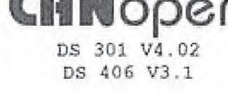

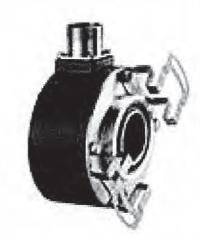

#### CARACTERISTIQUES ELECTRIQUES

| Allmentation        | 5-30Vdc             |
|---------------------|---------------------|
| Mise en fonction    | <1s                 |
| Consommation à vide | < 50mA (à 24Vdc)    |
| Précision           | ± 1/2 LSB (13 bits) |

codeurs installés sur les poulies principales (3)

### ABSOLUTE MULTITURN ENCODERS, MHM5 SERIE, MODBUS - TCP/IP

| Description          | Type Key          |             |       |    |    |    |    |       |   |     |
|----------------------|-------------------|-------------|-------|----|----|----|----|-------|---|-----|
| Reference            | MHM5-             | EM          | 00.70 | В- |    |    |    | 88.66 |   | PRM |
| Interface            | Modbus            | EM          |       |    |    |    |    |       |   |     |
| Version              | 2 x M12           |             | 00    |    |    |    |    |       |   |     |
|                      | lontegrated hu    | b. 3xM12    | Al    |    |    |    |    |       |   |     |
| Code                 | Binary            |             |       | В  |    |    |    |       |   |     |
| Revolutions (Bits)   | Singleturn        |             |       |    | 00 |    |    |       |   |     |
|                      | Multiturn (4096   | revolution  | 5)    |    | 12 |    |    |       |   |     |
|                      | Multiturn (1638-  | 4 revolutio | ns)   |    | 14 |    |    |       |   |     |
| Steps per revolution | 4096              |             |       |    |    | 12 |    |       |   |     |
| (Bits)               | 8192              |             |       |    |    | 13 |    |       |   |     |
|                      | 65536             |             |       |    |    | 16 |    |       |   |     |
| Flange               | Clamp flange      |             |       |    |    |    | C  |       |   |     |
|                      | Synchro flange    |             |       |    |    |    | \$ |       |   |     |
| Shaft diameter       | 10 mm             |             |       |    |    |    |    | 10    |   |     |
|                      | 06 mm             |             |       |    |    |    |    | 06    |   |     |
| Mechanical options   | Without           |             |       |    |    |    |    |       | 0 |     |
|                      | Shaft sealing (II | P66)        |       |    |    |    |    |       | S |     |
|                      | Customized        |             |       |    |    |    |    |       | C |     |
| Connection           | Radial M12 cor    | nector      |       |    |    |    |    |       |   | PRM |

# Document technique DT8 : structure de la trame écoutée

|      |    |    |    |    |    |    |    |    |    |    |    |    |    |    |    |    | g.9     |          |
|------|----|----|----|----|----|----|----|----|----|----|----|----|----|----|----|----|---------|----------|
| 0010 | 00 | 2a | bf | 4c | 00 | 00 | 80 | 01 | 20 | fb | ac | 1c | 01 | 13 | ac | 1c | .*.L    | ******   |
| 0020 | 01 | 40 | 08 | 00 | a8 | 88 | b9 | 48 | ae | 3b | 43 | 41 | 50 | 45 | 54 | 5f | .@H     | .;CAPET_ |
| 0030 | 53 | 49 | 49 | 5F | 32 | 30 | 31 | 34 |    |    |    |    |    |    |    |    | SII_201 | 4        |

| 1       |                            | Trame éth       | ernet2          |                             |  |  |  |  |  |  |  |
|---------|----------------------------|-----------------|-----------------|-----------------------------|--|--|--|--|--|--|--|
|         | Destination                | Source          | ce              | Type IP                     |  |  |  |  |  |  |  |
|         | 6 octets                   | 6 octe          | ets             | 2 octets                    |  |  |  |  |  |  |  |
| 1       |                            | Protoco         | le IP           |                             |  |  |  |  |  |  |  |
| Vers IP | Longueur de l'entête | Type de service | Longueur totale |                             |  |  |  |  |  |  |  |
| 1 (     | octet                      | 1 octet         | 20              | 2 octets                    |  |  |  |  |  |  |  |
|         | Identific                  | ation           | indicateur      | Fragment offset             |  |  |  |  |  |  |  |
|         | 2 oct                      | ets             | 2 octets        |                             |  |  |  |  |  |  |  |
| Durée   | e de vie                   | Protocole       | Somme de co     | mme de contrôle de l'entête |  |  |  |  |  |  |  |
|         | 2 oct                      | ets             | 2 octets        |                             |  |  |  |  |  |  |  |
|         |                            | Adresse s       | source          |                             |  |  |  |  |  |  |  |
|         |                            | 4 octe          | ets             |                             |  |  |  |  |  |  |  |
|         |                            | Adresse des     | stination       |                             |  |  |  |  |  |  |  |
|         |                            | 4 octe          | ets             |                             |  |  |  |  |  |  |  |
|         |                            | Option(s) + re  | mplissage       |                             |  |  |  |  |  |  |  |
|         |                            | Donné           |                 |                             |  |  |  |  |  |  |  |

| Modèle ENSD ©NEOPTEC                             |                                 | = | = | = | =                                                        | = | = | = | $\equiv$ | $\equiv$ |  |      |      |  |       |         |  |  | = |  | =                     | = | = |  |
|--------------------------------------------------|---------------------------------|---|---|---|----------------------------------------------------------|---|---|---|----------|----------|--|------|------|--|-------|---------|--|--|---|--|-----------------------|---|---|--|
| Nom : (Suivi, s'il y a lieu, du nom d'épouse) |                                 |   |   |   |                                                          |   | L |   |          |          |  |      |      |  |       |         |  |  |   |  |                       |   |   |  |
| Prénom :                                         |                                 |   |   |   |                                                          |   |   |   |          |          |  |      |      |  |       |         |  |  |   |  |                       |   |   |  |
| N° d'inscription :                               |                                 |   |   |   |                                                          |   |   |   |          |          |  | é(e) | le : |  |       | /       |  |  | / |  |                       |   |   |  |
| _                                                | (Le numéro est celui qui figure |   |   |   | sur la convocation ou la feuille d'émarge Section/Option |   |   |   |          | Epreuve  |  |      |      |  |  1 | Matière |  |  |   |  |                       |   |   |  |
| •                                                |                                 |   |   |   |                                                          | Ш |   |   | Ш        |          |  |      |      |  |       |         |  |  |   |  | $ldsymbol{\bf \beta}$ | Ш |   |  |

EDE STI 1

# DR 1

# Document Réponse DR1

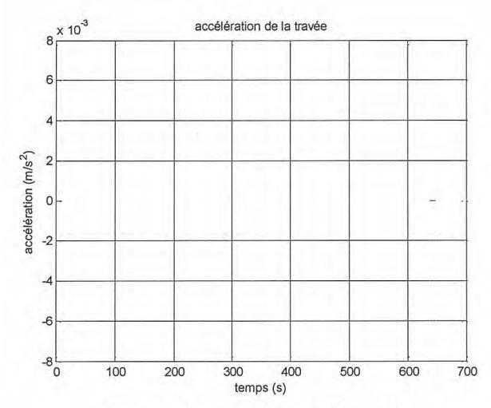

Figure 5-2a – accélération référence

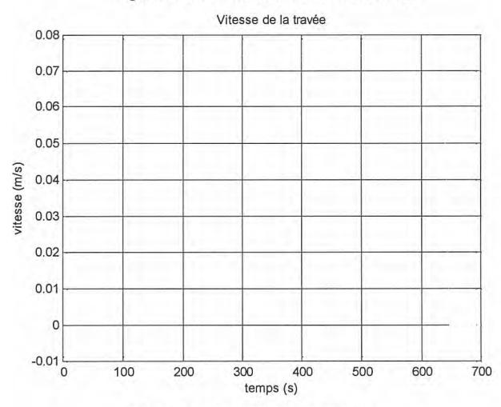

Figure 5-2b - Vitesse référence

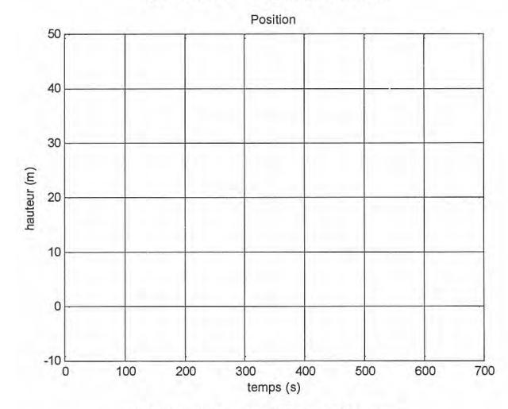

Figure 5-2c - Position référence