# **Concours de recrutement du second degré**

# **Rapport de jury**

**Concours : CAPET externe et CAFEP**

**Section : sciences industrielles de l'ingénieur**

**Options :** ingénierie des constructions, ingénierie électrique, ingénierie informatique, ingénierie mécanique.

**Session 2018**

Rapport de jury présenté par : Jean-Michel SCHMITT Président du jury

# **Sommaire**

| Avant-propos                                                                                                                    | 4         |
|---------------------------------------------------------------------------------------------------------------------------------|-----------|
| Résultats statistiques                                                                                                          | 8         |
| Épreuve d'admissibilité :<br>« Analyse et exploitation pédagogique d'un système pluritechnique »                                |           |
| Éléments de correction<br>Rapport du jury                                                                                       | 12<br>28  |
| Épreuve d'admissibilité :<br>« Étude d'un système, d'un procédé ou d'une organisation »                                         |           |
| Éléments de correction pour l'option ingénierie des constructions<br>Rapport du jury pour l'option ingénierie des constructions | 32<br>54  |
| Éléments de correction pour l'option ingénierie électrique<br>Rapport du jury pour l'option ingénierie électrique               | 59<br>73  |
| Éléments de correction pour l'option ingénierie informatique<br>Rapport du jury pour l'option ingénierie informatique           | 77<br>86  |
| Éléments de correction pour l'option ingénierie mécanique<br>Rapport du jury pour l'option ingénierie mécanique                 | 89<br>96  |
| Épreuve d'admission : « Mise en situation professionnelle »                                                                     |           |
| Exemple de sujet<br>Rapport du jury                                                                                             | 99<br>110 |
| Épreuve d'admission : « Entretien à partir d'un dossier »                                                                       | 116       |
| Rapport sur la transmission des valeurs et principes de la République                                                           | 121       |

Les réunions préparatoires à cette session 2018 du CAPET de sciences industrielles de l'ingénieur (concours externe et CAFEP) se sont déroulées au lycée Raspail à Paris. Les épreuves d'admission se sont déroulées du 24 juin au 3 juillet 2018 dans de très bonnes conditions au lycée Franklin Roosevelt à Reims.

Les membres du jury adressent de vifs remerciements aux proviseurs de ces établissements et à leurs directeurs délégués aux formations professionnelles et technologiques ainsi qu'à leurs collaborateurs pour l'accueil chaleureux qui leur a été réservé.

### **Avant-propos**

Pour cette session 2018, les épreuves d'admissibilité étaient très classiques. Par conséquent, j'insisterai plus dans cet avant-propos sur les épreuves d'admission. Plus généralement, les remarques et conseils prodigués les années précédentes restent d'actualité afin de bien préparer la session 2019.

En effet, il est utile de rappeler que le CAPET a pour objectif de répondre à la demande de l'État employeur qui souhaite recruter des professeurs. Les compétences pédagogiques sont vérifiées lors de l'épreuve commune d'admissibilité et lors des épreuves d'admission. Ainsi, il est indispensable de s'y préparer dès l'inscription au concours, en assistant dans plusieurs lycées et collèges à des séances en présence d'élèves et en échangeant avec des professeurs chevronnés qui maîtrisent la didactique des sciences industrielles de l'ingénieur. Cette immersion en établissements scolaires permet aussi d'observer les évolutions de la pédagogie, le travail, l'implication et la réactivité des élèves et ainsi d'actualiser ses connaissances du système éducatif.

Les futurs candidats devront, au cours de leur préparation au concours, mener les réflexions nécessaires à la mise en place d'une progression pédagogique par cycle, progression devant être élaborée dans le cadre d'une évaluation par compétences. Ils doivent se concentrer sur les objectifs des différentes séquences de collège et de lycée, et imaginer les stratégies pédagogiques et didactiques à mettre en œuvre pour faire acquérir aux élèves les compétences visées par les différents programmes. Le jury attend la description précise de la séquence inscrite dans une progression pédagogique, de ses attendus, de l'organisation de la séance présentée par le candidat, ainsi que la justification des choix faits pour chacun de ces points. Bien évidemment, dans un souci d'efficacité, en plus des réflexions précédentes, les candidats doivent vraiment s'appuyer sur leur expérience professionnelle pour intégrer à leur exposé la différenciation pédagogique, l'évaluation des compétences et des connaissances associées, la remédiation et l'accompagnement personnalisé dans les contenus pédagogiques présentés.

J'invite les futurs candidats et leurs formateurs à apporter une attention particulière à la préparation des épreuves demandant une approche pédagogique.

Les principales compétences attendues sont :

- Compétences disciplinaires et didactiques
  - o Identifier des sources d'informations fiables et pertinentes
  - o Maintenir une veille sur les nouvelles ressources disciplinaires et pédagogiques
  - o Savoir préparer des séquences pédagogiques précisant les compétences et les objectifs attendus, et mettant en place une stratégie pédagogique pertinente
  - o Analyser les besoins, progrès et acquis des élèves
  - o Communiquer aux élèves et aux parents les objectifs, critères et résultats des évaluations
  - o Intégrer les évolutions du numérique dans ses pratiques pédagogiques
  - o Contextualiser les apprentissages pour leur donner un sens et faciliter leur appropriation par les élèves
  - o Adapter son enseignement et son action éducative à la diversité des élèves
  - o Savoir composer des groupes d'élèves pour organiser la classe
  - o Organiser et gérer des groupes d'élèves dans des activités de projet
  - o Déceler les signes du décrochage scolaire
- Compétences éthiques et déontologiques
  - o Etre conscient de la relativité de ses savoirs

- o Aider les élèves à développer leur esprit critique et à distinguer les savoirs, les opinions et les croyances
- o Aider les élèves à savoir argumenter et respecter le point de vue des autres
- o Se mobiliser et mobiliser les élèves contre les stéréotypes et les discriminations
- o Participer à l'éducation aux usages responsables du numérique

## Compétences relationnelles

- o Adopter une démarche d'écoute active
- o Participer à la conception et à la mise en œuvre de projets collectifs disciplinaires et éducatifs
- o Gérer les conflits
- o Travailler en équipe
- o Installer avec les élèves une relation de confiance et de bienveillance
- o Savoir conduire un entretien, animer une réunion
- Compétences pédagogiques et éducatives
  - o Maintenir une veille sur les recherches des différentes formes et pratiques pédagogiques et éducatives
  - o Connaitre les processus d'apprentissage
  - o Proposer des processus d'apprentissage innovants
  - o Contribuer à la mise en place de projets interdisciplinaires
- Compétences de communication
  - o Intégrer dans son activité l'objectif de maîtrise de la langue orale et écrite
  - o Utiliser les technologies du numérique pour échanger et se former
  - o Maitriser au moins une langue vivante au niveau B2
  - o Mettre en place du travail collaboratif
- Compétences d'analyse et d'adaptation de son action
  - o Exercer son analyse critique, seul ou entre pairs, de ses propres pratiques professionnelles
  - o Identifier ses besoins de formation
  - o Etre capable de rechercher les supports de son enseignement dans le milieu économique et d'en extraire des exploitations pédagogiques pertinentes

Les épreuves d'admission ont pour objectif de valider les compétences scientifiques, technologiques, expérimentales, pédagogiques et didactiques des candidats.

Pour la première épreuve d'admission, la séquence pédagogique à présenter est liée aux activités pratiques réalisées lors de la première phase de l'épreuve ; elle est relative aux enseignements de technologie au collège ou aux enseignements technologiques du cycle terminal « sciences et technologies de l'industrie et du développement durable (STI2D) » ou bien aux sciences de l'ingénieur de la voie générale du lycée. Le niveau de cette séquence est imposé aux candidats. Par conséquent, ces derniers devront se préparer à être confrontés à l'une des trois situations d'enseignement précisées ci-dessus. Il est donc indispensable que les candidats se soient approprié les programmes du collège et du lycée, et surtout se soient imprégné de la philosophie des enseignements, en, je le rappelle, se déplaçant directement dans des établissements scolaires pour échanger avec des enseignants sur leurs pratiques pédagogiques et pour prendre connaissance de la réalité des plateaux techniques : organisation du laboratoire, quantités et types de supports didactiques et de postes informatiques mis à la disposition des élèves.

Le jury a été surpris de constater que certains candidats n'avaient pas lu les programmes correspondants aux exigences de l'épreuve, pourtant facilement accessibles par Internet. Cette désinvolture a souvent entraîné des notes qui ne permettent pas d'être reçu à ce concours.

Le jury a été également surpris de constater que de nombreux candidats ne maîtrisaient pas les différentes démarches : investigation, résolution de problème technique et démarche de projet.

Trop souvent, la démarche d'investigation se résume à une recherche sur documents. Ces démarches suivent des schémas qui leur sont propres et prédéfinis, elles sont illustrées dans les documents d'accompagnements disponibles sur Eduscol. Le jury encourage les candidats à se familiariser avec ces démarches et ainsi les ré exploiter avec efficience lors de la présentation de la séquence et des séances. Ces conseils concernent également la seconde épreuve d'admission.

La première épreuve d'admission est une épreuve longue qui nécessite également une bonne gestion du temps afin que l'exposé ne porte pas que sur la partie TP qui a déjà été évaluée, mais essentiellement sur la présentation de la séquence au niveau demandé.

Depuis la session 2017, que ce soit à l'agrégation ou au CAPET, à l'externe comme à l'interne, il existe une option ingénierie informatique et surtout un programme d'informatique pour toutes les options de ces concours. Les compétences liées à ce programme sont par conséquent également évaluées. Le jury conseille aux futurs candidats de ne surtout pas faire l'impasse sur l'informatique qui tient dorénavant une place non négligeable dans les programmes de technologie au collège, des enseignements technologiques du cycle terminal « sciences et technologies de l'industrie et du développement durable (STI2D) » et des sciences de l'ingénieur de la voie générale du lycée.

La réussite aux épreuves ne s'improvise pas. Il faut s'y préparer avec rigueur dès l'inscription au concours.

Pour les épreuves d'admission, l'accès à l'Internet est autorisé afin que les candidats soient dans les conditions du métier qu'ils envisagent d'exercer. Mais, cela ne doit pas masquer la réflexion, la cohérence, l'appréciation du niveau des élèves et la précision pédagogique dans les explications qui sont des qualités précieuses pour un futur enseignant.

La description des épreuves des concours précise que « *L'entretien qui succède à la présentation du candidat permet au jury d'approfondir les points qu'il juge utiles. Il permet en outre d'apprécier la capacité du candidat à prendre en compte les acquis et les besoins des élèves, à se représenter la diversité des conditions d'exercice de son métier futur, à en connaître de façon réfléchie le contexte dans ses différentes dimensions (classe, équipe éducative, établissement, institution scolaire, société) et les valeurs qui le portent, dont celles de la République* ». Le ministère de l'Éducation nationale a demandé à tous les présidents des concours de recrutement « *de veiller à ce que dans ce cadre, les thématiques de la laïcité et de la citoyenneté trouvent toute leur place* » afin « *que l'École soit en mesure, par la formation et le recrutement de nos futurs enseignants, de valider la mission première que lui fixe la Nation, à savoir de transmettre et de faire partager aux élèves les valeurs et principes de la République ainsi que l'ensemble des dispositions de la Charte de la laïcité, portant notamment égale dignité de tous les êtres humains et liberté de conscience de chacun ».*

Cette demande a été prise en compte pour les épreuves d'admission. Le comportement des candidats face aux questions du jury, sur ces sujets particulièrement sensibles, a donné globalement satisfaction. Des informations sur les questions posées et quelques conseils aux futurs candidats sont donnés dans ce rapport.

Dans toutes les épreuves, le jury attend des candidats une expression écrite et orale irréprochable. Le CAPET est un concours exigeant qui impose de la part des candidats un comportement et une présentation exemplaires. Le jury reste vigilant sur ce dernier aspect et invite les candidats à avoir une tenue adaptée aux circonstances particulières d'un concours de recrutement de cadres de catégorie A de la fonction publique.

Pour cette session, le jury est globalement satisfait des prestations des candidats. Il regrette cependant que des candidats admissibles ne se soient pas présentés à la session d'admission. Cela étant, il conseille aux futurs candidats de lire attentivement ce rapport, de s'imprégner de la didactique de la discipline et de la méthode pour élaborer une séquence pédagogique et d'avoir étudié les programmes du collège, de STI2D et de sciences de l'ingénieur de la voie générale du lycée.

J'espère sincèrement que ce rapport sera très utile aux futurs candidats du CAPET externe SII et du CAFEP SII.

> Jean-Michel SCHMITT Président du jury

# **Résultats statistiques**

# **Option ingénierie des constructions**

# **CAPET**

| Inscrits | Nombre<br>de<br>postes | Présents aux<br>deux<br>épreuves<br>d'admissibilité | Admissibles | Présents aux<br>deux épreuves<br>d'admission | Admis |
|----------|------------------------|-----------------------------------------------------|-------------|----------------------------------------------|-------|
| 218      | 43                     | 93                                                  | 75          | 56                                           | 37    |

| Moyenne obtenue par le premier candidat admissible | 18,6  |
|----------------------------------------------------|-------|
| Moyenne obtenue par le dernier candidat admissible | 5,7   |
| Moyenne obtenue par le premier candidat admis      | 16,96 |
| Moyenne obtenue par le dernier candidat admis      | 8,01  |

| Inscrits | Nombre<br>de<br>postes | Présents aux<br>deux<br>épreuves<br>d'admissibilité | Admissibles | Présents aux<br>deux<br>épreuves<br>d'admission | Admis |
|----------|------------------------|-----------------------------------------------------|-------------|-------------------------------------------------|-------|
| 36       | 1                      | 16                                                  | 3           | 3                                               | 1     |

| Moyenne obtenue par le premier candidat admissible | 16,2  |
|----------------------------------------------------|-------|
| Moyenne obtenue par le dernier candidat admissible | 12,4  |
| Moyenne obtenue par le premier candidat admis      | 17,32 |
| Moyenne obtenue par le second candidat admis       | 17,32 |

# **Option ingénierie électrique**

# **CAPET**

| Inscrits | Nombre<br>de<br>postes | Présents aux<br>deux<br>épreuves<br>d'admissibilité | Admissibles | Présents aux<br>deux épreuves<br>d'admission | Admis |
|----------|------------------------|-----------------------------------------------------|-------------|----------------------------------------------|-------|
| 363      | 39                     | 148                                                 | 88          | 59                                           | 39    |

| Moyenne obtenue par le premier candidat admissible | 18,6  |
|----------------------------------------------------|-------|
| Moyenne obtenue par le dernier candidat admissible | 7,2   |
| Moyenne obtenue par le premier candidat admis      | 19,23 |
| Moyenne obtenue par le dernier candidat admis      | 9,2   |

| Inscrits | Nombre<br>de<br>postes | Présents aux<br>deux<br>épreuves<br>d'admissibilité | Admissibles | Présents aux<br>deux<br>épreuves<br>d'admission | Admis |
|----------|------------------------|-----------------------------------------------------|-------------|-------------------------------------------------|-------|
| 76       | 2                      | 36                                                  | 5           | 5                                               | 2     |

| Moyenne obtenue par le premier candidat admissible | 14,7  |
|----------------------------------------------------|-------|
| Moyenne obtenue par le dernier candidat admissible | 12    |
| Moyenne obtenue par le premier candidat admis      | 15,97 |
| Moyenne obtenue par le dernier candidat admis      | 15,57 |

# **Option ingénierie informatique**

# **CAPET**

| Inscrits | Nombre<br>de<br>postes | Présents aux<br>deux<br>épreuves<br>d'admissibilité | Admissibles | Présents aux<br>deux épreuves<br>d'admission | Admis |
|----------|------------------------|-----------------------------------------------------|-------------|----------------------------------------------|-------|
| 268      | 56                     | 85                                                  | 66          | 48                                           | 35    |

| Moyenne obtenue par le premier candidat admissible | 15,7  |
|----------------------------------------------------|-------|
| Moyenne obtenue par le dernier candidat admissible | 5,8   |
| Moyenne obtenue par le premier candidat admis      | 17,21 |
| Moyenne obtenue par le dernier candidat admis      | 8,17  |

| Inscrits | Nombre<br>de<br>postes | Présents aux<br>deux<br>épreuves<br>d'admissibilité | Admissibles | Présents aux<br>deux<br>épreuves<br>d'admission | Admis |
|----------|------------------------|-----------------------------------------------------|-------------|-------------------------------------------------|-------|
| 85       | 3                      | 22                                                  | 7           | 6                                               | 3     |

| Moyenne obtenue par le premier candidat admissible | 13,6  |
|----------------------------------------------------|-------|
| Moyenne obtenue par le dernier candidat admissible | 10,7  |
| Moyenne obtenue par le premier candidat admis      | 15,59 |
| Moyenne obtenue par le dernier candidat admis      | 14,16 |

# **Option ingénierie mécanique**

# **CAPET**

| Inscrits | Nombre<br>de<br>postes | Présents aux<br>deux<br>épreuves<br>d'admissibilité | Admissibles | Présents aux<br>deux épreuves<br>d'admission | Admis | Liste<br>complémentaire |
|----------|------------------------|-----------------------------------------------------|-------------|----------------------------------------------|-------|-------------------------|
| 316      | 72                     | 150                                                 | 113         | 96                                           | 72    | 1                       |

| Moyenne obtenue par le premier candidat admissible | 17,1  |
|----------------------------------------------------|-------|
| Moyenne obtenue par le dernier candidat admissible | 5,6   |
| Moyenne obtenue par le premier candidat admis      | 17,33 |
| Moyenne obtenue par le dernier candidat admis      | 8     |

| Inscrits | Nombre<br>de<br>postes | Présents aux<br>deux<br>épreuves<br>d'admissibilité | Admissibles | Présents aux<br>deux<br>épreuves<br>d'admission | Admis |
|----------|------------------------|-----------------------------------------------------|-------------|-------------------------------------------------|-------|
| 75       | 3                      | 40                                                  | 7           | 5                                               | 3     |

| Moyenne obtenue par le premier candidat admissible | 16,4  |
|----------------------------------------------------|-------|
| Moyenne obtenue par le dernier candidat admissible | 12,9  |
| Moyenne obtenue par le premier candidat admis      | 18,35 |
| Moyenne obtenue par le dernier candidat admis      | 15,43 |

# **Éléments de correction de l'épreuve « Analyse et exploitation pédagogique d'un système pluritechnique »**

## **Question 1**

La société Polycréatis a reçu le prix « coup de cœur du jury » pour sa démarche écoresponsable dans la conception du catamaran SunSeaRider pour les raisons suivantes : utilisation de l'énergie solaire, dite propre, et incitation du skipper à la conduite écoresponsable.

# **Question 2**

$$\left\{T_{poids \rightarrow catamaran}\right\} = \left\{ \begin{array}{c} -(M+7m)g \ \vec{z}_{O} \\ \vec{0} \end{array} \right\}_{G} = \left\{ \begin{array}{c} -16\ 285 \ \vec{z}_{O} \\ \vec{0} \end{array} \right\}_{G}$$

## **Question 3**

On isole le catamaran soumis à l'action de l'eau et à son poids (avec 7 passagers). L'équation de la résultante statique en projection sur ⃗*z <sup>O</sup>* donne :

$$-(M+7m)g + 2R_{archimède} = 0$$

$$=>R_{archimède}=\frac{(M+7m)g}{2}$$

AN : *Rarchimède=* 8 142 N

Or 
$$R_{archimède} = \rho_{eau} \times V_{eau} \times g$$
, d'où  $V_{eau} = \frac{R_{archimède}}{\rho_{eau} \times g} = > V_{eau} = \frac{M+7m}{2 \times \rho_{eau}}$ 

AN : 
$$V_{eau} = \frac{1030 + (7 \times 90)}{2 \times 1000} = > V_{eau} = 0.83 \text{ m}^3$$

#### **Question 4**

D'après la figure 6, on a 
$$V_{eau} = H \times a_{flotteur} \times L_{flotteur}$$
 =>  $H = \frac{V_{eau}}{a_{flotteur} \times L_{flotteur}}$ 

AN: 
$$H = \frac{0.83}{0.5 \times 6}$$
 =>  $H = 0.28 \text{ m}$ 

## **Question 5**

D'après la figure 6, on a *sin θ = Hrampe Lrampe*

On détermine *Hrampe* :

$$H_{rampe} + H_{plancher} + H_{flotteur} = H_{quai} + H$$
 $H_{rampe} = H_{quai} + H - (H_{plancher} + H_{flotteur})$ 
 $H_{rampe} = 0.6 + 0.28 - (0.05 + 0.75)$ 
 $H_{rampe} = 0.08 \text{ m}$ 

D'où:

$$\theta = \arcsin\left(\frac{H_{rampe}}{L_{rampe}}\right)$$

AN: 
$$\theta = \arcsin\left(\frac{0.08}{1.5}\right)$$
 =>  $\theta \approx 3.1^{\circ}$ 

L'exigence ld 2.2 précise que la pente de la rampe doit être inférieure à 10%, donc l'angle limite à respecter vaut :

$$\theta_{limite} = arctan\left(\frac{10}{100}\right) => \theta_{limite} = 5.7^{\circ}$$

Conclusion : 3,1°< 5,7° donc la pente est bien inférieure à 10%, et l'exigence ld 2.2 est vérifiée.

#### **Question 6**

On a  $q_p(2) = c_p \times c_e(2) \times q_b$  avec  $q_b = 0.5 \times \rho_{air} \times v_b^2$  et  $v_b = 23$  nœuds soit en m·s<sup>-1</sup>:

$$v_b = 23 \times 1.8 \times \frac{1000}{3600} => v_b = 11.5 \text{ m} \cdot \text{s}^{-1}$$

D'où 
$$q_p(2) = q_p = 1.5 \times 2 \times 0.5 \times 1.3 \times (11.5)^2 = q_p = 258 \text{ N} \cdot \text{m}^{-2}$$

#### **Question 7**

$$F_{a\acute{e}ro} = q_p \times S_{toit}$$
 AN:  $F_{a\acute{e}ro} = 258 \times 11 = > F_{a\acute{e}ro} = 2837 \text{ N}$ 

#### **Question 8**

$$F_{latéral} = q_{latéral} \times H_{latéral}$$
 AN:  $F_{latéral} = 860 \times 1 = > F_{latéral} = 860 \text{ N}$ 

#### **Question 9**

Inventaire des actions mécaniques appliquées à l'ensemble S = (catamaran + un passager) :

$$\begin{aligned} &\{T_{eau \rightarrow S}\} &= \left\{ \overrightarrow{R}_{archimède} \right\}_{B} \\ &\{T_{poids \rightarrow S}\} &= \left\{ \overrightarrow{P}_{0} \right\}_{G} = \left\{ \begin{matrix} -(M+m)g \ \overrightarrow{z}_{0} \\ \overrightarrow{0} \end{matrix} \right\}_{G} = \left\{ \begin{matrix} -10 \ 987 \ \overrightarrow{z}_{0} \end{matrix} \right\}_{G} \\ &\{T_{vent \rightarrow S}\} &= \left\{ \begin{matrix} \overrightarrow{F}_{a\acute{e}ro} \\ \overrightarrow{0} \end{matrix} \right\}_{C} = \left\{ \begin{matrix} 2 \ 837 \ \overrightarrow{z}_{C} \\ \overrightarrow{0} \end{matrix} \right\}_{C} \\ &\{T_{vent \ lat\acute{e}ral \rightarrow S}\} &= \left\{ \begin{matrix} \overrightarrow{F}_{lat\acute{e}ral} \\ \overrightarrow{0} \end{matrix} \right\}_{A} = \left\{ \begin{matrix} -860 \ \overrightarrow{y}_{C} \\ \overrightarrow{0} \end{matrix} \right\}_{A} \end{aligned}$$

#### **Question 10**

On écrit la somme des moments s'appliquant sur l'ensemble S au point B :

$$\sum \overrightarrow{M}_{B,ext\to S} = \overrightarrow{BG} / \overrightarrow{P} + \overrightarrow{BC} / \overrightarrow{F}_{a\acute{e}ro} + \overrightarrow{BA} / \overrightarrow{F}_{lat\acute{e}ral}$$

$$\sum \overrightarrow{M}_{B, \text{ext} \rightarrow S} = \left[ \left( c \ \overrightarrow{y}_C + d \ \overrightarrow{z}_C \right) \land \left( -P \ \overrightarrow{z}_O \right) \right] + \left[ \left( e \ \overrightarrow{y}_c + f \ \overrightarrow{z}_c \right) \land F_{a\acute{e}ro} \overrightarrow{z}_c \right] + \left[ \left( a \ \overrightarrow{y}_c + b \ \overrightarrow{z}_c \right) \land \left( -F_{lat\acute{e}ral} \ \overrightarrow{y}_c \right) \right]$$

En projetant l'équation sur *x*⃗ *<sup>O</sup>* on obtient :

$$\sum \overrightarrow{M}_{B, \text{ext} \to S} \cdot \overrightarrow{x}_{O} = -P \times c \times \cos \alpha + P \times d \times \sin \alpha + e \times F_{a\acute{e}ro} + b \times F_{lat\acute{e}ral}$$

AN :

$$\sum \vec{M}_{B,\text{ext}\to S} \cdot \vec{x}_O = (-10\ 987 \times 800 \times \cos 10^\circ) + (10\ 987 \times 1\ 460 \times \sin 10^\circ) + (1\ 550 \times 2\ 837) + (600 \times 860)$$
$$\sum \vec{M}_{B,\text{ext}\to S} \cdot \vec{x}_O = -957\ \text{N·m}$$

La somme des composantes de moments suivant *x*⃗ *<sup>O</sup>* est négative, les actions mécaniques ont donc tendance à ramener le catamaran vers la surface de l'eau. L'exigence Id 3.1 est donc respectée, le catamaran ne bascule pas.

## **Question 11**

L'effort extérieur appliqué à l'épontille se décompose en deux composantes, comme le montre la figure ci-dessous. La composante normale crée une sollicitation de compression et la composante tangentielle crée une sollicitation de flexion. Il s'agit donc d'une sollicitation de flexion composée.

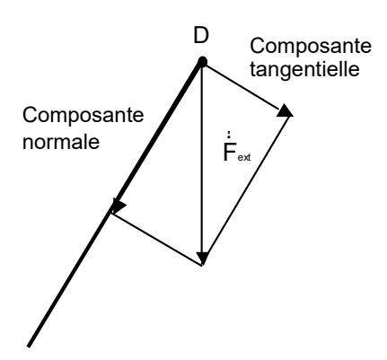

#### **Question 12**

L'expression du torseur de cohésion en G<sup>E</sup> est (en N et N∙m) :

$$\{T_{coh\acute{e}sion}\} = \begin{cases} -F_{ext} \sin\beta \ \vec{x}_E - F_{ext} \cos\beta \ \vec{z}_E \\ -F_{ext} \sin\beta \ (L-z) \ \vec{y}_E \end{cases}_{G_E} = \begin{cases} -414 \ \vec{x}_E - 1 \ 137 \ \vec{z}_E \\ (-662 + 414z) \ \vec{y}_E \end{cases}_{G_E}$$

Ce torseur est maximal au point O, en *z* =0.

AN: 
$$\{T_{cohésion}\}$$
 =  $\left\{\begin{array}{c} -414 \ \vec{x}_E - 1 \ 137 \ \vec{z}_E \\ -662 \ \vec{y}_E \end{array}\right\}_O$  exprimé en N et N·m

**Question 13** Voir DR1 – CORRIGÉ

## **Question 14**

D'après le principe de superposition :

$$|\sigma_{total}|_{max} = |\sigma_{compression}| + |\sigma_{flexion}|_{max}$$

Avec :

$$\left|\sigma_{compression}\right| = \frac{F_{ext}\cos\beta}{S}$$
 soit  $\left|\sigma_{compression}\right| = \frac{F_{ext}\cos\beta}{\frac{\pi}{4}\left(D^2 - \left(D - 2\mathrm{e}\right)^2\right)}$ 

$$|\sigma_{flexion}|_{max} = \frac{M_{fy-max}}{l_{Gy}} x_{max}$$
 soit  $|\sigma_{flexion}|_{max} = \frac{M_{fy-max}}{\frac{\pi}{64} (D^4 - (D - 2e)^4)} \frac{D^4}{2}$ 

La contrainte totale vaut alors :

$$|\sigma_{total}|_{max} = \frac{1 \ 137}{\frac{\pi}{4} (100^2 - 96^2)} + \frac{662 \ 400}{\frac{\pi}{64} (100^4 - 96^4)} \frac{100}{2}$$

$$|\sigma_{total}|_{max} = 1.8 + 44.8$$

$$|\sigma_{total}|_{max}$$
 = 46,6 MPa

Le coefficient de sécurité, noté *s*, vaut alors : |*σtotal*|*max = Re s* soit *s* = 241 46,6 => *<sup>s</sup>* = 5,2

Le coefficient de sécurité est supérieur à 3, l'exigence Id 4.1 est donc vérifiée.

Le matériau de l'épontille est en alliage d'aluminium donc l'épontille résiste à la corrosion (pas de fer). L'exigence Id 4.2 est donc aussi vérifiée.

#### **Question 15**

La simulation numérique donne une contrainte maximale de 48,6 MPa et le calcul théorique donne 46,6 MPa. L'écart entre les deux résultats est très faible (de l'ordre de 4%). Ceci s'explique par la forme et les dimensions de l'épontille qui correspondent bien aux hypothèses de Navier-Bernoulli pour la théorie des poutres : la dimension longitudinale est grande par rapport aux dimensions transversales. Le résultat du calcul théorique issu de la théorie des poutres est donc très proche du résultat issu de la simulation par la méthode des éléments finis.

#### **Question 16**

D'après l'annexe A4, de 11h30 à 12h30, la puissance surfacique moyenne reçue au sol vaut :

*Pmoy ≈* 780 W∙m-2

## **Question 17**

La puissance totale reçue par l'ensemble des panneaux solaires vaut : *Preçue = Pmoy ×n×Spanneau*

AN : 
$$P_{reçue} = 780 \times 16 \times 0,57 = P_{reçue} = 7 114 \text{ W}$$

Le rendement d'un panneau solaire vaut *ηpanneau = Pproduite Preçue* , d'où :

$$P_{produite} = \eta_{panneau} \times P_{reçue}$$

AN : *Pproduite =* 0,22×7 114 *=> Pproduite =* 1 565 W

Le rendement du régulateur a pour expression : *ηrégulateur = Prégulateur Pproduite* d'où :

$$P_{régulateur} = \eta_{régulateur} \times P_{produite}$$

AN : 
$$P_{régulateur} = 0.95 \times 1565 = P_{régulateur} = 1487 \text{ W}$$

Le rendement du moteur vaut *ηmoteur = Pmot Prégulateur - Pinstruments* , d'où :

$$P_{mot} = \eta_{moteur} \times (P_{régulateur} - P_{instruments})$$

AN : 
$$P_{mot} = 0.56 \times (1.487-10)$$
 =>  $P_{mot} = 827 \text{ W}$ 

# **Question 19**

La puissance distribuée pour une hélice vaut *Phélice = Pmot* 2 et *Phélice = Fpoussée×Vseuil*

On en déduit que la vitesse *Vseuil* vaut alors *Vseuil = Pmot* 2*×Fpoussée*

AN: 
$$V_{seuil} = \frac{827}{2 \times 750}$$
 =>  $V_{seuil} = 0.55 \text{ m} \cdot \text{s}^{-1} \approx 1.98 \text{ km} \cdot \text{h}^{-1} \text{ soit } 1.1 \text{ nœud.}$ 

L'exigence Id 1.3 est vérifiée car 1,1 nœud >1 nœud.

#### **Question 20**

L'énergie embarquée dans les batteries vaut *Eembarquée* = 8× capacité × tension

AN : 
$$E_{embarqu\acute{e}e} = 8 \times 115 \times 12$$
 =>  $E_{embarqu\acute{e}e} = 11$  kWh

### **Question 21**

Si la puissance est positive, l'énergie est puisée dans les batteries.

Si la puissance est négative, l'énergie est stockée dans les batteries.

#### **Question 22**

À partir de la figure 11, on effectue un bilan de puissance :

$$\begin{split} P_{\textit{batterie}} &= \text{-}(19 \times 0.02 + 14 \times 0.03 + 9 \times 0.15 + 4 \times 0.23) + (8 \times 0.3 + 15 \times 0.17 + 22 \times 0.07 + 31 \times 0.03) \\ P_{\textit{batterie}} &= 4.35 \text{ kW} \end{split}$$

L'énergie puisée dans les batteries pendant le parcours type de 30 min (0,5 h) vaut :

$$E_{batterie} = P_{batterie} \times 0,5$$

Pour réaliser le parcours total de 20 km (2 h), il faut quatre fois plus d'énergie, soit *Enécessaire =* 4*× Ebatterie*

```
AN : Enécessaire = 4×0,5×4,35 => Enécessaire = 8,7 kWh
```

L'énergie nécessaire est inférieure à l'énergie embarquée (8,7 < 11 kWh), donc l'exigence Id 1.1 est vérifiée.

De plus, le taux de décharge vaut 8,7 x 100 = 79 % 100 . L'exigence Id 1.2 est donc aussi vérifiée.

## **Question 23**

On souhaite calculer la distance *d\_max* (en km) parcourue à une vitesse *V* (en nœuds) pendant un temps *T* (en h) :

$$d_max=V \times T$$

$$d_max=1,8 \times V \times \frac{Cr}{Ci} \times \frac{1}{60}$$

```
Définition de la fonction en langage Python :
def calcul_d_max(Cr,Ci) :
        d_max=1.8*V*Cr/(Ci*60)
        return(d_max)
Définition de la fonction en langage C++ :
double calcul_d_max(double Cr, double Ci)
double d_max=1.8*V*Cr/(Ci*60);
return d_max ;
}
```

## **Question 24**

La distance du bateau par rapport au quai vaut :

$$d = \sqrt{(x_c - x_p)^2 + (y_c - y_p)^2}$$

```
Définition de la fonction en langage Python :
import sqrt from math
def calcul_d(xc,yc) :
        d=sqrt((xc-xp)**2+(yc-yp)**2)
        d_max=calcul_d_max(Cr,Ci)
        if d<d_max :
                print(″autonomie suffisante″)
        else :
                print(″autonomie insuffisante″)
Définition de la fonction en langage C++ :
void calcul_d(double xc, double yc)
double d=sqrt(pow((xc-xp),2)+pow((yc-yp),2)) ;
double d_max=calcul_d_max(Cr,Ci) ;
if (d<d_max)
        cout<<″autonomie suffisante″ ;
```

```
else
        cout<<″autonomie insuffisante″ ;
}
```

**Question 25** Voir DR2 – CORRIGÉ ci-après ;

**Question 26** Voir DR3 – CORRIGÉ ci-après.

#### **Question 27**

On mesure le temps d'allumage du voyant rouge sur le DR3, et on trouve :

$$\frac{t_{voyant\text{-rouge}}}{t_{total}} = 0.35$$

Le voyant rouge est donc allumé 35 % du temps lors de la sortie du catamaran. D'après la figure 12, le temps offert lors de la prochaine sortie est *toffert* = 0,12 x 2 h = 14 min.

#### **Question 28**

On peut envisager d'autres solutions pour produire de l'énergie propre dans le cas d'une utilisation du catamaran dans des régions moins ensoleillées :

- l'énergie éolienne ;
- l'énergie mécanique produite par le pédalage ;
- l'énergie de la houle marine.

Pour une irradiation solaire moindre, on pourrait agrandir la surface des panneaux solaires augmentant ainsi la puissance reçue.

## **Éléments de correction de la partie pédagogique**

**Question 29** – Cf DR4 ci-après.

#### **Question 30**

D'après la progression proposée dans le document de l'annexe 8, l'équipe a organisé les séquences pédagogiques de la classe de 1re en 9 séquences de 3 à 4 semaines, durée raisonnable pour limiter le risque de décrochage des élèves. La progression se déroule sur 31 semaines laissant 5 semaines d'ajustement dans l'année scolaire pour l'organisation d'activités pédagogiques transversales, la réalisation de projets, la gestion des aléas.

Les séquences sont réparties entre les congés scolaires, ce qui évite toute coupure dommageable à la continuité des apprentissages. La progression pédagogique proposée pour la classe de première prend en compte les 7 heures d'enseignement technologique transversal (ETT) et l'heure d'enseignement technologique en langue vivante (ETLV).

Chaque séquence d'enseignement repose sur un thème de travail formulé sous la forme d'une problématique, précédée d'une situation déclenchante, destinée à stimuler la curiosité et la motivation des élèves. Ces thèmes sont variés pour susciter l'intérêt de tous les élèves de la classe qui, lors des séances d'enseignement transversal, peuvent être issus des différentes spécialités proposées en STI2D.

L'équipe pédagogique a fait le choix de n'aborder que deux centres d'intérêt (CI) par séquence pédagogique, ne ciblant ainsi qu'un nombre limité de compétences et savoirs associés. Dans chaque séquence, en fonction des centres d'intérêt retenus, différentes compétences sont travaillées, en lien avec les savoirs associés des enseignements technologiques communs du baccalauréat STI2D, conformément à la répartition proposée dans le document de l'annexe 7.

La répartition du temps consacré au travail des compétences et connaissances associées est proposée de manière à vérifier la cohérence des apprentissages sur l'ensemble du cycle terminal. Chaque groupe de compétences et connaissances associées pourra être travaillé de manière spiralaire tout au long du cycle terminal à travers les différents thèmes proposés et sur la base de supports d'activités variés tant par leur technologie que leur typologie (systèmes, dossiers, etc.).

## **Question 31**

La séquence n°3 proposée en classe de 1re STI2D est basée sur le thème d'étude « Qu'est-ce qu'un système innovant ? ».

Les centres d'intérêt choisis sont :

- CI-4 Composants, matières et solutions constructives ;
- CI-8 Pilotage et commande des systèmes.

Les éléments du programme travaillés peuvent être répartis dans les différentes activités comme suit :

- étude de dossier 1 Analysons un produit innovant
  - o 1.1 Compétitivité et créativité (1.1.1 et 1.1.3) ;
  - o 1.2 Écoconception (1.2.1) ;
- étude de dossier 2 Une alternative au canot à moteur thermique
  - o 3.2 Constituants d'un système (3.2.1, 3.2.3 et 3.2.4) ;
- étude de dossier 3 Optimisation d'une solution
  - o 2.2 Outils de représentation (2.2.1 et 2.2.2) ;
- activités pratiques 1&2 Énergie embarquée
  - o 3.1 Structures matérielles et ou logicielles (3.1.2 et 3.1.4).

La durée prévue pour cette séquence est de trois semaines. Celle-ci a pour objectif d'illustrer comment la technologie peut être mise au service de l'innovation et permettre ainsi le développement de solutions respectueuses de l'environnement tant au niveau de leur construction que de leur exploitation.

Au regard des volumes horaires, on constate que dans cette séquence située en début d'année de première, l'attention est particulièrement portée sur la maîtrise des outils de représentation.

Les séances sont prises en charge par un ou deux enseignants et se déroulent en classe entière (30 élèves) et en groupes allégés (15 élèves).

Pour les séances en classe entière, il est important de rendre l'élève actif, en ce sens dispenser un cours magistral suivi de travaux dirigés d'application n'est pas forcément la formule la plus adaptée. Le laboratoire est équipé de 15 ordinateurs ce qui permet d'envisager un travail par binôme d'élèves.

Ici, plusieurs activités sont proposées dans un souci de différenciation des apprentissages. Elles s'appuient sur des études de dossier ou des activités pratiques qui placeront l'élève dans une situation d'apprenant actif. Les séances mobilisant les démarches d'investigation ou de résolution de problème s'articulent avec des temps de consolidation et de remédiation.

L'enseignement technologique en langue vivante (ETLV) est intégré à l'enseignement technologique transversal en s'appuyant sur des supports de travail commun. Les compétences langagières sont travaillées à partir de compétences et savoirs technologiques déjà maîtrisés.

## **Question 33 -** cf DR5 ci-après.

## *Semaine 1*

**Activation** : le problème est posé en exposant la situation déclenchante sous forme de texte ou de vidéo. L'émergence de la problématique est privilégiée par une réflexion collective. Il est possible de recourir à un outil de représentation type carte mentale projetée au TNI (tableau numérique interactif) pour structurer les échanges entre et avec les élèves.

**EDD1** : deux études, au minimum, de dossiers de produits ayant fait l'objet de dépôt de brevets (produits pluritechnologiques) sont proposées. Un temps d'échange peut être prévu dans la dernière demi-heure de la séance afin que les élèves puissent confronter et relever les points communs de leurs études :

- les élèves travaillent en binôme ou trinôme ;
- une démarche d'investigation est privilégiée.

**Cours 1** : travail de structuration et d'apport de connaissances prenant appui sur l'EDD1.

**EDD2** : étude de la conception du support SunSeaRider.

Plusieurs observations portant sur l'étude de la flottabilité et l'autonomie du bateau pourront servir de prétexte à la lecture et l'exploitation des ressources fournies dans le dossier.

Découverte du support (document à compléter – schéma, SysML…) :

- les élèves travaillent en binôme ou trinôme ;
- une démarche d'investigation est privilégiée.

**Cours 2** : il est consacré à la mise en place des connaissances en lien avec le traitement de l'information fournie par les capteurs utilisés lors de mesures qui seront réalisées lors des activités pratiques 1 et 2.

#### *Semaine 2*

Elle est consacrée aux activités pratiques. Il s'agit de mettre en œuvre des systèmes, qui, comme SunSeaRider embarquent une source d'énergie électrique (production solaire et éolienne uniquement). Elle permet de s'interroger sur l'implantation de la source et d'estimer son dimensionnement en fonction d'un besoin exprimé.

La situation déclenchante pourra s'appuyer sur la question suivante : « Peut-on remplacer la source d'énergie photovoltaïque du SunSeaRider par un système éolien ? » (une ou plusieurs éoliennes de technologie à définir…), SunSeaRider VS ou WindSeaRider ?

Une démarche d'investigation est privilégiée.

Les deux activités pratiques sont réalisées par des binômes ou trinômes d'élèves selon la répartition :

- une heure en classe entière appropriation du dossier, élaboration d'un protocole de mesure ;
- deux heures en effectif réduit au cours desquelles les élèves doivent procéder à des mesures et rédiger un compte rendu de manipulation.

La synthèse des activités pratiques est faite le vendredi en classe entière : exploitation des résultats des élèves pour construire la fiche de structuration des connaissances.

## *Semaine 3*

Elle est consacrée à l'étude de dossier 3. Le cours 3 est consacré à un apport de connaissances sur la représentation du réel, en vue d'une exploitation ultérieure lors de l'étude du dossier 3.

Le travail préalable sur la lecture de plan et les représentations d'une variante de la liaison entre l'épontille et la structure du toit permettra, par exemple, d'optimiser la liaison entre l'épontille et le toit solaire du SunSeaRider. Les apports de connaissances se feront en deux temps avant et entre les deux séances consacrées à l'activité pratique 3 :

- les élèves travaillent en binôme (un ordinateur pour deux élèves) ;
- une démarche de résolution de problèmes est privilégiée.

La dernière séance de la semaine 3 est consacrée à une évaluation des compétences et connaissances associées travaillées au cours des semaines 1 et 2.

Le professeur peut réaliser une évaluation formative, consistant à positionner l'élève sur une échelle de performance à des fins de dialogue avec lui, ou sommative.

Le professeur doit construire un outil de suivi de l'activité pour l'évaluation formative. Celui-ci renvoie aux compétences évaluées et s'appuie sur des critères avec leurs indicateurs évaluables et quantifiables, ces indicateurs étant communiqués aux élèves. L'évaluation est effectuée pendant les séances.

L'évaluation sommative est réalisée par l'évaluation d'un compte rendu (collectif ou individuel) ou d'un devoir sur table.

Évaluation formative (les élèves disposent d'un outil de suivi et identifient les compétences travaillées) :

- semaine 1 évaluation des compétences en lien avec la rédaction (tous les élèves) et la présentation orale des travaux réalisés (quelques élèves) ;
- semaine 2 évaluation des compétences en lien avec la mise en œuvre du protocole d'essai (séquences 2 et 3 - tous les élèves). Relevé des comptes rendus d'activité (séquences 5 et 6 – tous les élèves sur des activités qui peuvent être différentes) ;
- semaine 3 évaluation des compétences en lien avec l'utilisation d'un outil de représentation et/ou de modélisation.

## Évaluation sommative :

- semaine 1 non ;
- semaine 2 non ;
- semaine 3 évaluation des compétences et connaissances associées travaillées dans la séquence 3. Une étude de cas évaluée selon les modalités d'évaluation de l'épreuve de l'ETT du baccalauréat peut être envisagée.

L'étude de dossier 3 s'articule avec le cours 3 consacré à la représentation graphique du réel. Les compétences en lien avec l'utilisation des outils de représentation sont travaillées. L'optimisation de la liaison entre l'épontille et le toit est une situation problème qui justifie l'utilisation d'un logiciel de représentation graphique 3D. Les éléments d'évaluation sont :

- la connaissance des normes de représentation ;
- les compétences en lien avec la définition d'une liaison mécanique « simple » sous forme de croquis ou représentation volumique ;
- la manipulation du logiciel de représentation volumique.

## **Question 35**

Proposer aux élèves de réaliser un travail de présentation orale en langues vivantes à partir de la ressource de l'étude de dossier 2 « Une alternative au canot à moteur thermique ». Cette activité peut être proposée à partir de la fin de la semaine 2.

Fixer un des trois objectifs de l'évaluation de l'ETLV, par exemple :

- présenter les éléments techniques de réponse aux points importants identifiés dans le cahier des charges (fonctions, performances) ;
- proposer différents sujets de manière à varier les activités au sein de la classe
  - o présentation du SunSeaRider ;
  - o accessibilité PMR ;
  - o panneaux solaires ;
  - o batteries ;

- o indicateur de consommation d'énergie ;
- fixer les compétences évaluées
  - o CO7 et CO9.2 (évaluées par les élèves et le professeur de S2I) ;
  - o CO10 (évaluée par le professeur de langue vivante).

La participation des élèves auditeurs à l'évaluation des exposés permet de maintenir l'activité au sein de la classe. Cette évaluation devra être menée sur la base de quelques critères et pourra être mise en œuvre à l'aide d'un outil de sondage automatique.

L'organisation retenue est la suivante : 15 binômes / 1 microordinateur par binôme. Chaque sujet est traité par 3 binômes (1 binôme évalué / 2 binômes évaluateurs). Le binôme évalué doit élaborer un exposé de 5 minutes illustré par 3 diapositives maximum.

Le temps de préparation est d'une séance, et celui de la présentation et structuration est aussi d'une séance (présentation / échange et évaluation).

# DOCUMENT RÉPONSE DR1 - CORRIGÉ

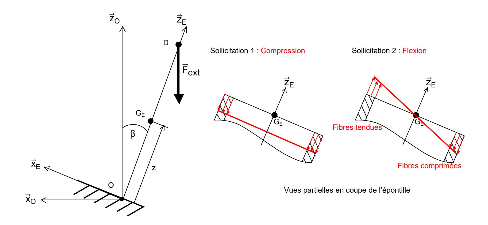

# **DOCUMENT RÉPONSE DR2 – CORRIGÉ**

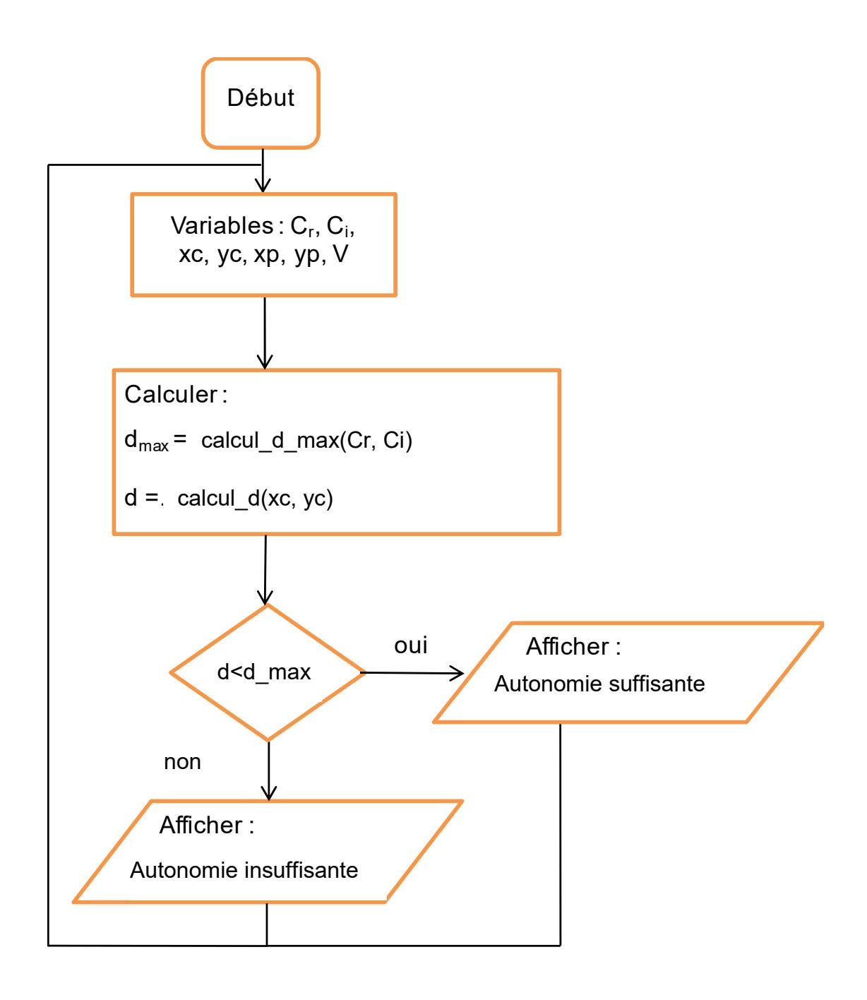

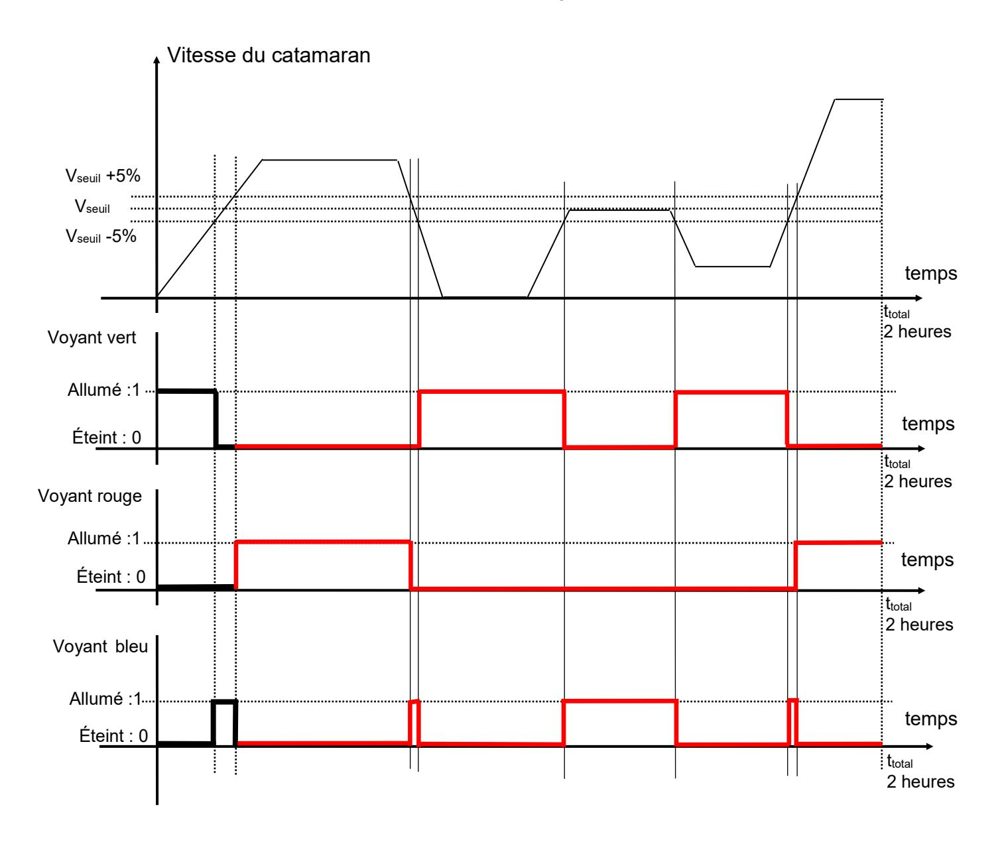

# **DOCUMENT RÉPONSE DR4– CORRIGÉ**

| Partie du sujet                    | Compétence attendue                           | Savoirs associés                                         |
|------------------------------------|-----------------------------------------------|----------------------------------------------------------|
|                                    |                                               | (*) Savoir associé pertinent                             |
| TENUE MÉCANIQUE DE LA STRUCTURE    | CO1.1 –<br>Justifier les choix des matériaux, | 1.1.<br>Compétitivité et créativité.                     |
| PORTEUSE DU TOIT                   | des structures d'un système.                  | 1.2.<br>ÉcoConception.                                   |
|                                    |                                               | 3.1.<br>Structures<br>matérielles et/ou logicielles. (*) |
| Champ de la Matière                |                                               |                                                          |
| Résistance des Matériaux.          |                                               |                                                          |
| AUTONOMIE ÉNERGÉTIQUE DU CATAMARAN | CO2.1 –<br>Identifier les flux et la forme de | 1.1.<br>ÉcoConception.                                   |
|                                    | l'énergie, caractériser ses transformations   | 3.2.<br>Constituants d'un système. (*)                   |
| Champ de l'Énergie                 | et/ou modulations et estimer l'efficacité     |                                                          |
| Stockage de l'énergie.             | énergétique globale.                          |                                                          |
| SÉCURITÉ ET ÉCORESPONSABILITÉ      | CO4.3 –<br>Identifier et caractériser le      | 2.3.<br>Approche comportementale.                        |
|                                    | fonctionnement temporel d'un système.         | 3.1.<br>Structures matérielles et/ou logicielles. (*)    |
| Champ de l'Information             |                                               |                                                          |
| Traiter une information.           |                                               |                                                          |

Justifier la pertinence du choix du support SunSeaRider pour une exploitation dans le cadre de l'enseignement technologique transversal en STI2D.

La conception du support SunSeaRider s'inscrit dans le cadre d'une démarche de développement durable comme le montre la première partie du sujet. Les différentes activités proposées abordent les champs Matière, Énergie et Information ce qui fait du SunSeaRider un système pluritechnologique adapté pour une séquence proposée en enseignement technologique transversal.

## **DOCUMENT RÉPONSE DR5- CORRIGÉ**

Organisation hebdomadaire des séances de la séquence n°3

|                 | Lundi                                                              | Mardi                        |                                  | Mercredi                      |                                                     | Vendredi                         |                                  |                                |  |  |  |  |
|-----------------|--------------------------------------------------------------------|------------------------------|----------------------------------|-------------------------------|-----------------------------------------------------|----------------------------------|----------------------------------|--------------------------------|--|--|--|--|
| Heures hebdo. : | 1                                                                  | 2                            | 3                                | 4                             | 5                                                   | 6                                | 7                                | 8                              |  |  |  |  |
| Groupe 1        | Classe entière<br>Prof. SII 1                                      | Croupe 1 EDD 1 support 1     |                                  | Classe entière<br>Prof. SII 2 |                                                     | orofesseurs SII<br>1 - EDD 2     | Classe entière<br>Co-ens. SII/LV | Classe entière<br>Prof SII 2   |  |  |  |  |
| Groupe 2        | Activation                                                         |                              | eur SII - 2<br>D 1 – support 2   | Cours 1                       | Groupe 2 – EDD 2                                    |                                  | ETLV<br>Sujet 1                  | Cours 2                        |  |  |  |  |
|                 | Semaine 2                                                          |                              |                                  |                               |                                                     |                                  |                                  |                                |  |  |  |  |
|                 | Lundi                                                              | М                            | ardi                             | Mercredi                      |                                                     | Vendredi                         |                                  |                                |  |  |  |  |
| Heures hebdo. : | 1                                                                  | 2                            | 3                                | 4                             | 5                                                   | 6                                | 7                                | 8                              |  |  |  |  |
| Groupe 1        | Classe entière<br>Prof. SII 1                                      | Croupe 1 Activité protique 1 |                                  | Classe entière<br>Prof SII 2  | Profess<br>Groupe 1 – Ad                            | Classe entière<br>Co-ens. SII/LV | Classe entière<br>Prof SII 2     |                                |  |  |  |  |
| Groupe 2        | Prépa. Activités<br>1 & 2                                          |                              | eur SII - 2<br>tivité pratique 2 | Prépa. Activités<br>1 & 2     | Professeur SII 1<br>Groupe 2 – Activité pratique 1  |                                  | ETLV<br>Sujet 2                  | Structuration<br>Connaissances |  |  |  |  |
|                 |                                                                    |                              |                                  | Semai                         | ne 3                                                |                                  |                                  |                                |  |  |  |  |
|                 | Lundi Mardi                                                        |                              | ardi                             | Mercredi                      |                                                     | Jeudi                            |                                  | Vendredi                       |  |  |  |  |
| Heures hebdo. : | 1                                                                  | 2                            | 3                                | 4                             | 5                                                   | 6                                | 7                                | 8                              |  |  |  |  |
| Groupe 1        | Classe entière Co-ens – 2 professeurs SII Prof. SII 1 Groupe 1 & 2 |                              |                                  | Classe entière<br>Prof SII 1  | Co-ens – 2 professeurs SII<br>Groupe 1 & 2<br>EDD 3 |                                  | Classe entière<br>Co-ens. SII/LV | Classe entière<br>Prof SII 2   |  |  |  |  |
| Groupe 2        | Cours 3                                                            | <del>-</del>                 |                                  | Cours 3                       |                                                     |                                  | ETLV<br>Sujet 3                  | Évaluation                     |  |  |  |  |

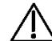

## Pour compléter les grilles, adopter les abréviations ci-dessous :

• Étude de dossier : EDD

Activité pratique : TP

• Structuration des connaissances : SDC

• Étude technologique en langue vivante : ETLV

Cours

Activation

Évaluation

# **Rapport du jury de l'épreuve d'admissibilité « Analyse et exploitation pédagogique d'un système pluritechnique »**

## **1. Présentation du sujet**

Le support du sujet est un catamaran solaire autonome destiné aux collectivités territoriales ou à la navigation de plaisance. Cette invention a reçu la médaille d'or du concours Lépine européen en 2013, ainsi que le prix des écotrophées félicitant l'entreprise pour sa démarche écoresponsable en 2015. L'analyse d'un système pluritechnologique, répondant à des contraintes actuelles (accessibilité des personnes à mobilité réduite, réduction des gaz à effet de serre, écoresponsabilisation…), a permis d'évaluer les compétences d'analyse, de modélisation et de résolution des candidats.

#### **2. Analyse globale des résultats**

Le sujet propose un questionnement sur les différents champs des sciences industrielles de l'ingénieur. Les cinq parties indépendantes sont abordées de manière linéaire par une majorité des candidats. Comme dans les sessions précédentes, les dernières parties sont moins bien traitées par beaucoup de candidats. Le jury invite donc les futurs candidats à gérer efficacement le temps de l'épreuve, afin d'avoir une couverture optimale du sujet.

Le jury déplore, par ailleurs, que certains candidats ne traitent que les parties du questionnement en lien avec leur option. Le jury insiste sur le caractère transversal de l'épreuve qui doit engager les futurs candidats à acquérir des connaissances dans les quatre spécialités.

La partie portant sur l'exploitation pédagogique permet au candidat de montrer ses compétences en ingénierie pédagogique en développant une réflexion en lien avec la mise en œuvre de l'enseignement spécifique des sciences industrielles de l'ingénieur. Le questionnement proposé aborde différents aspects de l'analyse que doit mener un enseignant pour construire une séquence d'enseignement technologique transversal et d'enseignement technologique en langue vivante en STI2D.

#### **3. Commentaires sur les réponses apportées et conseils aux futurs candidats**

#### **3.1. Première partie**

Cette partie consiste à déterminer la pente de la rampe d'accès au catamaran pour permettre l'accessibilité aux personnes à mobilité réduite. Le questionnement proposé est très guidé et permet de répondre à la problématique sans difficulté majeure.

Globalement, cette partie est accessible avec des notions de base de mécanique et de géométrie telles que le poids, le principe fondamental de la statique et les relations géométriques et trigonométriques dans un triangle rectangle…, mais nécessite néanmoins de la rigueur pour répondre correctement.

Le jury déplore que plus de la moitié des candidats ne sache pas écrire le torseur de l'action mécanique du poids du catamaran, tout comme la confusion, trop fréquente, entre masse et poids.

Le jury regrette également une lecture souvent trop rapide du questionnement menant, pour un grand nombre, à des réponses approximatives : par exemple, l'action mécanique de la poussée d'Archimède était demandée pour un flotteur et non deux.

Le jury conseille vivement aux candidats de maîtriser les connaissances fondamentales de mécanique et d'avoir un sens critique par rapport aux résultats numériques aberrants (hauteur d'immersion du bateau, volume d'eau déplacé par flotteur…).

#### **3.2. Deuxième partie**

Cette partie permet de vérifier le non-basculement du catamaran dans des conditions de navigation défavorables. Il s'agit ici de calculer, pas à pas, les actions mécaniques agissant sur le catamaran, puis de déterminer le moment résultant de ces actions mécaniques afin d'en étudier le signe.

Les candidats ont majoritairement bien traité les questions relatives à la détermination des actions mécaniques. Le jury note ici essentiellement des erreurs dans les conversions d'unité. Il conseille aux candidats de faire les applications numériques sans oublier d'indiquer les unités de la grandeur physique calculée.

Le bilan des actions mécaniques n'a pas été traité correctement, le jury constatant l'oubli de l'action de l'eau et un manque de rigueur dans l'écriture des actions mécaniques. L'outil torseur est peu ou mal utilisé. Peu de candidats ont mené à bien le calcul numérique du moment résultant permettant de conclure quant à l'exigence de non-basculement. Le jury a été surpris de constater que la notion de moment n'était pas maîtrisée par certains candidats.

#### **3.3. Troisième partie**

Cette partie permet, par une étude de résistance des matériaux, de vérifier la tenue de l'ancrage sur la nacelle d'une épontille inclinée. Il s'agit ici d'un calcul classique de contrainte normale maximale au niveau de l'encastrement d'une poutre (épontille). Les sollicitations de résistance des matériaux et le principe de superposition sont connus des candidats mais le calcul numérique est rarement mené à bien. À ce sujet, le jury constate trop d'erreurs de calcul et insiste pour que les résultats littéraux soient encadrés et suivis des applications numériques. Le tracé des contraintes dans la section droite a été mal réalisé ou pas du tout par les candidats. Par la suite, les conclusions relatives à la comparaison avec le modèle numérique n'ont pu être correctement traitées. Il est à noter que peu de candidats ont composé sur cette partie. Le jury conseille donc aux candidats de ne négliger aucune composante du programme des sciences de l'ingénieur dans leur préparation au concours.

#### **3.4. Quatrième partie**

Cette partie, scindée en deux études énergétiques, permet de valider deux exigences du cahier des charges.

Le premier objectif est la vérification de la vitesse minimale de navigation garantie par le constructeur, sans utilisation des batteries. Le sujet guide le candidat dans une étude énergétique afin de déterminer cette vitesse. Une grande partie des candidats a correctement traité cette partie. Le relevé de la puissance moyenne à partir de la courbe fournie est fait par la quasi-totalité des candidats. Globalement, les calculs des puissances sont correctement menés. Cependant, le jury relève des erreurs d'homogénéité dans les formules employées : ainsi pour tenir compte de la surface des panneaux solaires, il faut multiplier et non diviser. La notion de rendement est parfois mal utilisée. Enfin, trop de candidats oublient de tenir compte des deux moteurs dans les calculs.

L'objectif de la seconde étude est de valider le dimensionnement de la batterie lorsque celle-ci est utilisée. Cette étude repose sur la lecture de l'histogramme de distribution de puissance au niveau des batteries. Le jury relève beaucoup d'erreurs d'interprétation de ce graphique et peu de candidats parviennent à calculer l'énergie nécessaire pour parcourir 20 km.

#### **3.5. Cinquième partie**

Cette partie permet de valider deux objectifs.

Pour informer l'utilisateur de la réserve énergétique du catamaran en temps réel, le candidat était invité, dans un premier temps, à rédiger deux fonctions en langage Python ou C++. Le jury déplore que ces questions n'aient été traitées que par un faible nombre de candidats. Il rappelle que le programme d'informatique commun à toutes les options du CAPET SII est disponible à l'adresse suivante :

[http://cache.media.education.gouv.fr/file/capet\\_externe/92/1/p2017\\_capet\\_ext\\_sii\\_590921.pdf](http://cache.media.education.gouv.fr/file/capet_externe/92/1/p2017_capet_ext_sii_590921.pdf) Une maîtrise globale des méthodes de programmation, d'ailleurs communes à la plupart des langages, est attendue : variables, fonctions et structures de contrôle.

Le questionnement autour du second objectif – inciter l'utilisateur à l'écoconduite – a été correctement traité par une forte proportion de candidats.

#### **3.6 – Sixième partie – Partie pédagogique**

Les questions portent respectivement sur la justification de l'exploitation du support (catamaran solaire), l'étude d'une progression pédagogique et la mise en œuvre d'une activité en enseignement technologique en langue vivante.

Le questionnement proposé permet d'évaluer les compétences du candidat dans les différentes phases de la préparation d'une séquence pédagogique d'enseignement technologique transversal y compris l'enseignement technologique en langue vivante :

- justifier l'adéquation d'un support d'étude au regard de compétences et connaissances associées travaillées ;
- analyser et exploiter une fiche de préparation de séquence ;
- exploiter une progression et organiser des séances dans un fonctionnement hebdomadaire des enseignements imposé représentatif d'une situation réelle ;
- structurer l'enchaînement des enseignements et définir des modalités d'évaluation formatives et sommatives ;
- proposer une activité en enseignement technologique transversal en adéquation avec la séquence pédagogique imposée.

La partie pédagogique est traitée de manière très hétérogène. La justification du support et l'exploitation de la fiche de préparation de séquence proposée dans le sujet sont globalement satisfaisantes. Les candidats peinent à exploiter les documents pour expliciter les éléments de programme travaillés ainsi que les éléments de contexte et l'organisation de la séquence étudiée. Ils rencontrent également des difficultés à transposer les éléments descripteurs d'une séquence pédagogique en une organisation hebdomadaire des enseignements.

### **4. Conclusions**

Concernant les réponses aux questions, le jury souligne l'importance d'une rédaction claire, rigoureuse et concise. En effet, de trop nombreuses copies comptent un nombre important de fautes d'orthographe, de problèmes de syntaxe ou sont difficiles à déchiffrer. Le jury déplore la présence de commentaires personnels inappropriés sur certaines copies. Les candidats doivent correctement repérer les questions et, en cas d'absence de réponse, l'indiquer. Le jury conseille également de mettre les résultats en évidence.

Le jury demande aux candidats de maîtriser les fondamentaux des sciences de l'ingénieur, ce qui ne peut se faire sans une connaissance parfaite des unités des grandeurs physiques.

Cette épreuve comporte une exploitation pédagogique. Le jury signifie aux candidats qu'il ne faut pas négliger la préparation à cette partie de l'épreuve d'admissibilité. Elle est exigeante, nécessite une véritable préparation et une certaine prise de hauteur par rapport à des présentations parfois « académiques » qu'il faut savoir transposer dans un contexte réel de mise en œuvre.

Une lecture attentive et complète du sujet est indispensable pour éviter de mauvaises interprétations de certaines questions et pour permettre d'exploiter au mieux les documents ressources mis à disposition.

Enfin, le jury insiste sur le fait que, pour traiter cette épreuve transversale, les candidats doivent avoir un minimum de connaissances et de culture technologique dans plusieurs domaines.

Ces différents points restent primordiaux pour des enseignants destinés à l'enseignement technologique dans sa globalité. Le jury conseille donc aux futurs candidats de travailler en ce sens.

#### **5. Résultats**

605 copies ont été évaluées, la moyenne des notes obtenues est de 6,41 et l'écart-type de 3,4 avec :

- 16,82 comme meilleure note ;
- 0,16 comme note la plus basse.

# **Éléments de correction de l'épreuve « Étude d'un système, d'un procédé ou d'une organisation » – option ingénierie des constructions**

# **Étude 1 : Partenariats - Intégration urbaine**

# **Question 1**

|             | Métier                                     | Date d'intervention |  |  |  |
|-------------|--------------------------------------------|---------------------|--|--|--|
| Entreprises | Poseur charpente métallique                | 11 2015             |  |  |  |
| MOA         | Technicien travaux C.T.S.                  | 09 2012 > 04 2017   |  |  |  |
| MOe         | Dessinateur-projeteur Charpente métallique | 09 2013 > 05 2014   |  |  |  |

Le tableau ci-dessus renseigné n'est qu'un exemple parmi d'autres, sachant que la maîtrise d'ouvrage finance l'ensemble du projet, que la maîtrise d'œuvre en assure la conception, les études techniques et les contrôles tandis que les entreprises le réalisent.

# **Question 2**

# **Développement durable.**

Le développement des villes va toujours de pair avec une offre complémentaire de services que les communes doivent assurer. Qu'il s'agisse de la construction d'écoles ou autres bâtiments publics, d'aménagements de zones résidentielles, tertiaires, industrielles ou artisanales etc, les municipalités doivent accompagner cette nouvelle urbanisation en gérant au mieux les flux de déplacements des biens et des personnes, tout en essayant de garantir une meilleure maîtrise des pollutions de tous types que ces extensions génèrent.

Les nuisances de tous types occasionnées par "la voiture" étant de moins en moins acceptées, (voir en ce sens les arrêtés municipaux de circulation des véhicules de plus en plus contraignants), les villes se doivent de proposer et développer de nombreux modes de transports en commun. L'Eurométropole de Strasbourg ayant une population de 500 000 personnes environ, le tramway est tout à fait adapté pour aider à la limitation des déplacements individuels.

## **Lien et échanges avec l'Allemagne.**

Pour renforcer les liens entre Strasbourg et sa voisine allemande et favoriser ainsi les échanges, l'extension d'une ligne de tramway est une opportunité à saisir. Malheureusement, la ligne ne peut pas emprunter le pont de l'Europe qui enjambe le Rhin. Pour des problèmes techniques d'une part (les ponts routiers sont trop "élastiques" pour satisfaire aux contraintes du rail) et également à cause de la saturation de ce pont avec ses 35000 passages quotidiens.

La construction d'un pont franchissant le Rhin et adapté aux exigences d'un tramway est donc nécessaire.

## **Construction Européenne**

Une autre notion très importante est attachée à ce projet : sa vocation Européenne. En effet, une ville frontière comme Strasbourg, qui plus est siège de nombreuses institutions européennes dont 2 parmi les plus importantes (Conseil de l'Europe et Parlement Européen) ne peut pas limiter son rayonnement à son seul territoire administratif et pour ce faire, doit s'ouvrir par tous les moyens possibles vers l'extérieur.

## **Question 3**

#### **Intérêt technique.**

Se positionner en retrait du fleuve peut apporter une simplification des modes opératoires constructifs moins complexes à mettre en œuvre grâce notamment au dégagement des aires de travail de réalisation de la culée C0.

#### **Continuité du corridor écologique.**

Outre cet intérêt technique (discutable malgré tout puisque le surcoût est à prendre en compte), il faut mettre en avant la nécessaire conservation d'un couloir entre berge et culée afin de maîtriser au mieux les enjeux environnementaux.

- La flore existante sur berge peut ainsi être conservée, voire intensifiée. Elle participe de fait au confortement de la berge elle-même et sert de lieu d'accueil pour certains animaux : insectes, oiseaux. On peur également considérer que certaines espèces participent -même succinctement- à l'épuration partielle des eaux.
- Corridor et continuité écologique pour la faune : avifaune, Chiroptères avec aménagements spécifiques en suspension sous le tablier, herpétofaune ...

Et enfin, continuité du circuit de promenades le long des berges du Rhin.

## **Question 4**

Les arguments décrits précédemment démontrent que la construction de ce nouvel ouvrage de franchissement s'intègre bien dans l'environnement urbain.

Il est raisonnable de penser que ce pont permettra une meilleure gestion des déplacements tant actuels que futurs (il est prévu une augmentation de 15% du trafic) tout en conservant un niveau de nuisances acceptable par le plus grand nombre. En ce sens, cet ouvrage d'art répond parfaitement aux attentes de la maîtrise d'ouvrage.

# **Étude 2 : Le matériau béton utilisé pour la pile centrale**

### **Question 5**

#### **Calcul de la masse volumique théorique du béton frais.**

Il suffit de prendre les dosages pondéraux indiqués dans le "Tableau de composition du béton de structure de la pile centrale" *voir page 5* ... soit :

Pour 1 m<sup>3</sup> , 735 + 400 + 660 + 350 + 0 + 1,40 + 181 = 2327,4 kg.

La masse étant obtenue pour un volume de 1 m<sup>3</sup> , on obtient une masse volumique théorique de ≈ 2327,4 kg/m<sup>3</sup> .

#### **Validation de la formulation.**

La masse volumique réelle est mesurée et est égale à 2368 kg/m<sup>3</sup> . *Voir page 5* : "Tableau des résultats d'essais sur béton frais" ... soit :

L'écart absolu entre Mv réelle (2368) et Mv théorique (2327,4) est 2368 - 2327,4 = 40,6 kg/m3

Ce qui représente 40,6 / 2368 ≈ 1,71%. Cette valeur < 2,5% permet de valider la composition pondérale du béton.

## **Question 6**

#### **Conformité du béton aux exigences de résistance mécanique en compression.**

Le béton attendu *voir page 5* "Tableau de composition du béton de structure de la pile centrale" est le suivant :

**BPS** NF EN 206-1 **C30/37 XF1 Dmax 22,4 Cl0,65 S (150 ± 30)**

*NB : Les différents sigles dans l'appellation normalisée selon NF EN 206-1**ci-dessus correspondent à :*

- *BPS Béton à propriétés spécifiées ...*
- *C30/37 Classe de résistance à la compression à 28 jours. Permet de connaître fc28.*

- *XF1 Classe d'exposition. Permet de connaître l'environnement dans lequel évoluera le béton. (ici, XF = attaques gel/degel avec ou sans agent de déverglaçâtes)*
- *Dmax 22.4 Granularité : Diamètre maximal des granulats en mm.*
- *S4 Classe de consistance : Indique la plasticité souhaitée.*
- *Cl0,65 Classe de teneur en chlorures.*

La résistance caractéristique fC28 exigée, à prendre dans l'appellation **C30/37** du béton, est de 30 MPa. (En effet, d'après les Eurocodes, l'essai de référence permettant de déterminer la résistance en compression uniaxiale du béton doit être pratiqué sur des éprouvettes cylindriques).

*NB : Dans l'appellation C30/37, la 1ère valeur "30" -qui est celle à retenir- correspond aux résultats des essais de compression sur cylindre 16/32 (16cm et h32cm pour un élancement de 2) alors que la 2ème valeur indiquée "37" marque les essais sur cubes.*

À partir des "Tableaux de valeurs de résistance du béton et du ciment utilisés" *page 6*, les valeurs retenues sont :

$$f_{CE}$$
 = 43,1 MPa ;  $C_{E}$  = 59,6 MPa ;  $C_{min}$  = 52 MPa.

Grâce au "tableau de vérification des résistances moyennes du béton **fCE**" *voir page 6*, les calculs donnent :

**Selon Livret 2.21 (IN0034)** fCE ≥ 1,1 fC28 soit 43,1 ≥? 1,1\* 30 ; 43,1 > 33 donc Vérifié fCE ≥ fC28 + 0,8 \* (CE-Cmin) soit 43,1 ≥? 30 + 0,8 \* (59,6 - 52) ; 43,1 ≥ 36,1 donc Vérifié **Selon fascicule 65** fCE ≥ fC28 + 2S soit 43,1 ≥? 30 + 2 \* 3 ; 43,1 > 36 donc Vérifié fCE ≥ fC28 + \* (CE-Cmin) soit 43,1 ≥? 30 + 1 \* (59,6 - 52) ; 43,1 ≥ 37,6 donc Vérifié

Le béton est bien conforme aux exigences concernant la résistance mécanique à la compression à 28 jours.

## **Question 7**

*NB : Les réactions sulfatiques internes sont dues essentiellement à l'ettringite.*

*C'est un produit cristallin (3 CaO, Al2O3, 3 CaSO4, 32 H2O) issu de l'hydratation des ciments. La réaction, très exothermique, s'accompagne d'une expansion bénéfique au très jeune âge (phase de prise) du mélange non encore durci. Elle entraine une diminution de la porosité et une augmentation concomitante de la résistance mécanique. Cependant, l'ettringite peut provoquer un gonflement si elle se forme après la prise du ciment (ettringite secondaire). Elle est présente dans les ouvrages à base de ciment Portland qui subissent des traitements à des températures supérieures à 65 °C Sources : LERM ; CEREMA*

En suivant les étapes de calcul définies dans "l'organigramme de calcul" *Voir annexe 1 Bétons - § c3 page 22*

**Étape**  : Détermination de **Qm** (Q41, Rc2/Rc28). *Voir "Abaque de détermination Qm" annexe 1 - § c4 page 22*

La détermination se fait à partir de la formule **Qm = Q41 ratio Qm/Q41**

On retient dans le tableau "paramètres de calcul" *voir page 6* : **Rc2** = 20 MPa et **Rc28** = 63 MPa.

On calcule le rapport Qm/Q41 à partir de l'abaque *§ c4 page 22* : y(x) = - 1,2 x + 1,73

soit Qm/Q41 = - 1,2 Rc2/Rc28 + 1,73 = -1,2 (20/63) + 1,73 = **1,35**

Connaissant Q41 dans le tableau "paramètres de calcul" *voir page 6* Q41 = 299 J/g, on en déduit :

$$Qm = Q41 * 1,35 = 404 J/g$$

**Étape**  Détermination du liant équivalent chaleur LEch

La formule de composition donnée dans le "Tableau de composition du béton de structure de la pile centrale" *voir page 5* montre qu'il n'y a pas d'additions minérales. Donc,

LEch = C soit **LEch** = **350 kg**

**Étape**  Détermination du terme correctif (en degré °C) **= 40 (Eeff/LEch) - 18**

On retient dans le "Tableau de composition du béton de structure de la pile centrale" *voir page 5* les dosages en eau et ciment d'où : Eeff/LEch = 181/350 = 0,517 (résultat du rapport de la masse d'eau à celle du ciment)

$$\alpha = 40 * 0.517 - 18 = + 2.7 °C$$

**Étape**  Détermination de **ΔTadia** (en degré) = **(Qm LEch) / (Cth Mv) + α** 

On note Qm = 404 J/g ; LEch = 350 kg ; Cth = 1 kJ kg-1°C-1 ; Mv = 2368 kg/m3 et = 2,7 °C

**ΔTadia** (en degré °C) = (404 350) / (1 2368) + 2,7 = **62,4 °C**

**Étape**  Détermination des déperditions thermiques **ΔT = ΔTadia R**

On retient dans l'extrait de "Abaque estimant le coef. R" *annexe 1 - § c4 page 22* la valeur de R pour EP = 3 m.

soit **R = 0,96** et par déduction, **ΔT** = ΔTadia R = 62,4 0,96 ≈ **60 °C.**

# **Question 8**

Estimer le niveau de prévention vis-à-vis des réactions sulfatiques internes est essentiel pour s'affranchir des risques importants de détérioration des bétons. Avec comme objectif une meilleure pérennité des performances du matériau dans le cadre du développement durable, les normes actuelles imposent la prise en compte de différents phénomènes suceptibles d'affecter les qualités du béton.

En s'appuyant sur les données exposées dans les 4 tableaux de l'annexe 1 Bétons - voir page 21, on note :

- que l'ouvrage "pile centrale "est en **catégorie 2** (1er tableau)
- que la classe d'exposition vis-à-vis de la RSI : **XH3.** (2ème tableau)
- Ce qui nous donne un niveau de prévention **Cs** lu directement dans le 3ème tableau.
- Et le 4ème tableau indique que la température Tmax au sein de l'ouvrage doit rester **inférieure à 70°C**.

En prenant **ΔT** ≈ **60 °C** (résultat de la question précédente) et sachant que la température Tmax au sein de l'ouvrage doit rester < à 70°C, la température du béton frais ne doit pas excéder 70 - ΔT = 70 - 60 = **10°C** 

## **Question 9**

Sauf conditions climatiques où les températures seraient exceptionnellement élevées pour les périodes de bétonnages (voir planning prévisionnel où les opérations de coulage sur la pile P2 sont prévues en hiver), la qualité du béton attendu est tout à fait satisfaisante. Au cas où un épisode de chaleur marquait des températures élevées, une action visant à refroidir les matériaux composant le béton serait à envisager.

# **Étude 3 : Études préparatoires au choix structurel du pont**

## **Question 10**

On peut retenir les ponts à haubans (éventail ; harpe), les ponts à poutres treillis (surtout pour les ponts rails) en métal, les ponts à voussoirs en BP etc. Les matériaux principaux sont béton et acier, câbles métalliques. Pour une telle portée, cordes et bois ne sont généralement pas retenus.

De nombreux sites sur le web permettent de visualiser de superbes images de ponts, tout en spécifiant les catégories auxquelles ces ouvrages appartiennent*. (Voir sites de Planet TP-ASCOTP ; AFGC ; Structurae etc.)* 

## **DR1 Étude 3 : Études préparatoires au choix du pont Question 10**

Source images : ASCOTP

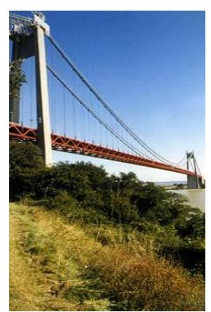

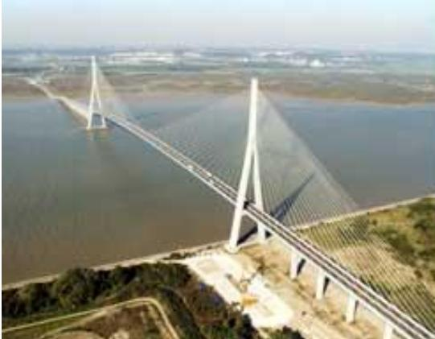


## **Question 11**

# **DR1 Étude 3 : Études préparatoires au choix du pont Question 11**

En béton, le pont ne pourrait se concevoir qu'avec des voussoirs en BUHP / BTUHP. Mais la hauteur des voussoirs aux appuis (de l'ordre d'une dizaine de mètres pour un ouvrage de cette portée) nécessiterait d'élever l'ensemble : d'où des problèmes de raccords topographiques avec les voies terrestres (terrassements complémentaires, emprises plus grandes ...) ainsi que des problèmes de pente à respecter pour les tramways.

C'est cette raison principale qui conduira la maîtrise d'œuvre à écarter la solution "tout béton".

# **Question 12**

Calcul des taux de charges **ponctuelles et linéiques permanentes** sur la structure.

| Charges linéiques                                           | Q | L(m) | l(m) | H(m) PV |    | p.Un  | p. Tot |      |
|-------------------------------------------------------------|---|------|------|---------|----|-------|--------|------|
| La dalle de béton sur le caisson a une épaisseur de 20 cm.  | 1 | 1    | 8,1  | 0,2     | 25 | 40,50 | 40,50  | kN/m |
| Le poids linéique des garde corps est de pgc<br>= 37 daN/m. | 4 |      |      |         |    | 0,37  | 1,48   | kN/m |
| Le poids linéique du caisson est de pmét<br>= 54,6 kN/m.    | 1 |      |      |         |    | 54,60 | 54,60  | kN/m |
| Total - réparti-                                            |   |      |      |         |    | Total | 96,58  | kN/m |

*Attention : la charge des caténaires est linéique mais rentre dans les charges P. car s'applique ponctuellement sur le pont par le biais des poteaux ! Rappel : Le poids linéique des caténaires est de pcat = 5 daN/m*

| Charges ponctuelles                                                | L(m)       | P.liné | P.   |    |      |       |    |
|--------------------------------------------------------------------|------------|--------|------|----|------|-------|----|
| Sur poteau intermédiaire, la charge des cables est                 | 32,50 0,05 |        | 1,63 | kN |      |       |    |
| Charge ponctuelle apportée par les poteaux intermédiaires          |            |        | 1,56 | kN | Tot. | 3,19  | kN |
| Sur les poteaux aux appuis, la charge des câbles est               | 16,25 0,05 |        | 0,81 | kN |      |       |    |
| Charge ponctuelle apportée par les poteaux sur appui               |            |        | 1,56 | kN | Tot. | 2,37  | kN |
| Total -non réparti- sur les 2 pot. d'appui et les 3 intermédiaires |            |        |      |    |      | 14,30 | kN |

*Remarque : en comparaison, la charge ponctuelle est négligeable (14,30 kN qui serait répartie sur 130 m donnerait 0,11 kN/m) devant le taux de charge répartie de 96,58 soit un rapport proche de 1 à 1000 !* 

*Les poids volumiques des béton et acier sont béton = 25 et acier = 78 KN/m<sup>3</sup>*

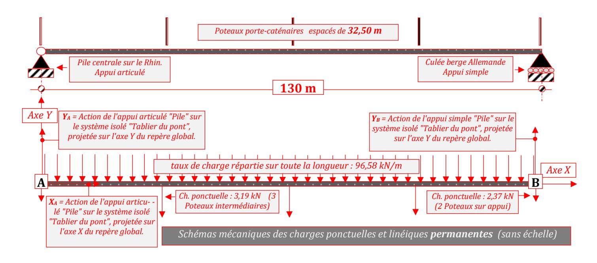

#### ▲ Question 13 ▲

# DR2 ▲ Étude 3 : Études préparatoires au choix du pont ▲ Question 13 ▲

Schémas mécaniques du pont chargé par 2 tramways ; ① cas "favorable" ② cas "défavorable".

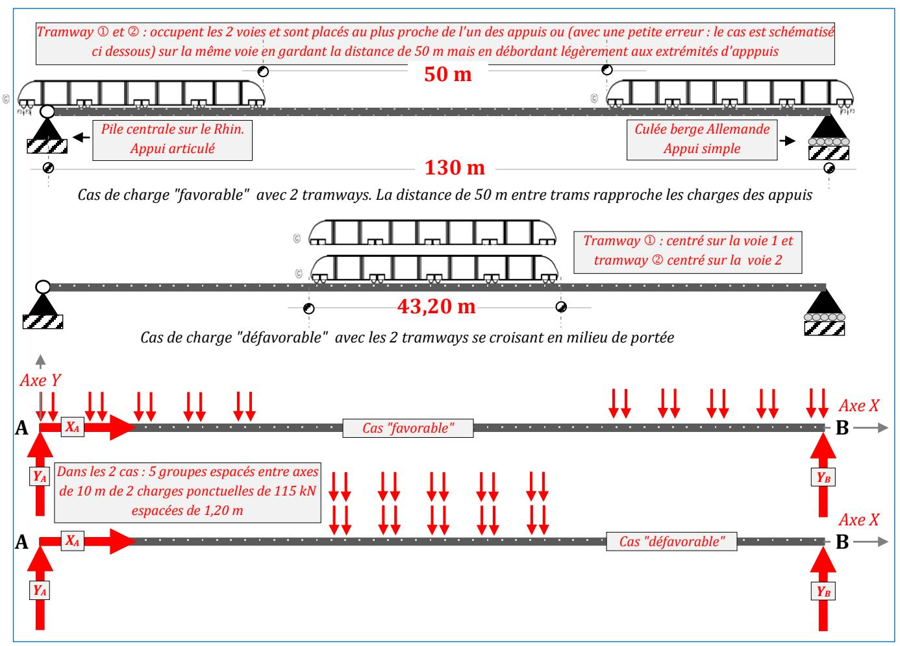

voir DT3 page 16 : Les 20 charges ponctuelles de 115 kN représentent le poids des essieux (NB : Sans grande

*erreur, on pourrait les rapporter à une charge répartie, ce qui est proposé en Question 15*). On note que pour une même charge placée sur une poutre, il s'ensuivra des valeurs de moments fléchissants d'autant plus élevées que ces charges se rapprochent du centre de la poutre, d'où plus de flèche et plus de contraintes dans la matière etc.

*NB : Par simplification, l'accélération de la pesanteur est prise égale à10 m\*s -2 , d'où une équivalence entre daN et kg*

# **Question 14**

# **DR2 Étude 3 : Études préparatoires au choix du pont Question 14**

Schémas mécaniques du pont chargé par 3 tramways au plus "défavorable".

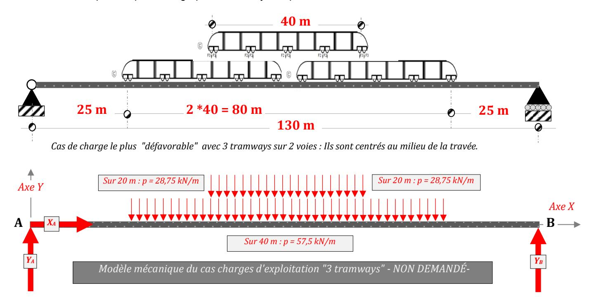

Pour le cas ci-dessus, non demandé, le calcul est établi de la manière suivante :

Hypothèse d'une répartition des charges tramway :

Poids d'un convoi :11,5 tonnes par essieu soit un total de 115 kN/essieu \* 10 essieux/convoi = 1150 kN/convoi. Ces 1150 kN à répartir sur 40 mètres de longueur soit : 1150 / 40 = 28,75 kN/m.

 Hypothèse des charges ponctuelles au niveau des essieux : idem question 13, à savoir 2 efforts ponctuels (poids de chaque essieu) espacés de 1,20 m, et les entraxes de chaque couple d'efforts espacés eux-mêmes de 10 mètres.

## **Valeur du moment fléchissant à mi-travée**

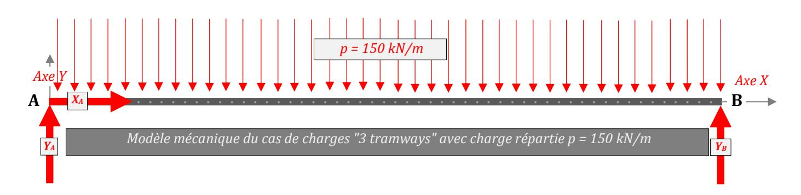

La valeur du moment fléchissant à mi-travée d'une poutre sur 2 appuis non encastrés et chargée de façon répartie correspond au moment maximal et vaut :  $Mf_{max} = p \cdot L^2 / 8$ . Ce qui donne :

$$Mf_{max} = 150 \cdot 130^2 / 8 = 316875 \text{ kN.m} \approx 317 \text{ MN.m}$$

# ▲ Question 15 ▲

# DR3 ▲ Étude 3 : Études préparatoires au choix du pont ▲ Question 15 ▲

Position en y et z du centre de gravité de la section du caisson métallique.

NB : Il peut y avoir plusieurs exemples de décomposition de la section en surfaces élémentaires.

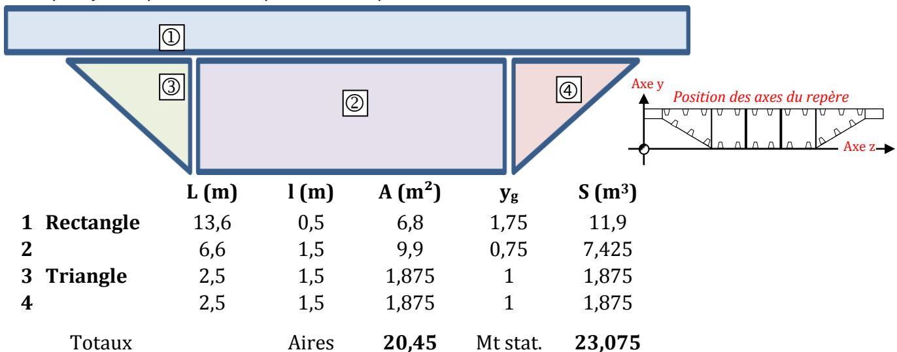

Calcul de la position en  $y_G$  = rapport de la somme des moments statiques élémentaires (en m³) à la somme des surfaces (en m²), soit 23,075 / 20,45. = 1,128  $\approx$  1,13 m

# Coordonnées (y,z) du centre de section : G (6,80 m ; 1,13 m)

La recherche du centre de section se fait grâce aux moments statiques des surfaces élémentaires. La symétrie de la section transversale du tablier permet de donner la valeur de zg soit 13,60 m /2 = 6,80 m par rapport à l'origine.

# **▲** Question 16 **▲**

# DR3 ▲ Étude 3 : Études préparatoires au choix du pont ▲ Question 16 ▲

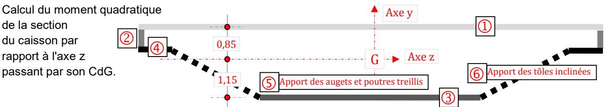

|     | Q | haut  | base   | S      | bh3/12            | y <sub>G</sub> du cdg | D /cdg       | $Sd^2$   | I cdg   |
|-----|---|-------|--------|--------|-------------------|-----------------------|--------------|----------|---------|
|     |   | m     | m      | $m^2$  | dm <sup>4</sup>   | m                     | m            | $m^4$    | $m^4$   |
|     |   |       |        |        |                   | Utilisati             | on du th. de | Huygens  |         |
| S 1 | 1 | 0,012 | 13,600 | 0,1632 | 1,9584E-06        | 2,00                  | 0,85         | 0,117912 | 0,11791 |
| S 2 | 2 | 0,500 | 0,012  | 0,006  | 0,000125          | 1,75                  | 0,60         | 0,00216  | 0,00457 |
| S 3 | 1 | 0,012 | 6,600  | 0,0792 | 9,504E-07         | 0                     | -1,15        | 0,104742 | 0,10474 |
| S 4 | 2 | 0,012 | 1,000  | 0,012  | 1,44E-07          | 1,500                 | 0,35         | 0,00147  | 0,00294 |
| S 5 | _ |       |        |        | Donnée sujet      |                       |              | 0,12     | 2250    |
| S 6 | 2 | 0,007 |        |        | Donnée s          | sujet                 |              | 0,0      | 1400    |
|     |   |       |        | Total  | en m <sup>4</sup> | 0.366667              |              | ≈ 0.37 m | 14      |

Comme pour le moment statique, il faut "découper" la section en surfaces élémentaires et calculer les moments quadratiques par rapport à l'axe passant par leur propre CdG. Ensuite, grâce au théorème de Huygens, obtenir les inerties par rapport à l'axe de l'ensemble de la section, puis sommer l'ensemble.

Rappel du théorème de Huyghens :  $I\!\!I\Delta G_z = I\!\!I\Delta' G_z + S*d^2$  d étant la distance entre les 2 axes  $\Delta'$  et  $\Delta$ .

## ▲ Question 17 ▲

Pour résoudre cette problème, on utilise le principe de superposition. Le calcul des flèches à partir des 2 cas suivants retenus:

① charge répartie  $p = p_{exp} + p_{per}$  soit 18 + 100 = 118 kN/m et ② charge ponctuelle  $P_{exp}$  = 1150 kN .

Calcul de flèche : modèle charge répartie  $f_{maxi} = 5 p * L^4 / 384 * E * I$ 

$$f_1 = 5 * (0,118) *130^4 / (384*E*I) = 5,65 m$$

Calcul de flèche : modèle charge ponctuelle :  $f_{maxi} = P * L^3 / 48 * E * I$ 

$$f_2 = (1,15) * 130^3 / (48*E*I) = 0,68 m$$

soit un total de 6,33 m, parfaitement incompatible avec les valeurs usuelles retenues (jusqu'au  $1/300^{\text{ème}}$  maxi de la portée soit L /  $300 \approx 0,43$  m).

## ▲ Question 18 ▲

Un appui simple génère une inconnue d'appui (soit généralement dans le cas des poutres, celle liée à l'intensité signée le plus souvent sur l'axe Y du repère global). Un appui articulé en génère 2 (soit l'intensité et la direction de l'action ou préférentiellement 2 inconnues d'intensité signée dont l'une sur l'axe Y et l'autre sur l'axe X du repère global).

Nous avons donc 4 inconnues d'appui. Le système "tablier" ne possédant pas de rotule interne, seules les équations du PFS dans le plan sont disponibles pour l'étude soit 3 équations.

Dans sa nouvelle configuration, le système "tablier" est donc hyperstatique de degré 1.

## DR4 ▲ Étude 3 : Études préparatoires au choix du pont ▲ Question 19 ▲

#### En fonction des écritures et convention adoptées :

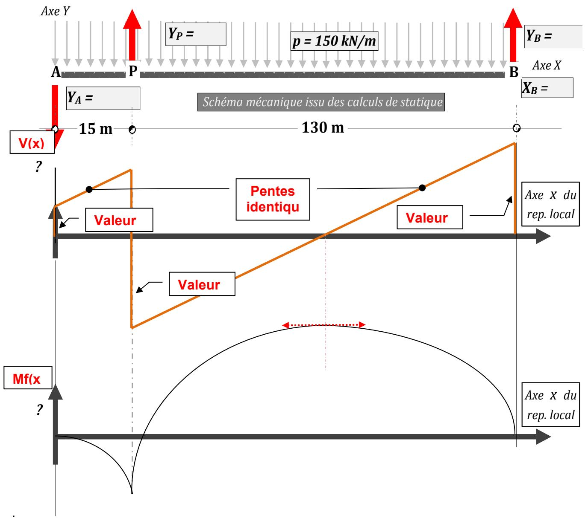

① Effort tranchant : Sur l'appui A, l'effort tranchant  $V(X_{=0})$  a une valeur correspondant à celle de l'action d'appui (signée négativement selon la convention adoptée), soit  $V(0) = -Y_A$ . Dans la 1<sup>ère</sup> travée (de A à P), la charge répartie signée négativement impose une droite croissante dont le coefficient directeur est la valeur inverse de l'intensité signée de la charge, soit  $V(0 < x < P) = -Y_A + p \cdot x$ .

Sur l'appui P, l'effort tranchant V(P) "décroche" de la valeur inverse de  $Y_P$ . De manière évidente, l'intensité de  $Y_P$  étant supérieure à la somme de celles de  $Y_A$  et de  $P \cdot X$  (ici 150  $\cdot$  15), V(P) se retrouvera en valeur négative.

Dans la 2ème travée, V(P < x < B) sera une droite croissante de coefficient directeur identique à celui de la travée AP. Elle reliera les 2 points suivants dont les coordonnées cartésiennes sont : en P : x = 15 m ;  $y = (-Y_A - P + p \cdot x)$  et en B : x = 145 m et  $y = Y_B$ . Dans le même esprit que ce que l'on obtient en A, la valeur sur l'appui B est  $V(B) = Y_B$ .

② Moment fléchissant: Sachant que A et B ne sont pas des appuis encastrés, les valeurs de Mf(0) et Mf(145) sont obligatoirement nulles. Les efforts tranchants étant des droites et sachant que l'effort tranchant est la dérivée inverse du moment fléchissant (dMf(x)/dx = -T(x)), on peut affirmer que le moment fléchissant suivra une courbe parabolique. La droite de l'effort tranchant étant croissante, son coefficient directeur est positif. Ce qui entrainera un coefficient directeur négatif pour la parabole qui du coup, "regardera vers les y négatifs". On peut encore affirmer que les valeurs négatives de V(x) entrainent une croissance de la parabole et inversement. Enfin, pour l'abscisse x où lel tranchant est nul, le moment fléchissant présentera un maximum.

\_ \_ \_ \_ \_ \_ \_ \_ \_ \_ \_ \_ \_ \_ \_ \_ \_ \_ \_ \_ \_ \_ \_ \_ \_ \_ \_ \_ \_ \_ \_ \_ \_ \_ \_\_ \_ \_ \_ \_ \_ \_ \_ \_ \_ \_ \_ \_ \_ \_ \_ \_ \_ \_ \_ \_ \_

# **DR5 Étude 3 : Études préparatoires au choix du pont Question 20**

NB: Les graphes de N(x) et V(x) ne sont pas exigés. Ils sont développés en page suivante à titre d'information.

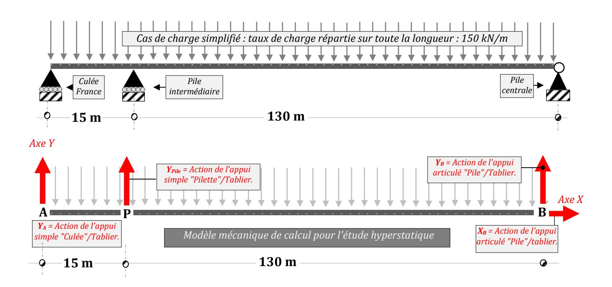

Comme le système est hyperstatique, l'utilisation du théorème des 3 moments semble bien appropriée pour obtenir les résultats recherchés.

Dans le cas des poutres continues où les inerties sont les mêmes et les charges uniformément réparties égales sur les travées, on a (Mi-1 Li) + 2 (L<sup>i</sup> + Li+1) M<sup>i</sup> + (Li+1 Mi+1) = - 1/4 (p<sup>i</sup> L<sup>i</sup> 3 + pi+1 L 3 i+1) avec ...

- L<sup>i</sup> et Li+1 = portée des travées i et i +1
- Mi-1 et M<sup>i</sup> et Mi+1 = moments sur les appuis i -1 ; i ; i +1 et
- p<sup>i</sup> = charge répartie uniforme sur la totalité de la travée i

Dans notre cas, les données utiles pour l'application numérique sont :

Li= 15 m ; Li+1 = 130 m ; Mi-1 = Mi+1 = 0 (appuis de rive non encastrés) ; M<sup>i</sup> est inconnu ; p<sup>i</sup> = 150 kN/m Ce qui donne

$$2*(15+130)*M_i = -1/4*(150*15^3+150*130^3)$$
; soit  $M_i = -1/1160*(506250+329550000) = -1/1160*(506250+329550000)$ 

- 284531,25 kN.m ≈ **- 285 MN.m.**

Connaissant maintenant le moment fléchissant sur 2 appuis consécutifs, on obtient par déduction selon la méthode classique de calcul des équations de moment fléchissant, les efforts tranchants qui correspondent aux valeurs des actions d'appui de rive YA, puis en "retournant" le système, à YB.

soit 
$$M_i = (T_{i-1} * L_i) - (p_i * L_i^2)/2$$
. Ainsi :

Ti-1 = Y<sup>A</sup> = (M<sup>i</sup> + (p<sup>i</sup> L<sup>i</sup> )/2)/ L<sup>i</sup> = ((- 284531,25) + (150 15<sup>2</sup> )/2)/15 = - 17843,75 kN ≈ **- 17,85 MN** pour l'appui en A et en "retournant" le système (inversion de l'axe x du repère local avec origine en B):

$$T_{i\text{-}1} = Y_B = (M_i + (p_i * L_i^2)/2) \ / \ L_i = ((-284531,25) + (150*130^2)/2)/130 = 7561,30 \ \text{kN} \approx \textbf{+ 7,56 MN} \ \text{pour l'appui en B}$$

En appliquant au système isolé (le tablier) l'équation du PFS sur l'axe des Y : Y<sup>A</sup> + Y<sup>P</sup> + Y<sup>B</sup> - pLtotale = 0

soit  $Y_P = p*L - Y_A - Y_B = (150 * 145) - 7561 + 17844 = 32032 \approx 32,03 MN$ 

NB : Comme aucun effort extérieur autre que  $X_B$  ne s'applique au système, alors  $X_B = 0$ 

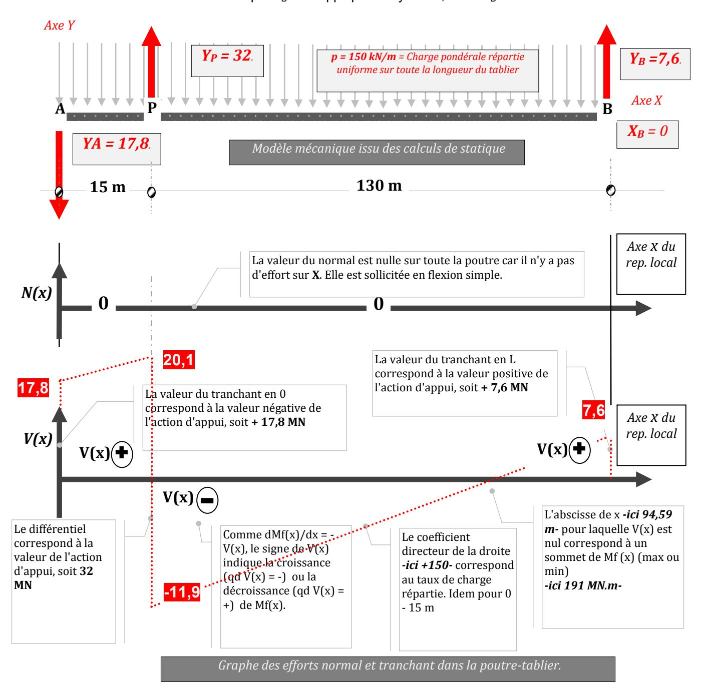

#### Graphe du moment fléchissant entre les 2 piles. Valeur de Mf<sub>maxi</sub>.

Puisque le problème ne concerne que la travée entre piles, le plus simple est de "retourner" le système en partant du point B. Ainsi, l'équation du moment fléchissant sera établie dans la 1<sup>ère</sup> zone !

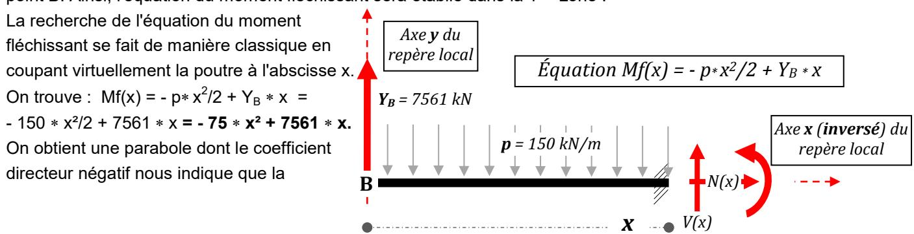

concavité sera dirigée vers les "y négatifs".

Valeurs remarquables de x à "calculer" pour

construire la courbe : 0 m ; 130 m et x pour lequel "y" s'annule.

Pour x = 0 : Mf(0) = 0 ! pour x = 130 m : Mf(130) = - 75 130² + 7561 130 = -284530 kN.m ≈ **- 285 MN.m**

(NB : On retrouve la valeur étudiée au § 3.2.2 avec la formule des 3 moments).

Pour connaître x pour lequel "y" s'annule, il faut dériver la fonction Mf(x)

soit la nouvelle fonction y(x) = -V(x) = dMf(x)/dx = 150 x - 7561. y s'annule pour x = 7564 / 150 = 50,41 m et la valeur de Mf(50,41) = 75 (50,41)² + 7561 50,41 = + 190577 kN.m ≈ **+190 MN.m**

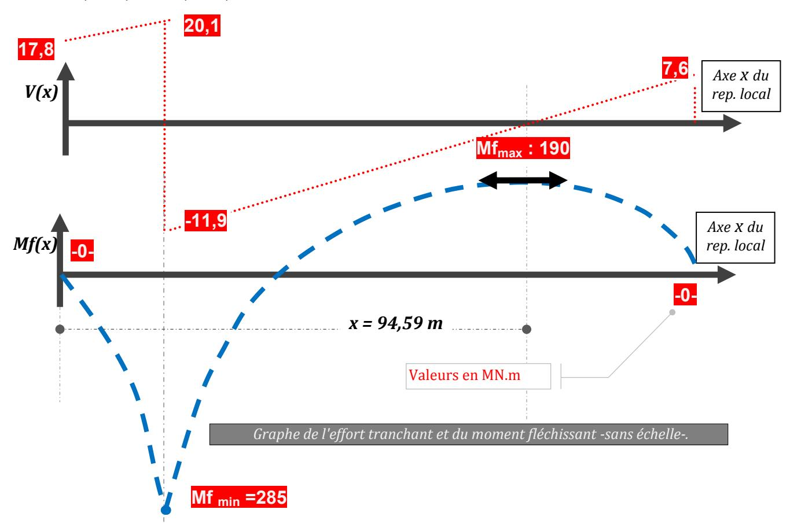

# **Question 21**

Le Mfmax en travée passe de 317 MN.m (trouvé Question 14) à 190 MN.m (trouvé ci-dessus). Le gain de moment fléchissant (donc de flèche) est de 40 % ; Par ailleurs, -mais c'est sans incidence-, la position du Mfmax est décalée.

## **Question 22**

Le gain de 40 %, bien que non négligeable ne permet pas de rester dans les limites de flèche. Une autre architecture est donc à envisager. La solution retenue : le bow-string est bien appropriée. D'autres solutions ont malgré tout été étudiées, en particulier un pont à haubans.

# **Étude 4 : Étude acoustique**

# **Question 23**

Le sonomètre est l'instrument de mesure le plus usité pour la mesure du niveau de pression acoustique.

## **Question 24**

#### **Niveau de pression acoustique à 5 m de la source. Campagne de mesures .**

*Voir Annexe 2 Acoustique page 23* :

En prenant la formule (§ b3 de l'annexe) ... = ∗ (∑ (/) )**.** on trouve **Lp = 89 dB.**

Le tableau selon les arrondis pratiqués permet d'obtenir la même valeur de 89 dB.

## **Question 25**

## **Niveau de pression acoustique en façade de bâtiment. Campagne de mesures où Lp = 91 dB.**

*Voir § b4 Annexe 2 Acoustique page 23 :* 

À chaque doublement de distance, on perd 3 dB ... soit

à 5 m : 91 dB ; à 10 m : 88 dB ; à 20 m : 85 dB ; à 40 m : 82 dB ; à 80 m : **79 dB** 

On obtient donc une atténuation acoustique de 91 - 79 = **12 dB en façade du bâtiment.**

# **Question 26**

*Voir Tableau des valeurs correctives §A Annexe 2 Acoustique page 23 :* 

| Fréquence     | 31,5  | 63    | 125   | 250  | 500  | 1000 | 2000 | 4000 | 8 000 |
|---------------|-------|-------|-------|------|------|------|------|------|-------|
| Lp par octave | 73    | 78    | 81    | 86   | 87   | 81   | 74   | 67   | 60    |
| Correction    | -39,4 | -26,2 | -16,1 | -8,6 | -3,2 | 0    | 1,2  | 1    | -1,1  |
| Val. corrigée | 33,6  | 51,8  | 64,9  | 77,4 | 83,8 | 81   | 75,2 | 68   | 58,9  |

Log somme : **86,7 dB**

Avec le gain de 12 dB trouvé plus haut, (même calcul) on obtient une valeur de 74,7 dB(A) en façade.

# **Question 27**

# **Niveau acoustique continu équivalent LAeq (22h00-06h00) puis LAeq (06h00-22h00).**

*Voir §b5 Annexe 2 Acoustique page 24 et informations données dans tableau page 11 :* 

Comme chaque passage occasionne le même bruit de 70 dB, il suffit de faire le rapport des temps soit ...

Entre 22h et 6 h, il y a 2 + 10 + 6 + 6 = 24 passages soit 24 minutes

LAeq(22h00-06h00) = 10 \* log[ (1/(8\*60)) \* 24 \* 10 (70/10) ] = **57 dB(A) = LAeq(22h00-06h00)**

Entre 6h et 22 h, il y a 240 passages soit 240 minutes

LAeq(6h00-22h00) = 10 \* log[ (1/(16\*60)) \* 240 \* 10 (70/10) ] = **64 dB(A) = LAeq(6h00-22h00)**

## **Question 28**

#### **Vitesse maximale du tramway.**

*Voir tableau §c3 et courbe de vitesse §c21 Annexe 2 Acoustique pages 24 et 25 et informations page 11.*

Les valeurs précédentes 57 et 64 sont trop grandes de **2 dB(A) et 4 dB(A)** pour respecter les contraintes réglementaires des lf nuit et lf jour (55 et 60 en apport travaux).

Action sur la vitesse : 40 km/h donne 1,6 pour log10(v) ; pour un différentiel de 4 dB, il faut abaisser à 1,45 soit 30 km/h !) Le résultat obtenu -soit sur la courbe soit par calcul- montre donc qu'il faut abaisser la vitesse de 10 km/h.

### **Question 29**

On peut envisager agir sur d'autres leviers tels les revêtements. L'herbe permet une forte réduction des bruits réverbérants et peut également servir de système de rétention d'eau en cas d'orages. S'y ajoute le coté "vert".

#### **Question 30**

Pour des raisons d'intensité du trafic (plus la vitesse est grande, plus de voyageurs sont pris en charge d'une part, et plus les trajets sont rapides d'autre part), le maître d'ouvrage préférera ne pas agir sur les vitesses donc visera plutôt une action liée aux revêtements et des arrêts de climatisation aux stations, même avec des coûts d'entretien majorés.

# **Étude 5 : Étude géotechnique –Terrassements**

# **Question 31**

**Principales phases des travaux de terrassement nécessaires à la réalisation de la rampe d'accès** 

- Décapage de la terre végétale ;
- Mise en œuvre d'une couche de matériaux drainants ;
- Mise en œuvre des remblais de préchargement ;
- Terrassement de la plateforme de préchargement pour permettre la réalisation de la culée C4 et des murs de soutènement ;
- Livraison de la plateforme finale pour accueillir le corps des circulations ;
- Travaux d'aménagements extérieurs contigus à l'ouvrage.

# **Question 31**

**Phase susceptible d'imposer un temps d'inactivité sur la planification du chantier.** 

La phase concernée est celle liée au préchargement de la zone de chantier n°3.

Après la mise en œuvre des remblais de préchargement, la couche de sol en place va tasser.

Le tassement total d'un sol se décompose en tassement primaire et en tassement secondaire. Le tassement primaire a deux composantes, un tassement immédiat et un tassement différé associé à la consolidation. De ce fait, une partie du tassement des couches géologiques inférieures évolue quasi instantanément avec la montée en charge des remblais, mais un temps reste nécessaire à la consolidation des sols en place.

## **Question 33**

#### **Principe et l'utilité d'une phase constructive utilisant la technique d'un préchargement.**

- **Principe :** Mise en place d'un remblai drainant au niveau du terrain naturel, surmontée d'une couche de matériaux de hauteur supérieure aux remblais définitifs, destiné à charger un sol compressible afin d'accélérer sa consolidation. Ce procédé doit être complété par un dispositif de drainage du sol en place et de dissipation des pressions interstitielles.
- **Utilité** : Le poids de cet ensemble permet de tasser les couches de sol en place, de telle sorte que les fondations des ouvrages à construire sur ces terrains ne subissent plus d'efforts mécaniques préjudiciables à leur pérennité (frottements négatifs).

Une fois le tassement du terrain sous la rampe d'accès stabilisé, le corps de la voirie ne subira pas de désordres dus à d'éventuels tassements différentiels.

Une fois le niveau de tassement suffisant ayant été atteint, les matériaux de préchargement sont démontés et la construction des ouvrages peut démarrer.

## **Question 34**

**Contrainte moyenne (σ**v0 **en kPa) au milieu de la couche soumise aux tassements, apportée par son p. propre**

$$\sigma_{VO} = \gamma$$
 · (h REMBLAI SABLO GRAV + h ALLUVIONS SABLO GRAV moy compacte )/2= 26 · (3+3)/2 = **78.0 kPa** (= 0.78 daN/cm<sup>2</sup>)

#### **Question 35**

**Hauteur H<sup>R</sup> définitive des remblais prévus au-dessus de la couche drainante**

$$Z_{Remblai} = 144,693 NGF$$
  $Z_{sup base drainante} = +139,500 NGF$ 

$$H_R = 144,693 - 139,500 = 5,193 \text{ m} \approx 5,200 \text{ m}$$

**Variation de contrainte** Δσ<sup>F</sup> **(en kPa), sur le sol en place à +138,500 NGF, apportée par le massif final.**

$$\Delta \sigma_{\rm F} = \gamma_{\rm RD} \cdot h_{\rm RD} + \gamma_{\rm R} \cdot H_{\rm R} = 21 \cdot (1+5,200) = 130,2 \text{ kPa} (= 1,302 \text{ daN/cm}^2)$$

DR6 ▲ Étude 5 : Étude géotechnique - Terrassements ▲ Question 32 ▲

Coupe géologique localisée au niveau de C4 / Semelle pieux de C4 / Niveau de la nappe (noté N.N.P.) / Base drainante.

# Profil géologique:

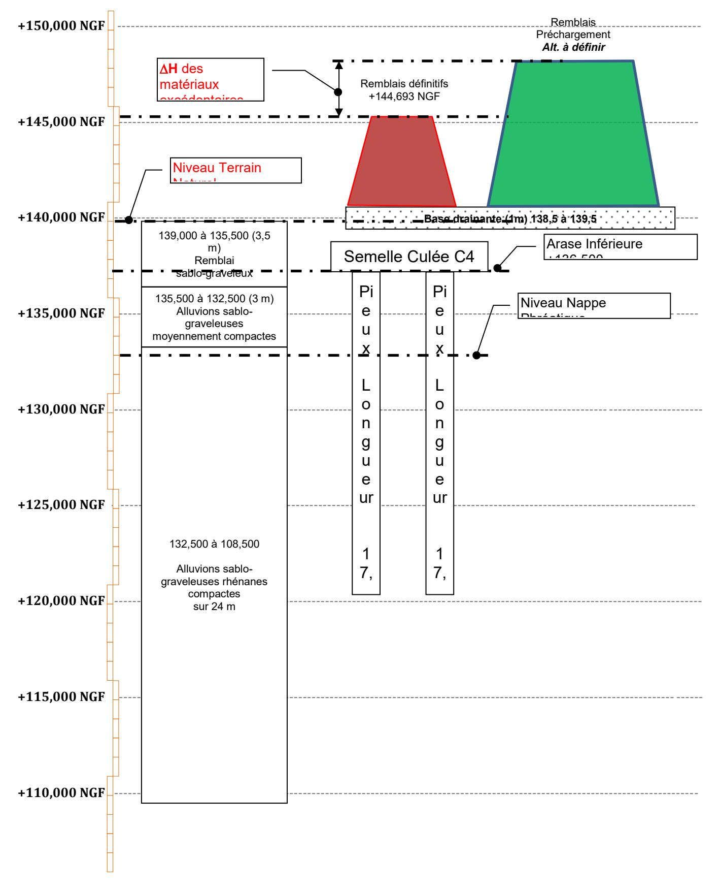

**Tassement** ∆**, en cm, de la couche de sol.**

$$\Delta h = -6.0,5 / (1+1,3) \cdot \log (1+130,2/78) = -0,556$$
 m soit un **tassement de 56 cm**

**Temps nécessaire pour obtenir 100% de ce tassement**

La consolidation du sol est considérée comme presque terminée lorsque le degré de consolidation atteint quasi 100% du tassement global estimé. Cela revient à considérer T<sup>v</sup> = 2

$$t = \frac{Tv * H^2}{4 * C_v}$$
 d'où t = 2 \* (600)² / (4 \* 2,546.10<sup>-3</sup>)= **70 699 135,9 s**

soit en jour : t = 70699135,9 / (3600 \* 24) = 818,3 j **≈ 819 j** et à raison de 30 j / mois : **t ≈ 2 ans 3 mois**

# **Question 38**

## **Justification de la solution constructive retenue (remblai de préchargement)**

Un délai de 2 ans (=730 jours) est très supérieur à 120 jours, ce qui ne laisse pas suffisamment de temps, au regard du planning prévisionnel, pour que le sol puisse finir de tasser normalement.

La technique (remblais de préchargement) consiste donc à surcharger considérablement le sol support afin d'atteindre plus rapidement, dans cette configuration préchargée, un tassement partiel correspondant au tassement final visé dans la configuration finale réelle.

La question qui en découle est : « Quelle est l'épaisseur totale de remblais à mettre en œuvre pour obtenir en 120 jours la totalité des tassements calculés sous les remblais initialement prévus ? »

## **Question 39**

## **Calcul de facteur temps T<sup>V</sup> correspondant au planning**

Un délai de 2 ans (=730 jours) est très supérieur à 120 jours, ce qui ne laisse pas suffisamment de temps, au regard du planning prévisionnel, pour que le sol puisse finir de tasser normalement.

$$T_V = \frac{4 \times C_V}{H^2} * t$$
, soit:  $T_V = 4 \cdot 2,546.10^{-3} \cdot (120 \cdot 24 \cdot 3600) / 600^2 = T_V = 0,293 \approx 0,29$ 

D'après le tableau *voir annexe 4 géotechnique page 27*,

pour un facteur temps **T<sup>V</sup> ≈ 0,29** , le degré de consolidation **UV(120j) est de 80%.**

Cela revient à dire qu'après une période de 120 jours, le tassement visé de 57 cm correspond à 80% du tassement global qui serait obtenu sous l'effet des remblais de préchargement.

Et par « règle de 3 », si un tassement de 57 cm correspond à 80% du tassement estimé sous l'effet du préchargement, il en découle la relation :

$$\Delta h = 80/100 \cdot \Delta H$$
 soit  $\Delta H = 56 \cdot 100 / 80 = 70$  cm

### **Question 40**

#### **Calcul de variation de contrainte**

La relation permettant le calcul du tassement d'une couche de sol sous l'effet d'une distribution de contrainte uniformément répartie se traduit dans notre cas de figure par :

$$\begin{split} \frac{\Delta H}{H} &= -\frac{Cc}{1+e_0} * \log \left(1 + \frac{\Delta \sigma_{Pr\acute{e}ch}}{\sigma_c}\right), \qquad soit \quad \log \left(1 + \frac{\Delta \sigma_{Pr\acute{e}ch}}{\sigma_c}\right) = -\frac{1+e_0}{Cc} * \frac{\Delta H}{H} \\ &1 + \frac{\Delta \sigma_{Pr\acute{e}ch}}{\sigma_c} = 10^{-\frac{1+e_0}{Cc} * \frac{\Delta H}{H}} \qquad \qquad \text{d'où} \qquad \Delta \sigma_{Pr\acute{e}ch} = \left(10^{-\frac{1+e_0}{Cc} * \frac{\Delta H}{H}} - 1\right) * \sigma_c \end{split}$$

$$\Delta \sigma_{Pr\acute{e}ch} = \left(10^{-\frac{1+1.3}{0.5}*\frac{-70}{600}} - 1\right) \times 78 = 190.39$$
 
$$\Delta \sigma_{Pr\acute{e}ch} = 190.39 \text{ kPa}$$

**Hauteurs globales des remblais de préchargement (totale et des seuls matériaux de remblais)** 

$$\Delta \sigma_{Pr\acute{e}ch} = \gamma_{RD} * H_{BD} + \gamma_{RPr\acute{e}ch} * H_{Pr\acute{e}ch}$$
 or  $\gamma_{RD} = \gamma_{RPr\acute{e}ch} = \gamma = 21 \ kPa$ 

$$\Delta \sigma_{Pr\acute{e}ch} = \gamma * (H_{BD} + H_{Pr\acute{e}ch}) = \gamma * H_{GLOBALE\ REMBLAIS\ PRECHARGEMENT}$$

$$H_{GLOBALE\ REMBLAIS\ PRECHARGEMENT} = \frac{\Delta \sigma_{Pr\'{e}ch}}{\gamma} = \frac{190,39}{21} =$$
**9,066** *m*

*é*ℎ = − = 9,066 – 1,000 = , **Niveau altimétrique à vérifier en fin de montage des remblais de préchargement.**

Niveau fini PFT préchargement = Niveau de pose de la base drainante + HBD + HPréch = +138,500 + 1,000 + 8,066

#### soit **147,566 NGF**

**Résumé des réponses Question 40 :**

- ∆*é* = **190,39 kPa ;**
- = , **;**
- *é* = ,
- **Niveau fini PFT préchargement = 147,566 NGF**

## **Question 41**

**Calcul de l'épaisseur des matériaux à éliminer.**

Niveau fini PFT visé = +144,693 NGF

Niveau fini PFT préchargement = +147,600 NGF

Niveau fini PFT préchargement après tassement du sol support = +147,600 - 0,700 m= +146,900 NGF

Épaisseur des matériaux excédentaires à éliminer = 146,900 - 144,693 **= 2,207 m**

## **Question 42**

Les différents acteurs des projets publics -voire privés- sont souvent sujets aux remarques désobligeantes de certaines personnes mettant en avant systématiquement les aspects nuisibles d'un projet. Sans cacher les contraintes de ce type liées à de telles constructions, il va de soi que le caractère reconnu "d'utilité publique" impose -de fait- les nuisances.

Or, la perception des gênes n'est pas une fonction proportionnelle au temps, mais au contraire se rapproche plutôt d'une exponentielle. On peut considérer dès lors que des explications concernant les modes opératoires susceptibles de réduire drastiquement la durée de travaux sont les plus pertinentes à apporter.

*NB : Commentaires informatifs complémentaires sur les nuisances.*

# **Particularités des matériaux constitutifs du milieu géologique en place. Vulnérabilité des eaux souterraines**

Des matériaux alluvionnaires sablo-argileux permettent une dynamique particulière des eaux.

Le drainage des eaux dans des matériaux sablonneux permet la migration des polluants vers le Rhin et/ou la nappe phréatique.

La présence d'argile et d'alluvion rend le sol sensible aux états hydriques fluctuants.

Toute migration d'eaux polluées pourrait avoir des incidences durables environnementales, mais aussi sur la durabilité des ouvrages liés aux plateformes et terrassements.

La couche drainante mise en œuvre en pied de remblai doit rester saine, sans favoriser quelconque canal de migration d'eaux polluées.

### **Mécanismes par lesquels des polluants peuvent affecter les eaux souterraines. Solutions techniques.**

Les plateformes des terrassements généraux, ainsi que les infrastructures des voies de circulation peuvent être sujettes à des effondrements de cavités proches de la surface.

Des dispositifs de type géotextiles anti contaminants et de renforcement peuvent être mis en œuvre afin d'assurer les pérennités mécanique et structurelle de l'ouvrage d'une part, mais également pour amoindrir tout transfert d'hydrocarbures vers le milieu naturel.

Les mécanismes de pollution des sols sont variés. Le ruissellement et l'infiltration sont les deux facteurs favorisant la pollution des eaux souterraines.

#### Solutions techniques :

- Collecte des eaux de ruissellement :
- Canalisation des écoulements via des fossés, cunettes, vers des bassins de décantation et de traitement ;
- Mise en œuvre de barrière étanche (géo membrane, géo composite bentonitique...).

# **Étude 6 : Environnement numérique collaboratif. BIM**

## **Question 43**

**Niveaux de développement ND de la maquette numérique durant les opérations en phase chantier.**

**ND 4** : SYNTHÈSE – ÉTUDE D'EXÉCUTION –CONSTRUCTION

**ND 5** : DOSSIER DES OUVRAGES EXÉCUTÉS

**Démarche « BIM » utilisée par le groupement d'entreprises.** 

Le BIM est un processus de gestion collaboratif du projet reposant sur les échanges et l'enrichissement de la maquette numérique par les acteurs du projet. Dans le cas présent, les informations utiles ne sont pas centralisées au sein d'une maquette numérique partagée.

La démarche adoptée n'intègre pas encore le concept collaboratif BIM.

La réponse est donc **NON.**

**Degré d'expérience BIM au regard des pratiques pré-décrites du groupement d'entreprises. BIM de niveau 1**

### **Question 44**

#### **Approche numérique pour conduire le projet dans le cadre d'une démarche de DD.**

L'approche numérique permet d'avoir une vision globale de la vie de l'ouvrage en passant par les différentes phases de conception, réalisation, exploitation, entretien et gestion, déconstruction et recyclage.

Le BIM, grâce à ses capacités d'analyses, permet très tôt de vérifier et d'adapter la conception d'un projet afin de réduire son impact environnemental.

Les projets de construction représentent une partie non négligeable de notre empreinte carbone globale. Les analyses de site, solaires, d'isolation, de chauffage et ventilation, d'énergies renouvelables, d'hydrologie, et des déchets liés à la construction-démolition pourraient être également réalisées grâce à la modélisation des données et ainsi contribuer à des ouvrages plus économiques et plus écologiques.

La planification et l'estimation des quantités plus précises permettent d'avoir les matériaux voulus au moment opportun sur le chantier, réduisant ainsi les commandes imprécises et de ce fait les déchets.

## **Question 45**

#### **Utilisation émergente des outils numériques. Limites actuelles du déploiement.**

**Avantages :** l'usage des outils numériques émergeants permet de :

- définir un ouvrage dans sa globalité avant de le construire ;
- anticiper les problèmes techniques avant la construction (détection d'interférences) ;
- impliquer l'ensemble des partenaires du projet ;
- conserver de la donnée numérique dans le temps ;
- enrichir les modèles numériques d'un nombre considérable de données attributaires ;
- concevoir avec de nouvelles possibilités ;
- gagner en efficacité par l'intégration des process industriels pour valider les interfaces ;
- assister de manière précise la réalisation ;
- suivre les réserves de chantier ;
- mettre à jour en continu les maquettes/plans ;
- gagner en sécurité grâce à un management visuel ;
- …

#### **Limites :**

- investissement initial conséquent (équipement et formation) ;
- manque de formation des personnes ;
- aspect législatif et processus collaboratif insuffisamment cadrés pour le moment ;
- craintes des entreprises relatives à la confidentialité des données ;
- outils en développement et non complètement stabilisés ;
- avancée culturelle très ou trop rapide pour certains partenaires ;
- rentable pour des chantiers de tailles importantes uniquement pour le moment ;
- outils en voie de développement pour les chantiers de rénovation (TPE/PME) ;
- …

## **Question 46**

### **Données attributaires introduites et partagées dans le cadre d'une modélisation numérique commune du projet.**

#### **Bureau d'études « Béton Armé »**

- Caractéristiques des bétons employés
- Tarifications
- Quantités
- Provenance des matériaux …

#### **Bureau d'études « Charpente Métallique »**

- Caractéristiques mécaniques des aciers utilisés
- Protections utilisées anticorrosion feu
- Tarifications
- Procédures de montage
- Périodicité des entretiens
- Provenance des assemblages …

#### **Bureau d'études « Acoustique »**

- Temps de réverbération des matériaux utilisés
- Coefficients d'absorption des matériaux utilisés
- Quantitatifs des surfaces exposées, des écrans, …
- Nature et puissance des sources sonores …

### **Bureau d'études « Géotechnique »**

- Poids volumique des sols manipulés
- Caractéristiques relatives à la nature et l'état des sols rencontrés (granulométrie, classement,…)
- Indice des vides, indice de compression, coefficient de consolidation….

### **Nom de l'extension des fichiers numériques utilisés pour partager des données au sein d'une maquette numérique.**

Les fichiers « .ifc » ("Industry Foundation Classes") sont dits interopérables.

#### **Niveau de fiabilité des informations partagées.**

A ce jour, l'ensemble des données attributaires subit encore quelques pertes durant le transfert de fichiers numériques. Ce problème devrait se régler avec le temps.

La solution la plus adaptée est de travailler avec une suite logicielle en provenance du même éditeur de logiciel.

# **Question 47**

#### **Niveau de détail minimum (LOD) d'une maquette numérique le mieux adapté**

Pour le chef de chantier qui gère les équipes des coffreurs/ferrailleurs : LOD 300 Pour l'économiste de la construction en phase avant-projet sommaire : LOD 200 Pour le conducteur de travaux qui gère les interférences entre intervenants : LOD 400

## **Question 48**

## **Nécessité pour les entreprises à s'emparer des enjeux digitaux en cours de développement.**

Cette question trouve ses éléments de réponse dans le développement de la question 45.

# **Rapport du jury de l'épreuve « Étude d'un système, d'un procédé ou d'une organisation » – option ingénierie des constructions**

#### **1. Présentation du sujet**

Le sujet de cette épreuve d'admissibilité du CAPET SII option Ingénierie des constructions s'appuie sur un projet réel, réalisé depuis peu à Strasbourg **:** Le **Pont Béatus Rhénanus**.

Cet ouvrage participe à la (re)création d'une ligne continue de tramway (ligne D) entre la métropole alsacienne et Kehl, la ville-frontière allemande. Sa construction a nécessité la réalisation de plusieurs ouvrages de franchissement dont ce pont sur le Rhin à hauteur de la capitale Européenne.

L'objet technique « pont » permet un questionnement très vaste. Six thèmes d'études très différents et éloignés les uns des autres ont été retenus, afin que tous les candidats ayant suivi des formations très diverses telles :

- L'ingénierie des structures (CM ou Béton) ;
- L'Architecture et urbanisme ;
- L'Ingénierie des méthodes, des matériaux ;
- L'Ingénierie de l'acoustique, de la géotechnique, de l'hydraulique, de la topographie ;
- Etc….

soient susceptibles de trouver matière à appréhender correctement, au moins pour partie, le sujet. Au besoin, une lecture attentive des annexes et documents techniques complète les connaissances nécessaires au traitement des questions.

Cette approche dans la conception des épreuves permet au jury de considérer que **tous les candidats**, et ce, quels que soient les profils de formation, sont dans une posture de réussite, sans pour autant être spécialiste de l'un ou l'autre thème de l'épreuve qui porte, pour cette session 2018, sur les points suivants:

- Partenariats Intégration urbaine ;
- Le matériau « béton » utilisé pour la pile centrale ;
- Études préparatoires au choix structurel du pont ;
- Étude acoustique ;
- Étude géotechnique Terrassements ;
- Environnement numérique collaboratif.

Les six études proposées constituant le sujet ont été très largement simplifiées eu égard à la complexité du projet et de la réalisation réelles, ce qui pouvait laisser paraître quelques approximations et/ou omissions, voulues par le jury, par rapport aux règlements et autres normes calculatoires.

Dans le même esprit, la présentation des documents professionnels est réduite au minimum afin de ne pas surcharger le temps de lecture. Aussi, s'il pouvait apparaitre aux candidats un manque dans les données nécessaires à la résolution d'un problème, un apport personnel motivé et justifié pour y pallier n'était en aucun cas préjudiciable.

Totalement **indépendantes** entre elles, chacune des études renvoie à un secteur particulier du domaine de la construction. Dans la mesure du possible, les questions au sein d'un même thème sont de difficulté croissante et le plus souvent possible indépendantes également les unes des autres ; ce

qui permet de pouvoir traiter -ne serait-ce que partiellement- n'importe quelle partie et ce, dans un ordre librement choisi. Là également, les candidats ne sont pas pénalisés par rapport à cela.

Enfin, le thème N°6 traite d'un problème transversal : "**l'évolution des pratiques numériques collaboratives",** couvrant toutes les étapes de la vie de l'ouvrage. À partir de là, les réponses attendues pouvaient éventuellement nécessiter la relecture de l'une ou l'autre annexe.

#### **2. Analyse globale des résultats**

Une majorité de candidats a bien compris la structure du sujet dans son approche par thème et comment traiter chaque partie grâce à ses connaissances acquises en cours de formation ou disponibles dans les documents annexes. Cela étant et malgré toutes les recommandations données dans les rapports de concours des années précédentes, le jury constate le traitement encore trop linéaire du questionnement proposé et en corollaire, un manque d'éléments de réponse aux dernières questions dont le niveau de difficulté est pourtant loin d'être inaccessible.

Ainsi, les candidats ayant opté pour une stratégie de rédaction mieux ciblée en fonction de leurs capacités de réponse au questionnaire ont obtenu des résultats satisfaisants, voire très satisfaisants.

### **3. Commentaires sur les réponses apportées et conseils aux candidats**

Étude N°1 : Partenariats - Intégration urbaine.

Ce thème vise à prendre en compte la transformation et le modelage de l'environnement dans lequel s'inscrit l'ouvrage, ainsi que la justification du bien-fondé de sa réalisation par les différents acteurs de sa construction.

Le jury a apprécié le fait que presque tous les candidats (93%) ayant traité cette partie l'ont fait plutôt correctement, tout en regrettant qu'un petit nombre parmi eux ne connaissent pas le rôle des différents intervenants (maîtrise d'ouvrage ; maîtrise d'œuvre ; entreprises) et/ou qu'ils n'aient pas la hauteur de vue nécessaire à une critique positive des réalisations d'ouvrages. En effet, dans toute société organisée, de nombreuses contraintes (sanitaires, environnementales, esthétiques, sécuritaires etc.) viennent s'ajouter au seul cahier des charges de la fonction première pour laquelle l'ouvrage est réalisé. En ce sens, le futur professeur doit être en capacité d'apprécier l'ensemble des interfaces entre la construction elle-même et son environnement.

Étude N°2 : Le matériau « béton » utilisé pour la pile centrale.

Cette partie fait appel aux diverses connaissances du matériau béton. Sauf celle liée à la résolution de la 1ère question concernant les masses volumiques, (faisant partie des bases scientifiques acquises lors d'un parcours lycée), l'ensemble des autres connaissances nécessaires pour traiter essais de convenance et conditions restrictives dans lesquelles le béton doit être utilisé, se trouve dans les apports documentaires (annexes ; documents techniques).

Les candidats ayant appliqué les différents textes normatifs en suivant les consignes données dans les documents ont obtenu d'excellents résultats. D'autres copies ont montré le survol du problème en traitant de façon trop superficielle le questionnaire. Cela étant, pour ces derniers, la stratégie est malgré tout restée "payante" puisque des points sont accordés aux réponses même incomplètes.

Environ 60 % des questions ont été traitées pour un résultat globalement moyen.

Étude N°3 : Études préparatoires au choix structurel du pont.

Ce thème aborde les études structurelles. Il reprend plus ou moins une démarche similaire à celle utilisée dans les bureaux d'études : prédimensionnement de la structure, définition des cas de charges, vérification de stabilité et des déformations en fonction du modèle mécanique retenu et éventuellement ajustement de la géométrie de l'ouvrage.

Cependant, la grande différence entre cette épreuve et la réalité du bureau d'études réside dans le calculatoire, effectué grâce à des logiciels de calculs en BET, inexistants en situation de concours. Aussi est-il important d'axer les réponses au questionnaire non sur le calcul (répétitif le plus souvent) mais sur l'analyse du système étudié et surtout son modèle à partir duquel les calculs numériques sont menés.

Il est à noter que 85% des candidats ont abordé les 5 premières questions de cette partie et seulement 45% les 6 suivantes alors que 15% d'entre eux ont traité tout le questionnaire.

Ceci paraît très surprenant au regard de l'option choisie par le candidat : en effet, ce type de problèmes et de résolutions qui les accompagnent, rentrent -a priori- dans la formation des candidats. Outre les recommandations habituelles liées à la relecture des réponses apportées (ce qui permettrait

vraisemblablement pour certains d'éviter de grossières erreurs scientifiques telles les confusions dans les unités, dans l'hétérogénéité des formules, dans les multiples ou sous-multiples, dans les opérateurs etc.), le jury conseille aux candidats un travail rigoureux de révision des bases de la mécanique. Les quelques connaissances minimales nécessaires pour renseigner le questionnaire sont largement accessibles à un étudiant de niveau licence, voire de niveau BTS/DUT. De plus et pour aider à la résolution, un apport documentaire et des documents réponse facilitaient l'analyse et la rédaction des solutions.

Sur l'ensemble de cette partie, 55 % des questions ont été traitées avec des résultats que le jury estime très insuffisants.

### Étude N°4 : Étude acoustique

Cette partie amène les candidats à établir un diagnostic d'acoustique routière à partir de données relevées lors d'essais effectués in situ dans des conditions similaires.

Sachant que les notions de confort imposent des normes acoustiques de plus en plus contraignantes, les nuisances potentielles doivent rester en deçà d'un seuil à ne pas dépasser.

Que ce soit lors de la phase travaux (divers labels existent tels "chantier vert" ; "HQE" etc.) ou définitive, des remédiations doivent être en mesure d'être apportées afin de satisfaire aux exigences normatives.

Malgré la documentation très accessible et disponible, seuls 45% des candidats ont traité les 2 premières questions et 25% l'ensemble. Le jury, au vu de ce taux de réponse et des résultats très faibles constatés, pense qu'une meilleure gestion du temps est à envisager pour nombre de candidats et/ou qu'il est nécessaire de pallier à un manque certain de préparation -quand bien même a minimadans certains champs disciplinaires.

#### Étude N°5 : Étude géotechnique – Terrassements

Le thème des sols permet de mettre en avant les notions de physique des matériaux et d'appréhender l'évolution de ces derniers en fonction des temps calendaire et météorologique.

Toujours dans le même esprit d'aide à la résolution et à la rédaction, les calculs demandés dans cette partie ne nécessitent pas -hormis les bases scientifiques- de connaissances approfondies que détient un spécialiste de géotechnique.

Suivre les consignes données dans les apports documentaires et appliquer les formules données permet de répondre aisément à l'ensemble du questionnaire.

Malheureusement, à peine 20% des candidats ont traité cette partie ; pourcentage bien faible et dommageable pour les autres puisque les résultats obtenus par les candidats ayant traité cette partie sont très bons.

#### Étude N°6 : Environnement numérique collaboratif

Le thème de cette dernière partie montre l'intérêt que porte le jury aux nouvelles pratiques professionnelles qui se dessinent de plus en plus aujourd'hui dans le monde de la construction.

Le questionnement propose une réflexion à mener à partir d'une recherche documentaire et a pour ambition de préparer les futurs candidats à maitriser les domaines innovants.

Le jury a apprécié la curiosité des candidats à s'engager dans cette nouvelle voie et encourage les futurs professeurs à appréhender ces pratiques professionnelles qui seront le commun de demain. Les réponses à apporter aux différentes questions, sans difficulté particulière, ont permis aux 45% de candidats ayant traité le sujet d'obtenir de très bons résultats.

#### **4. Conclusions**

Comme pour toutes les épreuves de concours ou d'examen, la lecture attentive de l'ensemble du sujet permet de s'affranchir de l'erreur de "gestion du temps" trop souvent constatée dans les copies.

Conscient de la "longueur" volontaire du questionnaire afin de balayer plusieurs thèmes, le jury recommande expressément aux candidats de ne pas trop s'attarder sur le traitement des points non ou mal maitrisés, quand bien même de nombreux éléments de solution sont donnés dans les annexes et documents techniques. Pour rappel, tous les thèmes sont accessibles, ne serait-ce que dans les premières questions de chaque partie !

Cela étant, Le jury a quand même été surpris par un nombre beaucoup trop important de mauvaises ou non-réponses à des questions très basiques (comme le calcul de la masse volumique du béton par exemple). L'institution qu'est l'École ne peut en aucun cas faire appel à des personnels dont le niveau scolaire n'atteint pas celui des élèves auxquels ils sont sensés s'adresser.

Il faut noter que l'évaluation ne tient pas compte exclusivement -loin s'en faut- du "résultat", mais également d'autres critères tels le nombre de parties et de questions abordées, la capacité de concision des réponses, d'analyse des situations (même si les calculs sont faux), la capacité à chercher et trouver les bons éléments dans la documentation annexe et bien sûr la qualité de rédaction (soin, orthographe, expression écrite, qualité des schémas) etc….

Pour illustrer ce propos, il faut considérer qu'une copie présentant trois bonnes réponses à des questions "simples" sera certainement mieux considérée que la seule bonne réponse à une question "complexe". En effet, le jury estime que les candidats à l'option "Ingénierie des constructions" ne doivent pas se limiter à leur seule spécialité mais doivent maitriser, au moins en partie, d'autres domaines d'études du secteur du BTP.

Pour conclure ce paragraphe, les documents réponse proposés peuvent donner une indication sur le niveau de détails attendu par les correcteurs ; ceci amènera le candidat à rechercher au maximum la concision dans les éléments de réponses et à éviter toutes explications complémentaires "inutiles" et surtout "chronophages".

Le plus important étant au final que le futur professeur fasse comprendre au jury qu'il est en capacité de maitriser la bonne gestion d'une problématique et d'en d'assurer la résolution.

#### **5. Résultats**

108 copies ont été évaluées, la moyenne des notes obtenues est de 8,41 et l'écart type est de 2,8 avec :

- 16,77 comme meilleure note ;
- 0,87 comme note la plus basse.

# **Éléments de correction de l'épreuve « Étude d'un système, d'un procédé ou d'une organisation » – option ingénierie électrique**

#### 4 PARTIE A : définition des obligations et du niveau d'éclairement normatif

*Le niveau d'éclairement minimal normatif correspond au besoin en nuit profonde de 22 heures à 5 heures. Pour des raisons de confort des usagers la municipalité choisit de réglé un niveau d'éclairement plus élevé avant 22 heures et après 5 heures. Ce choix impose de pouvoir régler la tension d'alimentation des luminaires selon deux valeurs : la tension nominale pour le niveau d'éclairement le plus élevé et la tension économique pour l'éclairement en nuit profonde. Cette fonction de réglage de la tension est assurée par un régulateur.*

*Le système de gestion comprend un régulateur abaisseur de tension de type COMPACTO II® (figure 2)*.

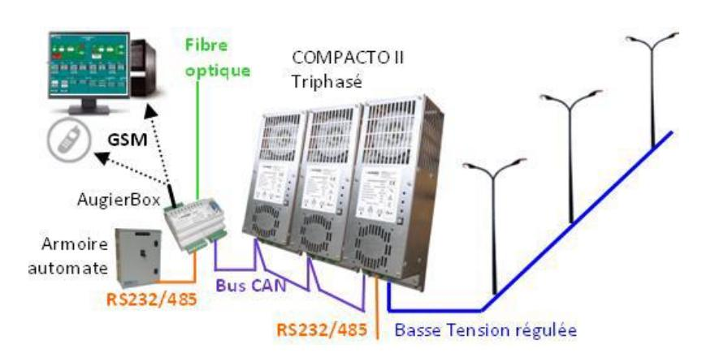

figure 2 : synoptique du système de gestion

Objectif : valider les niveaux d'éclairement pour les valeurs nominale et réduite de la basse tension régulée alimentant les candélabres.

*Les luminaires alimentés par l'armoire de commande de la rue des fêtes viennent d'être remplacés. De nouvelles lampes au sodium haute pression (SHP) ont été installées lors du remplacement des luminaires. Les mâts et les ballasts, adaptés aux nouveaux luminaires et lampes, n'ont pas été remplacés.*

#### 4.1 Caractéristiques de la rue des fêtes

*46 luminaires, séparés de 24 m et d'une hauteur de 12 m ;*

*luminaires IP 65 avec vasque en plastique ;*

*ampoules de type SHP SON T PIA Plus 150 W ;*

*voie pénétrante urbaine à faible trafic en zone habitée d'une largeur de 12 m ;*

*zone à faible degré de pollution ;*

*contrat d'entretien des luminaires tous les 18 mois soit toutes les 12 000 heures.*

Question 1. Á l'aide du tableau 2, document technique DRS 1, déterminer le niveau de luminance moyenne (*L<sup>m</sup>* en cd·m-2 ) à maintenir.

Voie pénétrante urbaine à faible trafic en zone habitée *Lm*=1,5 cd·m-2 . Question 2. Á partir de la figure 3, évaluer la surface de la rue éclairée (*Sé*) par chaque candélabre. En déduire le flux lumineux minimal à maintenir (*Lmin* en lumen). Un candélabre doit permettre d'assurer l'éclairement de la surface même si ses voisins directs sont en panne.

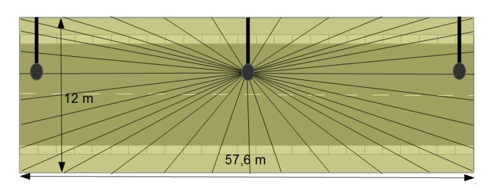

figure 3 : zone éclairée par le candélabre central

$$S_{\acute{e}} = 57,6*12 = 691, m2$$

$$L_{min}$$
 = LM \* Sé = 1,5\*691,2 = 1036,8 Lm

*L'ancienne installation nécessitait un contrat d'entretien toutes les 12 000 heures. Pour la nouvelle installation les services techniques proposent de passer à un contrat de 8 000 heures. La municipalité veut s'assurer que cela est indispensable.*

Question 3. Á l'aide du document technique sur les lampes, DRS 6, déterminer le flux lumineux nominal des lampes (*JM*) et la tension nominale correspondante (*UN*). Á l'aide du tableau A, document technique DRS 2, déduire les limites de ce même flux lumineux après 12 000 heures (*JM12*) et après 8 000 heures (*JM8*).

$$J_M = 17700 \text{ Lm } U_N = 230 \text{ V}$$

Pour 12 000 heures de fonctionnement un éclairement compris entre :

$$J_{M12} = J_M^* 0.63 = 11151 \text{ Lm}$$
 soit une réduction possible à 93 %

$$J_{M12} = J_M^* 0.72 = 12744 \text{ Lm}$$
 soit une réduction possible à 81.3 %

Pour 8 000 heures de fonctionnement un éclairement compris entre :

$$J_{M8} = J_M * 0.76 = 13452 \text{ Lm}$$
 soit une réduction possible à 77 %

$$J_{M8} = J_M^* 0.80 = 14160 \text{ Lm}$$
 soit une réduction possible à 73 %

*Le flux lumineux est proportionnel au carré de la tension d'alimentation du luminaire suivant la relation :* 1 2 = 1 2 2 2

Question 4. Déterminer la tension minimale à appliquer aux luminaires pour garantir la valeur normative du flux lumineux dans les 2 cas d'utilisation après 12 000 heures (Um12) et après 8 000 heures(Um8).

Il faut maintenir les 1036,8 Lm quel que soit le niveau de luminosité du luminaire tout en ayant une tension inférieure aux 200 volts préconisés par le constructeur. Les tensions minimales correspondant aux éclairements précédents sont :

$$U_{m12max} = \sqrt{U_{N}^{2} * L_{min} / L_{M12}} = \sqrt{230^{2} * 1036.8 / 12744} = 65.6 \text{ V}$$

$$U_{m12min} = \sqrt{U_{N}^{2} * L_{min} / L_{M12}} = \sqrt{230^{2} * 1036.8 / 11151} = 70.1 \text{ V}$$

$$U_{m8max} = \sqrt{U_{N}^{2} * L_{min} / L_{M8}} = \sqrt{230^{2} * 1036.8 / 14160} = 62.2 \text{ V}$$

$$U_{m8min} = \sqrt{U_{N}^{2} * L_{min} / L_{M8}} = \sqrt{230^{2} * 1036.8 / 13452} = 63.9 \text{ V}$$

Question 5. Le fournisseur du système de gestion préconise de limiter la tension d'alimentation des luminaires à 200 V pour garantir une économie compatible avec l'amortissement financier du système. Quelle est la périodicité du contrat d'entretien à conseiller à la municipalité ?

Le flux peut être réduit de façon significative sans perte d'éclairement en nuit profonde avec les deux contrats d'entretien. Le contrat d'entretien toutes les 12 000 heures étant moins cher son maintien est préconisé.

#### 5 PARTIE B : validation du nouveau régulateur

Objectif : vérifier les performances du nouveau régulateur pour s'assurer qu'il répond aux exigences attendues.

*Les régulateurs précédemment installés, dans les postes Brévard et Leduc, sont de type LUBIO®.*

*Pour éviter les sauts de luminosité, toutes les variations sont faites avec des rampes de 10 minutes. L'allumage a lieu au plus tôt à 17 h 00 et l'extinction au plus tard à 08 h 00. Un interrupteur crépusculaire permet de retarder l'allumage et d'avancer l'extinction en fonction de la luminosité naturelle. Le passage à la tension économique démarre tous les jours de l'année à 22 h 00 et le retour à la tension nominale à lieu à 05 h 00.*

*L'évolution de la tension dans le cas le plus sévère est présentée figure 4.*

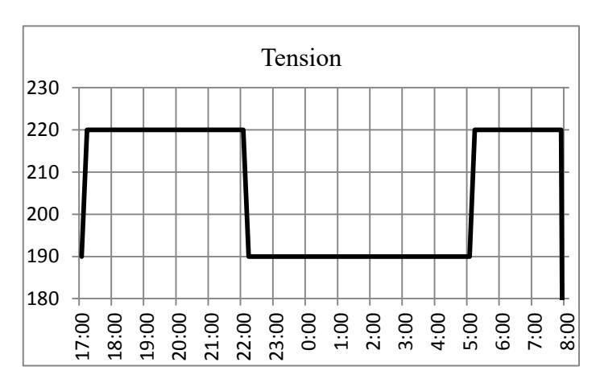

figure 4 : évolution de la tension dans le cas le plus sévère

*La ville envisage aussi de remplacer les lampes par des LED.*

*Les documents ressources DRS 3 et DRS 4 présentent l'ancien régulateur de type LUBIO® et le nouveau régulateur de type COMPACTO II®. Ils renseignent, pour une même charge, les valeurs des grandeurs appelées au réseau pour : la tension, le courant, les puissances et les harmoniques de courant, pour l'application aux luminaires de la tension nominale (230 V) et de la tension économique (190 V).*

#### 5.1 Comparaison des deux régulateurs

Question 6. Déterminer le nombre de niveau de tension paramétrables sur le COMPACTO II®. Comparer avec ceux du LUBIO®.

Le COMPACTO II® possède 3 niveaux de tension (1 nominal et 2 économiques). Le LUBIO® n'en a

que 2 (1 nominal et 1 économique). Le COMPACTO II® peut donc remplacer le LUBIO*®*.

Question 7. Pour chaque type de régulateur et pour le fonctionnement en mode nominal et économique identifier et comparer :

- la valeur de la tension et du courant absorbé au réseau ;
- la valeur de la puissance absorbée et apparente ;
- le taux de distorsion harmonique (*THD*) ;
- le facteur de puissance (*FP*) et le facteur de déplacement (*cos*).

| Grandeurs absorbées<br>au réseau | LUBIO®            |                  | COMPACTO II®   |                     |
|----------------------------------|-------------------|------------------|----------------|---------------------|
|                                  | Nominale<br>220 V | Économique 190 V | Nominale 220 V | Économique<br>190 V |
| Tension (V)                      | 235               | 236,9            | 233,1          | 235,2               |
| Courant (A)                      | 11,69             | 9,71             | 8,48           | 6,5                 |
| P (W)                            | 1930              | 1460             | 1900           | 1430                |
| S (VA)                           | 2720              | 2290             | 1980           | 1530                |
| THD (%)                          | 28,8              | 28,9             | 29,6           | 28,5                |
| FP                               | 0.71              | 0,64             | 0,96           | 0,94                |
| Cos()                           | 0.75              | 0,67             | 1              | 0,98                |

Question 8. En déduire la valeur de la puissance réactive liée au fondamental de courant et de la puissance déformante attribuée aux harmoniques de courant. On rappelle : <sup>1</sup> = × tan() et = √ <sup>2</sup> −<sup>2</sup> − <sup>1</sup> 2

| Grandeur              | LUBIO®                       |                     | COMPACTO II®      |                  |
|-----------------------|------------------------------|---------------------|-------------------|------------------|
| absorbée au<br>réseau | Nominale 220 V               | Économique<br>190 V | Nominale<br>220 V | Économique 190 V |
| Q1<br>(VAR)           | 𝑃 × tan(𝜑) = 1702            | 1618                | 0                 | 290              |
| D (VAD)               | 2 −<br>𝑃2 −<br>𝑄2 =881<br>√𝑆 | 703                 | 557               | 460              |

Question 9. Quels sont les intérêts du COMPACTO II® par rapport au LUBIO® ? Les 2 régulateurs seront-ils adaptés à la commande des futures LED.

Le COMPACTO II® possède un facteur de puissance et un facteur de déplacement (cos()) nettement meilleurs que le LUBIO®. Il absorbe moins de courant pour une même puissance consommée. Son THD est équivalent à celui du LUBIO®, mais comme il consomme moins de courant les harmoniques de courant sont plus faibles.

Il peut aussi piloter des LED ce que ne peut pas faire le LUBIO®.

#### 5.2 Validation du principe de la technologie dite sans pollution harmonique

*La technologie utilisée par les régulateurs COMPACTO II® permet de ne générer que peu de pollution harmonique. Pour réguler la tension des luminaires, ces régulateurs ajoutent une tension alternative sinusoïdale (dite tension injectée) en opposition de phase par rapport à la tension du réseau (voir figure 5).*

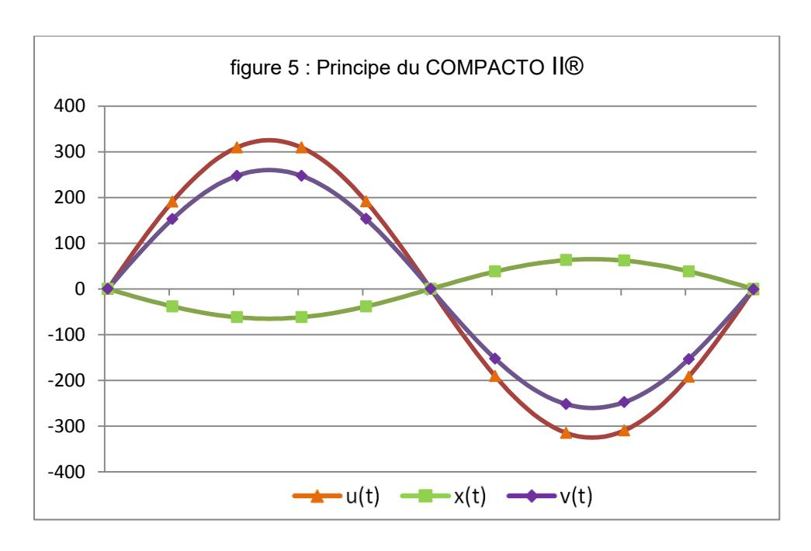

Les valeurs nominales qui caractérisent le réseau électrique en France sont une tension de  $U_{max}$ =230 $\sqrt{2}$  Volts à la fréquence de 50 Hertz.

Question 10. Déterminer la valeur de l'angle  $\varphi$  dans l'expression de la tension x(t) pour que cette tension soit en opposition de phase par rapport à la tension u(t) du réseau. On donne :

$$u(t) = U_{\text{max}} \cdot \sin(\omega \cdot t)$$
$$x(t) = X_{\text{max}} \cdot \sin(\omega \cdot t + \pi)$$

II faut  $\varphi = \pi$ .

La tension instantanée appliquée aux luminaires est : v(t) = u(t) + x(t)

Question 11. Déterminer l'expression de la tension injectée x(t) pour que la tension efficace aux bornes des luminaires soit V = 190 V.

La tension v(t) est une tension alternative sinusoïdale, on peut donc écrire que :

```
v(t) = 190\sqrt{2} \times \sin(100\pi \times t) Il faut donc résoudre : x(t) = u(t) - v(t) x(t) = u_{max} \times \sin(100\pi \times t + \pi) = -V_{max} \times \sin(100\pi \times t) -X_{max} \times \sin(100\pi \times t) = 230\sqrt{2} \times \sin(100\pi \times t) - 190\sqrt{2} \times \sin(100\pi \times t) -X_{max} = 230\sqrt{2} - 190\sqrt{2} -X_{max} = 325,3 - 268,7 -X_{max} = -56,6 \ V x(t) = 56,6 \times \sin(100\pi \times t + \pi)
```

Question 12. Quels sont les intérêts du COMPACTO II® par rapport au LUBIO® ? Les 2 régulateurs seront-ils adaptés à la commande des futures LED.

Le COMPACTO II® pollue moins que le LUBIO®. Il nécessite moins de courant pour une même puissance. Il peut aussi piloter des LED ce que ne peut pas faire le LUBIO®.

6 PARTIE C : choix des matériels et réalisation des schémas électriques

Objectif: choisir le régulateur et les éléments de protection adaptés à l'installation; réaliser les

schémas électriques et l'implantation dans le coffret.

*Des informations nécessaires pour traiter cette partie sont données ci-dessous :*

- *réseau électrique d'alimentation triphasé 3 P + N 400 V 50 Hz ;*
- *schéma de liaison à la terre de l'installation de type TT ;*
- *pas de paratonnerre à moins de 30 m du coffret d'installation ;*
- *46 luminaires répartis de manière équilibrée sur les 3 régulateurs assurant l'alimentation triphasée des candélabres ;*
- *ampoules de type SHP SON T PIA Plus 150 W avec un facteur de puissance de 0,84, associées à des amorceurs (un par ampoule) d'une puissance P<sup>a</sup> = 50 W.*

Choix du régulateur dans la gamme COMPACTO II®

Question 13. À l'aide de la documentation technique DRS 5 vérifier, pour un luminaire (ensemble lampe et amorceur), la puissance active *P1L*, et déterminer la puissance réactive *Q1L* et la puissance apparente *S1L*.

D'après la documentation technique, 15 luminaires consomment 3020 W, donc 1 luminaire consomme 3020/15 = 201,3 W ce qui correspond aux données théoriques.

La puissance réactive Q1L = 201,3 \* tan(arcos(0,86)) = 119,5 VAR. La puissance apparente est donc S1L = (Q1L ² + P1L²)1/2 = 234 VA.

Question 14. Calculer la puissance apparente *STL* qui caractérise la totalité des luminaires sur la zone de la rue des fêtes.

Les lampes sont réparties de manière équilibrée sur les 3 phases, on en déduit que :

$$S_{TL} = 3 * S_{1P} \approx 46 * S_{1L} = 46*234 = 10764 \text{ VA}.$$

Question 15. Á l'aide du document constructeur, choisir le modèle et la puissance du variateur électronique. Justifier les réponses.

Le modèle : VETC car les luminaires sont reliés au réseau triphasé ;

La puissance de 12 kVA qui est supérieure à la puissance STL est réalisée à partir de 3 COMPACTO II® mono 4kVA.

#### Protection contre la foudre

*Le constructeur du régulateur COMPACTO II® préconise l'installation de parafoudres en amont et en aval du régulateur pour assurer la protection de son matériel à la fois pour les surtensions en mode commun (MC) et les surtensions en mode différentiel (MD).*

Question 16. Á l'aide du document ressource DRS 7, justifier la nécessité de protéger le régulateur pour les deux types de surtensions.

Le schéma de liaison à la terre est de type TT ce qui implique une liaison à la terre de la masse du régulateur et l'expose donc aux surtensions en mode commun. La présence de composants électroniques à l'intérieur du régulateur le rend sensible également aux surtensions en mode différentiel.

Question 17. Justifier le choix de parafoudre de type 2. Expliquer pourquoi le constructeur préconise la mise en place d'un parafoudre en amont et d'un autre en aval du régulateur.

Pas de présence de paratonnerre à moins de 30 m donc parafoudre de type 2.

Les surtensions peuvent apparaitre en amont du régulateur sur les lignes d'alimentation ce qui

nécessite la présence du parafoudre amont. Les surtensions peuvent également apparaitre sur les câbles des luminaires ce qui explique la protection en aval du régulateur.

Question 18. Le courant maximum de décharge étant estimé à 15 kA, déterminer, à l'aide des documents constructeurs, la référence des parafoudres à mettre en place dans l'installation.

*I<sup>m</sup>* = 15 kA => PF65r Installation triphasée 400V avec protection pour MC et MD => PF65r 3P+N => 15685

Question 19. Á l'aide des documents constructeurs, déterminer le calibre et le type de courbe de déclenchement des disjoncteurs de déconnexion à associer aux parafoudres choisis précédemment.

Le disjoncteur doit être adapté au parafoudre, *I<sup>m</sup>* = 15 kA. Pour assurer la non sélectivité avec le disjoncteur de tête, il faut le même calibre or ICOMPACTO II*®* = 17 A donc calibre 20 A courbe C (pas de courant de démarrage ni de départ long).

Détermination des protections associées

*La protection en tête de l'installation sera assurée par un disjoncteur différentiel à courant résiduel. Une mesure de la prise de terre donne R<sup>m</sup> = 150 Ω.*

Question 20. Justifier le rôle de ce dispositif de protection. Expliquer ce qui justifie son utilisation pour cette installation.

Le disjoncteur différentiel assure 2 fonctions :

- la protection des biens matériels en cas de court-circuit ou de surcharge ;
- la protection des personnes en cas de défaut de masse.

Ce qui justifie l'utilisation de ce matériel est le schéma de liaison à la terre de type TT.

Question 21. Déterminer la sensibilité IΔn du dispositif différentiel à mettre en place. En déduire, à l'aide des documents constructeurs, la référence du matériel à mettre en place dans l'installation.

IΔn < U<sup>l</sup> /R<sup>m</sup>

La tension de sécurité étant de U<sup>l</sup> = 50 V => IΔn < 50/150 = 0,333A.

On choisit donc un dispositif avec un IΔn = 300mA.

D'après le document constructeur du régulateur, le courant absorbé est de 17 A par phase.

D'après le document constructeur, le calibre du disjoncteur sera de 20 A avec une sensibilité de 300 mA. La distribution se fait en 3P+N, la référence est donc 16883.

Réalisation des schémas électriques

Question 22. Compléter le document réponse DR1 en y intégrant les différents éléments choisis pour assurer la fonctionnalité et les protections nécessaires.

Voir document réponse DR1.

#### 7 PARTIE D : mise en communication des régulateurs

Objectif : compléter le schéma électrique par le câblage de la partie communication et paramétrer le superviseur.

*La communication entre les régulateurs et le superviseur est réalisée grâce à la passerelle AUGIERBOX. Cette passerelle est en liaison avec chaque régulateur par le biais d'un bus de communication de type CAN. La passerelle permet également de mesurer les tensions régulées fournies par les régulateurs.*

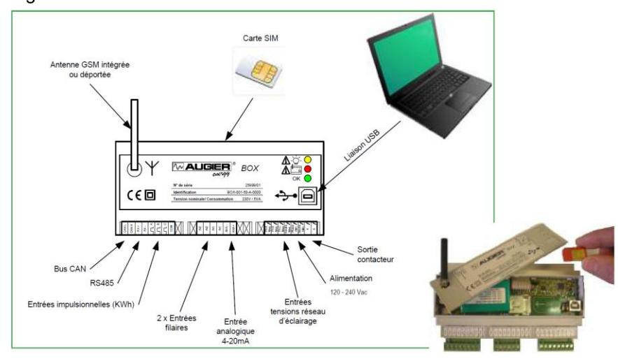

Réalisation du câblage de la passerelle AUGIERBOX

Question 23. Compléter le document réponse DR 1 pour :

- commander l'ouverture et la fermeture du contacteur principal KM1 par la passerelle (sortie contacteur : bornes K) ;
- mesurer les tensions du réseau d'éclairage par la passerelle ;
- réaliser la communication entre la passerelle et les régulateurs par le bus CAN.

Voir document réponse DR1.

#### Paramétrage du superviseur

La connexion du port USB du COMPACTO II® sur un ordinateur en utilisant le logiciel COMPACTO PC permet de modifier tous les paramètres internes. Ce logiciel permet l'adaptation du COMPACTO II® variateur à n'importe quelle application spécifique. Comme changer les valeurs de la date et de l'heure, la fréquence d'augmentation et de diminution de la tension, les niveaux d'économie de tension, les vitesses du gradient de tension (haut/bas), les cycles d'éclairages en fonction du calendrier, etc …


*L'armoire « rue des fêtes » possède un compteur d'énergie à sortie à impulsion pour totaliser la consommation de l'éclairage.*

*Les coordonnées GPS de la ville de Dampmart :*

**Géographique degré décimaux X**: 48.883331 **Y**: 2.73333 **DMS X**: 48° 52' 59.99" **Y**: 2° 43' 59.99"

Question 24. Compléter le document réponse DR 2 (zones encadrées) pour configurer les tensions du COMPACTO II® et le cycle de fonctionnement.

Voir document réponse DR2.

*Chaque AUGIER BOX possède une identité propre (codification sur 16 caractères), des coordonnées géographiques de longitude et latitude (pour l'horloge astronomique et une géo localisation).*

*Elle possède en mémoire des numéros de téléphone pour l'envoi d'informations vers le* 

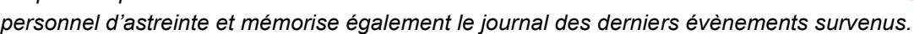

*La communication avec le personnel d'astreinte s'effectue par SMS via le réseau GSM, de manière bidirectionnelle : l'AUGIER BOX peut être à l'origine de l'appel (sur alarme ou évènement), ou recevoir un appel pour consultation (télé relevés opérés à partir d'un téléphone mobile).*

*La communication avec un superviseur est effectuée via le réseau GSM-data / GPRS.*

*Les liaisons CAN, RS485, EN62053 permettent toutes les extensions vers d'autres systèmes d'analyse, ou vers d'autres matériels AUGIER à contrôler tels que les variateurs* COMPACTO II®*.*

*L'armoire où est installé l'AUGIER BOX contient 3 régulateurs abaisseurs* COMPACTO II® *qui ont pour adresse respective 1, 2 et 3.*

*La configuration GSM de l'AUGIER BOX est la suivante : le numéro de téléphone rattaché à la carte SIM est le 06 77 03 54 76, le code PIN de la carte est le 1234 et le mot de passe le 5476. Elle porte le nom de : RUE DES FETES.*

Question 25. Compléter le document réponse DR 3 pour configurer l'AUGIER BOX et la liaison GSM.

Voir document réponse DR3.

Question 26. Un technicien désire envoyer un SMS pour enclencher l'éclairage le 31 décembre à 12 h. Définir le contenu du message à envoyer.

Commande : #5476#SWITCHON#31/12#12h00#

Réponse : RUE DES FETES

DATE: 31/12

FORCED SWITCH ON:

12h00

TIME: 0mn

La réponse du COMPACTO II®, non demandée, ne figure que pour information.

8 PARTIE E : validation des économies d'énergie

Objectif : vérifier les consommations d'énergie pour déterminer le retour sur investissement des solutions d'éclairage public.

}

*Il s'agit d'effectuer un comparatif entre une solution classique d'alimentation des lampes à travers des ballasts ferromagnétiques et une solution d'alimentation par un régulateur abaisseur de type COMPACTO II®.*

*Dans cette partie, il faudra :*

- *- estimer la consommation électrique avec une solution d'alimentation fixe sur le réseau ;*
- *- estimer la consommation électrique avec dispositif d'alimentation de type COMPACTO II® ;*
- *- réaliser le bilan économique.*
- *Les consommations, exprimées en kWh, seront arrondies à l'unité immédiatement supérieure ;*

- *Les puissances, exprimées en kW ou kVA, seront arrondies à la décimale immédiatement supérieure ;*
- *Les coûts, exprimés en € TTC, seront arrondies à l'unité immédiatement supérieure.*

*La durée moyenne d'éclairage sur une journée est de 11,6 h ce qui représente 4 240 h sur une année. L'éclairage sous tension réduite est fixe tous les jours de l'année, il est réglé entre 22 h et 5 h.*

*Le coût de l'énergie en incluant l'abonnement EDF selon le tarif souscrit est de 0,11 € par kWh TTC sur toute l'année.*

*La lampe avec son ballast consomme 204 W sous tension nominale de 230V.*

*Le bilan de la consommation annuelle entre 2008 et 2017 de l'installation « rue des fêtes » est donné par le graphe figure 7.*

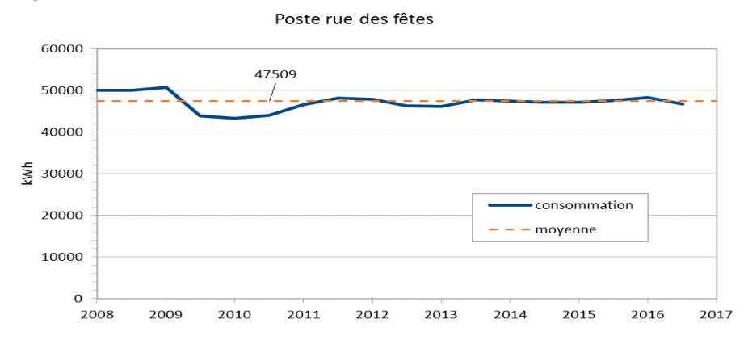

figure 7 : consommation annuelle et moyenne de l'installation « rue des fêtes »

Question 27. Calculer la puissance consommée *Pr* par la lampe alimentée sous tension réduite *Ur* de 190 V.

$$P_r = \left(\frac{U_r}{U_n}\right)^2 \times P_n = \left(\frac{190}{230}\right)^2 \times 204 = 139W$$

Question 28. Déterminer la consommation d'énergie en kWh sur une journée pour une solution en alimentation directe *Wj*<sup>1</sup> et une solution avec régulateur abaisseur de tension *Wj*<sup>2</sup> . En déduire le pourcentage d'économie d'énergie *W* de la solution avec régulateur abaisseur.

$$W_{j1} = P_n \times 11,6 = 0.204 \times 11.6 = 2.37 \text{ kWh}$$
  
 $W_{j2} = P_n \times (11,6 - 7) + P_r \times 7 = 0.204 \times (11.6 - 7) + 0.139 \times 7 = 1.92 \text{kWh}$   
 $\Delta W = \frac{W_{J1} - W_{J2}}{W_{J1}} = \frac{2.37 - 1.92}{2.37} = 0,19 => 19\%$ 

Question 29. À la lecture du graphe figure 7, déterminer la consommation annuelle de l'armoire *W<sup>a</sup>* en kWh et en déduire l'économie d'énergie réalisée *Weco* en kWh et calculer le gain financier *GF* sur une année en € TTC.

$$W_a = 47509kWh$$
  
 $W_{eco} = W_a \times \Delta W = 47509 \times 19\% = 9025 kWh$   
 $GF = W_{eco} *PU = 9025 \times 0,11 = 992,75€ TTC$ 

Ce qui représente bien une économie d'énergie.

*L'armoire électrique de commande de l'éclairage comprend :*

*3 modules régulateur abaisseur de tension monophasé COMPACTO II® de 3 KVA ;*

- *Un module AUGIER BOX pour la commande et le dialogue à distance de 900€ HT ;*
- *Le coffret de 170€ HT ;*
- *Les protections et l'appareillage électrique pour un montant de 280€ HT.*

*La réalisation de l'armoire électrique nécessite 8 h de travail avec un coût horaire total estimé à 90 € HT.*

Question 30. Calculer le coût de l'installation.

| Désignation        | quantité | PU HT      | PT HT      |
|--------------------|----------|------------|------------|
| AUGIER BOX         | 1        | 900,00 €   | 900,00 €   |
| COMPACTO II®       | 3        | 1 160,00 € | 3 480,00 € |
| Armoire électrique | 1        | 450,00 €   | 450,00 €   |
| Main d'œuvre       | 8        | 90,00 €    | 720,00 €   |
|                    |          | TOTAL HT   | 5 550,00 € |
|                    | TVA      | 20%        | 1 110,00 € |
|                    |          | TOTAL TTC  | 6 660 €    |

*La durée de vie moyenne de ce type de luminaire associé à ce type de lampe est de 15 ans.*

*Le temps moyen de bon fonctionnement MTBF (Mean Time Between Failures) du régulateur abaisseur de tension COMPACTO II® est de 18 ans.*

*Avec ce choix technologique, la durée de vie des lampes est augmentée de 50%, la maintenance notamment pour le relamping des ampoules par les services techniques de la ville est diminuée. Les économies annuelles sur la maintenance des 46 candélabres sont estimées à 370 €/an TTC.*

Question 31. Déterminer le temps de retour sur investissement *TRI* de cette solution. Cette solution est-elle économiquement viable, par rapport à la durée de vie des lampes et des COMPACTO II® ?

$$TRI = \frac{6\,660}{992,75 + 370} = 4.9\,ans$$

La solution est viable car la durée de vie des lampes et du *COMPACTO II®* est largement supérieure au *TRI*.

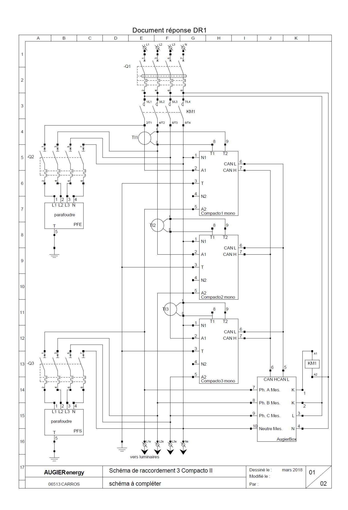

Document réponse DR2 COMPACTO × Fichier Interface Langue ? Config. par défaut LECTURE ECRITURE OK Configuration Paramètres Supervision Mesure de puissance Maintenance Table JBUS Fonction commande - Début cycle écor Fin cycle économie ECO1 Monocycle Commande filaire (Entrée TOR) 05 00 Commande ✓ Multicycle 4-20 mA 0-10 V inversée Nominal Entrée filaire pour By Pass Aperqu Saison 1 Fonction relais Début ECO1 Fin ECO1 Début ECO2 Aucune Semaine Protection surcharge Signalisation défaut Weekend Commande d'éclairage (Horaires hofloge astro.) Forçage relais - Saison 2 Bo E001 Début ECO2 Bo ECO2 Commande d'éclairage (Programmateur) Semaine Edinction quotidienne Weekend Temporisations -Temps de préchauffage "minutes" 10 Saison 3 Fin ECO1 Début ECO2 Consignes Semaine Tension de préchauffage (PRE) "Veff" 21 Weekend Tension nominal (NOM) "Veff" Saison 4 -Tension d'économie ECO1 "Veff" Début ECO1 Fin ECO1 Début ECO2 19 Semaine Tension d'économie ECO2 "Veff" Weekend Tension commande filaire (Entrée TOR) 230 Dérogation Rampe montante "V/min" -60 Début ECO1 Fin ECO1 Début ECO2 Rampe descendante "V/min" 3 60 Tx 🕙 Rx 🕚 Etat de la connexion : Déconnecté AugierBox × OK Fichier Connexion Visualisation Langue Firmware ? Supervision Alarmes Paramétrage Maintenance Evênement Consommation GSM GPRS Horaires et coordonnées Options 2° 44' 0" E ON Permanent ON Derogation Heure d'extinction AUTO OFF Derogation OFF Permanent - Allumage forcé Extinction forcée Extinction quotidienne Heure d'extinction 00 / 00 Temps d'allumage Heure d'extinction Temps d'extinction Heure d'allumage 0m Dm Etat de la connexion : Déconnecté Tx O Rx O

Document réponse DR3

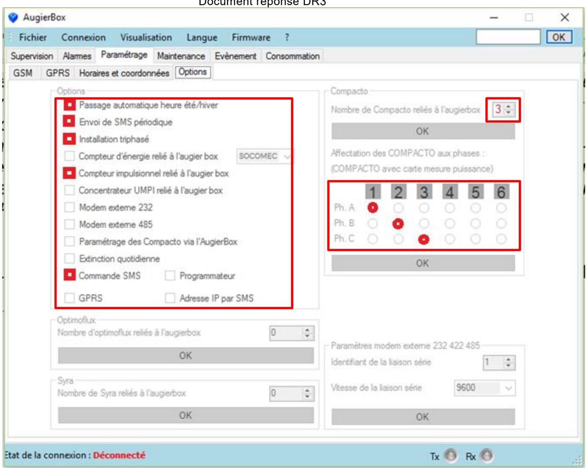


# **Rapport du jury de l'épreuve « Étude d'un système, d'un procédé ou d'une organisation » – option ingénierie électrique**

#### **1. Présentation du sujet**

La ville de Dampmart s'est engagée sur la voie des économies d'énergie. Elle a ainsi fait rénover la gestion de l'éclairage public.

En 2012, la ville a rénové la rue Daniel Leduc qui consomme 11 % de l'énergie consacrée à l'éclairage public. En 2013 c'est la rue Clément Brévard qui a été rénovée. Le système de gestion mis en place sur ces rues donne pleinement satisfaction mais il n'est plus distribué par le fabricant. La ville envisage de rénover l'éclairage de la rue des fêtes.

L'objet de cette étude consiste donc à choisir un nouveau système de gestion de l'éclairage.

## **2. Analyse globale des résultats**

Les candidats ont majoritairement traité l'ensemble des questions posées, signe d'une préparation sérieuse à cette épreuve du concours. Certains candidats montrent déjà une certaine maîtrise des attendus du programme et des connaissances associées.

Si certains candidats parviennent à faire le lien entre les différentes parties de l'épreuve, la grande majorité n'a pas atteint cet objectif. Les candidats n'ont pas pris suffisamment de recul par rapport à l'objectif global de l'étude proposée.

Le jury constate également des lacunes sur le plan disciplinaire dans les fondamentaux de l'ingénierie électrique (choix de matériel, élaboration d'un schéma électrique).

Le jury rappelle aux candidats l'importance de soigner la présentation de la copie et la qualité de la rédaction. Le jury demande aux candidats de faire particulièrement attention aux fautes d'orthographe et de grammaire. Les candidats doivent correctement repérer les questions et en cas d'absence de réponse, l'indiquer. Le jury conseille également de mettre les résultats en évidence en les encadrant par exemple.

Les raisonnements doivent être menés de façon lisible et explicite de manière à faire ressortir la méthode utilisée. Les réponses, qui se limitent à l'écriture du résultat sans explication, ne sont pas admises. Certains candidats sont en difficulté dans la conduite de calcul complexe.

#### **3. Commentaires sur les réponses apportées et conseils aux candidats**

## PARTIE A

Cette partie permet d'évaluer le candidat sur sa capacité à exploiter des documents normatifs simples afin de valider un choix économique concret. La grande majorité des candidats a travaillé sur cette partie. Peu de candidats ont su faire le lien entre les différentes questions de cette partie.

La question 1 a bien été traitée par l'ensemble des candidats.

La question 2 a été traitée de manière incomplète. Le calcul de la luminance minimale n'étant pas souvent traité.

Pour la question 3, peu de candidats présentent les quatre cas possibles de flux lumineux.

La question 4 nécessitait le résultat de la question 2. Les candidats n'ayant pas répondu à la question 2 ont souvent utilisés, par erreur, les résultats de la question 3. Ceux, ayant correctement répondu à la question 2, ont rarement réutilisé ce résultat.

La question 5 devait permettre de valider les deux types de contrat pour retenir le moins cher. La tension de 200 V ayant été comprise comme une limite à atteindre et non comme un maximum, les candidats n'ont majoritairement proposé qu'un seul contrat.

#### Partie B

C'est la capacité du candidat à mobiliser ses connaissances techniques et à exploiter les documentations qui est mise en valeur dans cette partie. Presque tous les candidats ont abordé cette partie orientée électrotechnique. Il est conseillé aux candidats de noter sur leurs copies les formules littérales et le détail de leurs calculs pour éviter les notations binaires lorsque seuls les résultats apparaissent.

Pour les questions 6, 7, 8, 9 et 12, l'objectif était de comparer les deux régulateurs. Il est conseillé dans de tels cas, de présenter les résultats sous forme de tableaux. L'analyse de ces résultats n'a pas donné entière satisfaction, bien que les données aient été correctement relevées.

Pour les questions 10 et 11 l'objectif était de valider le principe technologique du régulateur par une démarche analytique simple. Si beaucoup de candidats ont su donner la valeur du déphasage, peu d'entre eux ont obtenu une expression analytique correcte de la tension.

#### PARTIE C

Dans cette partie les candidats étaient amenés à choisir certains matériels nécessaires et à réaliser les schémas électriques.

Il est fortement conseillé aux candidats de faire apparaître clairement les critères de choix et le raisonnement employé pour définir le matériel. Il ne s'agit pas de faire un récit littéraire, mais d'exposer sa réflexion. Les références complètes ne justifient pas le choix.

Pour les questions 13, 14 et 15 consacrées au choix du régulateur, un nombre important de candidats ne fait pas le lien entre ces questions, travaille sur 15 luminaires au lieu de 1 comme demandé et confond les facteurs de puissance et de déplacement. Le type de régulateur (VETC) est rarement identifié.

Les questions 16, 17, 18 et 19 portaient sur la protection contre la foudre. C'est ici le schéma de liaison à la terre de type TT qui conditionnait et justifiait le choix des différents éléments de protection. Son importance n'a pas été relevée par un grand nombre de candidats. L'absence de paratonnerre à moins de 30 m et l'utilisation de lignes aériennes sont rarement prises en compte pour justifier le type de paratonnerre. Certains candidats ont également confondu la référence du parafoudre PF15 avec le courant de décharge de 15 kA. Le modèle est rarement donné avec la référence en triphasé et certains candidats font un choix de parafoudre en monophasé.

Ce type de protection semble largement méconnu des candidats. Il ne s'agissait ici cependant que d'exploiter de la documentation technique sans prérequis nécessaire.

Pour le choix du disjoncteur différentiel en tête d'installation, traité aux questions 20 et 21, les candidats ont oublié la fonction de protection des biens qu'assure cet appareil et n'ont mentionné que le rôle de protection des personnes. L'obligation de l'utilisation de cet appareil dans une configuration de schéma de liaison à la terre de type TT n'est que rarement citée. Très peu de candidats ont su calculer la sensibilité In du différentiel.

La conception du schéma électrique n'a pas été abordée par 22 % des candidats.

Trop peu de candidats ont présenté un schéma électrique correct aux questions 22 et 23. La majorité des candidats ne semble pas maitriser la conception d'un schéma électrique.

Les candidats se présentant à l'option ingénierie électrique du CAPET sciences industrielles de l'ingénieur doivent maîtriser les bases de l'électrotechnique : choix de matériels et conception de schémas électriques.

#### PARTIE D

Cette partie n'a pas été abordée par 30 % des candidats. Ceux ayant traité cette partie n'ont pas su exploiter convenablement les données techniques contenues dans le sujet.

Pour la question 24, il fallait utiliser les données du cycle de fonctionnement proposées par la municipalité et les niveaux de tension permettant les économies d'énergie.

Pour la question 25, la configuration GSM semble avoir été faite sans rigueur.

Quand la question 26 est traitée par le candidat la réponse est généralement correcte.

#### PARTIE E

Cette partie n'a pas été abordée par 25 % des candidats.

Pour les questions 27 et 28, les candidats ne font pas correctement les liens entre la puissance électrique absorbée par une lampe, sa tension d'alimentation et l'énergie qu'elle consomme. Très peu de candidats ont donné des réponses correctes alors que la relation puissance – tension et la notion d'énergie font partie des fondamentaux attendus d'un candidat se présentant à l'option choisie.

Pour la question 29, quel que soit le résultat obtenu à la question précédente, les candidats n'ont souvent pas su déterminer les économies d'énergies réalisées ainsi que le gain financier.

Pour la question 30, le coût de la main d'œuvre calculé par les candidats ne tient pas compte du temps de travail consacré au câblage de l'armoire. Certains candidats n'ont pas tenu compte du passage à 20 % de la TVA.

À la question 31, le jury a été surpris de constater que certains candidats ne connaissent pas la notion de retour sur investissement qui permet de vérifier qu'une solution est économiquement viable. Certains n'ont pas tenu compte non plus des économies d'énergie réalisées.

### **4. Conclusion**

Le jury a été surpris de la méconnaissance d'un trop grand nombre de candidats des savoirs disciplinaires et a regretté qu'ils aient abordé cette épreuve de manière trop superficielle et sans se soucier de la cohérence entre les différentes parties.

Enfin, le jury rappelle aux candidats qu'il est essentiel d'accorder une grande importance à la présentation de la copie et à la qualité de la rédaction.

#### **5. Résultats**

188 copies ont été évaluées, la moyenne des notes obtenues est de 7,18 et un écart type de 3,06 avec :

- 14,56 comme meilleure note ;
- 0,56 comme note la plus basse.

# **Éléments de correction de l'épreuve « Étude d'un système, d'un procédé ou d'une organisation » – option ingénierie informatique**

#### **Question 1**

La relation UML existant entre l'acteur « Commissaire de course » et l'acteur « Employé » est un héritage. Cela signifie que le « Commissaire de course » a toutes les compétences de l'employé (inscrire les participants) plus des compétences qui lui sont propres (gérer les courses).

#### **Question 2**

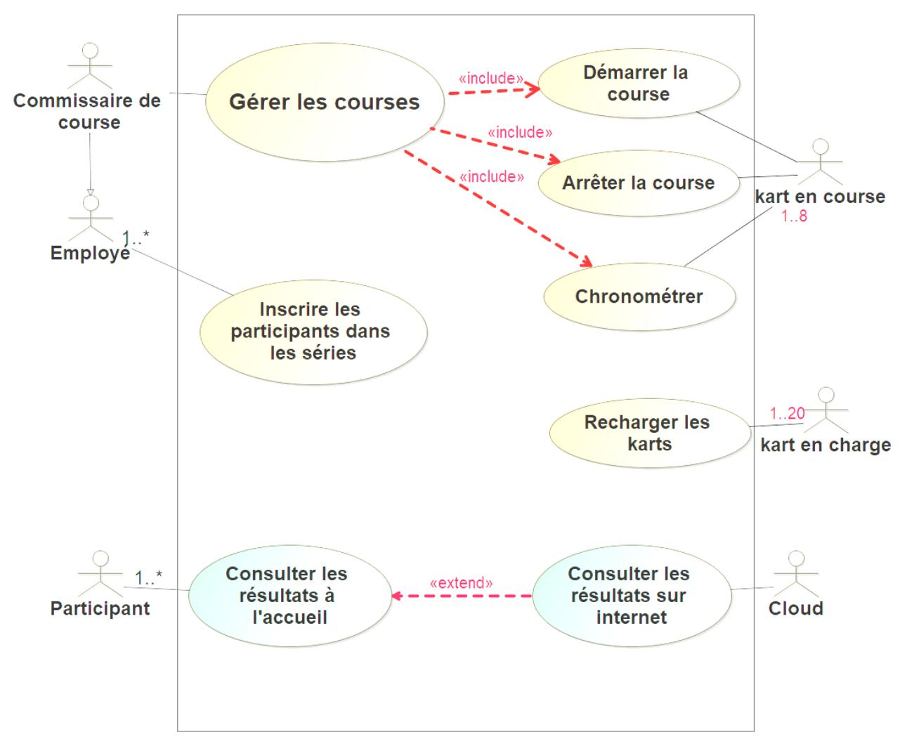

#### Note :

- la relation «Include» de « Gérer les courses » vers « Inscrire les participants dans les séries » est autorisée ;
- la relation «Include» de « Gérer les courses » vers « Recharger les karts » est autorisée.

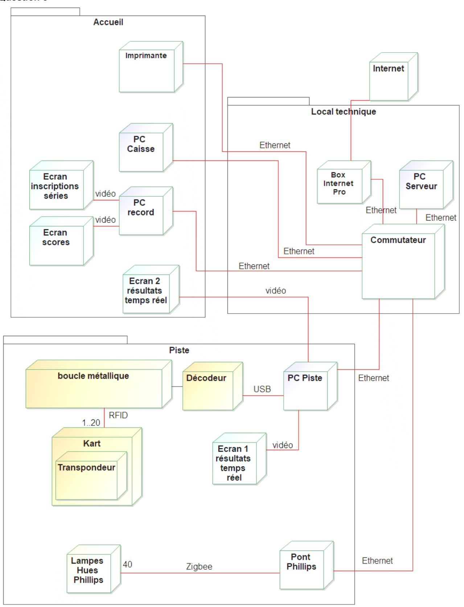

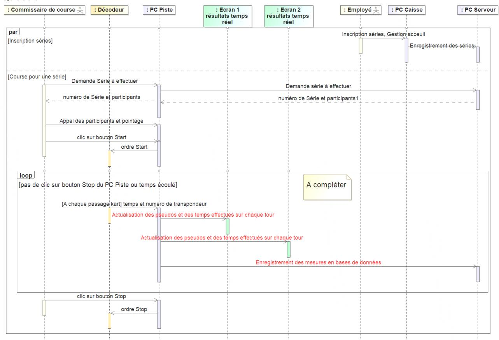

#### **Question 5**

Contenu de la trame: \$ST

Nombre de bits pour émettre un octet : 10 bits (1 bit de start, 8 bits de données et 1 bit de stop). Durée de transmission de la trame qui comporte 3 octets : 3 \* (10 / 9600) \* 1000 ms = 3,125 ms.

#### **Question 6**

t<sup>1</sup> - t<sup>0</sup> = 25089ms. La durée de transmission de la trame de start n'influe pas sur le calcul car il s'agit d'un calcul différentiel.

#### **Question 7**

Contenu de la trame : \$P;01;00002;69;3;000010000;181\r\n

Justification de la valeur du checksum égale à (181)10:

- simplification de la trame, pour tout octet « a », a^a = 0 : \$P;01;00002;69;3;000010000; ;
- remplacement de chaque caractère par son code ascii dans sa représentation hexadécimale puis binaire ;
  - o \$ => (24)<sup>16</sup> => (0010 0100)2
  - o P => (50)<sup>16</sup> => (0101 0000)<sup>2</sup>
  - o 2 => (32)<sup>16</sup> => (0011 0010)<sup>2</sup>
  - o 6 => (36)<sup>16</sup> => (0011 0110)<sup>2</sup>
  - o 9 => (39)<sup>16</sup> => (0011 1001)<sup>2</sup>
  - o 3 => (33)<sup>16</sup> => (0011 0011)<sup>2</sup>
  - o 0 => (30)<sup>16</sup> => (0011 0000)<sup>2</sup>
- calcul du ou exclusif => (0100 1010)<sup>2</sup> ;
- complément à 1 => (1011 0101)<sup>2</sup> => (B5)<sup>16</sup> =>(181)10.

Le champ CCC est un checksum. Le checksum est calculé et transmis par le décodeur et testé par le « PC Piste ». Il permet de fiabiliser les échanges en cas d'erreur, par exemple en cas de parasites.

#### **Question 9**

Le protocole répond bien aux besoins de mesurage car il permet au « PC Piste » d'acquérir le numéro de kart et le temps de passage.

Le temps est compris entre 1 et 999999999 ms ≈ 1000000 s ≈ 277 heures Le numéro de kart est compris entre 0 et 99999.

#### **Question 10**

Une classe « Boundary » est une classe « frontière » qui permet de faire l'interaction entre le système et un acteur, ici entre le « PC Piste » et le port USB sur lequel est connecté le décodeur.

#### **Question 11**

La relation UML entre la classe CChronometre et la classe SerialPort est une composition.

#### **Question 12**

La relation UML entre la classe Form1 et la classe Form est un héritage. Form1 hérite de Form.

#### **Question 13**

```
class CChronometre
{
 private SerialPort serialPort1; 
 public CChronometre() {
 }
 public void Connexion(String sPort) {
 }
 public void Deconnexion() {
 }
 public String GetPorts() {
 }
 public void OrdreStart() {
 } 
 public void OrdreStop() {
 }
 private void serialPort1_DataReceived() {
 }
 private bool ChecksumOk(String sTrame) {
 }
 private bool TrameOk(String sTrame) {
 }
}
```

# **Question 14**

Un attribut statique est commun à tous les objets d'une classe car il n'en n'existe qu'un seul exemplaire en mémoire. On accède à un membre statique par le nom de la classe et non l'instance d'un objet de cette classe.

## **Question 15**

L'opérateur new permet de créer l'objet filemesure sur le tas, en allocation dynamique.

Une file d'attente est une collection où le premier objet inséré sera le premier sorti (FIFO First In First Out). Autres types de collection : pile, liste, arbre.

#### **Question 17**

La classe Queue est une classe générique dite aussi « template », car il est possible de créer une file d'attente de n'importe quel objet. Ici il s'agit d'une file d'attente de variables de type SMesure.

#### **Question 18**

La librairie standard STL (Standard Template Library).

#### **Question 19**

```
public void OrdreStart()
{
 try
 {
 this.serialPort1.Write("$ST");
 }
 catch (Exception exe)
 {
 throw new Exception("Erreur Ecriture ligne serie \r\n");
 }
}
```

## **Question 20**

Départ de la course : \$M;START\r\n Fin de la course : \$M;STOP\r\n

Passage d'un kart sur la boucle métallique : \$P;01;00002;69;3;000010000;181\r\n

#### **Question 21**

```
private bool ChecksumOk(String sTrame)
{
 bool bOk = false;
 byte byCK = 0; // cheksum calculé
 // ou exclusif des 27 premiers octets
 for (int i = 0; i < 27 ; i++)
 {
 byCK ^= (byte) sTrame[i];
 }
 byCK ^= 0xFF; // complément à 1
 String sCk = sTrame.Substring(27, 3); // extrait le cheksum de la trame reçue
 byte byCKOrig = Convert.ToByte(sCk); // conversion en type Byte
 if (byCKOrig == byCK) // cheksum reçu = cheksum calculé
 bOk = true;
 return bOk;
 }
```

### **Question 22**

Le programme réagit à des évènements qui peuvent se produire, par exemple des actions de l'opérateur sur une interface graphique (clic sur un bouton, saisie d'une information par exemple).

#### **Question 23.**

```
private void serialPort1_DataReceived()
{ // lecture du port série et stockage de la trame dans la variable
 // sTrameLue de type String
 String sTrameLue = serialPort1.ReadLine(); // lit le port série
 if (this.TrameOk(sTrameLue))
 {
 // si c'est la réponse à un ordre de départ
 if (sTrameLue == "$M;START\r")
 {
 Commun.nEtat = (int)ETAT.MESURE;
 }
 // sinon si c'est la réponse à un ordre d'arrêt
 else if (sTrameLue == "$M;STOP\r")
 {
 Commun.nEtat = (int)ETAT.DEBUT;
 }
 // sinon c'est le passage d'un transpondeur
 else if (sTrameLue.Substring(0, 2) == "$P")
 {
 this.serialPort1.Write("$VA");
 // Extrait les informations de la trame
 String sTrameNoKart = sTrameLue.Substring(6, 5);
 String sTrameTemps = sTrameLue.Substring(17, 9);
 String sTrameBatterie = sTrameLue.Substring(15, 1);
 String sTrameSignal = sTrameLue.Substring(12, 2);
 // Enregistre dans la file d'attente
 SMesure mesure;
 mesure.no_tour = 0;
 mesure.no_kart = Convert.ToInt32(sTrameNoKart);
 mesure.temps_tour = Convert.ToInt32(sTrameTemps);
 mesure.signal = Convert.ToInt32(sTrameSignal);
 mesure.batterie = Convert.ToInt32(sTrameBatterie);
 Commun.fileMesure.Enqueue(mesure);
 }
 }
}
```

#### **Question 24**

En C++, la compilation du code source produit directement un fichier exécutable par le système d'exploitation. Il n'y a donc pas besoin de machine virtuelle pour exécuter le programme.

#### **Question 25**

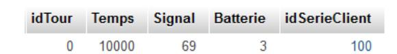

#### **Question 26**

select idSerieClient from TSerieClient where noKart=2 and noSerie=40;

insert into ttourclient(`idTour`, `Temps`, `Signal`, `Batterie`, `idSerieClient`) values (0,10000,69,3,100);

#### **Question 28**

Il faut rajouter un sémaphore booléen (ou mutex) pour partager la ressource commune qu'est la file d'attente.

L'algorithme est pour chaque accès à la file d'attente :

- opération « Prendre Sémaphore »;
- accès à la file d'attente ;
- opération « Rendre Sémaphore »;

#### **Question 29**

Le traitement de la réception ligne série sur évènement permet de faire une lecture non bloquante. La méthode RunCourse() doit être exécutée dans un thread afin de ne pas figer la fenêtre de l'IHM lors de l'enregistrement des mesures en base de données.

#### **Question 30**

/24 signifie que le masque est 255.255.255.0

#### **Question 31**

Il y a 2<sup>8</sup> – 2 = 254 hôtes possibles pour ce réseau.

#### **Question 32**

Les équipements suivants doivent avoir une adresse statique afin de pouvoir être administrés et accessibles depuis les autres hôtes :

Box coté LAN : 192.168.1.1/24 Commutateur : 192.168.1.2/24 Imprimante : 192.168.1.3/24 Serveur : 192.168.1.16/24

Pont Phillips© Hue : 192.168.1.17/24

Tous les autres hôtes peuvent avoir leur adresse IP attribuée dynamiquement par DHCP car il n'a pas d'accès depuis les autres hôtes et cela simplifie l'administration réseau.

#### **Question 33**

Les trames 17 et 18 permettent de faire une requête ARP. Dans la trame 17, l'hôte d'adresse IP 192.168.1.20 recherche l'adresse MAC de l'hôte d'adresse IP 192.168.1.16. Dans la trame 18, l'hôte d'adresse IP 192.168.1.16 renvoie son adresse MAC.

## **Question 34**

L'hôte d'adresse IP 192.168.1.20 ne connaissant pas l'adresse MAC de son destinataire, il diffuse la requête en diffusion sur l'ensemble du réseau local.

Une requête ARP franchit les concentrateurs et les commutateurs mais pas les routeurs.

#### **Question 35**

| Nom de la<br>couche réseau<br>dans le modèle<br>OSI | Numéro<br>de la<br>couche<br>réseau<br>dans le<br>modèle<br>OSI | Protocole | Principales informations transmises                                                      |
|-----------------------------------------------------|-----------------------------------------------------------------|-----------|------------------------------------------------------------------------------------------|
| Application                                         | 7                                                               | HTTP      | Demande de page web, méthode GET :<br>GET /karting/classement.php HTTP /1/1              |
| Transport                                           | 4                                                               | TCP       | Port source : 1040<br>Port destination : 80                                              |
| Réseau                                              | 3                                                               | IP        | Adresse IP source : 192.168.1.20<br>Adresse IP destination : 192.168.1.16                |
| Liaison de<br>données                               | 2                                                               | Ethernet  | Adresse MAC source : 88:ae:1d:47:7a:b6<br>Adresse MAC destination :<br>d8:cb:8a:ee:95:02 |

Une DMZ est une zone démilitarisée. Depuis l'extérieur ou l'intérieur du réseau, il est possible d'accéder à la DMZ, donc au serveur web. Depuis la DMZ on ne pourra pas accéder au réseau local.

#### **Question 37**

On accède à un service REST dont les caractéristiques sont les suivantes :

- accès au service via une requête http dont la méthode est PUT ;
- le service est hébergé sur le pont en 192.168.17 ;
- la réponse est au format json ;
- l'ordre d'allumer est transmis dans les paramètres de la requête.

#### **Question 38**

La commande ping ayant répondu pour tous les équipements dans un temps court ( <1ms), on peut considérer la connectivité du réseau correcte.

# **Question 39**

Dans la version actuelle, il faut réaliser une boucle métallique dans le sol alors que dans la nouvelle version il faut installer un portique.

Le protocole de la nouvelle version est plus simple parce qu'il n'y a pas d'ordre de stop et start mais il faut mettre le décodeur à l'heure.

### **Question 40**

On exprime XT,max lorsque le rayon correspond à R<sup>p</sup> : T,max = √ <sup>2</sup> − ( − ) 2 On exprime XT,min lorsque le rayon correspond à r<sup>p</sup> : T,min = √<sup>2</sup> − ( − ) 2 Soit : ΔXtp = T,max − T,min = √<sup>2</sup> −( −) <sup>2</sup> − √<sup>2</sup> − ( − ) 2

De même, on trouve :

On exprime  $X_{T,max}$  lorsque le rayon correspond à  $R_b$ :  $X_{T,max} = \sqrt{Rb^2 - (Hb + Zt)^2}$  On exprime  $X_{T,min}$  lorsque le rayon correspond à  $r_b$ :  $X_{T,min} = \sqrt{rb^2 - (Hb + Zt)^2}$  Soit :  $\Delta X_{tb} = X_{T,max} - X_{T,min} = \sqrt{Rb^2 - (Hb + Zt)^2} - \sqrt{rb^2 - (Hb + Zt)^2}$ 

#### Question 42.

On a alors :  $\Delta T = \Delta X_t / V_{kart}$ 

Application numérique pour le portique :  $\Delta T = 0,0069 \text{ s}$ 

Application numérique pour la boucle magnétique : ΔT = 0,0028 s

Dans les deux cas, la précision est suffisante par rapport à ce qui est souhaité.

#### **Question 43**

Le niveau de batterie des karts est transmis dans la version actuelle en même temps que les mesures, donc pendant une course. La solution proposée via le réseau Sigfox permet d'accéder à l'information en permanence et à distance, même si le karting n'est pas ouvert au public. Le niveau des batteries serait connu toutes des 10 mn environ (140 messages par jour soit (24 \* 60) / 140 min) indépendamment du passage sur la boucle d'induction notamment lors de la recharge.

#### **Question 44**

Pour une gestion distante des résultats des courses, il faut réaliser les pages du serveur web permettant d'exploiter les mesures enregistrées en base de données. Pour obtenir le niveau de batterie des karts à distance, il faut mettre en place la carte électronique de mesure du niveau batterie sur les karts, et écrire une application, par exemple sur un smartphone, permettant de consulter les mesures.

# **Rapport du jury de l'épreuve « Étude d'un système, d'un procédé ou d'une organisation » – option ingénierie informatique**

#### **1. Présentation du sujet**

Le support du sujet est un système de chronométrage automatique pour une société de karting électrique.

Celui-ci fonctionne avec des systèmes de détections de passage sur la ligne d'arrivée, dont deux versions existent :

- la première utilise une boucle métallique noyée dans la dalle de la piste, permettant à des transpondeurs placés sur les karts de mesurer les temps réalisés ;
- la seconde utilise des tags RFID installés sur les karts, détectés par une antenne placée sur un portique au niveau de la ligne d'arrivée.

Un système informatique permet au responsable du karting de gérer les temps réalisés par les pilotes afin d'organiser des compétitions. Les scores des pilotes sont enregistrés en base de données et sont consultables sur le site web du karting.

L'objectif de cette étude est, dans un premier temps, de justifier la première architecture de chronométrage utilisée par la société de karting, puis de concevoir une partie du système de gestion de course et de mise en réseau des différents éléments. Une comparaison avec la seconde architecture de chronométrage est réalisée avant d'envisager des évolutions possibles du fonctionnement de l'activité.

#### **2. Analyse globale des résultats**

Le sujet couvre la majorité des compétences et connaissances du programme informatique de l'option ingénierie informatique excepté celles liées au domaine des traitements d'images.

L'ensemble du sujet a été abordé de manière linéaire par une majorité des candidats.

Le jury constate cependant des lacunes sur le plan disciplinaire dans les fondamentaux de l'ingénierie informatique (modélisation, programmation orientée objet, bases de données, mise en réseau des équipements).

Au total, 109 candidats ont composé. Les notes des candidats se répartissent sur une grande partie de l'échelle de notation.

Le jury rappelle aux candidats l'importance de soigner la présentation de la copie et la qualité de la rédaction. Les candidats doivent correctement repérer les questions et en cas d'absence de réponse, l'indiquer.

#### **3. Commentaires sur les réponses apportées et conseils aux candidats**

*Partie 1 – Analyse préliminaire du système*

Cette partie a pour but d'analyser les différents besoins du système et de définir l'architecture du karting.

Cette partie a été correctement traitée par la moitié des candidats.

Le jury constate une maîtrise inégale du langage de modélisation SysML permettant la description du système étudié. Les principaux diagrammes de SysML et les notions associées (type de relation, cardinalité, etc.) doivent être connus des candidats.

#### *Partie 2 – Transmission des données entre le boitier « Décodeur » et le « PC Piste »*

Cette partie a pour but de tester les connaissances des candidats liées à la transmission des données sur une liaison série (analyse du contenu des trames, fiabilité, durée de transmission).

Cette partie a été correctement traitée par la moitié des candidats.

Ces notions font partie des bases à connaître, le jury invite les candidats à réviser la norme RS232.

#### *Partie 3 – Conception détaillée : gestion d'une course depuis le « PC Piste »*

Cette partie aborde la conception et de la réalisation d'un module logiciel, ainsi que l'enregistrement des scores dans une base de données.

Un tiers des candidats a répondu correctement à cette partie.

Concernant la conception détaillée, le jury insiste sur l'importance de maîtriser les concepts de base en technologie objet, en particulier le diagramme de classes (relations de composition et d'héritage, nom de rôle et cardinalité) et le diagramme de séquences.

Concernant la partie réalisation, trop de copies laissent apparaître des lacunes importantes en programmation orientée objet, comme la déclaration d'une classe, l'implémentation d'une méthode dont l'algorithme est donné, la gestion des collections (files d'attente).

Les notions fondamentales de programmation événementielle, multithread, partage de ressource au moyen de sémaphores sont connues de très peu de candidats.

Le jury insiste aussi sur l'importance de maîtriser les fondamentaux du domaine des bases de données comme la manipulation d'enregistrements dans une table en utilisant le langage SQL (recherche, insertion).

#### *Partie 4 – Mise en réseau des équipements*

Cette partie étudie la mise en réseau des équipements permettant d'accéder aux données sur les différents lieux du karting et depuis l'extérieur.

Cette partie a été traitée correctement par la moitié des candidats.

Le jury invite les candidats à consolider leurs connaissances dans le domaine des réseaux (notions d'adressage logique et physique, masques réseaux, requêtes ARP, modèle OSI, protocoles, ports TCP, etc..).

Le jury rappelle aussi que pour certaines questions, comme la gestion de l'éclairage au moyen d'un service web, il est conseillé de bien lire la documentation fournie.

#### *Partie 5 – Synthèse*

Cette partie a pour but de faire le bilan de la solution étudiée et proposer des évolutions.

La comparaison des deux systèmes de mesurage est étudiée, ainsi qu'une évolution du système de mesurage de la batterie des karts.

Cette partie a été traitée correctement par un quart des candidats.

Le jury invite là aussi les candidats à bien consulter la documentation en annexe et dans le cadre d'une synthèse, à relire l'ensemble du sujet.

### **4. Conclusion**

Les connaissances les moins maîtrisées par les candidats se concentrent autour de la programmation orientée objet et multithread qui sont pourtant des notions fondamentales à l'heure actuelle.

Le jury note aussi que certains candidats répondent correctement soit à la partie réseau, soit à la partie conception et réalisation.

Le jury rappelle aux candidats l'importance d'avoir un niveau de connaissances et de culture technique suffisamment large dans l'ensemble des domaines de la spécialité Ingénierie Informatique et invite les futurs candidats à travailler dans ce sens.

#### **5. Résultats**

109 copies ont été évaluées, la moyenne des notes obtenues est de 7,43 et l'écart type est de 3,95 avec :

- 16,6 comme meilleure note ;
- 0,8 comme note la plus basse.

# **Éléments de correction de l'épreuve « Étude d'un système, d'un procédé ou d'une organisation » – option ingénierie mécanique**

### **1. Analyses préliminaires**

### **Question 1.**

#### *Déambulateur à plots*

Les plots ne permettent pas une grande manœuvrabilité car il faut soulever puis reposer le déambulateur à chaque mouvement : l'exigence 1.2 n'est pas respectée.

L'utilisateur, qui a du mal à se déplacer, doit entièrement manœuvrer le déambulateur : le déplacement ne peut pas être précis. L'exigence 1.2.1 n'est pas vérifiée.

## *Déambulateur à roues et freins*

Pour limiter la vitesse l'utilisateur doit agir de façon intentionnelle et contrôlée sur la commande de frein, donc l'exigence 1.1.1 n'est pas respectée.

Le déambulateur se mettra en mouvement si le sol est incliné, donc l'exigence 1.1.2 n'est pas respectée.

L'utilisateur, qui a du mal à se déplacer, doit entièrement manœuvrer le déambulateur : le déplacement ne peut pas être précis. L'exigence 1.2.1 n'est pas vérifiée.

#### **Question 2.**

Tous les types de roues ont un encombrement plus important que les roues orientables centrées, sauf les roues fixes. Or les roues fixes ne permettent pas l'orientation, donc seules les roues orientables centrées conviennent.

#### **Question 3.**

Dans une phase de pré-conception, le prototype sert à valider avant tout le comportement du robot. Le robot sera amené à évoluer au cours du projet. Donc le prix ou le coût des roues n'est pas essentiel. De même, la fiabilité deviendra importante lors de la phase de réalisation du produit.

#### **Question 4.**

Si le déambulateur utilisait des roues motrices non orientables, par construction graphique, le Centre Instantané de Rotation (CIR) du mouvement du déambulateur par rapport au sol ne pourrait pas être à proximité de la trajectoire voulue de Cm : il serait sur la droite (BC).

Pour suivre la trajectoire de Cm, l'utilisateur devrait faire déraper (glissement) le déambulateur.

#### **2. Détérioration du système due aux efforts de l'utilisateur**

#### **Question 5.**

Il y a répartition des masses et symétrie de la géométrie du déambulateur par rapport au plan ( , , ) *G y z* .

De plus les vecteurs forces sont contenus dans le plan ( , , ) *G y z* . On peut donc faire l'hypothèse d'un problème plan, dans le plan ( , , ) *G y z* .

## **Question 6.**

Appliquons le théorème de la résultante dynamique à l'utilisateur dans son mouvement par rapport au sol.

Il est soumis à, en projection sur *z* :

- son poids 
$$P = -m_h g$$

- l'effort du sol sur ses jambes 
$$F_{sol \rightarrow util} = \frac{1}{2} m_h \cdot g$$

On obtient: 
$$\frac{1}{2}m_hg - m_hg = m_ha_z$$
; donc  $a_z = \frac{1}{2}g$ .

$$V_{(M \in \textit{utilisateur / sol})} = -\frac{1}{2}g \cdot t + V_0 = -\frac{1}{2}g \cdot t$$
 car la vitesse initiale de l'utilisateur est nulle.

Pour déterminer le temps  $t_f$  à la fin de la chute, on intègre à nouveau :  $z(t) = -\frac{1}{4}g \cdot t^2 + z_0$ , avec  $z(0) = z_0 = 10$  cm <sub>of</sub>  $z(t_f) = 0$ 

Donc 
$$z(t_f) = 0 = -\frac{1}{4} g \cdot t_f^2 + z_0$$
 soit  $t_f = \sqrt{\frac{4 \cdot z_0}{g}}$ 

L'équation de vitesse à 
$$t_f$$
 devient :  $V_{t_f} = -\frac{1}{2}g \cdot t_f$  soit  $V_{t_f} = -\frac{1}{2}g \cdot \sqrt{\frac{4 \cdot z_0}{g}} = \sqrt{g \cdot z_0}$ 

Application numérique : 
$$V_{t_r} = \sqrt{9,81 \cdot 0,10} = 0,99 = 1 \text{ m} \cdot \text{s}^{-1}$$

## Question 7.

La vitesse passe de <sup>1 m·s-1</sup> à <sup>0 m·s-1</sup> en 0,1 s (voir énoncé) donc la décélération vaut en projection sur  $\vec{z}$ :  $a_d = \frac{0 - (-1)}{0, 1 - 0} = 10,0 \text{ m} \cdot \text{s}^{-2}$ 

#### Question 8.

On applique le théorème de la résultante la dynamique à l'utilisateur dans son mouvement par rapport

Il est soumis à, en projection sur  $\vec{z}$ :

- son poids;

l'effort du sol sur ses jambes 
$$F_{sol} \rightarrow util = \frac{1}{2} m_h g$$

l'effort du déambulateur sur ses mains :  $F_{Hdéamb \rightarrow util}$  .

 $m_h g - \frac{1}{2} m_h g + F_H deamb \rightarrow util = m_h a_d$  FH deamb  $\rightarrow util = m_h a_d + \frac{1}{2} m_h g$ On obtient:

FH déamb  $\rightarrow$  util =  $150 \times 10 + \frac{1}{2} 150 \times 9,81 = 2235,8$  N Application numérique :

#### Question 9.

Bilan des actions mécaniques appliquées sur le déambulateur (S) : l'effort de l'utilisateur  $F_{Hutil} \to déamb$ sur le déambulateur en H, le poids du déambulateur, les efforts liés aux liaisons ponctuelles entre les roues et le sol.

90

D'où les torseurs suivants :

$$\left\{ \tau_{\textit{pes.} \rightarrow \textit{S}} \right\} = \left\{ \begin{array}{ccc} 0 & 0 \\ 0 & 0 \\ -\textit{mg} & 0 \end{array} \right\}_{\textit{R}} \; \left\{ \tau_{\textit{util.} \rightarrow \textit{S}} \right\} = \left\{ \begin{array}{ccc} 0 & 0 \\ 0 & 0 \\ \textit{F}_{\textit{Hutil.} \rightarrow \textit{déamb.}} & 0 \end{array} \right\}_{\textit{R}} \; \text{avec.} \; \textit{FHutil.} \\ \text{avec.} \; \textit{FHutil.} \rightarrow \textit{déamb.} \; \text{connu.} \; ;$$

$$\left\{\tau_{\mathit{avant}\to\mathsf{S}}\right\} = \left\{ \begin{matrix} 0 & 0 \\ 0 & 0 \\ \mathsf{Z}_{\mathit{I}} & 0 \end{matrix} \right\}_{\mathit{R}} \quad \left\{\tau_{\mathit{arr}\to\mathsf{S}}\right\} = \left\{ \begin{matrix} 0 & 0 \\ 0 & 0 \\ \mathsf{Z}_{\mathit{J}} & 0 \end{matrix} \right\}_{\mathit{R}}$$

#### Question 10.

Le déambulateur (S) est en équilibre. Le théorème du moment statique sur (S) au point I s'écrit :

$$\stackrel{\rightarrow}{M}(\mathit{I},\mathit{pes.} \rightarrow \mathit{S}) + \stackrel{\rightarrow}{M}(\mathit{I},\mathit{util.} \rightarrow \mathit{S}) + \stackrel{\rightarrow}{M}(\mathit{I},\mathit{avant} \rightarrow \mathit{S}) + \stackrel{\rightarrow}{M}(\mathit{I},\mathit{arr.} \rightarrow \mathit{S}) = \stackrel{\rightarrow}{0}$$

$$\overrightarrow{IG} \wedge \left(-mg\overrightarrow{z}\right) + \overrightarrow{IH} \wedge \left(-F_H \overrightarrow{z}\right) + \overrightarrow{0} + \overrightarrow{IJ} \wedge Z_J \overrightarrow{z} = \overrightarrow{0}$$
soit

$$-132 \text{ mg } \overset{\rightarrow}{x} - 420 \text{ F}_{\text{H}} \overset{\rightarrow}{x} + (420 + 250) Z_{J} \overset{\rightarrow}{x} = \overset{\rightarrow}{0}$$

$$Z_{J} = \frac{132mg + 420F_{H}}{(420 + 250)}$$

$$Z_J = \frac{132 \times 45 \times 9,81 + 420 \times 2235,8}{(420 + 250)} = 1488,5 \text{ N}$$

Application numérique :

Le théorème de la résultante statique sur (S) s'écrit :

$$-mg - F_H + Z_I + Z_J = 0$$
 donc  $Z_I = mg + F_H - Z_J$ 

Application numérique :  $Z_i = 45 \times 9,81 + 2235,8 - 1488,5 = 1188,8 \text{ N}$ 

Comme il y a deux roues, on obtient :  $\frac{Z_J}{2} = 594,4 \text{ N}$  et  $\frac{Z_J}{2} = 744,3 \text{ N}$ 

#### Question 11.

Une extrémité de l'arbre est montée serrée dans le bâti, d'où l'encastrement. De l'autre côté, comme le stipule l'énoncé, l'effort n'est transmis que par le roulement en bout d'axe, d'où une modélisation par une charge ponctuelle.

La sollicitation appliquée à l'arbre est une flexion simple.

#### Question 12.

Contrainte maximale théorique : 
$$\sigma_{\text{max}} = \frac{\left| M_{f_y} \right| f}{I_{G_y}} z \quad \sigma_{\text{max}} = \frac{R I f}{\pi d^4} \frac{d}{2} = \frac{32 R I}{\pi d^3}$$
Application numérique :

Application numérique :

Détermination de  $I = 6,25 + 7 + 21 + \frac{5,5}{2} = 37 \text{ mm} = 37.10^{-3} \text{ m}$ 

En effet, le roulement pris en compte transmettra l'effort au centre de la portée et l'encastrement a lieu sur la partie cylindrique de 20 mm jusqu'à l'épaulement.

$$\sigma_{\text{max}} = \frac{32 \times 310 \times 37 \cdot 10^{-3}}{\pi \times (8 \cdot 10^{-3})^3} = 2,28 \cdot 10^8 \text{ N} \cdot \text{m}^{-2}$$

#### Question 13.

Par lecture graphique :  $\sigma_{\rm max} = 2,98 \cdot 10^8 \ {\rm N} \cdot {\rm m}^{-2}$ 

Or  $R_e = 2,75 \cdot 10^8 \text{ N} \cdot \text{m}^{-2}$  d'après la figure 5. Donc les déformations sont irréversibles. En effet,  $R_e$ marque la limite entre le domaine élastique et le domaine plastique.

#### Question 14.

Le modèle éléments finis tient compte de la rupture de section au niveau de l'épaulement qui engendre une concentration de contrainte.

On estime que l'effort du sol sur l'axe est un effort ponctuel appliqué au milieu de la portée du roulement dans le modèle poutre alors qu'il y a un effort réparti sur la surface du contact roulement / axe avec le modèle éléments finis.

#### Question 15.

La longueur de l'arbre pourrait être changée puisque  $\sigma$  dépend de I. On pourrait aussi changer le matériau puisqu'on compare  $\sigma$  et  $R_e$  et que ce dernier dépend du matériau choisi.

#### 3. Développement d'une commande adaptée à la manœuvrabilité

## 3.1 Étude de la composition des chaînes de transmission de mouvement

#### Question 16.

Le moteur RE50 donne la vitesse d'avance aux roues, ce qui en fait des roues motrices. Le moteur RE25 donne la direction aux roues, ce qui en fait des roues directrices.

Les codeurs permettent de déterminer la position angulaire de l'axe des moteurs. L'un récupère cette position angulaire pour que l'unité de traitement calcule la position des roues. L'autre récupère cette position angulaire pour que l'unité de traitement déduise (calcule) la vitesse du moteur.

#### Question 17.

$$Rt = \frac{16}{32} \times \frac{24}{36} = \frac{1}{3}$$

#### Question 18.

Précision du codeur :

$$500 \text{ tops/tours} \Rightarrow \frac{1}{500} \text{ tour/top} \Rightarrow \frac{1}{500} 360^{\circ} / \text{top} = 0.72^{\circ} / \text{top}$$

S'il y a une précision de 0,72° / top au début de la chaîne de transmission alors il y a une précision de

o,72° × 
$$r_{total}$$
 à la fin. Soit

1. Soit

1. Soit

1. Soit

1. Soit

1. Soit

1. Soit

1. Soit

1. Soit

1. Soit

1. Soit

1. Soit

1. Soit

1. Soit

1. Soit

1. Soit

1. Soit

1. Soit

1. Soit

1. Soit

1. Soit

1. Soit

1. Soit

1. Soit

1. Soit

1. Soit

1. Soit

1. Soit

1. Soit

1. Soit

1. Soit

1. Soit

1. Soit

1. Soit

1. Soit

1. Soit

1. Soit

1. Soit

1. Soit

1. Soit

1. Soit

1. Soit

1. Soit

1. Soit

1. Soit

1. Soit

1. Soit

1. Soit

1. Soit

1. Soit

1. Soit

1. Soit

1. Soit

1. Soit

1. Soit

1. Soit

1. Soit

1. Soit

1. Soit

1. Soit

1. Soit

1. Soit

1. Soit

1. Soit

1. Soit

1. Soit

1. Soit

1. Soit

1. Soit

1. Soit

1. Soit

1. Soit

1. Soit

1. Soit

1. Soit

1. Soit

1. Soit

1. Soit

1. Soit

1. Soit

1. Soit

1. Soit

1. Soit

1. Soit

1. Soit

1. Soit

1. Soit

1. Soit

1. Soit

1. Soit

1. Soit

1. Soit

1. Soit

1. Soit

1. Soit

1. Soit

1. Soit

1. Soit

1. Soit

1. Soit

1. Soit

1. Soit

1. Soit

1. Soit

1. Soit

1. Soit

1. Soit

1. Soit

1. Soit

1. Soit

1. Soit

1. Soit

1. Soit

1. Soit

1. Soit

1. Soit

1. Soit

1. Soit

1. Soit

1. Soit

1. Soit

1. Soit

1. Soit

1. Soit

1. Soit

1. Soit

1. Soit

1. Soit

1. Soit

1. Soit

1. Soit

1. Soit

1. Soit

1. Soit

1. Soit

1. Soit

1. Soit

1. Soit

1. Soit

1. Soit

1. Soit

1. Soit

1. Soit

1. Soit

1. Soit

1. Soit

1. Soit

1. Soit

1. Soit

1. Soit

1. Soit

1. Soit

1. Soit

1. Soit

1. Soit

1. Soit

1. Soit

1. Soit

1. Soit

1. Soit

1. Soit

1. Soit

1. Soit

1. Soit

1. Soit

1. Soit

1. Soit

1. Soit

1. Soit

1. Soit

1. Soit

1. Soit

1. Soit

1. Soit

1. Soit

1. Soit

1. Soit

1. Soit

1. Soit

1. Soit

1. Soit

1. Soit

1. Soit

1. Soit

1. Soit

1. Soit

1. Soit

1. Soit

1. Soit

1. Soit

1. Soit

1. Soit

1. Soit

1. Soit

1. Soit

1. Soit

1. Soit

1. Soit

1. Soit

1. Soit

1. Soit

1. Soit

1. Soit

1. Soit

1. Soit

1. Soit

1. Soit

1. Soit

1. Soit

1. Soit

1. Soit

1. Soit

1. Soit

1. Soit

1. Soit

1. Soit

1. Soit

1. Soit

1. Soit

1. Soit

1. Soit

1. Soit

1. Soit

1. Soit

1.

L'exigence 1.2.1 demande 1° de précision. Nous avons trouvé une précision de 0,026° donc l'exigence est validée.

#### 3.2 Commande en admittance

Question 19. 
$$H_1(p) = \frac{1}{m \ p + c} = \frac{\frac{1}{c}}{1 + \frac{m}{c} \ p} = \frac{K}{1 + \tau \ p}$$

$$\text{. La constante de temps est}$$

$$\tau = \frac{\frac{11,5}{200}}{1 + \frac{11}{c}} \approx 0,057 \ \text{s}$$
Application numérique : Comme cette constante de temps est très faible, le système réagit très

Comme cette constante de temps est très faible, le système réagit très rapidement. Si un effort important et brusque est appliqué alors une vitesse importante et brusque est envoyée au système. Ceci ne respecte pas l'exigence 1.1 car un mouvement brusque peut menacer l'intégrité physique de la personne. De plus, la sous-exigence 1.1.1 n'est pas respectée : la vitesse peut être importante, possiblement plus que 4 km/h.

#### Question 20

On relève la valeur de la vitesse nominale dans le DT3 :  $N_m = 2470 \text{ tr.min}^{-1}$ 

Or  $\omega_{\text{roue}} = r_{\text{tot}} \cdot \omega_{\text{m}}$  et  $V = R \cdot \omega$  pour un système qui roule sans glisser sur le sol tel que le Walk-E.

$$V_{\text{roue}} = R \cdot r_{\text{tot}} \cdot \omega_{\text{m}} = \frac{100 \times 10^{-3}}{2} \times \left(\frac{0.75}{7} \times \frac{1}{3}\right) \times \left(2.470 \times \frac{2\pi}{60}\right) \approx 0.462 \text{ m} \cdot \text{s}^{-1}$$

$$V_{roue} = 0,462 \times 3,6 \approx 1,7 \text{ km} \cdot \text{h}^{-1}$$

Le système étant en translation, tous ses points se déplacent avec la même vitesse de translation. Le robot se déplace donc à une vitesse maximale en-dessous de celle stipulée dans le cahier des charges 1.7 < 4 km·h<sup>-1</sup>. Cette exigence est validée.

#### Question 21.

On remarque qu'il y a une similitude importante entre les courbes  $\dot{x}$  et  $\dot{x}_f$ , de même entre les courbes  $\dot{y}$  et  $\dot{y}_f$ . De plus, il y a une concordance entre l'effort  $f_x$  et la vitesse  $\dot{x}_f$ , et entre l'effort  $f_y$  et la vitesse y<sub>f</sub>. En effet, l'allure des courbes est la même. Donc l'exigence 1.2.1 est respectée. Enfin, il n'apparaît pas de vibrations sur ces courbes donc l'exigence 1.3.2 est respectée. La nouvelle commande est valide.

#### Question 22.

K<sub>1</sub> permet de mesurer la position en sortie et de la comparer à la position souhaitée en entrée.

 $K_2$  permet de mesurer la vitesse en sortie et de la comparer à la vitesse calculée via les fonctions de transfert du schéma-bloc.

Ces comparaisons sont indispensables pour réguler une sortie qui ne serait pas celle désirée et donc éviter toute imprécision (1.2.1) ou comportement non souhaité (1.2.3, 1.3).

#### 4. Non-perturbation de la marche

#### 4.1 Batterie embarquée

#### Question 23.

Puissance à transmettre aux moteurs :  $P_{\text{bat}} = 0.5 [(2 \times 200) + (2 \times 10)] = 210 \text{ W}$ 

On sait que P = U.I.

Pour les moteurs qui entrainent les roues, U = 70 V soit  $P_{mot} = 70 \times I_{mot} \Rightarrow I_{mot} = \frac{P_{mot}}{70} = \frac{100}{70} \approx 1,43 \text{ A}$ 

Pour les moteurs qui donnent leur direction aux roues, U = 9V soit  $I_{dir} = \frac{5}{9} \approx 0,56 \text{ A}$ 

Le courant absorbé est donc :  $I = 2 \times 1,43 + 2 \times 0,56 = 3,98$  A

Une approche en utilisant le point de fonctionnement de chaque moteur permettrait un résultat plus proche de la réalité. Mais le suiet ne donnait pas les courbes des moteurs.

#### Question 24.

$$T_{th} = \frac{C}{I} = \frac{7.2}{3.98} \approx 1.8 \text{ h} = 1 \text{ h} 48 \text{ min}$$
Temps théorique d'autonomie :

Cette autonomie est inférieure à celle souhaitée, donc elle ne vérit

Cette autonomie est inférieure à celle souhaitée, donc elle ne vérifie pas le cahier des charges : exigence 1.4 (2h30).

#### Question 25.

$$P = U \cdot I$$
 et  $C = T_{th} \cdot I$  donc  $C \cdot U = P \cdot T_{th}$ 

Or on veut 
$$C \cdot U$$
 tel que  $P \cdot T_{th} = 210 \times 2,5 = 525 \text{ W} \cdot \text{h}$ 

Avec ce qui nous est donné dans le tableau du document technique, on cherche donc :

$$\frac{\textit{C.U}}{\textit{m}_{\textit{batterie}}} \ge \frac{525}{3} \ge 175 \text{ Wh.kg}^{-1}$$

La batterie Li-ion satisfait à cette exigence.

## 4.2 Puissance développée par les moteurs

#### Question 26.

Énergies cinétiques initiales et finales :

$$E_{co} = \frac{1}{2}mV_0^2 = 0$$
 et  $E_{cmax} = \frac{1}{2}(m + m_h)V_{max}^2 = \frac{1}{2}(150 + 45)\left(4 \times \frac{10^3}{3600}\right)^2 \approx 120,4 \text{ J}$ 

On en déduit la puissance :  $P = \frac{\Delta E_c}{1} = 120,4 \text{ W}$ 

#### Question 27.

Rendement:  $\eta = \Pi_i \eta_i = 0.98^3 = 0.94$ 

#### Question 28.

On considère que les deux moteurs d'avance doivent apporter la moitié de la puissance chacun.

 $P_{moteur} = \frac{\frac{P}{2}}{\eta} = \frac{\frac{93}{2}}{0.94} \approx 49.5 \text{ W}$  $\eta = \frac{r_a}{P_a}, P_u$ : puissance utile,  $P_a$ : puissance absorbée, correspond à Les moteurs d'avance du robot ont une puissance de 200 W donc ils peuvent largement subvenir à ce

besoin, y compris s'ils ne fonctionnent qu'à 50 % de leur puissance maximale comme c'est couramment le cas.

#### 4.3 Anticipation des intentions de l'utilisateur

#### Question 29.

Les coordonnées selon <sup>y</sup> sont extrêmement proches pour les deux systèmes de capture. L'erreur maximal est de 40 mm.

Les coordonnées selon <sup>x</sup> présentent des écarts jusqu'à 100 mm.

Les coordonnées selon <sup>z</sup> révèlent des écarts plus fréquents et plus importants (la caméra semble inopérante quand le pied se lève « trop » haut).

#### Question 30.

Pour obtenir  $\dot{X}_d$  et  $\ddot{X}_d$  on dérive la position des pieds obtenue par la caméra.

Le mouvement désiré est mesuré par un capteur : on récupère la vitesse désirée et l'accélération désirée.

Leur signe est comparé.

Si leur signe est identique, on en déduit que la personne souhaite accélérer. Si leur signe est contraire, on en déduit que la personne souhaite ralentir.

#### Question 31.

L'algorigramme permet de détecter l'intention de déplacement de l'utilisateur. Le déplacement n'est pas correctement mesuré dans toutes les directions (question 29) donc l'exigence 1.3.1 n'est pas respectée (deux directions présentent des écarts).

#### **5. Synthèse**

#### **Question 32.**

Lors de cette étude, les écarts entre certaines performances attendues, mesurées et simulées ont été recensés.

Les exigences 1.2.2.2 (encombrement), 1.2 (manœuvrabilité), 1.2.1 (précision minimale de l'angle des roues), 1.1.1 (limitation de vitesse) sont vérifiées.

Les exigences 1.1 (sécurité utilisateur via la résistance de l'axe) et 1.3.1 (détection d'un déplacement dans n'importe quelle direction) ne sont pas vérifiées.

Compte-tenu des résultats, le Walk-E répond globalement aux exigences. Mais quelques améliorations sur l'axe des roues motrices et le traitement des données de la caméra permettront de remédier aux insuffisances constatées.

# **Rapport du jury de l'épreuve « Étude d'un système, d'un procédé ou d'une organisation » – option ingénierie mécanique**

#### **1. Présentation du sujet**

Le système Walk-E étudié est un prototype de robot déambulateur d'assistance à la marche, développé au sein de l'équipe AGATHE (Assistance aux Gestes et Applications Thérapeutiques) de l'Institut des Systèmes Intelligents et de Robotique (ISIR) de Paris.

Les améliorations proposées par rapport aux autres modèles de déambulateurs présents sur le marché sont principalement :

- une meilleure stabilité posturale du patient ;
- une meilleure mobilité du patient en permettant l'augmentation de la vitesse de marche et l'allongement de la longueur du pas.

Le robot déambulateur Walk-E doit satisfaire aux exigences présentées dans l'énoncé du sujet. Elles ont été recensées et formulées conjointement par des praticiens hospitaliers et l'équipe de recherche, chaque corps de métier ayant une vision différente des contraintes inhérentes à l'assistance des personnes.

Ce déambulateur devra être capable de suivre les déplacements du marcheur sans nécessiter d'action ou d'intervention de sa part.

#### **2. Analyse globale des résultats**

Un tiers des candidats a traité au moins 80% des questions posées et obtient des résultats satisfaisants, les réponses étant souvent argumentées et bien rédigées, signe d'une préparation sérieuse à cette épreuve du concours. Certains candidats montrent une certaine maîtrise des attendus du programme.

Le jury relève aussi parmi les autres candidats des lacunes inquiétantes sur le plan disciplinaire dans les fondamentaux de l'ingénierie mécanique (isolement d'un système, principe fondamental de la dynamique, asservissement).

Le jury constate pour un tiers des candidats des erreurs graves de méthode et de rigueur, notamment en ce qui concerne la mise en œuvre d'une démarche de résolution analytique avec des erreurs de modélisation ou de bilans incomplets. Les raisonnements doivent être menés de façon lisible et explicite de manière à faire ressortir la méthode utilisée. Les réponses qui se limitent à l'écriture du résultat sans explication ne sont pas admises.

La majorité des candidats a abordé le sujet de manière linéaire par partie ce qui est attendu, car chaque ensemble de questions est un tout permettant la réponse, argumentée et quantitative, à une validation de performances du système. Certains candidats ont eu une approche partielle du questionnement, mais globale du sujet en abordant toutes les parties. Ces candidats obtiennent un taux de réponses tout à fait correct.

Beaucoup de candidats n'ont pas traité les dernières questions, vraisemblablement par manque de temps.

Pour un quart des copies le manque de qualité de l'écriture (allant jusqu'à l'impossibilité pour le jury de lire la réponse donc de la valider), de l'orthographe, de la syntaxe ou encore de la présentation générale de la copie est parfois à déplorer. Par ailleurs, le jury relève et apprécie la très bonne tenue et la clarté de certaines copies, révélant les qualités attendues d'un enseignant devant ses élèves.

#### **3. Commentaires sur les réponses apportées et conseils aux candidats**

*Partie I – Analyses préliminaires : physiologie de la marche et déambulateurs existants*

Cette partie a pour but d'appréhender le contexte pour comprendre les enjeux des exigences qui seront à vérifier.

La majorité des candidats a su tirer profit des informations mises à leur disposition pour analyser les déambulateurs existants et justifier les choix faits par l'équipe AGATHE.

Cependant, le jury invite les candidats à se relire car les justifications sont parfois incompréhensibles (oubli d'un verbe ou de mots dans la phrase, phrase très longue incohérente…) ou alors ils ne répondent pas du tout à la question posée. La capacité à aller droit à l'essentiel en faisant ressortir les points importants fait partie des qualités recherchées pour un enseignant. Le jury regrette que la justification des quatre roues orientables n'ait été traitée rigoureusement, en s'appuyant sur des concepts de la discipline sciences de l'ingénieur, que par un tiers des candidats.

#### *Partie II – Détérioration du système due aux efforts de l'utilisateur*

Cette partie a pour but de dimensionner les axes de roues avant pour résister aux efforts du patient. Elle a été bien traitée par la majorité des candidats.

Il est regrettable que certains candidats aient le bon raisonnement et se trompent dans l'application numérique. Le jury invite les candidats à vérifier l'homogénéité des résultats proposés.

Le jury déplore que l'utilisation du principe fondamental de la dynamique ne soit pas maîtrisée par certains candidats. Le bilan des actions mécaniques extérieures appliquées au déambulateur a été bien effectué.

La partie concernant la résistance d'une pièce du déambulateur a été bien traitée. Néanmoins, le jury regrette que certains candidats n'aient pas répondu complètement à la question sur la justification de la modélisation qui comportait trois parties et que le montage de l'axe et son chargement n'ait été bien abordé que par la moitié des candidats.

#### *Partie III – Développement d'une commande adaptée à la manœuvrabilité*

Cette partie a pour but de déterminer les contraintes à prendre en compte pour développer une commande du déambulateur Walk-E adaptée au cahier des charges.

Le jury déplore que certains candidats ne connaissent pas le rôle d'un codeur.

Malgré l'erreur d'indice dans l'énoncé, les candidats ont su vérifier le rapport de réduction du train d'engrenages.

Le jury regrette que le calcul de la constante de temps de la fonction de transfert du 1er ordre ait été traité par très peu de candidats.

Le calcul de la vitesse maximale du déambulateur a été bien traité. Il est a noté que le jury a apprécié le regard critique de quelques candidats vis à vis de leurs résultats.

#### Partie 4 – Non-perturbation de la marche

Cette partie a pour but de vérifier que le déambulateur Walk-E est bien un système d'assistance à la marche ; il ne doit donc pas la perturber.

En l'absence de courbe de points de fonctionnement du moteur, plusieurs réponses cohérentes sur le calcul de la puissance du moteur ont été validées mais les questions portant sur la batterie embarquée ont été trop peu souvent traitées. Le jury regrette un manque de connaissances des candidats sur les problématiques de charge et décharge d'une batterie.

Le choix des batteries doit s'appuyer sur un raisonnement basé sur des résultats quantifiés et des critères clairement énoncés.

Les calculs des énergies cinétiques et de la puissance ont été bien traités par les candidats.

#### Partie 5 – Synthèse

Cette partie a pour but de préciser comment la démarche de l'ingénieur a été appliquée lors de l'étude de ce sujet et conclure sur la capacité du déambulateur Walk-E à répondre aux exigences.

Le jury regrette que certains candidats n'aient pas répondu complètement à la question qui comportait deux parties. Une partie concernait la démarche de l'ingénieur et devait aborder les compétences : analyser ; modéliser ; simuler ; résoudre ; communiquer.

Une autre partie qui pouvait être mêlée à la première consistait à présenter une synthèse des performances étudiées validées ou non.

De nombreux candidats ont justifié la démarche de l'ingénieur appliquée dans cette étude mais ils n'ont pas conclu sur la capacité du déambulateur Walk-E à répondre aux exigences.

#### **4. Conclusions**

Le jury rappelle aux candidats l'importance de répondre aux problématiques en se plaçant aussi en qualité d'enseignant donc de soigner la présentation de la copie, la précision des réponses et la qualité de la rédaction.

Le jury demande aux candidats de faire particulièrement attention aux fautes d'orthographe et de grammaire. Les candidats doivent correctement repérer les questions et en cas d'absence de réponse, l'indiquer. Le jury conseille également de mettre les résultats en évidence en les encadrant par exemple.

Le jury invite les candidats à traiter avec plus de rigueur les unités des différentes grandeurs physiques pour avoir un regard critique sur l'homogénéité des relations et des résultats proposés.

Le jury invite les candidats à porter une attention particulière à la gestion du temps de composition.

Les raisonnements doivent être menés de façon lisible et explicite de manière à faire ressortir la méthode utilisée. Les réponses qui se limitent à l'écriture du résultat sans explication ne sont pas admises. Tous ces points seront nécessaires dans la pratique de leur futur métier d'enseignant pour exposer clairement les idées qu'ils souhaiteront faire passer.

#### **5. Résultats**

191 copies ont été évaluées, la moyenne des notes obtenues est de 8,5 et l'écart type est de 3,5 avec :

- 18,51 comme meilleure note ;
- 2,81 comme note la plus basse.

# **Exemple de sujet pour l'épreuve de mise en situation professionnelle**

#### **1. Présentation de l'épreuve**

La définition détaillée de l'épreuve est fournie dans un dossier annexe disponible sur le poste de travail.

Le réinvestissement de l'activité pratique en vue d'une exploitation pédagogique décrite dans le règlement d'examen est relatif à :

- la série technologique « sciences et technologies de l'industrie et du développement durable (STI2D) » en enseignement technologique transversal ;
- la classe de Terminale.

Elle devra s'inscrire dans la séquence « solutions constructives et comportement énergétique et/ou informationnel dans les systèmes mécatroniques ». Les compétences abordées seront :

- CO3.2 Évaluer la compétitivité d'un système d'un point de vue technique et économique ;
- CO4.4 Identifier et caractériser des solutions techniques relatives aux matériaux, à la structure, à l'énergie, et aux informations (acquisition, traitement, transmission) d'un système ;
- CO5.2 Identifier des variables internes et externes utiles à une modélisation, simuler et valider le comportement du modèle ;
- CO5.3 Évaluer un écart entre le comportement du réel et le comportement du modèle en fonction des paramètres proposés.

Les enseignements technologiques transversaux sont dispensés à raison de cinq heures par semaine organisées de la façon suivante :

- 4h d'activité pratique en demi-division ;
- 1h en classe entière.

Les locaux et les matériels sont :

- un laboratoire pouvant accueillir 35 élèves en classe entière, aménagé en îlots et qui permet aussi le déroulement d'une synthèse ou celui d'un lancement d'activités ;
- deux postes informatiques connectés au réseau pédagogique de l'établissement et à Internet pour chaque îlot ;
- un vidéo projecteur et un tableau numérique interactif.

Tous les supports logiciels jugés nécessaires sont disponibles dans le laboratoire.

Les systèmes pluritechnologiques présents dans le laboratoire sont, au minimum, ceux ci-dessous :

- robot haptique société SET ;
- ventilation mécanique centralisée société ERM ;
- banc sismique société 3R ;
- système de suivi société Didastel ;
- robot d'assistance société Didastel ;
- volet roulant solaire société Didastel ;
- robot Darwin DMS ;
- skate et son banc d'essai campus IP ;
- stabilisateur de prise de vue ERM.

Cette liste n'est pas exhaustive, le candidat peut imaginer un laboratoire disposant d'autres systèmes pluritechnologiques.

#### **2. Mise en contexte et prise en main du système**

#### **2.1 Mise en contexte**

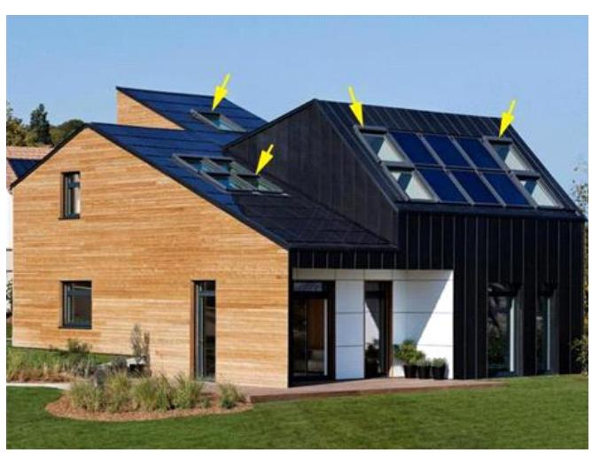

Figure 1. Exemple d'implantation

Au cours de ces dernières décennies, de nouvelles normes de construction des bâtiments ont contraint le « trait architectural » à suivre cette nécessaire évolution. Dans le domaine des performances énergétiques, les dispositions réglementaires sont rappelées dans le document normatif « RT (Réglementation thermique) 2012 ».

Outre les études des questions d'isolation, de ventilation, d'étanchéité à l'air et des apports en énergie renouvelable, la norme impose également un minimum de surfaces vitrées (1/6 des surfaces habitables), ainsi qu'un traitement des protections solaires.

Pour répondre à cette dernière exigence, des systèmes d'occultation plus ou moins sophistiqués ont été créés et intégrés aux immeubles de tous types afin de permettre aux occupants de mieux maîtriser les consommations d'énergie et les conditions de confort, été comme hiver.

Le volet roulant solaire (VRS) étudié satisfait aux normes de confort minimal : protection contre la chaleur, isolation renforcée contre le froid et isolation phonique.

Il comprend une motorisation, un pilotage à distance et une autonomie énergétique.


Figure 2. Volet roulant solaire


Figure 3. Télécommande de pilotage à distance

## **2.2 Prise en main**

L'objectif de cette partie est l'appropriation du système à partir de différentes manipulations et expérimentations.

Les questions ne sont pas obligatoirement à traiter dans l'ordre proposé. L'examinateur est à disposition du candidat pour répondre aux difficultés d'utilisation du système ou de compréhension du questionnement.

Matériels, logiciels et ressources à disposition :

- environnement Multimédia Pédagogique ;
- VRS-500\_EMP\_système et VRS-500\_EMP\_sous-système ;
- interface d'acquisition VRS-500\_Acquisition ;
- logiciel Matlab.
- **Activité 1.** Vérifier le fonctionnement du volet (montée/descente/arrêt). Renseigner les interactions sur le diagramme de contexte en phase d'exploitation (DR1).
- **Activité 2.** À partir des différentes ressources mises à disposition et des observations réalisées sur le système, compléter la chaîne d'énergie (DR2) et le diagramme d'exigence (DR3).

Appeler l'examinateur pour lui présenter une synthèse du travail effectué dans cette partie avant de poursuivre les activités.

#### **3. Problématique**

La société VELUX souhaite concevoir des systèmes qui « durent dans le temps ». Ce positionnement permet d'offrir des produits de qualité, avec la meilleure des garanties et être ainsi très attractifs pour les acheteurs potentiels.

### **Comment optimiser la durée de vie du système ?**

D'un point de vue « exigences système », cela amène à étudier la réponse apportée en conception à chacune des trois exigences suivantes :

- « Éviter un vieillissement prématuré » (Id = EP1) en termes structurels, via les solutions constructives et les constituants choisis ;
- « Être autonome en énergie » (Id = EO1) en termes énergétiques, via la durée de vie de l'installation solaire et principalement celle de la batterie ;
- « Assurer un fonctionnement en toute sécurité » (Id = EC1) en termes de comportements, afin de détecter les situations à risque pour le système, permettant un maintien quasi permanent en conditions opérationnelles de celui-ci.

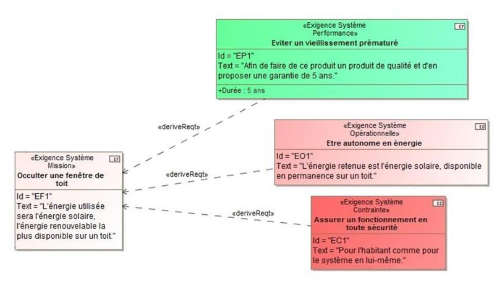

Figure 4. Diagramme des exigences

L'étude se décompose en quatre parties :

- étude d'un aller/retour en fonctionnement normal, de manière qualitative et quantitative, afin d'appréhender les grandeurs mises en jeu et établir des hypothèses de travail simplificatrices ;
- intégration Vérification Validation Qualification (IVVQ) de l'autonomie en énergie du système, afin de vérifier que celle-ci est bien assurée ;
- étude de la gestion de blocage, afin d'appréhender le comportement du VRS dans les différentes situations de blocage possibles ;
- étude de l'obtention de la position du volet, utile à la distinction des différents blocages.

#### **4. Résolution des problématiques**

#### **4.1 Étude d'un aller/retour du volet**

L'objectif de cette partie est d'appréhender le comportement énergétique du système lors d'un aller/retour du volet, de manière qualitative et quantitative, en fonctionnement normal.

Matériels, logiciels et ressources à disposition : interface d'acquisition du VRS.

**Activité 3.** À l'aide de l'interface d'acquisition du VRS, effectuer un relevé des grandeurs caractéristiques du moteur pour un aller/retour complet.

> En déduire les valeurs moyennes en courant et en tension du moteur pour chaque cycle (aller et retour).

> Conclure de façon qualitative et quantitative sur les grandeurs (en amplitude et en

temps) relevées lors d'une descente et lors d'une montée. Indiquer l'hypothèse simplificatrice devant être faite pour la suite de l'étude.

## **4.2 Étude de l'autonomie énergétique du système**

Le volet roulant solaire est utilisé de façon quotidienne. L'énergie stockée est consommée lorsqu'il n'y a pas de rayonnement solaire.

Les éléments du panneau photovoltaïque et la batterie doivent être dimensionnés afin d'assurer l'autonomie en énergie toute l'année.

Différents paramètres sont à prendre en compte :

- l'énergie journalière consommée ;
- l'énergie journalière disponible ;
- la durée de vie espérée de la batterie ;
- …

Dans une démarche d'Ingénierie Système, l'étude est réalisée dans le cadre de la phase finale en démarche de conception d'IVVQ :

- l'**Intégration** est faite, en considérant que le système est dans son contexte d'exploitation (en situation sur un toit) ;
- la **Vérification** de l'autonomie en énergie est faite elle aussi, puisque le fonctionnement du système est assuré sans aucune source externe d'alimentation en énergie (vérifié lors de la phase de prise en main du système) ;
- la **Validation** de l'autonomie est à faire, à partir du dimensionnement de l'installation et des données géographiques les plus défavorables ;
- la **Qualification** de l'autonomie reste à faire, principalement en termes de durée de vie de la batterie et d'autonomie sans recharge.

D'un point de vue des transferts d'énergie, la chaîne d'énergie simplifiée est donnée figure 5. Un facteur de conversion K permet de tenir compte des pertes liées à l'utilisation des différents convertisseurs et/ou régulateur entre le panneau photovoltaïque et le moteur électrique.

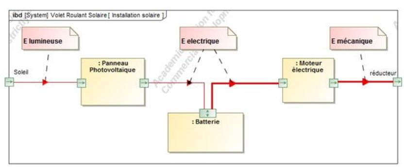

Figure 5. Diagramme des blocs internes

#### **4.2.1 Étude énergétique des besoins quotidiens**

L'objectif de cette partie est de déterminer les besoins quotidiens en énergie du système. Pour cela, il est indispensable de définir un scénario d'utilisation nominal, le plus réaliste possible sans être trop optimiste.

**Le scénario nominal retenu comprend deux allers-retours quotidiens du volet**, dont un est fait quotidiennement (basculement jour/nuit) et l'autre occasionnellement.

## Positionnement de l'étude :

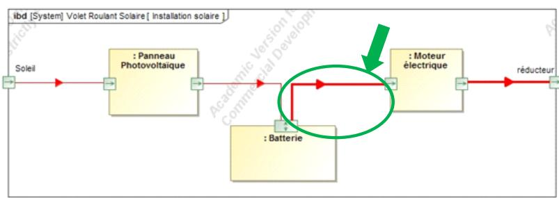

Figure 6. Diagramme des blocs internes pour létude de lactivité 4

Matériels, logiciels et ressources à disposition : interface d'acquisition du VRS.

**Activité 4.** À l'aide des relevés obtenus, déterminer l'énergie consommée pour un aller-retour (en J).

> En déduire les besoins quotidiens, notés B, du volet (en W∙h∙j-1 ) en appliquant au calcul de l'énergie un facteur de conversion K (K = 0,6.) pour tenir compte des différentes pertes (cellule photovoltaïque, batterie …).

## **4.2.2 Étude du dimensionnement de la cellule photovoltaïque**

Le volet roulant solaire doit pouvoir fonctionner, quelle que soit sa localisation en France. L'installation est dimensionnée pour fonctionner dans les conditions d'ensoleillement les plus défavorables.

L'objectif de cette partie est de déterminer le rendement maximal de la cellule photovoltaïque et d'effectuer le bilan énergétique global (énergie journalière reçue / besoins quotidiens) dans les conditions les plus défavorables, afin de valider l'autonomie énergétique du système.

### Positionnement de l'étude :

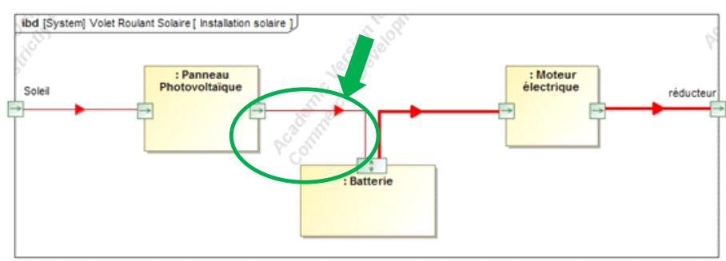

Figure 7. Diagramme des blocs internes pour létude de lactivité 5 et de lactivité 6

Matériels, logiciels et ressources à disposition :

- interface d'acquisition du VRS ;
- lampe halogène ;
- solarimètre ;
- documents fournis en annexe.

**Activité 5.** Proposer une démarche expérimentale permettant de déterminer la caractéristique de la puissance électrique en fonction de l'intensité électrique P = f(I) de la cellule photovoltaïque.

Tracer cette courbe.

En déduire le rendement de la cellule photovoltaïque au point de puissance maximal.

La région Nord fait partie des zones les moins ensoleillées de France. Les relevés issus du logiciel CALSOL donnent les irradiations moyennes journalières sur Lille, pour une position horizontale et une position verticale orientée plein Nord d'un panneau photovoltaïque (voir dossier Annexes).

**Activité 6.** Déterminer l'irradiation journalière moyenne minimale nécessaire pour le rendement estimé à l'activité 5.

> Établir le bilan énergétique global d'une installation solaire située à Lille et conclure quant à l'autonomie énergétique du système.

### **4.2.3 Étude du dimensionnement de la batterie**

L'objectif de cette partie est de déterminer le taux de décharge toléré par le fabricant et ses conséquences sur la durée de vie de la batterie, celle-ci étant dimensionnée pour satisfaire aux besoins énergétiques.

### Positionnement de l'étude :

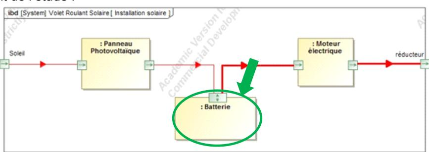

Figure 8. Diagramme des blocs internes pour létude de lactivité 7

Matériels, logiciels et ressources à disposition : environnement multimédia pédagogique (EMP) du système (constituants mécanismes motorisation).

La relation entre les données caractéristiques d'une batterie solaire est la suivante : *C= B∙N D∙T*. Avec :

- *C,* la capacité de la batterie (en A∙h) ;
- *T,* la tension nominale de la batterie (en V) ;
- *B,* les besoins quotidiens (en W∙h∙j-1 ) ;
- *N,* le nombre de jours de réserve, sans apport d'énergie (en j) ;
- *D,* le taux de décharge maximale de la batterie tolérée.

Le fabricant, lors du dimensionnement de la batterie solaire, a fixé une durée de **5 jours de réserve**, à savoir un maximum de 5 jours sans ensoleillement.

## **Activité 7 :** Déterminer, dans ces conditions, le taux de décharge de la batterie. Conclure de manière qualitative quant à sa durée de vie sachant que le taux de décharge acceptable pour ce type de batterie est de 10 %.

## **4.2.4 Étude de l'autonomie énergétique en cas de non-rechargement**

L'étude précédente est menée dans les conditions les plus défavorables d'ensoleillement. On considère que le système est en état de bon fonctionnement.

Un dysfonctionnement non visible est défini par toute défaillance de la chaîne d'énergie entraînant le non-rechargement de la batterie (l'actionnement du volet est toujours possible tant que la batterie peut fournir l'énergie nécessaire).

Les objectifs de l'étude expérimentale sont :

- la détermination théorique de l'autonomie maximale sans rechargement de la batterie ;
- la mise en évidence du comportement du système lors d'une décharge totale de la batterie ;
- l'influence de ce comportement sur l'autonomie réelle.

## Positionnement de l'étude :

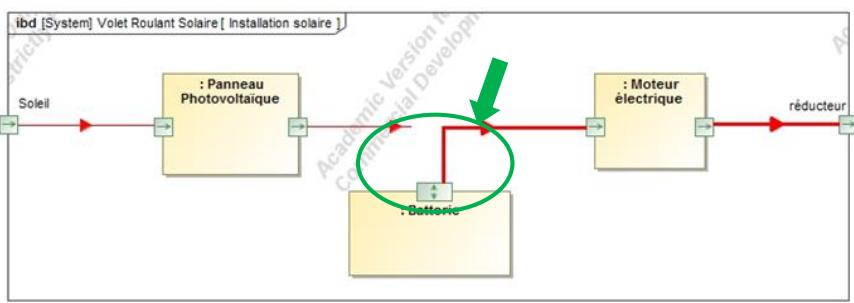

Figure 9. Diagramme des blocs internes pour la définition de létude de lactivité 8

Matériels, logiciels et ressources à disposition :

- alimentation de laboratoire réglable et sa connectique ;
- logiciel Matlab ;
- documents fournis en annexe.

**Activité 8.** Déterminer l'autonomie du système en nombre de jours, en considérant que la batterie se décharge totalement.

Le modèle Matlab simulant le comportement de la batterie est proposé figue 10.

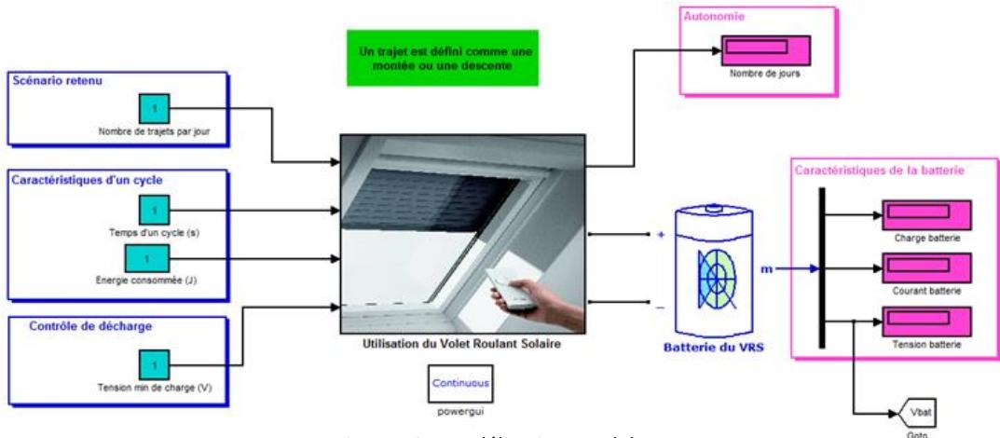

Figure 10 : Modélisation Matlab

La batterie est à paramétrer comme suit :

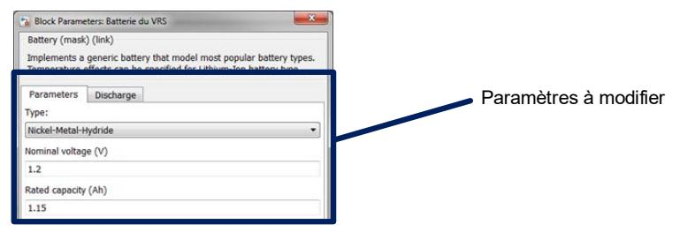

Figure 11. Boite de dialogue Matlab

## **Activité 9.** Ouvrir le modèle « Batterie\_VRS.mdl ». Valider le modèle vis-à-vis de l'autonomie théorique déterminée précédemment.

Un dysfonctionnement dans la chaîne d'énergie (cellule photovoltaïque, contrôleur de charge…) amène à une décharge totale de la batterie. Ce comportement est observé en utilisant une alimentation stabilisée en lieu et place de la batterie.

Pour ce faire, la procédure est la suivante :

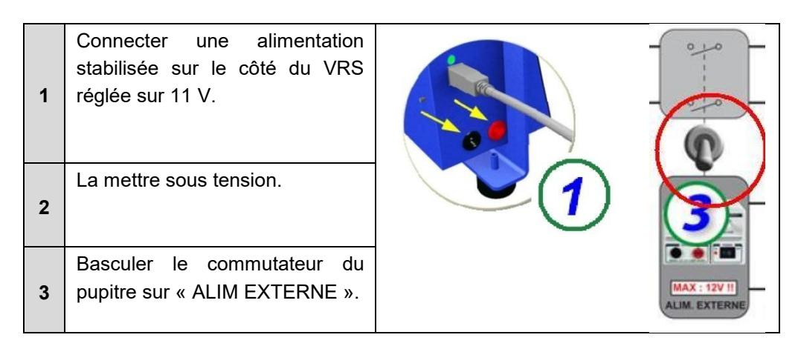

Le comportement observé influe directement sur l'autonomie du système et son impact sur la décharge de la batterie doit être estimé. La décharge réelle de la batterie ne pouvant être réalisée, le modèle Matlab « Batterie\_VRS.mdl » est utilisé pour simuler cette décharge totale.

# **Activité 10.** Modifier le paramétrage du modèle Matlab afin de tenir compte du comportement observé à l'activité 9.

Conclure quant à l'autonomie réelle et à la gestion de la batterie pour la sécurité de fonctionnement.

#### **4.3. Étude d'une situation de blocage**

Afin de protéger la motorisation et, d'un point de vue global le système, une procédure particulière permettant la gestion d'une situation de blocage du volet est mise en œuvre.

Cette situation de blocage accidentel peut se produire dans les cas suivants :

- fermeture du volet sur une fenêtre ouverte ;
- gel des lames en hiver (provoque un blocage instantané).

# **Activité 11.** Commander la fermeture totale du volet. Sur l'alimentation stabilisée, diminuer progressivement le niveau de tension jusqu'à ce que le volet réagisse (noter cette tension). Décrire le comportement observé. Conclure quant à l'intérêt de ce comportement.

Les objectifs de cette partie sont :

- la mise en évidence du comportement du système lors d'un blocage ;
- la justification de ce comportement vis-à-vis de la chaîne d'action ;
- la mise en comparaison du comportement du volet en fin de courses vis-à-vis d'un blocage inopiné.

Matériels, logiciels et ressources à disposition :

- EMP du VRS-500 ;
- interface d'acquisition du VRS-500.
- **Activité 12.** Générer un blocage volontaire lors d'une descente du volet (arrêt manuel, voir vidéo dans l'EMP). Sur les relevés du courant, de la tension et du capteur à effet Hall de l'interface d'acquisition, identifier distinctement les cinq phases suivantes :
  - 1. début du blocage ;
  - 2. régulation du courant ;
  - 3. moteur en court-circuit ;
  - 4. arrêt du moteur ;
  - 5. remontée des lames.
- **Activité 13.** Déterminer sur le document DR4 la zone de fonctionnement du moteur. Justifier ainsi la procédure choisie pour la gestion du blocage.
- **Activité 14.** Effectuer l'acquisition sur une fin de course en butée basse du volet. Comparer de manière qualitative et quantitative (en termes d'amplitude et de temps) le comportement du volet dans cette situation vis-à-vis d'un blocage inopiné. Préciser la différence notoire observée en phase 1 dans cette situation. Conclure sur l'origine de la différence observée.

### **4.4 Affichage du taux de charge de la batterie**

L'objectif de cette activité est d'observer la consommation énergétique du bloc moteur présent dans le sous-système. Les différents algorithmes implémentés dans la carte Arduino sont donnés (dossier Annexes) sous forme graphique conformément au programme écrit en langage C.

**Activité 15.** Programmer la carte Arduino avec le programme « Position.ino » (logiciel « Sketch » d'Arduino) et le tester à l'aide des boutons sur la carte.

> Observer le comportement du sous-système et présenter à l'examinateur le phénomène observé.

Modifier le programme pour obtenir le comportement du système réel.

La documentation de la carte de gestion des moteurs indique :

| Function        | pins per Ch. A | pins per Ch. B |
|-----------------|----------------|----------------|
| Direction       | D12            | D13            |
| PWM             | D3             | D11            |
| Brake           | D9             | D8             |
| Current Sensing | A0             | A1             |

Le courant maximal autorisé pour cette carte autorise est de 2 A. L'information recueillie sur les broches A0 et A1 est proportionnelle à l'intensité du courant délivré au moteur et est codée sur 10 bits (1024 niveaux). Les équivalences sont les suivantes :

- si *A0 = 0* alors *0 A* sont délivrés sur la sortie A ;
- si *A0 = 1023* alors *2 A* sont délivrés sur la sortie A.

# **Activité 16.** Modifier le programme pour afficher sur l'écran, via une transmission par un port série, la consommation instantanée en courant du moteur sur la durée d'une descente (proposer d'abord une version algorithmique si nécessaire, puis implémenter celle-ci en langage C en procédant par analogie et/ou en utilisant les ressources fournies).

Modifier ensuite le programme pour afficher sur l'écran, via une transmission par un port série, la consommation moyenne du moteur sur la durée d'une descente (proposer d'abord une version algorithmique si nécessaire, puis implémenter celle-ci en langage C en procédant par analogie et/ou en utilisant les ressources fournies).

Pour une descente complète, déterminer la capacité consommée de la batterie, en mAh.

Programmer l'affichage sur l'écran LCD du pourcentage de capacité de batterie.

À partir des activités 15 et 16, faire une analyse critique quant à l'intérêt d'une étude énergétique basée sur ce sous-système.

#### **5. Conclusions quant à la problématique**

**Activité 17.** Au regard des résultats obtenus lors des différentes études précédentes, conclure quant à la durée de vie globale du système d'un point de vue mécanique et énergétique.

# **Rapport du jury de l'épreuve de mise en situation professionnelle**

#### **1. Présentation de l'épreuve**

La durée de cette épreuve est de six heures. Elle est scindée en trois temps :

- quatre heures de travaux pratiques sur un système ;
- une heure en loge pour concevoir une exploitation pédagogique et sa présentation ;
- une heure d'entretien avec le jury organisée en 30 minutes de soutenance et 30 minutes d'échanges avec le jury.

Les deux parties, travaux pratiques et exploitation pédagogique, sont notées chacune sur dix points. Cette différenciation dans l'évaluation des deux parties de l'épreuve permet de dissocier la réussite à l'épreuve de « travaux pratiques » de celle à l'épreuve d'« exploitation pédagogique ».

Les supports utilisés, pour cette session, sont des systèmes pluritechnologiques actuels :

- robot collaboratif ;
- volet roulant solaire ;
- banc de simulation de séisme ;
- système de ventilation double flux ;
- système de caméra auto-suiveuse ;
- nacelle de prise de vue ;
- robot humanoïde ;
- skate électrique ;
- banc d'étude de soutènement ;
- robot haptique.

Un tirage au sort du support est réalisé indépendamment de la spécialité du candidat pour l'épreuve de mise en situation professionnelle.

Le travail pratique proposé est construit pour être accessible à tous les candidats. Les documents, accompagnant le support, fournissent un guide qui permet à tous les candidats, quelle que soit leur connaissance du système, quelle que soit leur spécialité, d'exprimer leurs compétences scientifiques et pédagogiques.

Chacun des supports conduit à une séquence de niveau imposé en technologie au collège, ou en série sciences et technologies de l'industrie et du développement durable en enseignement transversal, ou en série scientifique pour les enseignements de sciences de l'ingénieur.

Les objectifs de formation pour l'exploitation pédagogique de la séance d'activité pratique sont donnés aux candidats ainsi que le contexte de mise en œuvre de la séquence (effectifs, répartition horaire…).

Les compétences évaluées sont les suivantes :

- analyser, mettre en œuvre un protocole expérimental, simuler et vérifier des performances ;
- exploiter des résultats, justifier des choix et des solutions ;
- présenter de manière détaillée une partie significative d'une séance de formation constitutive de la séquence ;
- élaborer des documents de qualité pour présenter la séquence et la partie significative de la séance ;
- s'exprimer correctement à l'oral pour présenter la séquence et la partie significative d'une séance de formation.

Ces compétences sont évaluées, quels que soient les supports d'activités pratiques mis en œuvre.

Les candidats disposent :

- d'un espace numérique personnel qu'ils conservent pendant les six heures de l'épreuve ;
- d'un poste informatique équipé des logiciels de bureautique et dédié aux activités pratiques ;
- de toutes les ressources numériques en lien avec le travail pratique (dont les programmes d'enseignement, les repères pour la formation et les guides d'accompagnement lorsqu'ils existent).

Le jury dispose d'une traçabilité des connexions sur le réseau permettant de suivre les sites consultés.

Les postes de travaux pratiques sont équipés, selon la nécessité des activités proposées, des matériels usuels de mesure des grandeurs physiques (oscilloscopes numériques, multimètres, dynamomètres, tachymètres, cartes d'acquisition associées à un ordinateur…). Cette liste n'est pas exhaustive.

Cette épreuve est commune aux candidats au CAPET externe et au CAPET 3<sup>e</sup> voie. Les attendus, le déroulement et les supports didactiques ainsi que les exploitations pédagogiques sont identiques. Dans ce cadre, les conseils aux candidats sont communs pour les deux concours.

#### **2. Analyse globale des résultats**

Le jury tient à souligner le sérieux et la qualité de préparation de la majorité des candidats. Néanmoins, les attendus de l'épreuve et les modalités de mise en œuvre décrits au JORF et repris dans les rapports des jurys des années précédentes ne sont toujours pas connus de tous. Il s'avère extrêmement difficile de réussir les activités pratiques et l'exploitation pédagogique si les objectifs spécifiques de ces deux activités ne sont pas identifiés.

Les notions théoriques portant sur la didactique de la discipline et sur les différentes démarches pédagogiques associées sont très souvent citées par les candidats. Elles sont rarement justifiées et parfois énoncées d'une façon inappropriée. Elles ne font que trop rarement l'objet d'une contextualisation ou d'une proposition concrète dans le cadre de la séquence présentée.

Une proportion notable de candidats ne connaît pas les programmes de technologie au collège, de STI2D et l'enseignement de sciences de l'ingénieur de la série S ainsi que les documents ressources pour faire la classe. Bien que donnés, ces différents textes et documents nécessitent un temps important pour s'approprier leur philosophie. La méconnaissance de ceux-ci se révèle pénalisante pour construire une séquence et une séance pédagogique réaliste dans le temps imparti. Le jury a été également extrêmement surpris que des candidats n'aient pas appréhendé le socle commun de connaissances, de compétences et de culture ainsi que l'évaluation par compétences.

Le nombre des exploitations pédagogiques portant sur le collège, la série STI2D et l'enseignement de sciences de l'ingénieur dans la série SI a été équilibré sur l'ensemble de la session. Les candidats doivent donc être en mesure de produire des séquences et des séances sur tous les niveaux d'enseignement afin de pouvoir répondre aux attentes du jury.

## **3. Commentaires du jury sur les réponses apportées par les candidats et conseils aux futurs candidats**

Le jury a noté une prise en compte des remarques des années précédentes portant sur la concision de la présentation de l'activité pratique et sur l'intérêt de mettre en regard l'étude réalisée sur le système avec la séquence pédagogique demandée. Le jury invite les candidats à faire preuve d'une rigueur scientifique exemplaire lors de la présentation des travaux réalisés. Lors de l'exploitation pédagogique, les activités pratiques et leurs résultats ne sont néanmoins pas encore suffisamment réinvestis, voire pas réinvestis du tout, au niveau de la séquence demandée.

Le jury conseille d'organiser la présentation de la façon suivante :

- présentation du système (durée maximale cinq minutes) ;
- synthèse des activités menées en travaux pratiques (durée maximale cinq minutes) ;
- exploitation pédagogique (durée maximale vingt minutes).

Le manque de culture scientifique et technologique usuelle pénalise de nombreux candidats dans l'appropriation des supports pluritechnologiques. Il est impératif, pour espérer réussir correctement l'épreuve de mise en situation professionnelle, de disposer de compétences et de connaissances scientifiques et technologiques avérées. Cette culture technologique ne se limite en aucun cas à un domaine disciplinaire unique. Les futurs professeurs de sciences industrielles de l'ingénieur se doivent d'avoir une vision transversale et globale de leur discipline. Cela ne peut se faire qu'en conduisant une veille technologique régulière.

Quelques candidats ont proposé des présentations (orales et écrites) très formatées, quelquefois hors du contexte de l'activité pratique réalisée en amont, qui ne résistent pas aux questionnements du jury et mettent en évidence des lacunes. Le jury invite les candidats à, certes, maîtriser les attendus pédagogiques et didactiques de la discipline, mais surtout à être en capacité de les réinvestir de façon adaptée et pertinente.

Les candidats les plus efficaces font preuve d'autonomie et d'écoute lors des travaux pratiques. Ils prennent des initiatives dans la conception de leur séquence pédagogique. Ils ont su mettre à profit l'ensemble des ressources numériques mises à leur disposition.

Enfin, le jury rappelle que le concours constitue la première étape de l'entrée dans le métier du professorat. Le candidat se doit donc d'adopter une posture et un positionnement exemplaires constitutifs de la mission d'enseignant. Le jury invite vivement les candidats à s'approprier le référentiel des compétences professionnelles des métiers du professorat et de l'éducation (arrêté du 1-7-2013 - J.O. du 18-7-2013).

## **Maîtrise de la finalité de l'épreuve**

Le jury ne peut que renouveler les conseils qui ont été donnés lors des précédentes sessions :

- **connaître la description de l'épreuve (arrêté du 19 mars 2013 publié au JORF du 27 avril 2013 – arrêté du 24 avril 2013 publié au JORF du 22 août 2013 – arrêté du 19 avril 2016 du JORF n°0126 du 1 juin 2016) ;**
- lire les rapports de jury des sessions précédentes.

#### **Préparation – Formation aux épreuves**

Le jury conseille aux candidats de :

- s'approprier les programmes de tous les niveaux énoncés dans la définition de l'épreuve ainsi que les documents ressources associés ;
- prendre connaissance du socle commun de connaissances, de compétences et de culture ;
- s'informer des évolutions des programmes et des enseignements en collège ;
- s'informer des pratiques pédagogiques, des modalités de fonctionnement et de l'organisation des horaires de tous les niveaux d'enseignement que peuvent assurer les professeurs de sciences industrielles de l'ingénieur ;

- se préparer à exploiter les résultats d'investigations et d'expérimentations en regard des contenus disciplinaires ;
- s'informer sur les modalités des épreuves d'examen auxquelles ils préparent leurs futurs élèves.

## **Qualité des documents de présentation et expression orale**

Il est attendu des candidats une maîtrise des outils numériques pour l'enseignement afin de construire un document clair, lisible et adapté à la présentation de l'exposé.

Le jury est extrêmement attentif à la qualité de la syntaxe et de l'orthographe.

Les candidats s'expriment généralement correctement. La qualité de l'élocution et la clarté des propos sont indispensables aux métiers de l'enseignement.

#### **Pour la partie travaux pratiques**

#### **Organisation à suivre lors de l'épreuve**

Les candidats doivent rapidement mettre en œuvre et s'approprier le système. Des documents d'aide sous forme numérique et multimédia leur sont fournis.

Dès le début de l'épreuve, les candidats notent le niveau (collège, STI2D ou S-SI) sur lequel devra porter la séquence à élaborer.

Les candidats ont à réaliser des activités expérimentales et à analyser des résultats afin de conclure sur les problématiques proposées. Ces activités pratiques (mesures et interprétations) sont à réaliser au niveau de compétences d'un master première année.

Les candidats doivent penser à garder des traces numériques de leurs résultats et de leurs travaux afin de les réinvestir dans une séquence adaptée au collège ou au lycée.

Lors de cette session, durant les quatre heures de l'activité pratique, une heure peut être consacrée à la réalisation d'essais complémentaires susceptibles d'illustrer l'exploitation pédagogique présentée. Elle permet également de commencer l'élaboration des documents pédagogiques attendus lors de l'exposé. Il est également envisageable, pour les sessions du concours ultérieures, que ce temps d'élaboration pédagogique d'une heure soit positionné au début de l'épreuve de mise en situation professionnelle afin de construire un squelette de séquence en ayant à sa disposition le système.

La connaissance préalable du système et des logiciels n'étant pas demandée, les membres de jury peuvent être sollicités par les candidats en cas de problèmes ou de difficultés persistantes liées à l'exploitation d'un logiciel ou d'un appareil de mesurage spécifique. Plus généralement, le jury est présent pour accompagner les candidats dans leurs démarches.

#### **Aptitude à mener un protocole expérimental**

La mise en œuvre des matériels de mesurage et d'acquisition ne suscite pas de difficulté particulière. Les membres du jury assurent l'accompagnement nécessaire afin que la spécificité d'un équipement ne constitue pas un obstacle à la réussite du candidat. On attend du candidat qu'il soit capable de proposer et de justifier des choix de protocoles expérimentaux.

#### **Utilisation des modèles numériques**

Globalement, les candidats utilisent correctement les modèles numériques fournis. Le jury note cependant que de nombreux candidats manquent de recul et d'esprit critique dans l'interprétation des résultats de la simulation numérique et dans la critique des hypothèses faites lors de l'élaboration du modèle. Il est attendu des candidats une analyse pertinente des écarts entre les résultats fournis par la modélisation, les mesures issues du système réel à partir d'expérimentations et/ou les performances attendues indiquées dans le cahier des charges.

#### **Pour l'exposé devant le jury**

## **Présentation du travail pratique**

Une présentation succincte du support, des travaux réalisés et des résultats obtenus permet de contextualiser la séance qui sera présentée. Elle doit être réalisée avec toute la rigueur scientifique que le jury peut attendre d'un étudiant de master première année qui se destine au métier d'enseignant. Le jury apprécie les présentations synthétiques mettant en évidence les points qui feront l'objet d'un réinvestissement dans la description de la séquence et de la séance. Afin de faciliter l'exposé, il est suggéré d'utiliser les outils les plus adaptés de produire des supports de présentation de qualité.

#### **Description de la séquence**

Les candidats doivent concevoir le canevas d'une séquence et la positionner dans une progression pédagogique annuelle. Les documents ressources pour faire la classe constituent des points d'appui que les candidats ne peuvent ignorer.

Les hypothèses d'organisation de la pédagogie dans l'établissement doivent être précisées (exemple 7 h d'enseignement transversal dont 3 h en co-animation en 1re STI2D). Le positionnement de la séquence dans le plan de formation du cycle ou de l'année doit être précisé et justifié.

Une séquence se compose de plusieurs séances. Il est demandé de décrire la structure de chaque séance et de préciser les prérequis et les objectifs (compétences à faire acquérir, capacités et connaissances attendues), l'organisation de la classe, les systèmes utilisés, la durée des séances, le nombre d'élèves, les modalités pédagogiques (cours, activités dirigées, activités pratiques, projet), les stratégies pédagogiques (déductif, inductif, différenciation pédagogique, démarche d'investigation, démarche de résolution de problème technique, pédagogie par projet, approche spiralaire…), les activités des élèves et les productions attendues. La description de la séquence et des séances se doit de faire explicitement apparaître la prise en compte de la diversité des publics accueillis dans la classe.

Les phases de structuration des connaissances et les différentes formes d'évaluations des élèves sont des parties intégrantes de la séquence et doivent reprendre les objectifs annoncés. Les différentes modalités d'enseignement (EPI…) et les dispositifs d'accompagnement et de remédiation doivent être précisés.

#### **Utilisation du numérique**

Le jury note qu'une majorité de candidats fait appel aux ressources et usages du numérique dans les activités proposées aux élèves. Néanmoins, le jury conseille aux candidats de bien identifier les points de leur séquence pédagogique où l'usage du numérique apportera une réelle plus-value aux apprentissages des élèves. Si l'exploitation du numérique disciplinaire est souvent mise en œuvre par de nombreux candidats, peu d'entre eux proposent une séquence exploitant le numérique éducatif.

#### **Réinvestissement des résultats de travaux pratiques**

L'objectif attendu de la leçon est une exploitation pédagogique en lien avec tout ou partie des activités pratiques réalisées. Celles-ci étant d'un niveau supérieur à la séquence demandée, il ne s'agit pas de faire, au travers de la séquence pédagogique, un compte-rendu de l'activité pratique réalisée, mais de s'appuyer sur les expérimentations pour en extraire des données et des activités à proposer aux élèves du niveau de la classe visé. Les candidats doivent, en dix minutes au maximum :

- présenter brièvement le support, la problématique et la démarche méthodologique proposée ;
- justifier le(s) lien(s) avec la séquence pédagogique, expliciter les résultats et les investigations qui seront réutilisées dans la séquence.

De plus, il est important que les candidats explicitent comment les adapter au niveau d'enseignement visé. Le jury ne se satisfait en aucun cas d'une exploitation brute des activités proposées dans la première partie de l'épreuve.

Les candidats peuvent aussi envisager l'utilisation d'autres systèmes présents dans les établissements, en complément du système étudié pendant la première partie de l'épreuve.

#### **Réalisme de l'organisation de la classe**

Le jury attend des candidats qu'ils émettent des hypothèses réalistes sur les conditions d'enseignement. Leurs propositions doivent être pragmatiques afin que le jury puisse appréhender le scénario pédagogique envisagé.

#### **Évaluation**

Le processus retenu par le candidat pour l'évaluation des compétences doit être clairement décrit (évaluation diagnostique, formative, sommative, certificative…) et justifié. Les modalités et les outils doivent être précisés. Si des remédiations ou des différenciations pédagogiques sont envisagées, elles doivent être explicitées.

Trop souvent, les candidats se contentent d'évoquer les processus d'évaluation sans pouvoir en expliquer réellement le déroulement, les modalités et surtout l'objectif en termes d'acquisition des compétences par les élèves.

#### **Réactivité au questionnement**

Le jury attend de la concision et de la précision ainsi qu'une honnêteté intellectuelle dans les réponses formulées. Les réponses au questionnement doivent laisser transparaître un positionnement adapté aux attentes de l'Institution et une réelle appropriation des valeurs de la République ne se limitant pas à l'exposé des grands principes sans en démontrer le bienfondé pour les élèves.

Le candidat se doit d'être réactif sans chercher à éluder les questions ou à noyer le propos dans un discours pédagogique non maîtrisé. Plus qu'une réponse exacte instantanée, le jury apprécie la capacité à argumenter, à expliquer et justifier une démarche ou un point de vue.

#### **4. Conclusions**

L'épreuve de mise en situation professionnelle nécessite une préparation sérieuse et approfondie en amont de l'admissibilité. Cette préparation doit porter tout autant sur la partie « travaux pratiques » que sur la partie « exploitation pédagogique », car ces deux parties de l'épreuve sont complémentaires et indissociables. Les compétences nécessaires à la réussite de cette épreuve sont à acquérir et à développer notamment lors de stages en situation et de périodes d'observation ou d'enseignement. Elles sont complétées par une connaissance fine des référentiels et des documents ressources pour faire la classe. L'épreuve s'appuie sur la maîtrise disciplinaire des sciences industrielles de l'ingénieur. Le métier d'enseignant exige une exemplarité dans la tenue, dans la posture ainsi que dans le discours. L'épreuve de mise en situation professionnelle permet la valorisation de ces qualités.

#### **5. Résultats**

candidats ont été évalués pour cette épreuve, la moyenne des notes obtenues est de 10,8 et un écart type de 4,4 avec :

- 20 comme meilleure note ;
- 1,7 comme note la plus basse.

# **Rapport du jury de l'épreuve d'entretien à partir d'un dossier**

#### **Recommandations générales**

Il est demandé aux candidats de lire attentivement le règlement du concours afin de respecter les modalités de l'épreuve.

Il est impératif de prendre connaissance des programmes d'enseignement du collège au lycée et des ressources associées. Sur le plan de l'organisation pédagogique, les activités des élèves doivent être au centre des préoccupations du candidat.

Le jury demande aux candidats de ne pas limiter leur approche à une identification des objectifs de formation tels que définis dans les programmes mais de développer des activités en explicitant les démarches pédagogiques retenues.

Le jury invite les candidats à s'approprier le référentiel de compétences des professeurs disponible à l'adresse suivante :

[http://www.education.gouv.fr/cid73215/le-referentiel-de-competences-des-enseignants-au-bo-du-25](http://www.education.gouv.fr/cid73215/le-referentiel-de-competences-des-enseignants-au-bo-du-25-juillet-2013.html) [juillet-2013.html](http://www.education.gouv.fr/cid73215/le-referentiel-de-competences-des-enseignants-au-bo-du-25-juillet-2013.html)

Notamment, le jury attend des candidats une parfaite maîtrise, orale et écrite, de la langue française.

#### **1. Présentation de l'épreuve**

- Durée de l'épreuve : 1 heure (présentation : 30 minutes maximum, entretien avec le jury : 30 minutes) ;
- Coefficient 2.

L'épreuve est basée sur un entretien avec le jury à partir d'un dossier technique, scientifique et pédagogique réalisé par le candidat, suivi d'un entretien. Elle a pour but de vérifier que le candidat est capable de rechercher des supports de son enseignement dans le milieu industriel et d'en extraire des exploitations pertinentes pour son enseignement au collège ou au lycée.

L'entretien qui succède à la présentation du candidat permet au jury d'approfondir les points qu'il juge utiles. Il permet en outre d'apprécier la capacité du candidat à prendre en compte les acquis et les besoins des élèves, à se représenter la diversité des conditions d'exercice de son métier futur, à en connaître de façon réfléchie le contexte dans ses différentes dimensions (classe, équipe éducative, établissement, institution scolaire, société) et les valeurs qui le portent, dont celles de la République.

*Les dossiers doivent être déposés ou envoyés en recommandé en double exemplaires, au secrétariat du jury cinq jours francs avant le début des épreuves d'admission pour le support papier et en un exemplaire pour le support numérique. A l'issue des épreuves aucun dossier ou support numérique n'est restitué.* 

#### **2. Analyse globale des prestations**

Le jury note la grande diversité des supports techniques retenus par les candidats, celle-ci démontrant que les domaines d'investigations sont nombreux et qu'ils sont potentiellement capables d'être appréhendés et adaptés à l'enseignement technologique du cycle secondaire.

Le jury constate la grande disparité de la qualité du contenu des dossiers sur le fond et la forme. En effet, si la plupart des candidats ont respecté les consignes définissant l'épreuve, certains se sont contentés d'une approche très générale, voire superficielle, des présentations *scientifiques, technologiques et pédagogiques*.

Le jury attend des développements personnels approfondis à caractère *scientifique et technologique*  conformes aux exigences du concours et faisant référence aux exploitations *pédagogiques* possibles. Seule l'identification de problématique(s) industrielle(s) authentique(s) permet de satisfaire à cette exigence.

Le choix du support est donc essentiel pour garantir une exploitation scientifique, technologique et pédagogique suffisamment riche. Il doit être fait au plus tôt dans la préparation au concours. Le jury regrette que certaines prestations s'appuient uniquement sur des données obtenues par de simples échanges téléphoniques ou récupérées sur Internet sous la forme de présentations commerciales.

Un simple constituant d'un système ou une solution technologique non contextualisée ne peut constituer un support de dossier satisfaisant, de même qu'une présentation de matériaux ou famille de matériaux. Un futur enseignant en sciences et techniques industrielles doit être en constante veille technologique, établir et maintenir un contact permanent avec les divers acteurs du secteur industriel garantissant ainsi l'intégration des innovations technologiques dans le cursus de formation des collégien(ne)s et lycéen(ne)s.

#### **3. Commentaires et recommandations à l'attention des candidats**

## **Élaboration de la partie scientifique et technologique du dossier**

Le caractère pluritechnologique et la richesse scientifique du support retenu sont valorisés par le jury. Le choix de systèmes assimilés à des jouets ou déjà didactisés et l'exploitation des dossiers pédagogiques fournis avec ces équipements ne sont pas recommandés. De même, le principe du développement ex nihilo par le candidat d'une maquette ayant vocation à constituer un support de cours n'est pas envisageable.

L'approche systémique s'avère essentielle, car elle s'appuie sur une perception globale du système dans son environnement. Elle démontre aussi la capacité du candidat à contextualiser le support en utilisant une démarche d'analyse fonctionnelle et les outils de description de l'ingénierie système. Ce travail constitue un attendu fort du jury. Elle intègre en conséquence la complexité du réel. Il s'agit d'une étape incontournable de la présentation du support choisi.

Le jury déplore que pour un nombre conséquent de dossiers, l'étude scientifique et technologique se limite à une description du produit ou une explication du fonctionnement de celui-ci. Certains dossiers se limitent à une compilation de ressources copiées-collées depuis Internet sans citer les sources. Le plagiat est sévèrement sanctionné par le jury. Le candidat doit veiller à mener des études personnelles à caractère scientifique et technologique dépassant la simple description du support choisi et privilégiant l'élaboration de modèles comportementaux et leur utilisation dans la partie pédagogique.

Les phases de validation, au cœur des développements pédagogiques, imposent la vérification de grandeurs caractéristiques quantifiées. En lien avec la vérification et la quantification des caractéristiques étudiées, la démarche expérimentale prend ici tout son sens. Les protocoles d'acquisition des données doivent être décrits, voire accompagnés, du traitement des résultats obtenus.

Le jury recommande aux candidats de consulter les travaux de recherche universitaires, au moins en langue française, utiles à l'explicitation dans le dossier de solutions technologiques innovantes. Sans en exiger la maîtrise des contenus, ce travail peut permettre de rendre plus robustes certaines présentations. Dans cette perspective, il doit être fait mention des auteurs et travaux consultés dans la bibliographie des dossiers.

Le volet pédagogique doit permettre au candidat d'exploiter une des problématiques identifiées dans la partie scientifique et technologique. Le candidat doit veiller à conserver une logique entre les dominantes du support et l'exploitation pédagogique. L'adaptation pertinente des documents techniques utiles à l'exploitation pédagogique est un attendu du jury. La qualité des documents techniques insérés dans cette partie du dossier est une preuve de la capacité du candidat à produire des ressources d'activités exploitables par les élèves.

*Le jury conseille aux candidats de constituer un dossier de 40 pages au maximum annexes comprises.* 

## **Élaboration de la partie pédagogique du dossier**

Pour la séquence choisie, il est indispensable que le candidat précise clairement :

- le niveau de la classe choisie et l'enseignement concerné ;
- la pertinence du positionnement de la séquence au sein de la progression du cycle de formation qui ne saurait se résumer à un simple positionnement calendaire ;
- ses intentions pédagogiques en lien avec le programme ou le référentiel choisi et la problématique retenue, ce qui implique que les compétences travaillées et les connaissances visées soient explicitement exprimées ainsi que les prérequis nécessaires à cette nouvelle étape de formation ;
- l'adaptation des documents techniques exploitables pour des élèves;
- l'organisation pédagogique et les situations d'apprentissage prenant la forme d'une fiche séquence, détaillant au moins une des activités élèves ;
- une activité rédigée et détaillée à destination des élèves ;
- les contenus d'une fiche de synthèse qui participe de la structuration des connaissances ;
- l'évaluation des acquis des élèves indiquant les critères et les indicateurs de réussite ainsi que les modalités d'une remédiation.

Le jury apprécie les séquences développées qui prennent en compte la diversité des performances attendues des élèves ainsi que les séquences construites autour d'une approche pluritechnologique et pluridisciplinaire.

La connaissance des programmes de formation est prise en compte dans l'évaluation du candidat. Pour autant, un développement exhaustif à tous les niveaux de formation n'est pas nécessaire.

Le jury apprécie les propositions d'exploitations pédagogiques, en technologie au collège, en STI2D, en S-SI, qui exploitent pleinement le potentiel du support retenu.

L'approche pluridisciplinaire est rarement abordée bien que les thèmes d'études exposés par les candidats la rendent souvent possible.

À l'instar de l'élaboration de la partie scientifique et technologique du dossier, le jury invite les candidats à documenter leurs réflexions par la consultation des travaux universitaires sur les aspects didactiques et pédagogiques.

Un futur enseignant doit être en constante veille pédagogique et réglementaire ; les candidats s'assureront que l'exploitation pédagogique proposée est strictement conforme aux programmes en vigueur. Le jury invite les candidats à consulter le site RNR STI (http://eduscol.education.fr/sti/) ainsi que la revue Technologie (https://www.reseaucanope.fr/notice/technologie.html).

## **Soutenance du dossier**

Cette partie de l'épreuve doit permettre au candidat de démontrer :

- sa connaissance des contenus d'enseignement et des programmes de la discipline au collège et au lycée ;
- sa réflexion sur la didactique de la discipline et le développement de l'interdisciplinarité ;
- ses aptitudes à communiquer, à analyser et à synthétiser;
- sa connaissance des dispositifs d'évaluation ;
- l'apport du numérique au bénéfice de l'évaluation des élèves, de la remédiation et de l'exploitation des temps d'apprentissage en dehors de la salle de classe.

Le candidat expose, dans un premier temps, sans être interrompu par le jury, le résultat de ses travaux. Il doit mettre en évidence :

- les raisons qui ont présidé au choix du support ;
- la pertinence du support choisi pour une exploitation pédagogique ;
- la documentation technique rassemblée et la nature des échanges établis ;
- dans le cas d'un travail de groupe, son travail personnel clairement repéré dans le dossier et mis en évidence lors de l'exposé, tant dans les développements scientifiques et technologiques que dans l'exploitation pédagogique ;
- les objectifs pédagogiques choisis ;
- la structure de la (ou des) séquence(s) choisie(s) ;
- le travail demandé aux élèves ;
- les compétences mobilisées et les connaissances associées;
- les stratégies d'évaluation et de remédiation.

De nombreux candidats exploitent judicieusement le temps alloué à l'exposé en respectant un équilibre entre les développements scientifiques et technologiques et l'exploitation pédagogique.

Sur la forme, le jury constate encore fréquemment de trop nombreuses fautes d'orthographe et des diapositives trop chargées, voire illisibles.

Il est conseillé de faire appel aux applications numériques d'animation et de simulation actuelles pour la présentation des dossiers. La numérotation des diapositives est indispensable afin de faciliter les échanges avec le jury.

Le jury apprécie la qualité de l'expression orale des candidats et sanctionne le manque de rigueur dans ce registre (niveau de langage, terminologie technique, expressions inadaptées, approximations syntaxiques, etc.).

Le support numérique est un moyen sur lequel le candidat s'appuie au cours de son exposé. Trop de candidats se contentent de lire le contenu des diapositifs au lieu d'apporter des commentaires, des justifications, des arguments sur leurs choix. Le jury apprécie les prestations dynamiques où le candidat n'est pas dépendant de son support de présentation. Il démontre ainsi ses aptitudes à communiquer et capter l'attention de son auditoire.

#### **Entretien avec le jury**

Au cours de l'entretien, le jury pose des questions destinées à :

- expliciter les raisons qui ont conduit le candidat au choix du support et les liens établis avec l'entreprise ;
- expliciter le contexte de développement du dossier ;
- expliciter un développement scientifique dans la perspective de l'élaboration d'un modèle de comportement ;
- justifier les solutions technologiques adoptées ;
- préciser les exploitations pédagogiques possibles.

Le jury cherche à valoriser le candidat dans sa maîtrise des démarches pédagogiques mobilisées dans son enseignement. Il apprécie la réactivité du candidat, la pertinence de ses réponses, la qualité de son argumentation et son appropriation des valeurs de la République dans le contexte d'exercice du métier d'enseignant.

#### **4. Conclusion**

La préparation de cette épreuve doit être engagée dès l'inscription au concours. Le choix d'un support pertinent vis-à-vis des attentes de l'épreuve est essentiel, son appropriation et la réalisation du dossier constituent une solide préparation aux épreuves d'admissibilité.

Le dossier doit être élaboré à partir d'un produit porteur d'innovation. La richesse et la pertinence de son contenu sont à construire au travers de relations réelles avec les professionnels ; les candidats doivent donc prévoir de consacrer du temps pour le constituer et se l'approprier dans le détail, cette épreuve compte pour 2/9 de l'ensemble des épreuves du CAPET, elle participe notablement à la réussite au concours lorsqu'elle est bien préparée. Le dossier ne s'élabore pas uniquement à partir de ressources recueillies sur Internet. Les candidats se limitant à une analyse superficielle du support sont pénalisés.

L'entretien avec le jury permet également d'apprécier la capacité du candidat à prendre en compte les acquis et les besoins des élèves, à se représenter la diversité des conditions d'exercice de son métier futur et à en connaître de façon réfléchie le contexte dans ses différentes dimensions et les valeurs qui le portent, dont celles de la République.

Cette épreuve, comme celle de travaux pratiques, participe significativement à la réussite au concours quand elle est bien préparée. L'intérêt porté, le travail fourni à la constitution du dossier débouchent sur une bonne prestation et donc à la réussite du concours. De même, dans une proportion sensiblement identique, des candidats ont régressé dans le classement jusqu'à l'élimination.

#### **5. Résultats**

278 candidats ont été évalués pour cette épreuve, la moyenne des notes obtenues est de 10,75 et un écart type de 5,18 avec :

- 20 comme meilleure note ;
- 0,5 comme note la plus basse.

# **Rapport sur la transmission des valeurs et principes de la République**

Lors des épreuves d'admission, le jury évalue la capacité du candidat à agir en agent du service public d'éducation, en vérifiant qu'il intègre dans l'organisation de son enseignement :

- la conception des apprentissages des élèves en fonction de leurs besoins personnels ;
- la prise en compte de la diversité des conditions d'exercice du métier et la connaissance réfléchie des contextes associés ;
- le fonctionnement des différentes entités éducatives existant au sein de la société et d'un EPLE (institution, établissements scolaires, classes, équipes éducatives…) ;
- les valeurs portées par l'Éducation nationale, dont celles de la République.

Le candidat doit prendre en compte ces exigences dans la conception des séquences pédagogiques présentées au jury. Il s'agit de faire acquérir, à l'élève, des compétences alliant des connaissances scientifiques et technologiques et des savoir-faire associés, mais également d'installer des comportements responsables et respectueux des valeurs républicaines.

Cet objectif exigeant induit une posture réflexive du candidat lors de la préparation et de la présentation d'une séquence pédagogique. En particulier, les stratégies pédagogiques proposées devront permettre d'atteindre l'objectif de formation visé dans le cadre de « l'école inclusive ». Il est indispensable de donner du sens aux enseignements en ne les déconnectant pas d'un contexte sociétal identifiable. Cela doit contribuer à convaincre les élèves du bien-fondé des valeurs républicaines et à se les approprier.

L'éducation aux valeurs républicaines doit conduire à adopter des démarches pédagogiques spécifiques, variées et adaptées. Il s'agit en particulier de doter chaque futur citoyen d'une culture faisant de lui un acteur éclairé et responsable de l'usage des technologies et des enjeux éthiques associés. À dessein, il est nécessaire de lui faire acquérir des comportements fondateurs de sa réussite personnelle et de le conduire à penser et construire son rapport au monde. Les modalités pédagogiques, déployées en sciences industrielles de l'ingénieur, sont nombreuses et sont autant d'opportunités offertes à l'enseignant pour apprendre aux élèves :

- à travailler en équipe et coopérer à la réussite d'un projet ;
- à assumer une responsabilité individuelle et collective ;
- à travailler en groupe à l'émergence et à la sélection d'idées issues d'un débat et donc favoriser le respect de l'altérité ;
- à développer des compétences relationnelles en lui permettant de savoir communiquer une idée personnelle ou porter la parole d'un groupe ;
- à comprendre les références et besoins divers qui ont conduit à la création d'objets ou de systèmes à partir de l'analyse des « modes », des normes, des lois, etc. ;
- à différencier, par le déploiement de démarches rigoureuses, ce qui relève des sciences et de la connaissance de ce qui relève des opinions et des croyances. L'observation de systèmes réels, l'analyse de leur comportement, de la construction ou de l'utilisation de modèles multiphysiques participent à cet objectif ;
- à observer les faits et situations divers suivant une approche systémique et rationnelle ;
- à adopter un positionnement citoyen assumé au sein de la société en ayant une connaissance approfondie de ses enjeux au sens du développement durable. L'impact environnemental, les

coûts énergétiques, de transformation et de transport, la durée de vie des produits et leur recyclage, sont des marqueurs associés à privilégier ;

- à réfléchir collectivement à son environnement, aux usages sociaux des objets et aux conséquences induites ;
- à comprendre les enjeux sociétaux liés au respect de l'égalité républicaine entre hommes et femmes ;

…

Ces différentes approches permettent d'évaluer la posture du candidat par rapport au besoin de transmettre les valeurs et les principes de la République à l'école. La dimension civique de l'enseignement doit être explicite.

Pour prendre en compte cette dimension du métier d'enseignant dans la conception de séquences pédagogiques, les candidats peuvent s'appuyer sur différents textes réglementaires et ressources pédagogiques disponibles :

- le référentiel de compétences des métiers de l'éducation et du professorat (BOEN n°30 du 25 juillet 2013) ;
- les programmes d'enseignement moral et civique ;
- le socle commun de connaissances, de compétences et de culture ;
- l'instruction relative au déploiement de l'éducation au développement durable dans l'ensemble des écoles et établissements scolaires pour la période 2015-2018 (NOR : MENE1501684C, circulaire n°2015-018 du 4-2-2015, MENESR – DGESCO) ;
- le parcours Avenir (NOR : MENE1514295A, arrêté du 1-7-2015 JORF du 7-7-2015, MENESR - DGESCO A1-4) ;
- la banque de ressources « Pour une pédagogie de la laïcité à l'école » Abdennour Bidar la documentation française 2012 ;
- les ressources numériques en ligne du réseau de création et d'accompagnement pédagogiques CANOPÉ – éducation et société ;
- les ressources du portail national des professionnels de l'éducation Éduscol établissements et vie scolaire.