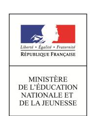

# **Concours de recrutement du second degré**

## **Rapport de jury**

| Concours : CAPET 3e voie                                                                                      |
|------------------------------------------------------------------------------------------------------------------|
| Section : sciences industrielles de l'ingénieur                                                                  |
| Options : ingénierie des constructions, ingénierie électrique, ingénierie informatique, ingénierie mécanique. |
|                                                                                                                  |
| Session 2019                                                                                                     |
|                                                                                                                  |
|                                                                                                                  |
|                                                                                                                  |
| Rapport de jury présenté par :                                                                                   |
| Norbert PERROT                                                                                                   |
| Président du jury                                                                                                |

## **Sommaire**

| Avant-propos                                                                                | 4        |
|---------------------------------------------------------------------------------------------|----------|
| Résultats statistiques                                                                      | 7        |
| Épreuve d'admissibilité « Analyse et exploitation pédagogique d'un système pluritechnique » |          |
| Éléments de correction Rapport du jury                                                   | 11 22 |
| Épreuve d'admission « Mise en situation professionnelle »                                   |          |
| Exemple de sujet Rapport du jury                                                         | 27 37 |
| Rapport sur la transmission des valeurs et principes de la République                       | 44       |

La réunion préparatoire à cette session 2019 du CAPET 3e voie de sciences industrielles de l'ingénieur et la réunion d'admissibilité se sont déroulées au lycée Fénelon à Paris. Les épreuves d'admission se sont déroulées les 1er, 2 et 3 juillet 2019 dans de très bonnes conditions au lycée Franklin Roosevelt à Reims.

Les membres du jury adressent de vifs remerciements aux proviseurs de ces établissements et à leurs directeurs délégués aux formations professionnelles et technologiques ainsi qu'à leurs collaborateurs pour l'accueil chaleureux qui leur a été réservé.

## **Avant-propos**

Pour cette session 2019 et pour la quatrième année consécutive, le CAPET de sciences industrielles de l'ingénieur a été ouvert pour des candidats de la 3e voie. Les deux épreuves sont la première épreuve d'admissibilité et la première épreuve d'admission du CAPET de sciences industrielles de l'ingénieur externe.

Pour cette session, ce CAPET a bénéficié d'un report de places du CAPET externe de sciences industrielles de l'ingénieur pour lequel toutes les postes n'ont pas été pourvus. Ainsi dans les options ingénierie électrique et ingénierie mécanique, le nombre d'admis est supérieur au nombre de places initialement prévu. En revanche, le niveau des prestations des candidats ne nous a pas permis de pourvoir toutes les places dans l'option IC.

Cet avant-propos reprend pour une large part certains points des rapports de 2016, 2017 et 2018.

Le jury regrette que 70 % des inscrits ne soient pas présentés aux épreuves d'admissibilité et surtout que 21,2 % des candidats admissibles aient été absents à la session d'admission, sans avoir eu la délicatesse de prévenir le président du jury. Au moment où il est demandé à l'Éducation nationale de participer à la transmission des valeurs de la République, ce comportement surprend.

Pour cette quatrième session, le jury est globalement satisfait des prestations des candidats. Cela étant, il conseille aux futurs candidats de lire attentivement ce rapport, de s'imprégner de la didactique de la discipline et des méthodes permettant d'élaborer une séquence pédagogique. Cela ne peut se faire qu'en étudiant les différents programmes du collège, de STI2D et de sciences de l'ingénieur de la série S. Pour la future session, il faudra prendre en compte la réforme du lycée et ses nouveaux programmes.

Bien que vérifiées dans les deux épreuves du concours, les compétences pédagogiques des candidats sont essentiellement évaluées lors de l'épreuve d'admission. Je tiens à rappeler de nouveau que le CAPET a pour objectif de répondre à la demande de l'État employeur, qui souhaite recruter des professeurs.

Les futurs candidats devront, au cours de leur préparation au concours, se concentrer sur les objectifs des différentes séquences de collège et de lycée et imaginer les stratégies pédagogiques et didactiques à mettre en œuvre pour faire acquérir aux élèves les compétences visées par les différents programmes. Le jury attend la description précise de la séquence inscrite dans la progression didactique qu'il a proposée, de ses attendus, de l'organisation détaillée d'une séance, ainsi que la justification des choix faits pour chacun de ces points. Bien évidemment, les candidats doivent intégrer à leur exposé la différenciation pédagogique, l'évaluation des compétences et des connaissances associées, la remédiation et l'accompagnement personnalisé dans les contenus pédagogiques présentés.

La séquence pédagogique à concevoir doit s'inspirer, en adaptant le niveau, des activités pratiques réalisées. Cette séquence doit être relative soit :

- − à l'enseignement de technologie du cycle 4 ;
- − aux enseignements technologiques transversaux de la série STI2D de la voie technologique du lycée ;

− à l'enseignement des sciences de l'ingénieur de la série scientifique S de la voie générale du lycée.

La prochaine session prendra en compte la réforme du lycée qui sera mise en place à la rentrée 2019.

Le contexte ainsi que le niveau et les compétences travaillées pendant la séquence pédagogique sont fixés dans le sujet de l'épreuve. Par conséquent, les candidats doivent se préparer à être confrontés à l'une des trois situations d'enseignement précisées ci-dessus. Une bonne connaissance des programmes des enseignements précités est requise pour espérer réussir cette partie de l'épreuve d'admission. La découverte de la réalité du métier d'enseignant de sciences industrielles de l'ingénieur et des conditions matérielles d'exercice devrait permettre aux candidats d'améliorer la crédibilité de leurs propositions pédagogiques. Pour ce faire, les candidats sont invités à rencontrer des enseignants dans leur établissement scolaire, pour échanger avec eux sur les pratiques pédagogiques et pour prendre connaissance de l'organisation des laboratoires, des supports didactiques et des postes informatiques disponibles.

Le jury a été surpris de constater que certains candidats n'aient pas lu les programmes correspondant aux exigences de l'épreuve, pourtant facilement accessibles par l'Internet. Cette désinvolture a souvent entraîné des notes ne permettant pas d'être reçu à ce concours.

L'épreuve d'admission est une épreuve longue qui nécessite également une bonne gestion du temps afin que l'exposé ne porte pas seulement sur la partie expérimentale évaluée préalablement, mais essentiellement sur la présentation de la séquence au niveau demandé.

Depuis la session 2017, que ce soit à l'agrégation ou au CAPET externe, interne et 3e voie, il existe une option ingénierie informatique et surtout un programme d'informatique pour toutes les options de ces concours. Les compétences liées à ce programme sont, par conséquent, également évaluées. Le jury conseille aux futurs candidats de ne surtout pas faire l'impasse sur l'informatique qui tient dorénavant une place non négligeable dans les programmes de technologie au collège, des enseignements technologiques du cycle terminal « sciences et technologies de l'industrie et du développement durable » (STI2D) et des sciences de l'ingénieur de la voie scientifique du lycée (S-SI).

La réussite à cette épreuve ne s'improvise pas. Il faut s'y préparer dès l'inscription au concours, voire avant. Proposer une séquence pédagogique étayée à partir d'activités expérimentales nécessite une préparation rigoureuse. Mettre à profit son expérience professionnelle en s'imposant une élaboration de ses propres séquences pédagogiques, respectant la démarche didactique spécifique de la discipline, ne peut que favoriser de bons résultats.

Pour l'épreuve d'admission, l'accès à l'Internet est autorisé afin que les candidats soient dans les conditions du métier qu'ils envisagent d'exercer. Cela ne doit cependant pas masquer la réflexion, la cohérence, l'appréciation du niveau des élèves et la précision pédagogique dans les explications qui sont des qualités précieuses pour un futur enseignant.

La description des épreuves des concours précise que : « L'épreuve d'admission doit, en outre, permettre au candidat de démontrer qu'il a réfléchi à l'apport que son expérience professionnelle constitue pour l'exercice de son futur métier et dans ses relations avec l'institution scolaire, en intégrant et en valorisant les acquis de son expérience et de ses connaissances professionnelles à la problématique du sujet et dans ses réponses aux questions du jury ».

Le ministère de l'Éducation nationale a demandé par ailleurs à tous les présidents des concours de recrutement « de veiller à ce que dans ce cadre, les thématiques de la laïcité et de la citoyenneté trouvent toute leur place » afin « que l'École soit en mesure, par la formation et le recrutement de nos futurs enseignants, de valider la mission première que lui fixe la Nation, à savoir de transmettre et de faire partager aux élèves les valeurs et principes de la République ainsi que l'ensemble des dispositions de la Charte de la laïcité, portant notamment égale dignité de tous les êtres humains et liberté de conscience de chacun ».

Cette demande a été prise en compte pour l'épreuve d'admission. Le comportement des candidats face aux questions du jury, sur ces sujets particulièrement sensibles, est variable mais a donné globalement satisfaction. Des informations sur les questions posées et quelques conseils aux futurs candidats sont donnés dans ce rapport.

Dans toutes les épreuves, le jury attend des candidats une expression écrite et orale irréprochable. Le CAPET est un concours exigeant, imposant aux candidats un comportement et une présentation exemplaires. Le jury reste vigilant sur ce dernier aspect et invite les candidats à avoir une tenue adaptée aux circonstances particulières d'un concours de recrutement de cadres de catégorie A de la fonction publique.

Pour conclure cet avant-propos, j'espère sincèrement que ce rapport sera très utile aux futurs candidats du CAPET SII 3e voie.

> Norbert PERROT Président du jury

# **Résultats statistiques**

# **Option ingénierie des constructions CAPET**

|          | Nombre | Présents à      |             | Présents à  |       |
|----------|--------|-----------------|-------------|-------------|-------|
| Inscrits | de     | l'épreuve       | Admissibles | l'épreuve   | Admis |
|          | postes | d'admissibilité |             | d'admission |       |
| 57       | 9      | 19              | 16          | 12          | 8     |

| Moyenne obtenue par le premier candidat admissible | 16,6  |
|----------------------------------------------------|-------|
| Moyenne obtenue par le dernier candidat admissible | 5,5   |
| Moyenne obtenue par le premier candidat admis      | 16,50 |
| Moyenne obtenue par le dernier candidat admis      | 8,20  |

# **Option ingénierie électrique**

## **CAPET**

| Inscrits | Nombre de postes | Présents à l'épreuve d'admissibilité | Admissibles | Présents à l'épreuve d'admission | Admis |
|----------|------------------------|--------------------------------------------|-------------|----------------------------------------|-------|
|          |                        |                                            |             |                                        |       |
| 108      | 9                      | 31                                         | 20          | 11                                     | 9     |

| Moyenne obtenue par le premier candidat admissible | 16,5  |
|----------------------------------------------------|-------|
| Moyenne obtenue par le dernier candidat admissible | 6,5   |
| Moyenne obtenue par le premier candidat admis      | 15,35 |
| Moyenne obtenue par le dernier candidat admis      | 8,00  |

# **Option ingénierie informatique**

## **CAPET**

|          | Nombre | Présents à      |             | Présents à  |       |
|----------|--------|-----------------|-------------|-------------|-------|
| Inscrits | de     | l'épreuve       | Admissibles | l'épreuve   | Admis |
|          | postes | d'admissibilité |             | d'admission |       |
| 124      | 6      | 33              | 14          | 13          | 11    |

| Moyenne obtenue par le premier candidat admissible | 15,4  |
|----------------------------------------------------|-------|
| Moyenne obtenue par le dernier candidat admissible | 8,2   |
| Moyenne obtenue par le premier candidat admis      | 14,40 |
| Moyenne obtenue par le dernier candidat admis      | 8,75  |

# **Option ingénierie mécanique**

## **CAPET**

|          | Nombre | Présents à      |             | Présents à  |       |
|----------|--------|-----------------|-------------|-------------|-------|
| Inscrits | de     | l'épreuve       | Admissibles | l'épreuve   | Admis |
|          | postes | d'admissibilité |             | d'admission |       |
| 136      | 19     | 46              | 35          | 31          | 21    |

| Moyenne obtenue par le premier candidat admissible | 18,9  |
|----------------------------------------------------|-------|
| Moyenne obtenue par le dernier candidat admissible | 5,9   |
| Moyenne obtenue par le premier candidat admis      | 16,40 |
| Moyenne obtenue par le dernier candidat admis      | 8,00  |

# **Éléments de correction de l'épreuve d'admissibilité « analyse et exploitation pédagogique d'un système pluritechnique »**

#### **Question 1**

La masse supplémentaire à gérer avec ces modifications est de 201 kg.

## **Question 2**

L'augmentation possible de la masse est de 10 % soit: 1800 · 0,1 = 180 kg < 201 : il y a 21 kg de trop. Pour alléger l'ensemble suspendu, on peut envisager de remplacer des matériaux constitutifs par des matériaux à masse volumique plus faible (alliage d'aluminium au lieu d'acier…), la diminution de la taille de la cabine, la diminution du nombre de passagers dans la cabine, la réduction de la surface vitrée, etc.

#### **Question 3**

Les conditions s'écrivent

A : Eint\_calcule < 0,95 · 2000 ou encore Eint\_calcule < (1 – flexibilite) · seuil. B : Eint\_calcule > 1,05 · 2000 ou encore Eint\_calcule > (1 + flexibilite) · seuil.

#### **Question 4**

indicateur\_0 = mesures[0][1] / mesures[0][2].

#### **Question 5**

Cet indicateur est le rapport de la tension sur l'intensité.

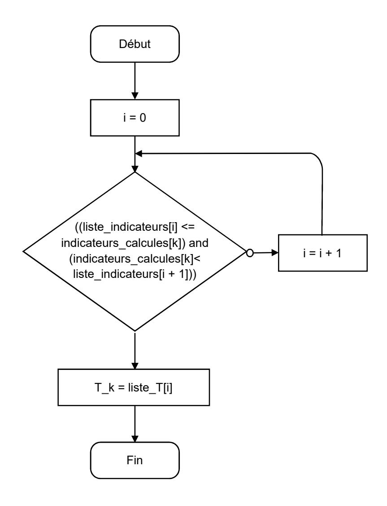

L'éclairement intérieur étant la somme des éclairements des vitrages, on a  $E_{\text{int}} = \sum_{k=0}^{3} E_{rk} \times TL_k$ .

Le code attendu s'écrit :

| En Python :      | Eint = 0                                                                      |  |  |
|------------------|-------------------------------------------------------------------------------|--|--|
|                  | for k in range(4):                                                            |  |  |
|                  | Eint = Eint + mesures[k][0] * T_calcules[k]                                   |  |  |
|                  | return Eint                                                                   |  |  |
| En C++ :         | float Eint = 0;                                                               |  |  |
|                  | for (k = 0 ; k < 4 ; k = k + 1) Eint = Eint + mesures[k][0] * T_calcules[k] ; |  |  |
|                  | return Eint ;                                                                 |  |  |
| En pseudo-code : | Eint ← 0                                                                      |  |  |
|                  | Pour k de 0 à 3 faire                                                         |  |  |
|                  | Eint ← Eint + mesures[k][0] * T_calcules[k]                                   |  |  |
|                  | Renvoyer Eint                                                                 |  |  |

Le facteur solaire peut descendre jusqu'à 0,05 environ. Par conséquent, le rayonnement solaire est diminué de 95 % ( > 90 %). Ainsi, avec une gestion automatisée de la teinte des vitrages, l'exigence id 1.4.1 est respectée.

#### **Question 8**

En travaillant avec le modèle électrique équivalent, on peut écrire directement :

$$R_{eq} = 2 \cdot R_{v} + R_{a} = 2 \cdot \frac{e_{v}}{\lambda_{v}} + \frac{e_{v}k}{\lambda_{k}} \; . \label{eq:Req}$$

#### **Question 9**

$$\text{La relation précédente implique}: \ \frac{\textbf{e}_{eq}}{\lambda_{eq}} = 2\frac{\textbf{e}_{v}}{\lambda_{v}} + \frac{\textbf{e}_{k}}{\lambda_{k}} \ \text{d'où} \ \lambda_{eq} = \frac{2\textbf{e}_{v} + \textbf{e}_{k}}{2\frac{\textbf{e}_{v}}{\lambda} + \frac{\textbf{e}_{k}}{\lambda_{v}}}.$$

$$A.N.: \; \lambda_{eq} = \; 0.0134 \; W \cdot m^{\text{--}1} \cdot K^{\text{--}1} \, .$$

#### **Question 10**

On considère le plafond, le plancher, les quatre faces, les montants ramenés à deux surfaces de matériaux traversées par deux flux de chaleur, ce qui donne :

$$\varphi_{tot} = \sum_{i} \varphi_{i} = \sum_{i} \frac{\lambda_{i} \cdot S_{i}}{e_{i}} \cdot (T_{ext} - T_{int}) = (\frac{\lambda_{eq} \cdot S_{v}}{e_{eq}} + \frac{\lambda_{p} \cdot S_{p}}{e_{p}}) \cdot (T_{ext} - T_{int}).$$

D'où 
$$A = \frac{\lambda_{eq} \cdot S_v}{e_{eq}} + \frac{\lambda_p \cdot S_p}{e_p}$$

Par analogie électrique, on retrouve :  $A = \frac{1}{R_{tot}} = \frac{1}{R_{ea}} + \frac{1}{R_{o}} = \frac{\lambda_{eq} \cdot S_{v}}{e_{ea}} + \frac{\lambda_{p} \cdot S_{p}}{e_{o}}$ .

A.N.: 
$$A = \frac{0.013 \cdot 10}{0.024} + \frac{0.025 \cdot 9}{0.045} = 5.416 + 5 = 10.42 \text{ W} \cdot \text{K}^{-1}$$
.

#### **Question 11**

La durée du trajet entre les gares T2 et T3A s'écrit :  $t_{23} = \frac{l_{23}}{v_0}$   $t_{23} = \frac{2160}{5} = 432 \text{ s} = 7,2 \text{ min}$ .

A.N.: 
$$t_{23} = \frac{2160}{5} = 432 \text{ s} = 7.2 \text{ min}$$
.

T2 et T3A sont les gares les plus éloignées l'une de l'autre, ce qui permet d'obtenir le temps de trajet le plus long et de simuler le cas le plus défavorable.

13

Malgré l'isolation, la température intérieure augmente rapidement à partir de la valeur initiale de 25 °C ; cela s'explique principalement par l'apport thermique des passagers.

En fin de trajet, la température atteint près de 55 °C, ce qui n'est pas acceptable et ne respecte pas l'exigence 1.4.4.1.

#### **Question 13**

Avec la climatisation, la température intérieure reste stable à une valeur très proche de la température initiale et de celle de la consigne de 25 °C.

Après une très courte phase de démarrage et en l'absence de perturbations, la puissance frigorifique nécessaire au maintien de la température à 25 °C se stabilise à une valeur de -1442,2 W.

#### **Question 14**

Le paramètre modifié entre les deux simulations est la puissance frigorifique de la climatisation Pmax. Elle passe de -2 000 W dans la première situation à -3 000 W dans la deuxième.

La climatisation 2 est choisie car elle permet d'abaisser la température intérieure de -6 °C en moins d'une minute conformément à ce qui est attendu.

Il faudra donc équiper la cabine avec une climatisation d'une puissance frigorifique de 3 000 W.

#### **Question 15**

Avec des batteries au lithium, la recharge s'effectue la nuit, ce qui permet d'avoir, sur 10 ans d'exploitation, un nombre de recharges qui s'élève à :  $365 \cdot 10 = 3650 > 2000$ .

Avec les supercondensateurs, la recharge est faite à chaque passage en gare, ce qui donne sur une

journée de 20 heures : 
$$\frac{20\cdot 60}{(5+1)}$$
 = 200 recharges et sur 10 ans :  $200\cdot 365\cdot 10$  = 730 000 < 1000 000 .

Le choix s'est porté sur les supercondensateurs car les batteries au lithium ne permettront pas d'atteindre la durée de vie escomptée de dix ans.

#### **Question 16**

La puissance électrique moyenne de la climatisation s'écrit :  $P = \frac{3\ 000 \cdot 1 + 1\ 200 \cdot 6}{(6+1) \cdot 2} = 728,5 \text{ W}$ .

L'énergie à stocker est donc :  $E = \frac{728,5 \cdot 7}{60 \cdot 0.94} = 90,4 \text{ W} \cdot \text{h}$  .

#### **Question 17**

La quantité d'énergie utilisable pour un module en fin de vie est :

$$E = \frac{1}{2} \cdot 89 \cdot (102^2 - 34^2) \cdot 0.8 = 329 \ 229 \ J = 91.4 \ W \cdot h \ .$$

La quantité d'énergie à stocker est de 90,4 W·h < 91,4 W·h : en fin de vie, le module de supercondensateurs sera encore capable de stocker l'énergie nécessaire à la climatisation.

14

La puissance du dispositif de recharge se calcule par la formule suivante :  $P = U \cdot I$ .

Le calcul doit être effectué au point de puissance maximale, c'est-à-dire quand l'intensité vaut encore 250 A et la tension atteint sa valeur finale de 102 V.

A. N. :  $P = 102 \cdot 250 = 25\,500 \,\text{W}$  ou 25,5 kW.

#### **Question 19**

Le module de supercondensateurs convient car il est capable de stocker suffisamment d'énergie pour assurer le fonctionnement de la climatisation même quand il sera proche de sa fin vie. Il pourra donc assurer un fonctionnement sur dix ans.

#### **Question 20**

Les fonctions de secours consomment 190 W durant un maximum de 3 heures, ce qui donne une quantité d'énergie de :  $190 \cdot 3 = 570 \text{ W} \cdot \text{h}$ .

La batterie possède une tension nominale de 12,8 V ce qui donne une capacité nominale de  $\frac{570}{12,8} = 44,5 \text{ A} \cdot \text{h} < 55$ . Par conséquent, la batterie d'une capacité de 55 A·h convient.

#### Question 21

On isole le solide (1), en équilibre dans le référentiel associé au solide (0), supposé galiléen. Il est soumis aux actions mécaniques extérieures modélisée ci-dessous :

$$\left\{T_{0\to 1}\right\} = \left\{\begin{matrix} -N_c \cdot \vec{x} \\ \vec{0} \end{matrix}\right\}_F \text{ (principe des actions réciproques) ;}$$

$$\{T_{r\to 1}\} = \begin{cases} F_r \cdot \cos(\beta) \cdot \vec{x} + F_r \cdot \sin(\beta) \cdot \vec{y} \\ \vec{0} \end{cases}$$

$$\left\{\mathsf{T}_{2\to 1}\right\} = \left\{\begin{matrix} X_{21} \cdot \vec{x} + Y_{21} \cdot \vec{y} + Z_{21} \cdot \vec{z} \\ L_{21} \cdot \vec{x} + M_{21} \cdot \vec{y} \end{matrix}\right\}_{\mathbb{C}} \text{ soit } \left\{\begin{matrix} X_{21} \cdot \vec{x} + Y_{21} \cdot \vec{y} \\ \vec{0} \end{matrix}\right\}_{\mathbb{C}} \text{ en faisant l'hypothèse d'un problème plan.}$$

#### **Question 22**

L'expression des moments au point C s'écrit :

$$\vec{M}_{\text{C},0\rightarrow1}\!=\!\vec{M}_{\text{F},0\rightarrow1}\!+\!\overrightarrow{\text{CF}}\wedge\vec{R}_{0\rightarrow1}\!=\!\vec{0}\!+\!\left(-\textbf{a}\cdot\vec{x}-\textbf{b}\cdot\vec{y}\right)\wedge-N_{c}\cdot\vec{x}\!=-\textbf{b}\cdot N_{c}\cdot\vec{z}\;.$$

De même :

$$\vec{M}_{C,r\rightarrow 1} = \vec{M}_{D,r\rightarrow} + \overrightarrow{\text{CD}} \wedge \vec{R}_{1\rightarrow 0} = \vec{0} + F_r \cdot \left[ \left( \cos\left(\beta\right) \cdot \vec{x} + \sin\left(\beta\right) \cdot \vec{y} \right) \wedge \left( c \cdot \vec{x} + d \cdot \vec{y} \right) \right] = F_r \cdot \left( -d \cdot \cos\left(\beta\right) + c \cdot \sin\left(\beta\right) \right) \cdot \vec{z}.$$

Le principe fondamental de la statique s'applique et le théorème du moment statique en C s'écrit :

$$-b\!\times\!N_c\!+\!F_r\!\times\!\!\left(-d\!\times\!cos\!\left(\beta\right)\!+\!c\!\times\!sin\!\left(\beta\right)\right)\!+\!0\!=\!0\;.$$

On en déduit : 
$$N_c = \frac{c \cdot \sin \beta - d \cdot \cos \beta}{b} \cdot F_r$$
.

En considérant le triangle rectangle, on a :  $tan \varphi = \frac{T_c}{N_c}$  soit  $T_c = f \times N_c$  d'où :

$$N_c = \frac{s \cdot \sin(\alpha_{maxi})}{2 \times f} \times P_e$$

A.N. :  $N_c$  = 50,96 kN < 93 kN. La sécurité des passagers est assurée.

## **Question 24**

Le longeron est soumis à une sollicitation de flexion simple.

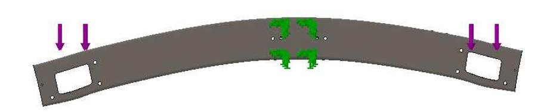

#### **Question 25**

L'équilibre de la partie située à gauche de la coupure G, pour  $z < L_1$ , tronçon [OA[, s'écrit :

$$\left\{ T_{\text{cohésion}} \right\}_{G} \ + \left\{ T_{\text{Ext} \rightarrow \text{Partie Gauche}} \right\}_{G} \ = \left\{ 0 \right\} \, .$$

$$\text{avec}: \left\{ \mathsf{T}_{\mathsf{Ext} \to \mathsf{P} \, \mathsf{G}} \right\} = \left\{ \frac{\overrightarrow{F_{\mathsf{o}}}}{\mathsf{GO} \, \wedge \, \overrightarrow{F_{\mathsf{o}}}} \right\}_{\mathsf{G}} \, \, \text{et} \, \, \overrightarrow{\mathsf{GO}} \, \wedge \, \overrightarrow{F_{\mathsf{o}}} = \left( -z \cdot \vec{\mathsf{z}} \right) \, \wedge \, \left( -F_{\mathsf{o}} \cdot \vec{\mathsf{x}} \right) = \, z \cdot F_{\mathsf{o}} \cdot \vec{\mathsf{y}} \, \, .$$

$$\text{ce qui donne}: \left\{ \mathbf{T}_{\mathsf{Ext} \to \mathsf{P}\; \mathsf{G}} \right\} = \left\{ \begin{array}{l} - \boldsymbol{F}_{\mathsf{O}} \cdot \vec{\mathbf{x}} \\ \boldsymbol{z} \cdot \boldsymbol{F}_{\mathsf{O}} \cdot \vec{\mathbf{y}} \end{array} \right\}_{\mathsf{G}}.$$

On obtient alors le torseur des efforts de cohésion :  $\{T_{cohésion}\} = \left\{ \begin{array}{c} F_{O} \cdot \vec{X} \\ -z \cdot F_{O} \cdot \vec{y} \end{array} \right\}_{C}$ .

La valeur maximale en valeur absolue du moment fléchissant s'obtient pour  $z = L_1$ :

$$\left\{\mathsf{T}_{\textit{cohésion}}\right\} = \left\{\begin{array}{c} F_{\mathsf{O}} \cdot \vec{x} \\ -L_{\mathsf{1}} \cdot F_{\mathsf{O}} \cdot \vec{y} \end{array}\right\}_{\mathsf{G}} = \left\{\begin{array}{c} 8522 \cdot \vec{x} \\ -0.804 \cdot 8522 \cdot \vec{y} \end{array}\right\}_{\mathsf{G}} = \left\{\begin{array}{c} 8522 \cdot \vec{x} \\ -6852 \cdot \vec{y} \end{array}\right\}_{\mathsf{G}}, \quad F_{\mathsf{O}} \quad \text{et} \quad L_{\mathsf{1}} \cdot F_{\mathsf{O}} \quad \text{étant} \quad \text{exprimés}$$

respectivement en N et N·m.

#### **Question 26**

La contrainte normale s'obtient par la relation :  $\sigma = -\frac{M_{fy} \cdot x}{I_{Gv}}$ 

Or 
$$M_{fy} = -6.852 \text{ N} \cdot \text{m}$$
,  $x = \frac{h}{2} = \frac{200}{2} = 100 \text{ mm}$  et

$$I_{Gy} = \frac{b \cdot h^3 - (b - 2 \cdot e) \cdot (h - 2 \cdot e)^3}{12} = \frac{150 \cdot 200^3 - (150 - 2 \cdot 7) \cdot (200 - 2 \cdot 7)^3}{12} = 27,07 \cdot 10^6 \text{ mm}^4.$$

A.N.: 
$$\sigma = -\frac{-6,852 \cdot 10^6 \cdot 100}{27.07 \cdot 10^6} = 25,31 \text{ MPa}.$$

En prenant en compte le coefficient de sécurité, on obtient : 5 · 25,31 = 126,5 MPa < 200 MPa ; la condition de limite d'élasticité est vérifiée.

#### **Question 27**

Le volume d'un tube de section S et de longueur L est:  $V = S \cdot L$ .

Pour le longeron en aluminium, on obtient :

$$V = (150 \cdot 200 - (150 - 2 \cdot 7) \cdot (200 - 2 \cdot 7)) \cdot 1737 = 4704 \cdot 1737 = 8,17 \cdot 10^6 \text{ mm}^3$$
.

Soit :  $V = 8,16 \cdot 10^{-3} \text{ m}^3$ .

On en déduit sa masse :  $m_{aliu} = 8,16 \cdot 10^{-3} \cdot 2700 = 22 \text{ kg}$ .

Le « gain » de masse est donc de : 22 - 49 = - 27 kg.

#### **Question 28**

Le but des modifications engagées est de répondre à une exigence de confort thermique des passagers. Cela impose principalement de réduire les apports solaires de 90 % et de maintenir une température intérieure à 25°C.

Les choix se sont portés sur des vitres à teinte variable, un renforcement de l'isolation thermique et la mise en place d'une climatisation régulée. La particularité de ce moyen de transport – cabine suspendue – oblige à un minimum d'autonomie énergétique, qui est obtenue par des supercondensateurs et une batterie au lithium. Tout cela occasionne une augmentation de la masse de la cabine qu'il faut réussir à limiter.

Les premières études menées ont permis de programmer les vitres pour automatiser l'occultation, de valider la performance de l'isolation, de dimensionner la climatisation, le stockage d'énergie et les stations de recharge.

Par la suite, une étude mécanique a confirmé une augmentation possible de la masse de 10 % mais cela se révèle insuffisant pour absorber la surcharge constatée de 21 kg.

Finalement, la dernière partie valide par une étude de résistance des matériaux la modification d'une pièce maîtresse de la structure porteuse. Le choix d'abandonner l'acier au profit de l'alliage d'aluminium permet de gagner 27 kg et donc de compenser la surcharge de 21 kg.

La cabine ainsi modifiée répond pleinement aux attentes de confort des passagers tout en restant utilisable sur les lignes existantes.

- Phase 1 problématisation qui se termine par une question. Situation déclenchante, formulation du problème.
- Phase 2 activité des élèves, recherche de solutions. Conjecture et hypothèses, activités d'investigation (expérimentation, observations, recherches documentaires).
- Phase 3 structuration des connaissances, échanges argumentés.

## **Question 33**

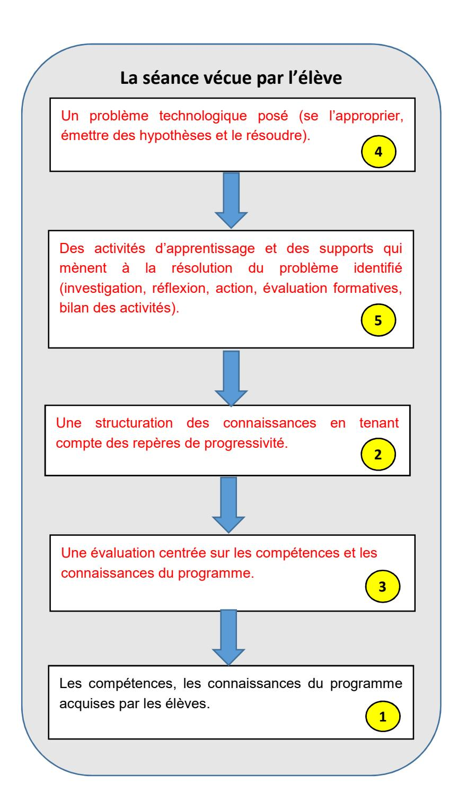

|                        | SÉANCE 1                                                                                                                                                                                                                                                                                                                                                                                                            | SÉANCE 2                                                                                                                                                                                                                                                                                                                                                                                                                                       | SÉANCE 3                                                                                                                                                                                                                                                                                                                                                                                                                                                                                                                                                           | SÉANCE 4                                                                                                                                                                                                                                                                                                                                                                                                                                                               | SÉANCE 5                                                                                                                                                                                                                                                                                                                    |
|------------------------|---------------------------------------------------------------------------------------------------------------------------------------------------------------------------------------------------------------------------------------------------------------------------------------------------------------------------------------------------------------------------------------------------------------------|------------------------------------------------------------------------------------------------------------------------------------------------------------------------------------------------------------------------------------------------------------------------------------------------------------------------------------------------------------------------------------------------------------------------------------------------|--------------------------------------------------------------------------------------------------------------------------------------------------------------------------------------------------------------------------------------------------------------------------------------------------------------------------------------------------------------------------------------------------------------------------------------------------------------------------------------------------------------------------------------------------------------------|------------------------------------------------------------------------------------------------------------------------------------------------------------------------------------------------------------------------------------------------------------------------------------------------------------------------------------------------------------------------------------------------------------------------------------------------------------------------|-----------------------------------------------------------------------------------------------------------------------------------------------------------------------------------------------------------------------------------------------------------------------------------------------------------------------------|
| Question directrice | Comment ont évolué les transports urbains dans le temps ?                                                                                                                                                                                                                                                                                                                                                     | Comment choisir le tracé d'un transport urbain par câble ?                                                                                                                                                                                                                                                                                                                                                                                     | Quels sont les éléments qui constituent un transport par câble ?                                                                                                                                                                                                                                                                                                                                                                                                                                                                                                | Quelles solutions proposer lors de la rétroconception thermique de cabines d'une installation de transport urbain par câble existante pour répondre aux exigences de confort en zone tropicale ?                                                                                                                                                                                                                                                                       | Comment réinvestir mon travail dans un nouveau contexte, l'habitat ?                                                                                                                                                                                                                                                        |
| Activités              | Dans un premier temps, chaque îlot doit réaliser un travail d'investigations sur l'évolution des transports urbains jusqu'à aujourd'hui. Ils établissent les raisons de ces évolutions.  Dans un second temps, ils synthétisent sous forme libre l'évolution et ainsi définissent un fil conducteur à leur présentation.  Chaque équipe présente son système grâce à un support multimédia et la synthèse réalisée. | L'installation existante se situe dans une ville des caraïbes présentant peu de dénivelé et traversée par deux cours d'eau.  La ligne est constituée en deux tronçons motorisés indépendamment (voir figure 5): l'une des motorisations se situe au niveau du terminal T2, l'autre au niveau du terminal T3B.  À partir de la cartographie d'une métropole, choix d'un tracé, le but étant de satisfaire une majorité d'acteurs (pas de véto). | Dans un premier temps, les élèves doivent choisir un modèle (télésiège, télécabine, téléphérique, funiculaire) de transport par câble au regard du contexte d'utilisation (milieu urbain) et des contraintes géographiques de la métropole choisie.  Dans un second temps, les élèves proposent une organisation structurelle de l'ouvrage et une description de la fonction d'usage de chaque élément. Ils réalisent plusieurs croquis légendés de leurs propositions.  Chaque équipe présente sa proposition de croquis légendés avec les textes de description. | Dans un premier temps, à l'aide du diagramme partiel des exigences relatif au confort thermique, les élèves, sous l'égide du professeur, expriment diverses solutions techniques pour répondre à chaque exigence.  Dans un second temps, les élèves sont répartis par groupes ayant chacun:  I'identification pour chaque fonction technique d'une solution technique;  la caractérisation de la solution technique (grandeurs physiques, principe de fonctionnement). | Évaluation sommative de séquence. Les élèves utilisent comme support une maquette d'habitation (BBC). Cet objet n'aura pas été étudié dans cette séquence. L'objectif est de vérifier si les élèves sont en capacité de réinvestir les compétences travaillées lors des séances précédentes sur une nouvelle problématique. |
| Démarche pédagogique   | Investigation.                                                                                                                                                                                                                                                                                                                                                                                                      | Investigation.                                                                                                                                                                                                                                                                                                                                                                                                                                 | Investigation.                                                                                                                                                                                                                                                                                                                                                                                                                                                                                                                                                     | Investigation                                                                                                                                                                                                                                                                                                                                                                                                                                                          |                                                                                                                                                                                                                                                                                                                             |
| Conclusion / bilan     | Les éléments schématiques sont des outils indispensables d'explication. Chaque objet évolue pour s'adapter aux besoins, aux progrès techniques, enjeux sociétaux (développement durable)                                                                                                                                                                                                                            | Le choix d'un tracé est le compromis entre les différentes contraintes imposées par les acteurs.                                                                                                                                                                                                                                                                                                                                         | Le croquis d'un transport par câble en vue de dessus, l'identification des éléments constitutifs de l'ouvrage et leur fonction (pylônes, câbles, cabines, gares (départ, intermédiaire et arrivée).                                                                                                                                                                                                                                                                                                                                                 | Pour chaque exigence, une solution technique est proposée. Les caractéristiques techniques sont identifiées et quantifiées. Lors de la conception ou rétroconception d'un produit, plusieurs solutions sont certainement possibles pour réaliser une fonction. La plus adaptée est retenue. Selon l'époque, les principes techniques sont différents, ils évoluent avec l'avancée des                                                                                  | Les objets techniques sont inventés pour résoudre certains problèmes, tels que les problèmes de communications, de transport, de dureté du travail  Ils participent à l'amélioration des conditions de vie (confort) tout en tenant compte du contexte de développement durable.                                            |

|                            |                                                                                                                                                                                                                                                                         |                                                                                                                                       |                                                                                                                                                                                                                                                                                                                                                                                                   | ais cie ntif iqu et co nn sa nce s s es hn olo iqu tec g es                                                                                                                                                                                                                                                                                                  |                                                                                                              |
|----------------------------|-------------------------------------------------------------------------------------------------------------------------------------------------------------------------------------------------------------------------------------------------------------------------|---------------------------------------------------------------------------------------------------------------------------------------|---------------------------------------------------------------------------------------------------------------------------------------------------------------------------------------------------------------------------------------------------------------------------------------------------------------------------------------------------------------------------------------------------|--------------------------------------------------------------------------------------------------------------------------------------------------------------------------------------------------------------------------------------------------------------------------------------------------------------------------------------------------------------------------------------------------------------|--------------------------------------------------------------------------------------------------------------|
| Év lua t ion a | for tiv ma e                                                                                                                                                                                                                                                   | for tiv ma e                                                                                                                 | for tiv ma e                                                                                                                                                                                                                                                                                                                                                                             | for tive ma                                                                                                                                                                                                                                                                                                                                                                                            | ativ so mm e                                                                                        |
| Re ss ou rce s | Lo icie l po la c réa tio g ur n ide de és tat ion rap pr en Sy stè ré el vi rtu el me ou Do nt ier cu me res so urc es pa p et mé riq nu ue | Go le Ma od élis ati og ps , m on mé riq ites nst teu nu ue , s co ruc rs | Ph oto mé riq nu ue Lo icie l po la c réa tio ide de g ur n r ap is l ég dé cro qu en s. iffé An ima tio idé o d e d ts typ n v ren es de âb le. tra rts ns po pa r c Do nt ier cu me res so urc es pa p ou PD F | Re mé riq t p ier sso urc es nu ue s e ap s, Int et, ern Lo icie ls d imu lat ion g e s Ph oto t v idé de di s e os ve rse s lut ion s t hn iqu (v itra so ec es ge , clim atis ati iso lati ég ula tio ) on on , r n… , | Do nts ier t cu me re sso urc es pa p s e mé riq nu ue s. |

| N ive au                                                                                                                | En ig ts se ne me n                                                                                          | É tu de i b les s p os s                                                                                                                                                                                                                                                                                                                                                                                                                                                                                                                                                                                                                                                                                                                                                                                                                                                                                                                                                                                                                                                                                                                                                                                                                                                                                                                |  |
|-------------------------------------------------------------------------------------------------------------------------------|--------------------------------------------------------------------------------------------------------------------------------|-----------------------------------------------------------------------------------------------------------------------------------------------------------------------------------------------------------------------------------------------------------------------------------------------------------------------------------------------------------------------------------------------------------------------------------------------------------------------------------------------------------------------------------------------------------------------------------------------------------------------------------------------------------------------------------------------------------------------------------------------------------------------------------------------------------------------------------------------------------------------------------------------------------------------------------------------------------------------------------------------------------------------------------------------------------------------------------------------------------------------------------------------------------------------------------------------------------------------------------------------------------------------------------------------------------------------------------------------------------------|--|
|                                                                                                                               | Sc ien de ce s 'in ( S ) l én ieu I g r                                              | Ex lo i te de d é l isa t ion t de im la t ion ér iq év ir les te ts du tra t u ba in p r s m o s e s s u s n um ue s p ou r p r o co m p or me n ns p or r • â b le. p ar c                                                                                                                                                                                                                                                                                                                                                                                                                                                                                                                                                                                                                                                                                                                                                                                                                                                                                                                                                                                                |  |
| C las de se Se de co n En ig ts se ne me n d 'ex lor t ion p a | Cr éa t ion t e Inn ion t ov a Te hn log iq c o ue ( C I T ) | Ap é he de l 'ap he i é le, éc iq iro le du à l 'im lan ion d 'un ba in ta t e ta ta t tra t u p r n r p ro c s oc on om ue e nv nn em en e p ns p or r • â b le. p ar c D éc ir les t ta t d 'a bo t ir à inn t ion da le dr d 'un é tro t ion ou vr p ro ce ss us p er me n u un e ov a ns ca e e r co nc ep • ém éa é ép V ivr d he de t iv i t bo de de l les lu t ion te hn log iq isa t r dr e un e ar c c r p ou r a r r n ou ve s o s c o ue s n on e au v x • ig f ix ée lor d 'un é tro t ion t he iq de b ine de tra t ba in â b le d 'un ex en ce s s s e r co nc ep rm ue c a s ns p or ur p ar c e ins ta l la t ion is ta te ex n |  |

| Ba lau éa t cc a r ien t sc ce s e te hn log ie du c o d év lop t e p em en du b le ( S T I 2 D ) ra | En ig t se ne me n te hn log iq c o ue tra l ns ve rsa | É tu d ier l 'im t e iro ta l, i é ta l e t éc iq d 'un tra t u ba in â b le iso d 'un p ac nv nn em en so c on om ue ns p or r p ar c en co m p ar a n • é tro m Co ir t im ise lu t ion d d 'un h ier de ha da le t de tra in tes de nc ev o ou o p r u ne s o a u re g ar c a s c rg es ns re sp ec s co n • , d év lop t du b le. e p em en ra S 'ap lus ieu éc ia l i t és d de l 'or isa t ion de l 'é tu de ée da le dr de la p uy er s ur p rs sp a u re g ar g an p ro p os ns ca e • é tro t ion r co nc ep                                                                                                                                                          |
|---------------------------------------------------------------------------------------------------------------------------------------------------------------------------------------------------------------------|--------------------------------------------------------------------------------------------------------------|-----------------------------------------------------------------------------------------------------------------------------------------------------------------------------------------------------------------------------------------------------------------------------------------------------------------------------------------------------------------------------------------------------------------------------------------------------------------------------------------------------------------------------------------------------------------------------------------------------------------------------------------------------------------------------------------------------------------------------------------------------------------------------------------------------------------------------------------------------------------------------------------------------------------------------------------------------------------------------------------------------------------------------------------------------------------------------------------------------------------------------------------------------------------------------------------------------------------------------------------------|
| Ba lau éa t s ien t i f iq Sc ien de cc a r c ue ce s l 'in én ieu ( S I ) g r                                                  |                                                                                                              | èm ér f fo An ly t te hn iq t v i ier t te du a se r u n s y s e c ue e se s p er rm an ce s a n es • Pr t v l i de de d è les op os er e a r s m o • An ly de és l ta ts ér im ta t leu év tu ls éc ts t a h ier de ha a se r s r u ex p en ux e rs en e ar p ar ra p p or u ca s c rg es o u au x • d è les d de l 'or isa t ion de l 'é tu de ée da le dr de la é tro t ion mo a u r eg ar g an p ro p os ns ca e r co nc ep fo 'a Pr de h i te tu de lu t ion de h ém de is, d lg ig op os er s ar c c re s s o s, so us rm e s c as c ro q u or ra mm es o u • , d 'a lg i t hm or es |

# **Rapport du jury de l'épreuve d'admissibilité « analyse et exploitation pédagogique d'un système pluritechnique »**

## **1. Présentation du sujet**

Le sujet est introduit par une problématique contemporaine liée à la mobilité des personnes. Dans un contexte de développement durable, les sociétés modernes doivent repenser les modes de déplacement en encourageant à se déplacer mieux et autrement tout en garantissant une qualité de service pour les usagers.

Le support du sujet est un système de transport urbain par câble réalisé par le groupe POMA. Dérivées d'un contexte de loisir, les cabines de ces installations sont passives, n'offrant qu'une ventilation naturelle, ou simplement équipées de batteries et de panneaux solaires pour assurer l'éclairage. De nos jours, les usagers attendent un minimum de confort, chauffage, climatisation et connectivité, écran d'informations et haut-parleurs. Le sujet propose d'étudier la rétroconception thermique des cabines d'une installation existante pour répondre aux exigences de confort en zone tropicale. Il permet d'évaluer les compétences d'analyse, de modélisation et de résolution des candidats.

#### **2. Analyse globale des résultats**

Le sujet propose un questionnement sur les différents champs des sciences industrielles de l'ingénieur. Les sept parties indépendantes sont abordées de manière linéaire par une majorité des candidats. Comme dans les sessions précédentes, les dernières parties sont moins bien traitées par beaucoup de candidats. Le jury invite donc les futurs candidats à gérer efficacement le temps de l'épreuve, afin d'avoir une couverture optimale du sujet.

Le jury déplore, par ailleurs, que certains candidats ne traitent que les parties du questionnement en lien avec leur option. Le jury insiste sur le caractère transversal de l'épreuve qui doit engager les futurs candidats à acquérir des connaissances dans les quatre spécialités.

La partie portant sur l'exploitation pédagogique permet au candidat de montrer ses compétences en ingénierie pédagogique en développant une réflexion en lien avec la mise en œuvre de l'enseignement spécifique des sciences industrielles de l'ingénieur. Le questionnement proposé aborde différents aspects de l'analyse que doit mener un enseignant pour construire une séquence d'enseignement de technologie au collège (cycle 4) et en dernier lieu de proposer, à partir de l'étude de rétroconception, des exploitations pédagogiques possibles en lycée (pré-Baccalauréat).

Globalement, le jury considère que les candidats se sont mieux préparés pour cette session que pour les précédentes.

#### **3. Commentaires sur les réponses apportées et conseils aux futurs candidats**

## **3.1. Première partie – Évolution de la masse de la cabine**

Cette partie, très courte, consiste à évaluer l'impact des modifications envisagées quant à la masse ajoutée. La plupart des candidats a bien répondu à ces premières questions. Le jury rappelle néanmoins que la proposition de retirer les améliorations envisagées ne peut être un élément de réponse à la seconde question.

## **3.2. Deuxième partie – Mise en œuvre d'un système d'occultation**

Cette partie s'intéresse à la gestion automatique de la teinte des vitrages de la cabine et à l'évaluation de son gain sur son comportement thermique.

Le jury déplore que les questions en lien avec le programme d'informatique n'aient été traitées que par un faible nombre de candidats. Il rappelle que ce programme d'informatique, commun à toutes les options du CAPET SII, est disponible à l'adresse suivante :

http://cache.media.education.gouv.fr/file/capet\_externe/92/1/p2017\_capet\_ext\_sii\_590921.pdf.

Une maîtrise globale des méthodes de programmation, d'ailleurs communes à la plupart des langages, est attendue : variables, fonctions et structures de contrôle.

En particulier dans le cadre de ce sujet, l'accès à un élément d'un tableau ou d'une liste de listes, l'incrémentation d'un compteur et la notion de boucle doivent faire partie des capacités des candidats. De même, lire et/ou compléter un algorigramme est une attente du jury.

Les réponses à la dernière question de cette partie, permettant de valider l'intérêt thermique de cette solution, sont souvent restées évasives et qualitatives. Le jury rappelle que toute conclusion doit être chiffrée en lien avec une grandeur physique, le facteur solaire ici, généralement pour conclure sur le respect d'une exigence.

#### **3.3. Troisième partie – Choix d'un climatiseur**

Cette partie est scindée en deux études : la première évalue la conductivité des vitrages pour en déduire le flux de chaleur transmis par conduction ; la seconde utilise cette valeur pour paramétrer une simulation du comportement thermique de la cabine dans le but de choisir un climatiseur à travers la détermination de la puissance frigorifique nécessaire au respect des exigences.

Le jury note ici des erreurs dans les manipulations d'équations. Il rappelle également que commenter des résultats de simulation ne peut se limiter à une réponse comme « la température augmente ». Encore une fois, toute conclusion doit être chiffrée en lien avec le respect d'une exigence et/ou interprétée physiquement.

#### **3.4. Quatrième partie – Gestion de l'autonomie énergétique**

L'objectif de cette partie réside dans le choix de solutions techniques pour le stockage de l'énergie et leur validation.

Le jury note ici essentiellement des erreurs dans les conversions d'unités et déplore que des problématiques simples comme le dimensionnement d'une batterie (question 20) ne soient pas maîtrisées.

#### **3.5. Cinquième partie – Vérification de la sécurité des passagers**

La cabine étant alourdie par l'ajout de nouvelles fonctionnalités, cette partie a pour but de vérifier la sécurité des passagers vis-à-vis du non-glissement de la pince sur le câble.

Le jury constate un inventaire des actions mécaniques extérieures très souvent incomplet et un manque de rigueur dans l'écriture des torseurs. Le jury a été surpris de constater que la notion de moment n'était pas maîtrisée par certains candidats.

## **3.6. Sixième partie - Modification de la structure porteuse**

Afin d'augmenter la masse et pallier le problème mis en avant au début du sujet, la modification du matériau d'une pièce est envisagée. Cette partie propose de vérifier que cette modification (nouvelle limite minimale d'élasticité) permet toujours de garantir la sécurité des passagers.

Le jury attend que les types de sollicitations soient connus des candidats. Il regrette que l'écriture du torseur de cohésion ainsi que le simple calcul du volume d'un tube ne soient pas maîtrisés.

Par ailleurs, la conclusion, comme sur l'ensemble du sujet, est rarement réalisée.

## **3.7. Septième partie – Exploitation pédagogique**

Les premières étapes du questionnement reviennent sur quelques éléments clés de la préparation de séquence tels que la démarche d'investigation. À partir d'éléments relatifs à la construction d'une séance par l'enseignant, les candidats doivent compléter les différentes phases du déroulement d'une séance vécue par l'élève.

La suite du déroulé du questionnement permet, au regard de l'analyse scientifique et technique menée préalablement, à partir d'une proposition du déroulé d'une séquence en technologie au cycle 4 et de la description des séances, de décrire une séance en tenant compte de la problématique donnée.

La dernière question vise, en référence à l'organisation de l'étude de rétroconception du transport urbain par câble, et plus globalement au regard du contexte d'installation et d'exploitation du système support de l'étude, à proposer une exploitation pédagogique possible pour les niveaux d'enseignement de sciences de l'ingénieur du baccalauréat scientifique et de l'enseignement technologique transversal du baccalauréat STI2D.

La partie pédagogique est traitée de manière très hétérogène. La description de la démarche d'investigation et le déroulé d'une séance vécue par l'élève proposée dans le sujet sont globalement satisfaisantes. Le jury déplore qu'un nombre important de candidats n'ait pas lu les documents annexes fournis qui permettaient de répondre à ces deux questions.

Les candidats peinent à exploiter les documents pour décrire les éléments de la séance et proposer des exploitations pédagogiques possibles et plausibles. Ils rencontrent également des difficultés à investir les éléments de l'étude scientifique et technique, au niveau considéré, en activités proposées aux élèves visant l'acquisition des compétences définies. Trop peu de candidats ont proposé, au sein du déroulement de la séance à développer, des activités élèves permettant l'acquisition de connaissances scientifiques disciplinaires et plus largement en lien avec les domaines des mathématiques et des sciences physiques. Trop de réponses sont généralistes et ne font pas le lien avec le contexte de l'étude demandé. Les propositions d'activités ou de supports pédagogiques sont trop souvent inappropriées, voire irréalistes et n'apportent rien à l'acquisition des compétences attendues de l'élève.

La définition des activités confiées ou compétences attendues des élèves démontre un manque de connaissance des attendus des programmes, tout particulièrement pour la technologie au collège. L'approche scientifique de l'enseignement de la technologie au collège, par l'appropriation de grandeurs physiques à travers d'expérimentations, n'est que trop peu souvent proposée.

## **4. Conclusions**

Le jury rappelle aux candidats l'importance de soigner la présentation de la copie, la qualité de la rédaction et la précision du vocabulaire. Le jury demande aux candidats de faire particulièrement attention aux fautes d'orthographe et de grammaire. Les candidats doivent correctement repérer les questions et en cas d'absence de réponse, l'indiquer clairement sur la copie. Le jury conseille également de mettre les résultats en évidence, en les encadrant par exemple. Le jury attire l'attention des candidats sur le fait que l'utilisation de stylos bille effaçables est déconseillée car certains résultats peuvent rapidement devenir illisibles sur la copie.

Les raisonnements doivent être menés de façon lisible et explicite de manière à faire ressortir la méthode utilisée. Les réponses qui se limitent à l'écriture du résultat sans explication ne sont pas admises. Tous ces points seront nécessaires aux candidats dans la pratique de leur futur métier d'enseignant pour exposer clairement les idées qu'ils souhaiteront faire passer.

Il est important de connaître les unités des différentes grandeurs physiques pour avoir un regard critique sur l'homogénéité des relations et des résultats proposés. Le jury invite donc les candidats à traiter ces aspects avec plus de rigueur. Les résultats doivent être présentés sous forme littérale, et les applications numériques doivent aussi être réalisées avec rigueur avec un nombre significatif de chiffres après la virgule cohérent. Les candidats doivent se présenter pour l'épreuve avec une calculatrice scientifique en état de marche.

La rigueur mathématique fait partie des attendus des candidats aux concours de recrutement de professeurs de sciences industrielles de l'ingénieur. Les grandeurs vectorielles ou scalaires doivent être clairement identifiées et leur signe ne doit pas être négligé.

Le jury recommande aux candidats d'apporter un soin particulier aux questions de conclusion de chacune des parties. Les écarts évalués doivent être clairement mis en évidence et commentés. La validation des performances se fait de façon justifiée vis-à-vis des critères du cahier des charges et des travaux réalisés dans la partie concernée.

Par ailleurs, une lecture attentive et complète du sujet est nécessaire pour éviter de mauvaises interprétations de certaines questions et pour permettre d'exploiter au mieux les documents ressources mis à disposition.

Enfin, le jury insiste sur le fait que pour traiter cette épreuve transversale, les candidats doivent avoir un minimum de connaissances et de culture scientifique et technique dans plusieurs domaines. Bien qu'une évolution soit constatée, ce point reste primordial pour des enseignants destinés à l'enseignement technologique dans sa globalité. Le jury conseille donc aux futurs candidats de travailler dans ce sens.

## **5. Résultats**

129 copies ont été évaluées pour cette épreuve, la moyenne des notes obtenues est de 7,9 et l'écarttype de 3,5 avec :

- − 18,9 comme meilleure note ;
- − 1,1 comme note la plus basse.

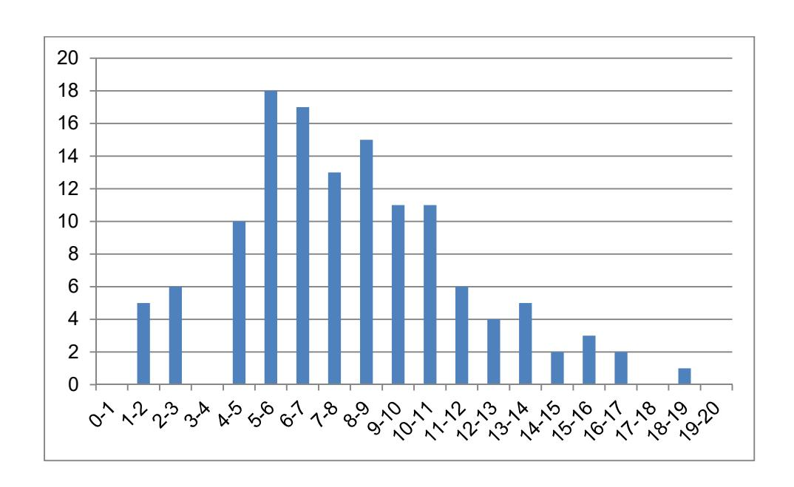

# **Exemple de sujet pour l'épreuve de mise en situation professionnelle**

## **1. Présentation de l'épreuve**

La définition détaillée de l'épreuve est fournie dans un dossier annexe disponible sur le poste de travail.

Le réinvestissement de l'activité pratique en vue d'une exploitation pédagogique décrite dans le règlement d'examen comme « l'exposé » est demandé pour la série et le niveau défini ci-dessous.

## **Déroulement de l'épreuve**

Activité pratique (4 heures) :

- − 45 minutes portant sur l'ingénierie pédagogique sur la séquence imposée ;
- − 30 minutes pour l'étude de la mise en contexte et prise en main ;
- − 2 h 15 pour l'étude de la ou des problématiques au plus haut niveau en tenant compte de la transversalité de l'épreuve ;
- − 30 minutes pour le réinvestissement de l'activité et pour la définition de la séance.

Préparation de l'exposé en loge (1 heure)

Exposé et entretien avec le jury (1 heure)

## **La séquence développée s'adresse à une classe de première S-SI de 36 élèves. La compétence visée est « analyser et modéliser les transferts d'énergie ».**

Horaires hebdomadaires pour la classe de première S SI :

- − 2 h d'enseignement en classe entière (CE) le mardi matin ;
- − 2 fois 2h d'enseignement en groupe à effectif réduit (GR) le jeudi matin (travaux pratiques et/ou projet) ;
- − 2h d'enseignement en classe entière (CE) le vendredi après-midi.

Les locaux et les matériels disponibles :

- − un laboratoire, pouvant accueillir 30 à 36 élèves en classe entière, est aménagé en 6 îlots et permet aussi le déroulement d'une synthèse ou celui d'un lancement d'activités;
- − chaque îlot est équipé de deux postes informatiques connectés au réseau pédagogique de l'établissement et à Internet ;
- − le laboratoire est équipé également d'un vidéo projecteur et d'un tableau numérique interactif ;
- − le laboratoire est équipé de matériels de mesure et de systèmes pluri-techniques et/ou de maquettes virtuelles ;
- − si nécessaire des tablettes connectées sont disponibles.
- − tous les supports logiciels jugés nécessaires sont disponibles dans le laboratoire.

Systèmes pluri-technologiques présents dans le laboratoire :

- − robot haptique ;
- − ventilation mécanique centralisée ;
- − banc sismique ;

- − système de suivi ;
- − robot d'assistance ;
- − système SLIDER ;
- − robot Darwin ;
- − bras BETA ;
- − stabilisateur de prise de vue.

## **2. Ingénierie pédagogique sur la séquence imposée**

Pour cette première partie, le candidat doit réfléchir et proposer une séquence de formation dont le contexte pédagogique est imposé. Le système support de l'activité pratique permet de viser la compétence donnée, comme la plupart des systèmes proposés.

Les attendus pour la séquence à proposer sont :

- − recenser les compétences à développer ;
- − recenser les savoir-faire et savoirs dans le référentiel du niveau imposé en lien avec le titre de la séquence ;
- − proposer une trame détaillée de celle-ci (activités, durée, coordination) ;
- − identifier et présenter les prérequis vis-à-vis de la progression pédagogique proposée ;
- − justifier les choix de modalités pédagogiques et didactiques (TP, TD, cours, projet ...) ;
- − définir, sans les rédiger avec précision, les évaluations formatives et sommatives.

Le candidat est invité à mettre en forme, à l'aide de l'outil de communication de son choix et dès le début de sa réflexion, les éléments qu'il souhaite présenter aux examinateurs lors de l'entretien.

#### **3. Mise en contexte et prise en main du système**

#### **3.1. Mise en contexte**

L'énergie est indispensable à notre vie, aussi bien dans notre habitat que sur notre lieu de travail, pour nous chauffer l'hiver, nous déplacer, avoir de la lumière à toute heure ou encore préparer à manger. En France, la plus grande partie de cette énergie est produite à partir du pétrole, de l'uranium, du gaz et du charbon. Ces ressources ne sont pas renouvelables, leur quantité disponible est limitée et s'amenuise. Leur utilisation massive a des conséquences sur notre environnement et notre santé : les émissions de gaz à effet de serre modifient notre climat, d'autres polluants affectent directement notre santé et des milliers de tonnes de déchets radioactifs sont stockés et devront pour certains d'entre eux, être surveillés pendant des milliers d'années.

Dans le souci de diminuer la consommation énergétique de chauffage, la dernière réglementation thermique RT2012 impose un certain niveau de perméabilité à l'air. La perméabilité à l'air d'un bâtiment est caractérisée par la quantité d'air qui entre ou sort de manière non contrôlée.

Pour des raisons sanitaires, l'air intérieur doit néanmoins être renouvelé (obligation règlementaire). Pour ce faire, en France, les bâtiments résidentiels neufs sont désormais tous équipés d'une Ventilation Mécanique Contrôlée (VMC). L'intérêt de ce système réside dans le contrôle des flux d'air entrants et sortants en fonction de l'utilisation effective des pièces du bâtiment. Les bâtiments tertiaires sont équipés d'une Centrale de Traitement de l'Air (CTA) qui intègre plusieurs systèmes ; le renouvellement de l'air avec une climatisation et un réchauffement de celui-ci.

L'étude proposée vise à étudier 2 solutions technologiques qui s'appuient sur :

- − un système réel en situation d'usage ; il s'agit d'une Centrale de Traitement de l'Air double flux (CTA) équipant la « Tour Elithis » située à Dijon. Il s'agit du premier Bâtiment Basse Consommation (BBC) de bureaux au monde dit « à énergie positive » construit en s'imposant un coût de construction « standard ». Cette tour dispose de 1 600 capteurs et servira de laboratoire « vivant » à cette étude. La CTA assure les fonctions de renouvellement de l'air, de chauffage, de refroidissement et de récupérateur d'énergie.
- − le système didactisé situé dans le laboratoire qui est une Ventilation Mécanique Contrôlée (VMC) double flux (DuolixMax) et plus spécifiquement sa version didactisée (VM20) par la société ERM. Cette VMC équipe principalement des logements type T2 à T5.

## Le but de l'étude est de :

- − découvrir, comprendre le fonctionnement d'une CTA ;
- − découvrir, comprendre le fonctionnement d'une ventilation mécanique contrôlée ;
- − comparer les deux systèmes ;
- − déterminer l'efficacité énergétique de la VM20 à partir de mesures effectuées et la comparer avec les performances annoncées par le constructeur ;
- − déterminer la consommation énergétique du ventilateur d'extraction lors d'un usage optimal ;
- − déterminer l'impact de la fermeture des iris et l'encrassement des bouches d'extraction d'air de la VM20 sur la consommation d'énergie du ventilateur d'extraction ;
- − comparer ce modèle avec les performances réelles annoncées par le constructeur.

## **3.2. Prise en main**

Le matériel à disposition est constitué :

- − d'un espace numérique personnel accessible pendant les 6 heures de l'épreuve ;
- − d'un ordinateur équipé des logiciels de bureautique et dédié aux activités pratiques (avec accès à internet) ;
- − d'un ordinateur (sans accès à internet) permettant de se connecter au serveur local de la tour Elithis pour relever des données comportementales de la ventilation (onglet « Données et comportement réels / Ventilation ») ;
- − d'un dossier comportant des ressources techniques et images ;
- − du système didactisé de VMC double flux (VM20) ;
- − d'un climatiseur réversible pour recréer des conditions de températures extérieures ;
- − d'instruments de mesure et d'une centrale d'acquisition de données.

À partir du site de la tour Elithis (données comportementales de la ventilation) accessible sur le serveur local dont l'adresse est 172.16.140.1 port 3000.

**Activité n° 1** Relever les mesures de température de l'air neuf entrant, de l'air neuf soufflé, de l'air vicié extrait, de l'air vicié rejeté pour la journée du 16 février à 14h00 et celle du 6 juillet à 16h00 (remarque : cette manipulation nécessite de configurer le navigateur. Firefox est fortement conseillé).

**Activité n° 2** Compléter le document réponse (DR1) en indiquant le(s) flux d'air entrant(s) et sortant(s) de la CTA de la tour Elithis.

L'étude se limitera à la fonction « l'échangeur de chaleur » matérialisée par le système didactisé VM20.

**Activité n° 3** Localiser sur le système les bouches d'entrée de l'air (extraction), les bouches de soufflage de l'air et l'échangeur thermique. Identifier le circuit emprunté par l'air sur le système didactisé et compléter le document réponse (DR2) en indiquant le(s) flux d'air entrant(s) et sortant(s).

**Activité n° 4** À l'aide du document « Présentation du système et capteurs », repérer sur le système didactisé les différents points de mesures.

**Activité n° 5** Observer le raccordement de la climatisation externe au système VM20. Expliquer l'intérêt de son utilisation dans le cadre de ce TP. Mettre en évidence les différences entre le système didactisé VM20 et la tour Elithis (CTA dans un bâtiment). Il est possible d'utiliser les relevés de l'activité 1.

Dès que votre intervention orale est prête, appeler l'examinateur pour présenter ces activités de prise en main.

#### **3.3. Problématique**

Comment assurer le confort intérieur d'une habitation en renouvelant l'air, tout en visant les performances optimales de l'installation ?

#### **4. Résolution de la ou des problématiques**

Il est recommandé au candidat d'appeler l'examinateur en cas de blocage sur une activité. Il est également fortement conseillé de faire appel à un examinateur en cas de doute sur la mise en œuvre du matériel.

**Avant de réaliser les activités suivantes, mettre la VMC en route, et plus précisément régler le système didactisé VM20 en mode MAN favorisant le chauffage et en mode « absence » (simulation d'une journée d'hiver).** 

## **4.1. Étude de l'échangeur thermique**

**Activité n° 6** Le système de VMC est équipé d'un échangeur thermique. À l'aide des vidéos Recair Sensitive.flv, expliquer au jury le phénomène d'échange thermique.

#### **4.2. Étude du by-pass**

**Activité n° 7** La VMC dispose d'un by-pass, représenté par un conduit sur les schémas cidessous. Donner sa fonction.

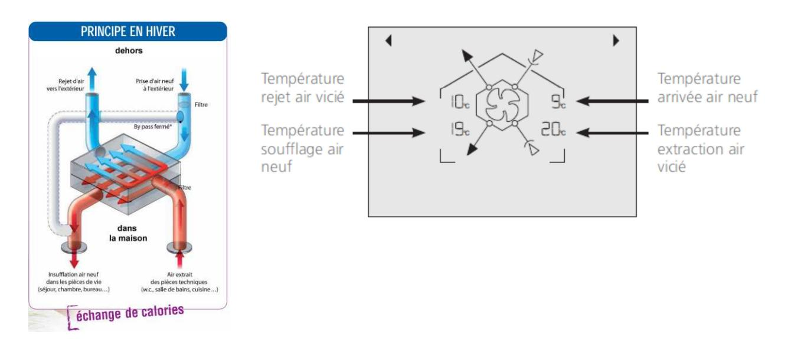

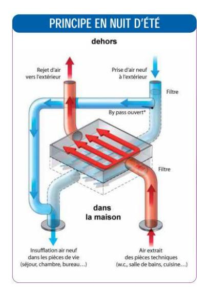

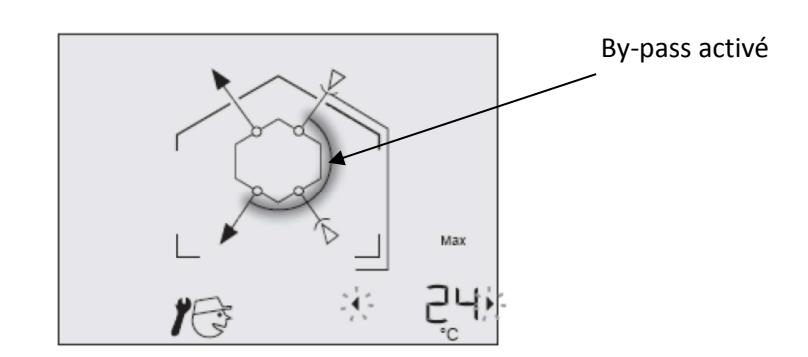

**Activité n° 8** Dans le cas du mode « été », on dispose des paramètres seuil haut et seuil bas ainsi que des variables Tint et Text. À partir du diagramme constructeur ci-après, donner l'algorithme ou le programme « orienté objet » de la commande du by-pass.

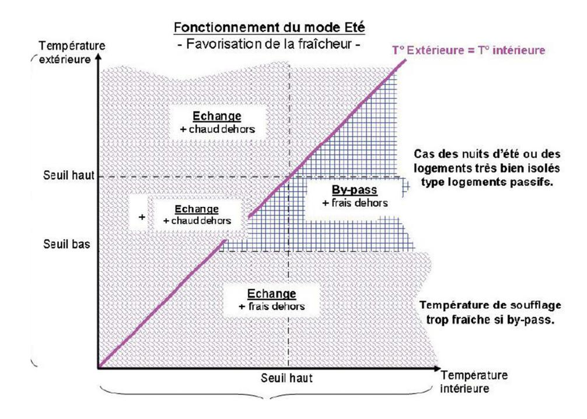

## 4.3. Étude de l'efficacité

Cette activité propose d'étudier l'échangeur thermique et plus particulièrement son efficacité. Pour cela, utiliser l'application « Échange thermique » disponible dans votre espace de travail.

#### **Définitions**

Puissance utile, récupérée sur l'air neuf :  $P_{utile} = 0.34 \cdot Q_v \cdot (T_{air \ neuf \ soufflé} - T_{air \ neuf \ extérieur})$ 

Puissance maximale disponible :  $P_{max} = 0.34 \cdot Q_{v} \cdot (T_{air\ vici\'e\ extrait} - T_{air\ neuf\ ext\'erieur})$ 

Efficacité énergétique :  $E = \frac{P_{utile}}{P_{max}}$ 

En partant du principe que le système DF VM20 est équilibré (débit d'air entrant = débit d'air extrait),

on pourra écrire :  $E = \frac{T_{air \ neuf \ soufflé} - T_{air \ neuf \ extérieur}}{T_{air \ vicié \ extrait} - T_{air \ neuf \ extérieur}}$ 

Exécuter l'application « Échange thermique ». Effectuer les raccordements entre la carte d'acquisition et le tableau principal de la VM20 en respectant les numéros de voie indiqués sur l'interface logicielle, puis raccorder la centrale d'acquisition à l'ordinateur. Mettre en route le système. Régler le système

didactisé VM20 en mode MAN favorisant le chauffage et en mode « absence » (simulation d'une journée d'hiver).

**Activité n° 9** Grâce à l'application « Échange thermique », relever les mesures de température instantanées. Calculer l'efficacité moyenne. L'échange thermique s'est-il réellement mis en place lors de vos mesures ? Pourquoi ?

Dès le relevé effectué, lancer la climatisation dans les conditions décrites ci-après, puis poursuivre l'activité 9. Faites valider le branchement par l'examinateur.

Pour reproduire en laboratoire, les conditions proches de la journée du 16 février observées dans la partie « prise en main du système », raccorder le climatiseur sur l'entrée d'air neuf de la VMC. Le

programmer en mode été pour qu'il souffle de l'air froid (demande de froid ) avec une température de 16°C. Le régler à la vitesse maximale.

**Pendant la mise en température de l'installation et la phase d'enregistrement, préparer l'activité 12 et 13.**

**Attention :** durée des mesures 5 minutes environ !

**Activité n° 10** Grâce à l'application « Échange thermique », relever et enregistrer les mesures de température dans les conditions proches du 16 février.

Utiliser maintenant le fichier de relevés de températures qui est stocké dans le dossier « Échange thermique ». Sélectionner l'onglet sans titre. Tracer avec Excel l'évolution de l'efficacité en fonction du temps. Calculer l'efficacité moyenne.

L'échange s'est-il réellement mis en place lors de vos mesures ? Pourquoi ?

Toute l'énergie (ou la puissance) a-t-elle été récupérée ? Pourquoi ?

**Activité n° 11** Le fabricant indique une efficacité comprise entre 90 % et 98 %.

Comparer les performances réelles avec les performances annoncées par le constructeur. Conclure.

**Activité n° 12** À partir des mesures relevées à l'activité 1, calculer l'efficacité de la CTA aux deux dates. Comparer les résultats à ceux obtenus par la VMC. Conclure.

## 5. **Conclusion quant à la problématique**

Cette activité propose d'étudier la consommation énergétique instantanée d'un tel système et en particulier le comportement énergétique du ventilateur d'extraction.

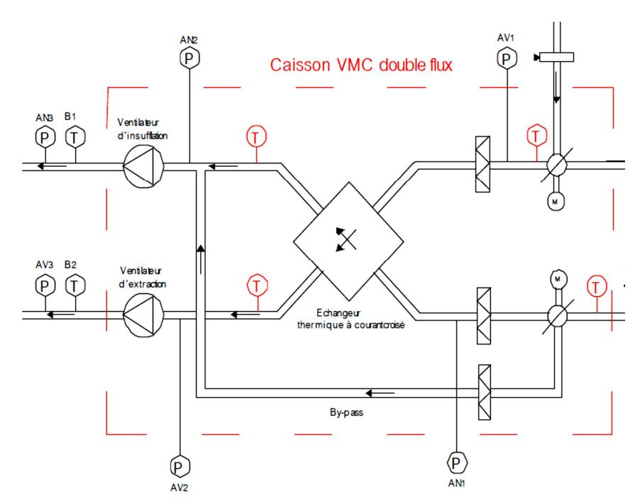

Schéma aéraulique partiel

Les formules suivantes permettent d'estimer la puissance utile du ventilateur d'extraction et la puissance électrique absorbée par le moteur :

- − puissance utile reçue par l'air P Q ( p p ) u v AV AV = ⋅ − 3 2 3 avec débit en m /s Qv et 3 p pression en Pa ou J/m (d'air déplacé) ;
- − puissance électrique en monophasé P U I cos élec = ⋅ ⋅ ϕ .

Diamètre des gaines : 125 mm

**Activité n° 13** Proposer un protocole expérimental à l'examinateur qui permette de calculer ces puissances.

## **Comportement réel en situation de laboratoire**

Cette phase de relevé se fera avec les registres à IRIS en position 0 et le système en mode « absence ».

**Attention :** afin d'obtenir la vitesse réelle de l'air dans le conduit, plusieurs mesures de vitesse de l'air doivent être réalisées, puis la moyenne de ces mesures doit être faite.

**Activité n° 14** Mesurer et relever le courant, la tension, le facteur de puissance, la vitesse de l'air et la pression différentielle entre les points de mesure AV3 et AV2. En déduire le débit, la puissance utile du ventilateur (ou puissance utile reçue par l'air), la puissance électrique consommée et le rendement du ventilateur.

## **Comportement réel en situation d'usage simulée**

La VMC utilisée ici peut être adaptée à tout type de pavillon (à partir du T3 : trois pièces principales). Tous les pavillons ne se ressemblent pas : les bouches de soufflage et d'extraction peuvent être très éloignées du caisson de récupération d'énergie impliquant des longueurs de raccordements longues et variables.

Dans de tels cas de figure, le constructeur n'a pas prévu des ventilateurs de différentes puissances, mais bien le même système adaptatif pour les cas les plus courants de structures de pavillons.

Pour reproduire les pertes de charges liées à l'installation d'une VMC en situation réelle, la résistance de l'air dans le réseau d'extraction peut être augmentée en fermant les registres à IRIS « WC » et « cuisine » (position 7), en déposant les bouches d'extraction « WC », « salle de bain » et « cuisine » et en les remplaçant par une feuille de papier. On reproduit ainsi un encrassement à l'usage, de l'installation.

## **Attendre systématiquement 5 minutes après toute nouvelle modification des IRIS que le système se stabilise !**

**Activité n° 15** Mesurer et relever le courant, la tension, le facteur de puissance, la vitesse de l'air et la pression différentielle entre les points de mesure AV3 et AV2. En déduire la puissance utile reçue par l'air, la puissance électrique consommée, et le rendement du ventilateur.

**Activité n° 16** Évaluer l'impact énergétique de l'augmentation de la résistance créée par la situation d'usage simulée. Conclure quant à l'adaptabilité du système et son rendement.

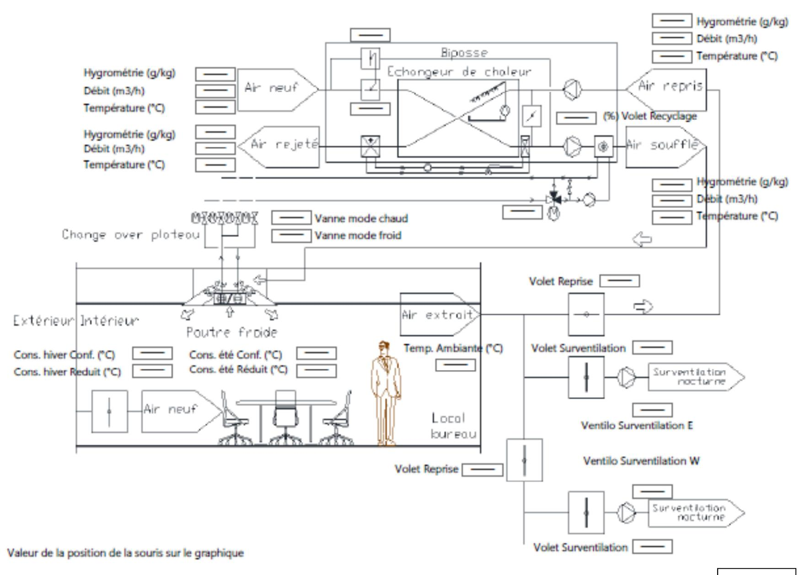

DR1

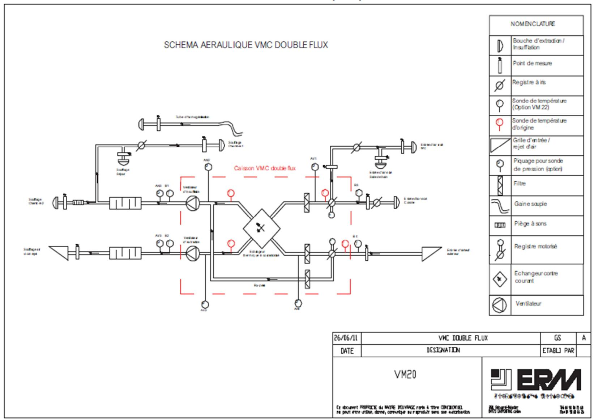

# **Rapport du jury de l'épreuve de mise en situation professionnelle**

## **1. Présentation de l'épreuve**

La durée de cette épreuve est de six heures. Elle est scindée en trois temps :

- − quatre heures dans un laboratoire de sciences industrielles de l'ingénieur débutant par 45 minutes d'ingénierie pédagogique ;
- − une heure en loge pour élaborer une exploitation pédagogique et sa présentation ;
- − une heure organisée en 30 minutes maximum de présentation et 30 minutes maximum d'échanges avec le jury.

Les deux parties, travaux pratiques et exploitation pédagogique, sont indépendantes et sont notées chacune sur dix points.

La distinction de l'évaluation des deux parties de l'épreuve permet de dissocier la réussite à l'épreuve de « travaux pratiques » de celle à l'épreuve d'« exploitation pédagogique ».

Les supports utilisés, pour cette session, sont des systèmes pluritechnologiques actuels :

- − robot collaboratif ;
- − bras deux axes de contrôle par caméra ;
- − banc de simulation de séisme ;
- − système de ventilation double flux ;
- − système de caméra auto-suiveuse ;
- − stabilisateur de prise de vue ;
- − robot humanoïde ;
- − système de travelling ;
- − banc d'étude sur la cohésion des sols ;
- − robot haptique.

Un tirage au sort du support est réalisé indépendamment de la spécialité des candidats pour l'épreuve de mise en situation professionnelle.

Le travail pratique proposé est construit pour être accessible à tous les candidats, quelle que soit leur option d'inscription au concours. Les documents, accompagnant le support, fournissent une guidance qui permet à tous les candidats, quelle que soit leur connaissance du système et leur spécialité, d'exprimer leurs compétences scientifiques et pédagogiques.

Chaque support conduit à une exploitation pédagogique de niveau imposé en technologie au collège, en série sciences et technologies de l'industrie et du développement durable (STI2D) en enseignement transversal ou en série scientifique pour les enseignements de sciences de l'ingénieur (S-SI).

Les objectifs de formation pour l'exploitation pédagogique de la séance d'activité pratique sont donnés aux candidats ainsi que le contexte de mise en œuvre de la séquence (effectifs, répartition horaire, progression didactique…)

Les compétences évaluées sont les suivantes :

- − analyser, mettre en œuvre un protocole expérimental, simuler et vérifier des performances ;
- − exploiter des résultats, justifier des choix et des solutions ;
- − présenter de manière détaillée une partie significative d'une séance de formation constitutive de la séquence ;

- − élaborer des documents de qualité pour présenter la séquence et la partie significative de la séance ;
- − s'exprimer correctement à l'oral pour présenter la séquence et la partie significative d'une séance de formation.

Ces compétences sont évaluées, quels que soient les supports d'activité pratiques mis en œuvre.

## Les candidats disposent :

- − d'un espace numérique personnel qu'ils conservent pendant les six heures de l'épreuve ;
- − d'un poste informatique équipé des logiciels de bureautique et dédié aux activités pratiques ;
- − de toutes les ressources numériques en lien avec le travail demandé (dont les programmes d'enseignement, les repères pour la formation et les guides d'accompagnement lorsqu'ils existent).

Le jury dispose d'une traçabilité des connexions sur le réseau permettant de suivre les sites consultés.

Pour la partie travaux pratiques, les postes de travail sont équipés des matériels usuels de mesure des grandeurs physiques (oscilloscopes numériques, multimètres, dynamomètres, tachymètres, cartes d'acquisition connectées à un ordinateur…), et ce, selon la nécessité des activités proposées. Cette épreuve est commune aux candidats au CAPET externe et au CAPET 3e voie. Les attendus, le déroulement et les supports didactiques ainsi que les exploitations pédagogiques sont identiques. Dans ce cadre, les conseils aux candidats sont communs aux deux concours.

## **2. Analyse globale des résultats**

Le jury tient à souligner la qualité de préparation de la majorité des candidats. Néanmoins, les attendus de l'épreuve et les modalités de mise en œuvre décrits au JORF et repris dans les rapports des jurys des années précédentes ne sont toujours pas connus de tous. Il s'avère extrêmement difficile de réussir les activités pratiques et l'exploitation pédagogique si les objectifs spécifiques de ces deux parties de l'épreuve ne sont pas connus.

Les notions théoriques portant sur la didactique de la discipline et sur les différentes démarches pédagogiques associées sont régulièrement citées par les candidats. Elles sont rarement justifiées et parfois énoncées de façon inappropriée. Elles ne font que trop rarement l'objet d'une contextualisation ou d'une proposition concrète dans le cadre de la séquence présentée lors de la leçon.

Une proportion significative de candidats ne connaît pas les programmes de technologie au collège et des séries S-SI et STI2D du lycée ainsi que les documents ressources pour faire la classe. Bien que donnés, ces différents textes et documents nécessitent un temps important pour se les approprier. La méconnaissance de ceux-ci se révèle pénalisante pour construire une séquence et une séance pédagogique réaliste dans le temps imparti. Le jury a été également extrêmement surpris que des candidats ne soient pas acculturés au socle commun de connaissances, de compétences et de culture ainsi qu'à l'évaluation par compétences.

Le nombre des exploitations pédagogiques portant sur le collège, la série STI2D et S-SI a été équilibré sur l'ensemble de la session. Les candidats doivent être en mesure de produire des séquences et séances sur tous les niveaux d'enseignement afin de pouvoir répondre aux attentes du jury.

Le jury rappelle que les exploitations pédagogiques sont appuyées sur les programmes en vigueur lors de la session du concours. À ce titre, le jury conseille aux futurs candidats de s'imprégner des programmes publiés au bulletin officiel spécial n°1 du 22 janvier 2019.

#### **3. Commentaires sur les réponses apportées par les candidats et conseils aux candidats**

Le jury a noté une prise en compte des remarques des années précédentes portant sur la concision de la présentation de l'activité pratique et sur l'intérêt de mettre en regard l'étude réalisée sur le système et la séquence pédagogique demandée. Le jury invite les candidats à faire preuve d'une rigueur scientifique exemplaire lors de la présentation des travaux réalisés et ne pas s'attacher à restituer l'intégralité (dans tous ses détails) de l'activité pratique. Lors de l'exploitation pédagogique, le jury a constaté que les activités pratiques et leurs résultats ne sont pas encore suffisamment réinvestis, au niveau de la séquence demandée.

Le jury conseille d'organiser la présentation de la façon suivante :

- − présentation du système (durée maximale cinq minutes) ;
- − synthèse des activités menées en travaux pratiques (durée maximale cinq minutes) ;
- − exploitation pédagogique (durée maximale vingt minutes).

Le manque de culture scientifique et technologique usuelle pénalise de nombreux candidats dans l'appropriation des supports pluritechnologiques. Il est impératif, pour espérer réussir l'épreuve de mise en situation professionnelle, de disposer de compétences et de connaissances scientifiques et technologiques avérées. Cette culture technologique ne se limite en aucun cas à un domaine disciplinaire unique. Les futurs professeurs de sciences industrielles de l'ingénieur se doivent d'avoir une vision transversale et globale de leur discipline et de conduire une veille technologique régulière.

Quelques candidats proposent des présentations (orales et écrites) très formatées, quelquefois hors du contexte de l'activité pratique réalisée en amont, qui ne résistent pas aux questionnements du jury et mettent en évidence des lacunes. Le jury invite les candidats à, certes, maîtriser les attendus pédagogiques et didactiques de la discipline, mais surtout à être en capacité de les réinvestir de façon adaptée et pertinente. À titre d'exemples, les termes « formatif », « sommatif », « inductif »… doivent être utilisés à bon escient et dans un contexte adapté.

Les candidats les plus efficients font preuve d'autonomie et d'écoute lors des travaux pratiques. Ils prennent des initiatives dans la conception de leur séquence pédagogique pour élaborer la leçon. Ils mettent à profit l'ensemble des ressources numériques mis à leur disposition.

Enfin, le jury rappelle que le concours constitue la première étape de l'entrée dans le métier du professorat. Le candidat se doit donc d'adopter une posture et un positionnement exemplaires constitutifs de la mission d'enseignant. Le jury invite vivement les candidats à s'approprier le référentiel des compétences professionnelles des métiers du professorat et de l'éducation (arrêté du 1-7-2013 - JORF du 18-7-2013).

## **Maîtrise de la finalité de l'épreuve**

Le jury renouvelle les conseils qui ont été donnés lors des précédentes sessions :

- − **connaître la description de l'épreuve (arrêté du 19 mars 2013 publié au JORF du 27 avril 2013 - arrêté du 24 avril 2013 publié au JORF du 22 août 2013 - arrêté du 19 avril 2016 du JORF n°0126 du 1 juin 2016) ;**
- − lire les rapports de jury des sessions précédentes.

## **Préparation – Formation aux épreuves**

Le jury conseille aux candidats de :

− s'approprier les programmes de tous les niveaux énoncés dans la définition de l'épreuve ainsi que les documents ressources associés ;

- − prendre connaissance du socle commun de connaissances, de compétences et de culture ;
- − s'informer des évolutions des programmes de S-SI et de STI2D et des enseignements en collège ;
- − s'informer des pratiques pédagogiques, des modalités de fonctionnement et de l'organisation des horaires en collège, en S-SI et en STI2D ;
- − se préparer à exploiter les résultats d'investigations et d'expérimentations en regard des contenus disciplinaires ;
- − s'informer sur les modalités des épreuves d'examen auxquelles ils préparent leurs futurs élèves.

## **Qualité des documents de présentation et expression orale**

Il est attendu des candidats une maîtrise des outils numériques pour l'enseignement afin de construire un document clair, lisible et adapté à la présentation de l'exposé.

Le jury est extrêmement attentif à la qualité de la syntaxe et de l'orthographe.

Les candidats s'expriment généralement correctement. La qualité de l'élocution et la clarté des propos sont indispensables aux métiers de l'enseignement.

## **Pour la partie travaux pratiques**

#### **Organisation à suivre lors de l'épreuve**

Dans un premier temps, les candidats doivent prendre connaissance des compétences imposées visées par la séquence de formation à élaborer. Durant les quarante-cinq premières minutes, le travail d'ingénierie pédagogique demandé consiste à établir une première trame de la séquence pédagogique au regard des éléments imposés au sein du sujet (niveau, organisation temporelle et structurelle…). Ce premier temps est décontextualisé du support de l'épreuve travaux pratiques.

À l'issue de ce premier temps, les candidats doivent rapidement mettre en œuvre et s'approprier le support. Des documents d'aide sous forme numérique et multimédia leur sont fournis.

Les candidats réalisent des activités expérimentales et analysent les résultats afin de conclure sur les problématiques proposées. Ces manipulations, mesures et interprétations, sont réalisées au niveau de compétences d'un master 1re année.

Les candidats doivent penser à garder des traces numériques de leurs résultats et de leurs travaux afin de les réinvestir, pour la l'exploitation pédagogique, dans une séquence adaptée au collège ou au lycée.

Lors de cette session, durant les quatre heures de l'activité pratique, une heure et quinze minutes ont été consacrées à la conception de l'exploitation pédagogique. Organisés en deux temps distincts, l'un en début des travaux pratiques pour 45 minutes et l'autre en fin de travaux pratiques pour 30 minutes, ils ont pour objectif d'engager une réflexion portant sur l'ingénierie pédagogique demandée et de commencer l'élaboration des documents pédagogiques attendus lors de l'exposé. Le temps d'ingénierie pédagogique ne nécessite pas de manipulation du système. Le postulat de départ est précisé que tout ou partie des supports du laboratoire permet d'atteindre l'objectif de formation assigné pour la leçon.

La connaissance préalable du système et des logiciels n'étant pas demandée, les membres de jury peuvent être sollicités par les candidats en cas de problème ou de difficultés persistantes liées à l'exploitation d'un logiciel ou d'un appareil de mesurage spécifique. Plus généralement, le jury est présent pour accompagner les candidats dans leur démarche.

#### **Aptitude à mener un protocole expérimental**

La mise en œuvre des matériels de mesurage et d'acquisition ne suscite pas de difficulté particulière. Les membres du jury assurent l'accompagnement nécessaire afin que la spécificité d'un équipement ne constitue pas un obstacle à la réussite des candidats. Le jury attend des candidats qu'ils soient capables de proposer et de justifier des choix de protocoles expérimentaux.

#### **Utilisation des modèles numériques**

Globalement, les candidats utilisent correctement les modèles numériques fournis. Le jury note cependant que de nombreux candidats manquent de recul et d'esprit critique dans l'interprétation des résultats de la simulation numérique et dans l'analyse des hypothèses utilisées lors de l'élaboration du modèle. Il est attendu des candidats une analyse pertinente des écarts entre les résultats fournis par la modélisation et la simulation, les mesures issues du système réel à partir d'expérimentations et/ou les performances attendues indiquées dans le cahier des charges.

## **Pour l'exposé devant le jury**

#### **Présentation du travail pratique**

Une présentation succincte du support, des travaux réalisés et des résultats obtenus permet de contextualiser la séance qui sera présentée. Elle doit être réalisée avec toute la rigueur scientifique que le jury peut attendre d'un candidat qui se destine au métier d'enseignant. Le jury apprécie les présentations synthétiques mettant en évidence les points qui feront l'objet d'un réinvestissement dans la description de la séquence et de la séance. Afin de faciliter l'exposé, il est suggéré d'utiliser les outils adaptés à la production d'une présentation de qualité.

## **Description de la séquence**

Les candidats inscrivent leur développement pédagogique dans un contexte pédagogique donné dans le sujet. L'objectif de formation, la progression didactique dans laquelle s'inclut la séquence à développer, les programmes et les documents ressources pour faire la classe sont mis à disposition sur le répertoire numérique personnel des candidats.

Les candidats doivent structurer une séquence pédagogique et la positionner dans une progression didactique annuelle. Les documents ressources pour faire la classe constituent des points d'appui que les candidats ne peuvent ignorer.

Les hypothèses d'organisation de la pédagogie dans l'établissement doivent être précisées (exemple 7 h d'enseignement transversal dont 3 h en co-animation). Le positionnement de la séquence dans le plan de formation du cycle ou de l'année doit être précisé.

Une séquence se compose de plusieurs séances. Il est demandé de décrire la structure de chaque séance et de préciser les prérequis et les objectifs (compétences à faire acquérir, capacités et connaissances attendues), l'organisation de la classe, les systèmes utilisés, la durée des séances, le nombre d'élèves, les modalités pédagogiques (cours, activités dirigées, activités pratiques, projet), les stratégies pédagogiques (déductif, inductif, différenciation pédagogique, démarche d'investigation, démarche de résolution de problème technique, pédagogie par projet, approche spiralaire…), les activités des élèves et les productions attendues. Les descriptions de la séquence et des séances doivent faire explicitement apparaître la prise en compte de la diversité des publics accueillis dans la classe.

Les phases de structuration des connaissances permettant la construction des connaissances des élèves et les différentes formes d'évaluations des élèves sont des parties intégrantes de la séquence et doivent reprendre les objectifs annoncés. Les différentes modalités d'enseignement (EPI, interdisciplinarité, concours scientifique et technique…) et les dispositifs d'accompagnement et de remédiation doivent être précisés.

## **Utilisation du numérique**

Le jury note qu'une majorité de candidats fait appel aux ressources et usages du numérique dans les activités proposées aux élèves. Néanmoins, le jury leur conseille de bien identifier les points de leur séquence pédagogique pour lesquels l'usage du numérique apportera une réelle plus-value aux apprentissages des élèves. Si l'exploitation du numérique disciplinaire est souvent mise en œuvre par de nombreux candidats, peu d'entre eux proposent une séquence exploitant le numérique éducatif.

## **Réinvestissement des résultats de travaux pratiques**

L'objectif attendu de la leçon est une exploitation pédagogique en lien avec tout ou partie des activités pratiques réalisées. Celles-ci étant d'un niveau supérieur à la séquence demandée, il ne s'agit pas de faire, au travers de la séquence pédagogique, un compte-rendu de l'activité pratique réalisée, mais de s'appuyer sur les expérimentations pour en extraire des données et des activités à proposer aux élèves. Les candidats doivent, en dix minutes au maximum :

- − présenter brièvement le support, la problématique et la démarche méthodologique proposée ;
- − justifier le(s) lien(s) avec la séquence pédagogique, expliciter les résultats et les investigations qui seront réutilisés dans la séquence.

De plus, il est important que les candidats explicitent comment les adapter au niveau d'enseignement visé. Le jury ne se satisfait en aucun cas d'une exploitation brute des activités proposées dans la première partie de l'épreuve.

Les candidats peuvent aussi envisager l'utilisation d'autres systèmes présents dans les laboratoires, en complément du système étudié pendant la première partie de l'épreuve.

## **Réalisme de l'organisation de la classe**

Le jury attend des candidats qu'ils émettent des hypothèses réalistes sur les conditions d'enseignement. Leurs propositions doivent être pragmatiques afin que le jury puisse appréhender le scénario pédagogique envisagé.

#### **Évaluation**

Le processus retenu par les candidats pour l'évaluation des compétences doit être clairement décrit (évaluation diagnostique, formative, sommative, certificative…) et justifié. Les modalités et les outils doivent être précisés. Si des remédiations ou des différenciations pédagogiques sont envisagées, elles doivent être explicitées.

Trop souvent, les candidats se contentent d'évoquer les processus d'évaluation sans pouvoir en expliquer réellement le déroulement, les modalités et surtout l'objectif en termes d'acquisition des compétences par les élèves.

## **Réactivité au questionnement**

Le jury attend de la concision et de la précision ainsi qu'une honnêteté intellectuelle dans les réponses formulées. Les réponses au questionnement doivent laisser transparaître un positionnement adapté aux attentes de l'Institution et une réelle appropriation des valeurs de la République ne se limitant pas à l'exposé des grands principes sans en démontrer le bienfondé pour les élèves.

Les candidats se doivent d'être réactifs sans chercher à éluder les questions ou à noyer le propos dans un discours pédagogique non maîtrisé. Plus qu'une réponse exacte instantanée, le jury apprécie la capacité à argumenter, à expliquer et justifier une démarche ou un point de vue.

## **4. Conclusions**

L'épreuve de mise en situation professionnelle nécessite une préparation rigoureuse, sérieuse et approfondie en amont de l'admissibilité. Cette préparation doit porter tout autant sur la partie « travaux pratiques » que sur la partie « exploitation pédagogique », car ces deux parties de l'épreuve sont complémentaires et indissociables. Les compétences nécessaires à la réussite de cette épreuve sont à acquérir et à développer notamment lors de stages en situation et de périodes d'observation ou d'enseignement. Elles sont complétées par une connaissance fine des référentiels et des documents ressources pour faire la classe. L'épreuve s'appuie sur la maîtrise disciplinaire des sciences industrielles de l'ingénieur.

Le métier d'enseignant exige une exemplarité dans la tenue, dans la posture ainsi que dans le discours. L'épreuve de mise en situation professionnelle permet la valorisation de ces qualités.

## **5. Résultats**

Soixante-sept candidats ont été évalués pour cette épreuve, la moyenne des notes obtenues est de 10,6 / 20 et l'écart-type de 4,8 avec :

- − 19,0 comme meilleure note ;
- − 2,1 comme note la plus basse.

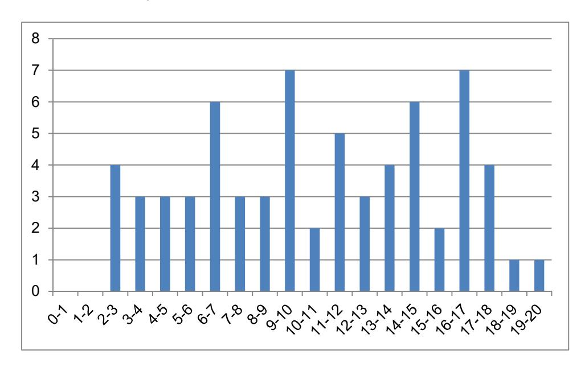

# **Rapport sur la transmission des valeurs et principes de la République**

Lors des épreuves d'admission, le jury évalue la capacité des candidats à agir en agent du service public d'éducation, en vérifiant qu'il intègre dans l'organisation de son enseignement :

- − la conception des apprentissages des élèves en fonction de leurs besoins personnels ;
- − la prise en compte de la diversité des conditions d'exercice du métier et la connaissance réfléchie des contextes associés ;
- − le fonctionnement des différentes entités éducatives existant au sein de la société et d'un EPLE (institution scolaire, établissement, classe, équipe éducative…) ;
- − les valeurs portées par l'Éducation nationale, dont celles de la République.

Les candidats doivent prendre en compte ces exigences dans la conception des séquences pédagogiques présentées au jury. Il s'agit de faire acquérir, à l'élève, des compétences alliant des connaissances scientifiques et technologiques et des savoir-faire associés, mais également d'installer des comportements responsables et respectueux des valeurs républicaines.

Cet objectif exigeant induit une posture réflexive des candidats lors de la préparation et de la présentation d'une séquence pédagogique. En particulier, les stratégies pédagogiques proposées devront permettre d'atteindre l'objectif de formation visé dans le cadre de « l'école inclusive ». Il est indispensable de donner du sens aux enseignements en ne les déconnectant pas d'un contexte sociétal identifiable. Cela doit contribuer à convaincre les élèves du bien-fondé des valeurs républicaines et à se les approprier.

L'éducation aux valeurs républicaines doit conduire à adopter des démarches pédagogiques spécifiques, variées et adaptées. Il s'agit en particulier de doter chaque futur citoyen d'une culture faisant de lui un acteur éclairé et responsable de l'usage des technologies et des enjeux éthiques associés. À dessein, il est nécessaire de lui faire acquérir des comportements fondateurs de sa réussite personnelle et le conduire à penser et construire son rapport au monde. Les modalités pédagogiques, déployées en sciences industrielles de l'ingénieur, sont nombreuses et sont autant d'opportunités offertes à l'enseignant pour apprendre aux élèves à :

- − travailler en équipe et coopérer à la réussite d'un projet ;
- − assumer une responsabilité individuelle et collective ;
- − travailler en groupe à l'émergence et à la sélection d'idées issues d'un débat et donc favoriser le respect de l'altérité ;
- − développer des compétences relationnelles en lui permettant de savoir communiquer une idée personnelle ou porter la parole d'un groupe ;
- − comprendre les références et besoins divers qui ont conduit à la création d'objets ou de systèmes à partir de l'analyse des « modes », des normes, des lois, etc. ;
- − différencier, par le déploiement de démarches rigoureuses, ce qui relève des sciences et de la connaissance de ce qui relève des opinions et des croyances. L'observation de systèmes réels, l'analyse de leur comportement, de la construction ou de l'utilisation de modèles multi physiques participent à cet objectif ;
- − observer les faits et situations divers suivant une approche systémique et rationnelle ;
- − adopter un positionnement citoyen assumé au sein de la société en ayant une connaissance approfondie de ses enjeux au sens du développement durable. L'impact environnemental, les

- coûts énergétiques de transformation et de transport, la durée de vie des produits et leur recyclage sont des marqueurs associés à privilégier ;
- − réfléchir collectivement à son environnement, aux usages sociaux des objets et aux conséquences induites ;
- − comprendre les enjeux sociétaux liés au respect de l'égalité républicaine entre hommes et femmes ;
- − appréhender des situations qui lui paraissent inhabituelles car elles ne sont pas en adéquation avec les stéréotypes ;
- − etc.

Ces différentes approches permettent d'évaluer la posture des candidats par rapport au besoin de transmettre les valeurs et les principes de la République à l'école. La dimension civique de l'enseignement doit être explicite.

Pour prendre en compte cette dimension du métier d'enseignant dans la conception de séquences pédagogiques, les candidats peuvent s'appuyer sur différents textes réglementaires et ressources pédagogiques disponibles :

- − le référentiel de compétences des métiers de l'éducation et du professorat (BOEN n°30 du 25 juillet 2013) ;
- − les programmes d'enseignement moral et civique ;
- − le socle commun de connaissances, de compétences et de culture ;
- − l'instruction relative au déploiement de l'éducation au développement durable dans l'ensemble des écoles et établissements scolaires pour la période 2015-2018 (NOR : MENE1501684C, circulaire n° 2015-018 du 4-2-2015, MENESR – DGESCO) ;
- − le parcours Avenir ;
- − la banque de ressources « Pour une pédagogie de la laïcité à l'école » Abdennour BIDAR la documentation française 2012 ;
- − les ressources numériques en ligne du réseau de création et d'accompagnement pédagogiques CANOPÉ – éducation et société ;
- − les ressources du portail national des professionnels de l'éducation Eduscol établissements et vie scolaire.

#### **Lors de la session 2019…**

Certains candidats ont su échanger naturellement avec les membres du jury sur la transmission des valeurs et des principes républicains sans s'attacher à donner des réponses convenues autour du sujet, mais en faisant preuve d'une réflexion pertinente, adaptée au contexte de la situation proposée. Il paraît clair que ces candidats sont soucieux de cet aspect important du métier.

Cependant, le jury déplore que certains candidats ne se soient pas suffisamment informés sur ces questions. Aussi ces candidats cherchent-ils à donner les « bonnes réponses » aux membres du jury sans faire preuve d'une analyse et d'une réflexion adaptée aux échanges.

Le jury conseille vivement aux futurs candidats de s'appuyer sur les textes réglementaires, et notamment la charte de la laïcité à l'école, et les ressources pédagogiques cités ci-dessus, pour développer une culture professionnelle de qualité sur cet aspect essentiel du métier.