**Concours** : CAFEP CAPET

**Section** : Sciences industrielles de l'ingénieur

**Option** : Ingénierie électrique

**Session 2021**

Rapport de jury présenté par : Pascale COSTA, présidente du jury.

# Sommaire

| Avant | -propos                                                           | 3  |
|-------|-------------------------------------------------------------------|----|
| Reme  | erciements                                                        | 4  |
| Évolu | tions des épreuves à partir de la session 2022                    | 5  |
| Résul | tats statistiques                                                 | 7  |
| Analy | se et exploitation pédagogique d'un système pluritechnologique    | 8  |
| A.    | Présentation de l'épreuve                                         | 8  |
| B.    | Sujet                                                             | 8  |
| C.    | Éléments de correction                                            | 9  |
| D.    | Commentaires du jury                                              | 16 |
| E.    | Résultats                                                         | 19 |
| Étude | d'un système, d'un procédé ou d'une organisation                  | 20 |
| A.    | Présentation de l'épreuve                                         | 20 |
| B.    | Sujet                                                             | 20 |
| C.    | Éléments de correction                                            |    |
| D.    | Commentaires du jury                                              | 28 |
| E.    | Résultats                                                         | 30 |
| Épreu | ıve de mise en situation professionnelle                          | 31 |
| А.    | Présentation de l'épreuve                                         |    |
| В.    | Commentaires du jury                                              |    |
| C.    | Résultats                                                         |    |
| Épreu | ıve d'entretien à partir d'un dossier                             |    |
| А.    | Présentation de l'épreuve                                         |    |
| B.    | Commentaires du jury                                              |    |
| C.    | Résultats                                                         |    |
| Rappo | ort sur la transmission des valeurs et principes de la République |    |
|       |                                                                   |    |

# **Avant-propos**

Ce rapport est dans la continuité de ceux des sessions précédentes.

Les attentes du concours du Capet et du Cafep de sciences industrielles de l'ingénieur (SII) sont définies par l'arrêté du 13 avril 2013 qui en fixe l'organisation. Les concours de recrutement d'enseignants n'ont pas pour seul objectif de valider les compétences scientifiques et technologiques des candidats ; ils doivent aussi valider les compétences professionnelles qui sont souhaitées par l'État employeur qui recrute des professeurs. L'excellence scientifique et la maîtrise disciplinaire sont indispensables pour présenter le concours, mais pour le réussir, les candidats doivent aussi faire preuve de qualités didactiques et pédagogiques et de bonnes aptitudes à communiquer.

Les deux épreuves d'admissibilité sont construites de manière à évaluer un spectre large de compétences scientifiques et technologiques ; la première épreuve est commune aux quatre options de du Capet/Cafep SII, l'autre est spécifique à l'option.

Les deux épreuves d'admission sont complémentaires des épreuves d'admissibilité ; la première épreuve d'admission est commune aux quatre options, l'autre est spécifique à l'option. Elles permettent l'évaluation des compétences pédagogiques des futurs professeurs et s'appuient sur le référentiel des compétences professionnelles des métiers du professorat et de l'éducation (publié au BOEN du 25 juillet 2013). Elles comportent un entretien avec le jury qui permet d'évaluer la capacité du candidat à s'exprimer avec clarté et précision, à réfléchir aux enjeux scientifiques, technologiques, didactiques, épistémologiques, culturels et sociétaux que revêt l'enseignement du champ disciplinaire du concours. Ces épreuves d'admission, dont le coefficient total est le double de celui des épreuves d'admissibilité, ont eu une influence significative sur le classement final.

Les candidats et leurs formateurs sont invités à lire avec application les commentaires et conseils donnés dans ce rapport et dans ceux des sessions antérieures afin de bien appréhender les compétences ciblées. La préparation à ces épreuves commence dès l'inscription au concours. Proposer une séquence pédagogique puis une séance à partir d'activités expérimentales ne s'improvise pas et nécessite une préparation rigoureuse. De même, la qualité du dossier dépend de la pertinence du choix du support. Elle impose aux futurs professeurs de s'engager, dès le début de leur carrière, dans un processus de rapprochement avec le monde de l'entreprise et de la recherche.

Ces épreuves permettent « également d'évaluer la capacité du candidat à prendre en compte les acquis et les besoins des élèves, à se représenter la diversité des conditions d'exercice de son métier futur, à en connaître de façon réfléchie le contexte dans ses différentes dimensions (classe, équipe éducative, établissement, institution scolaire, société) et les valeurs qui le portent, dont celles de la République ». Les thématiques de la laïcité et de la citoyenneté trouvent toute leur place lors des entretiens avec le jury ; en effet, la mission première que fixe la Nation à ses enseignants est de transmettre et faire partager aux élèves les valeurs et principes de la République ainsi que l'ensemble des dispositions de la charte de la laïcité.

Pour l'épreuve d'admission pratique, l'accès à Internet était autorisé afin de mettre les candidats dans les conditions du métier qu'ils envisagent d'exercer. Mais cela ne doit pas masquer le fait que la réflexion, la cohérence, l'appréciation du niveau des élèves et la précision pédagogique dans les explications sont des qualités précieuses pour un futur enseignant.

Dans toutes les épreuves, le jury attend des candidats une expression écrite et orale irréprochable. Le Capet/Cafep est un concours exigeant qui impose de la part des candidats un comportement et une présentation exemplaires. Le jury reste vigilant sur ce dernier aspect et invite les candidats à avoir une

tenue adaptée aux circonstances particulières d'un concours de recrutement de cadres de catégorie A de la fonction publique.

La session 2021 de ce concours externe présentait 49 postes pour le concours public et 3 postes pour le privé. Il a été impossible de pourvoir tous les postes pour le public : seuls 36 candidats ont été admis.

Si globalement, les candidats présents à cette session d'admission étaient bien préparés, l'admission n'a pu être prononcée pour ceux dont les prestations n'ont pas donné la garantie qu'ils étaient aptes à embrasser la carrière de professeur de sciences industrielles de l'ingénieur. Cela est regrettable dans la mesure où les besoins dans les établissements scolaires sont importants.

Les épreuves des concours de recrutements d'enseignants évoluent à partir de la session 2022. Les définitions des épreuves sont indiquées dans ce rapport et sur le site Devenir enseignant1 .

Pour conclure cet avant-propos, le jury souhaite que ce rapport soit une aide efficace aux futurs candidats. Tous sont invités à se l'approprier par une lecture attentive.

# **Remerciements**

Le lycée Roosevelt de Reims a accueilli les épreuves d'admission de cette session 2021 des quatre options du Capet/Cafep externe section sciences industrielles de l'ingénieur.

Les membres du jury tiennent à remercier le proviseur du lycée et son adjointe, son directeur délégué aux formations professionnelles et technologiques, ses collaborateurs et l'ensemble des personnels pour la qualité de leur accueil et l'aide efficace apportée tout au long de l'organisation et du déroulement de ce concours qui a eu lieu dans d'excellentes conditions malgré le contexte difficile lié à la crise sanitaire.

1 <https://www.devenirenseignant.gouv.fr/cid158866/epreuves-capet-externe-cafep-capet-sii.html>

# **Évolutions des épreuves à partir de la session 2022**

Les épreuves de concours évoluent à partir de la session 2022.

Les épreuves du Capet externe et du Cafep-Capet de la section sciences industrielles de l'ingénieur se composent de deux épreuves écrites d'admissibilité (une épreuve disciplinaire et une épreuve disciplinaire appliquée) et de deux épreuves orales d'admission (une épreuve de leçon et une épreuve d'entretien).

Les textes décrivant les épreuves ont été publiés dans l'arrêté du 25 janvier 2021 fixant les modalités d'organisation des concours du certificat d'aptitude au professorat de l'enseignement technique : <https://www.legifrance.gouv.fr/jorf/id/JORFTEXT000043075536>

### **A. Épreuves d'admissibilité**

### **Épreuve écrite disciplinaire**

 Durée : 5 heures Coefficient 2

L'épreuve, spécifique à l'option choisie, porte sur l'étude d'un système, d'un procédé ou d'une organisation.

Elle a pour but de vérifier que le candidat est capable, à partir de l'exploitation d'un dossier technique remis par le jury, de conduire une analyse critique de solutions technologiques et de mobiliser ses connaissances scientifiques et technologiques pour élaborer et exploiter les modèles de comportement permettant de quantifier les performances d'un système ou d'un processus lié à la spécialité et définir des solutions technologiques.

L'épreuve est notée sur 20. Une note globale égale ou inférieure à 5 est éliminatoire.

### **Épreuve écrite disciplinaire appliquée**

 Durée : 5 heures Coefficient 2

L'épreuve, commune à toutes les options, porte sur l'analyse et l'exploitation pédagogique d'un système pluri-technologique. Elle invite le candidat à la conception d'une séquence d'enseignement, à partir d'une problématique et d'un cahier des charges.

### L'épreuve permet de vérifier :

- que le candidat est capable de mobiliser ses connaissances scientifiques et technologiques pour conduire une analyse systémique, élaborer et exploiter les modèles de comportement permettant de quantifier les performances d'un système pluri-technologique des points de vue de la matière, de l'énergie et/ou de l'information, afin de valider tout ou partie de la réponse au besoin exprimé par un cahier des charges ;
- qu'il est capable d'élaborer tout ou partie de l'organisation d'une séquence pédagogique ainsi que les documents techniques et pédagogiques associés (documents professeurs, documents fournis aux élèves, éléments d'évaluation).

Les productions pédagogiques attendues sont relatives à une séquence d'enseignement portant sur les programmes de collège ou de lycée.

L'épreuve est notée sur 20. Une note globale égale ou inférieure à 5 est éliminatoire.

### **B. Épreuves d'admission**

### **Épreuve de leçon**

Durée des travaux pratiques encadrés : 5 heures

 Durée de la présentation : 30 maximum Durée de l'entretien : 30 minutes maximum

Coefficient : 5

L'épreuve a pour objet la conception et l'animation d'une séance d'enseignement dans l'option choisie. Elle permet d'apprécier à la fois la maîtrise disciplinaire, la maîtrise de compétences pédagogiques et de compétences pratiques.

L'épreuve prend appui sur les investigations et analyses effectuées par le candidat pendant les cinq heures de travaux pratiques relatifs à une approche spécialisée d'un système pluri-technologique et comporte la présentation d'une séance d'enseignement suivi d'un entretien avec les membres du jury. L'exploitation pédagogique attendue, directement liée aux activités pratiques réalisées, est relative aux enseignements en collège, en lycée et aux sections de STS de la spécialité.

L'épreuve est notée sur 20 : 10 points sont attribués à la partie liée aux travaux pratiques et 10 points à la partie liée à la soutenance. La note 0 à l'ensemble de l'épreuve est éliminatoire.

### **Épreuve d'entretien**

 Durée : 35 minutes Coefficient 3

L'épreuve d'entretien avec le jury porte sur la motivation du candidat et son aptitude à se projeter dans le métier de professeur au sein du service public de l'éducation.

L'entretien comporte une première partie d'une durée de quinze minutes débutant par une présentation, d'une durée de cinq minutes maximum, par le candidat des éléments de son parcours et des expériences qui l'ont conduit à se présenter au concours en valorisant ses travaux de recherche, les enseignements suivis, les stages, l'engagement associatif ou les périodes de formation à l'étranger. Cette présentation donne lieu à un échange avec le jury.

La deuxième partie de l'épreuve, d'une durée de vingt minutes, doit permettre au jury, au travers de deux mises en situation professionnelle, l'une d'enseignement, la seconde en lien avec la vie scolaire, d'apprécier l'aptitude du candidat à :

- s'approprier les valeurs de la République, dont la laïcité, et les exigences du service public (droits et obligations du fonctionnaire dont la neutralité, lutte contre les discriminations et stéréotypes, promotion de l'égalité, notamment entre les filles et les garçons, etc.) ;
- faire connaître et faire partager ces valeurs et exigences.

Le candidat admissible transmet préalablement une fiche individuelle de renseignement établie sur le modèle figurant à l'annexe VI de l'arrêté du 25 janvier 2021 fixant les modalités d'organisation des concours du certificat d'aptitude au professorat de l'enseignement technique, selon les modalités définies dans l'arrêté d'ouverture.

L'épreuve est notée sur 20. La note 0 est éliminatoire.

# **Résultats statistiques**

## **Ingénierie électrique**

### **CAPET externe public :**

| Session | Nombre de postes | Inscrits | Présents aux épreuves écrites | Admissibles | Présents aux épreuves orales | Admis |
|---------|---------------------|----------|-------------------------------------|-------------|------------------------------------|-------|
| 2019    | 45                  | 332      | 119                                 | 88          | 66                                 | 45    |
| 2020    | 51                  | 228      | 81                                  | 66          | 60                                 | 29    |
| 2021    | 49                  | 192      | 81                                  | 70          | 51                                 | 36    |

### **CAFEP CAPET privé :**

| Session | Nombre de postes | Inscrits | Présents aux épreuves écrites | Admissibles | Présents aux épreuves orales | Admis |
|---------|---------------------|----------|-------------------------------------|-------------|------------------------------------|-------|
| 2019    | 3                   | 72       | 32                                  | 7           | 6                                  | 3     |
| 2020    | 4                   | 63       | 27                                  | 10          | 9                                  | 4     |
| 2021    | 3                   | 59       | 35                                  | 9           | 8                                  | 3     |

### **Statistiques obtenues à l'admissibilité et à l'admission à la session 2021 :**

|               |                                                                                    | CAPET (public) | CAFEP (privé) |
|---------------|------------------------------------------------------------------------------------|----------------|---------------|
|               | Moyenne de la note obtenue par le premier candidat admissible | 17,33          | 15,47         |
| Admissibilité | Moyenne de la note obtenue par le dernier candidat admissible                   | 5,03           | 9,93          |
|               | Moyenne des candidats non éliminés                                                 | 8,08           | 8,01          |
|               | Moyenne des candidats admissibles                                                  | 8,76           | 12,33         |
| Admission     | Moyenne de la note obtenue par le premier candidat admis      | 17,16          | 16,14         |
|               | Moyenne de la note obtenue par le dernier candidat admis                     | 8,20           | 15,41         |
|               | Moyenne des candidats présents                                                     | 10,01          | 13,93         |
|               | Moyenne des candidats admis                                                        | 11,49          | 15,67         |

# **Analyse et exploitation pédagogique d'un système pluritechnologique**

### **A. Présentation de l'épreuve**

Durée : 5 heures Coefficient 2

L'épreuve est commune à toutes les options.

Elle a pour but de vérifier que le candidat est capable de mobiliser ses connaissances scientifiques et technologiques pour conduire une analyse systémique, élaborer et exploiter les modèles de comportement permettant de quantifier les performances d'un système pluritechnique des points de vue matière, énergie et information afin de valider tout ou partie de la réponse, au besoin exprimée par un cahier des charges.

Elle permet également de vérifier que le candidat est capable d'élaborer tout ou partie de l'organisation d'une séquence pédagogique, relative à l'enseignement de technologie du collège ou aux enseignements technologiques non spécifiques du cycle terminal "sciences et technologies de l'industrie et du développement durable (STI2D)" ou à l'enseignement de sciences de l'ingénieur du lycée général, ainsi que les documents techniques et pédagogiques associés (documents professeurs, documents fournis aux élèves, éléments d'évaluation).

# **B. Sujet**

Le sujet est disponible en téléchargement sur le site du ministère à l'adresse : [https://media.devenirenseignant.gouv.fr/file/capet\\_externe/06/5/s2021\\_capet\\_externe\\_sii\\_1\\_1390065.](https://media.devenirenseignant.gouv.fr/file/capet_externe/06/5/s2021_capet_externe_sii_1_1390065.pdf) [pdf](https://media.devenirenseignant.gouv.fr/file/capet_externe/06/5/s2021_capet_externe_sii_1_1390065.pdf)

L'étude porte sur l'optimisation d'une étape d'un procédé industriel d'extraction du nickel de l'usine Vale en Nouvelle-Calédonie.

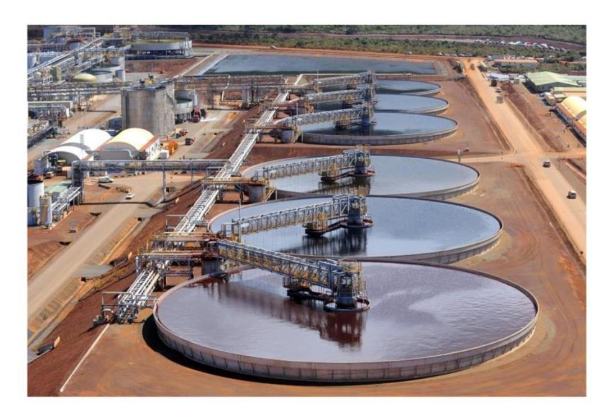

# **C. Éléments de correction**

**Question 1.** Il s'agit de l'exigence 1.4.2.1 : « Objectif de fonctionnement nominal ».

**Question 2.** On obtient une masse volumique ρboue = 1740 kg.m-3 .

**Question 3.** ωbras = 2π 60 × N = 2π 60 × 0,064 = 6,7 ∙ 10−3 rad.s -1

**Question 4.** V = r × ωbras

**Question 5.** dS = h × dr

**Question 6.** :F = k × ρ × S × Vdonc dF = k × ρ × dS × V = k × ρboue × r × ωbras × h × dr d'après les résultats des questions 4 et 5.

**Question 7.** Par intégration, on a : C = k × ρboue × ωbras × h × 1 3 (Rext 3 − Rint 3 ).

Par application numérique :

Ccourt = 120 × 1740 × 6,7 ∙ 10−3 × 0,1 × 1 3 (103 − 3 3 ) = 45 400 N.m

Clong = 120 × 1740 × 6,7 ∙ 10−3 × 0,1 × 1 3 (303 − 3 3 ) = 1 260 000 N.m

**Question 8.** Cbras = 2Ccourt + 2Clong = 2 610 kN.m

**Question 9.** D'après la courbe de tendance de la Figure 7, Cbras = 11,19e 0,11×50 = 2738 kN.m.

Il y a donc un écart relatif faible entre les valeurs théorique et expérimentale :

$$\frac{C_{\text{bras expe}} - C_{\text{bras theo}}}{C_{\text{bras expe}}} \times 100 = \frac{2738 - 2610}{2738} \times 100 = 4,7\%$$

La valeur théorique, et l'approche associée, sont donc validées.

**Question 10.** r3 = 12 124 = 1 10,3 = 0,097

**Question 11.** Nmot = Nbras r1×r2×r3 = 971 tr.min-1

**Question 12.** Cmot = r1×r2×r3 2×η3 Cbras = 94 N.m

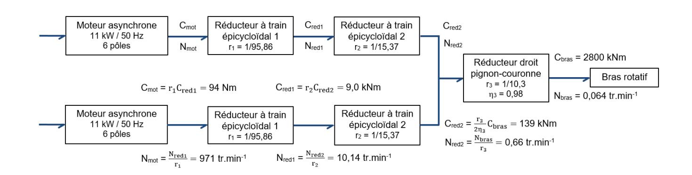

### **Question 13.**

- Le couple de charge maximum des moteurs sélectionnés est de 108 Nm, ce qui est légèrement supérieur au couple nécessaire pour mettre en rotation le bras lorsque la boue contient 50% de solides.
- De plus, on relève que le rendement des moteurs est optimal lorsqu'ils travaillent entre 75 et 100% de leur capacité de charge, ce qui correspond bien au cas à 50% de solides dans la boue.
- La vitesse de rotation nominale de ces moteurs est de 970 tr.min-1 , ce qui est très légèrement en-dessous de la vitesse imposée de 971 tr.min-1 .
- Et la puissance consommée avec un couple de 94 Nm et une vitesse de 971 trmin-1 = 102 rads -1 est de P = Cmot.mot = 9,6 kW, ce qui est inférieur à la puissance de 11 kW des moteurs installés.

Ainsi, les moteurs utilisés sont bien dimensionnés pour le cas souhaité.

Avec le pourcentage actuel de 35% de solides dans la boue, les moteurs sont largement surdimensionnés et fonctionnent notamment avec un rendement non optimal.

### **Question 14.**

1 : Réseau électrique 4 : Trains d'engrenage

2 : MAS 5 : Lames racleuses

3 : MAS

### **Question 15.**

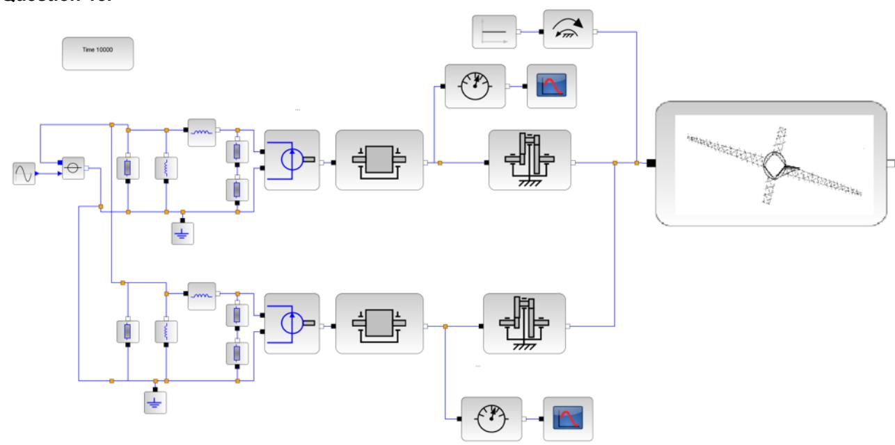

**Question 16.** La machine alimentée sous tension et fréquence nominales possède une vitesse de 970 tr/min. On en déduit que la vitesse de synchronisme est de 1000 tr/min. Le nombre de paires de pôle du moteur est 3, la machine possède 6 pôles.

Question 17. Le glissement nominal est donné par

$$g_n = \frac{N_s - N_n}{N_s} = 3\%$$

Question 18. La puissance réactive absorbée par la machine est consommée par les trois réactances

$$Q_0 = \frac{3V^2}{L_p \omega}$$
donc Lp = 79 ml

**Question 19.** Le modèle n'est pas validé car le courant calculé à rotor bloqué (270 Nm) ne correspond à celui du modèle. En revanche, le courant à vitesse nominale (108 Nm) correspond à celui de la documentation. La validation envisagée pour le modèle peut être critiquée car uniquement faite sur 2 points caractéristiques. Elle serait plus adaptée à partir d'une courbe de courant en fonction du couple composée d'un plus grand nombre de point.

**Question 20.** Avec un pourcentage de boue qui varie légèrement autour de 50%, le couple moteur reste toujours inférieur à 100% du couple nominal, donc les moteurs sont correctement dimensionnés et peuvent fournir le couple nécessaire.

**Question 21.**  $F = C_{mot}/L = 90/0,3 = 300 \text{ N}$ 

**Question 22.** La charge vaut F/g = 300/10 = 30 kg, on peut donc choisir, pour cette application, le capteur dont la charge nominale est 30 kg.

Si calcul avec  $g=9.81 \text{ m/s}^2$ , on obtient : F/g = 300/9.81 = 30.6 kg -> on peut accepter 40 kg de charge nominale.

Question 23. 
$$I = \frac{\pi \times D^4}{64} = \frac{\pi \times (27.5 \times 10^{-3})^4}{64} = 2.8 \times 10^{-8} \text{ m}^4$$
 donc 
$$f = \frac{F \times I^3}{3 \times E \times I} = \frac{300 \times (82 \times 10^{-3})^3}{3 \times 200 \times 10^9 \times 2.8 \times 10^{-8}} \approx 1 \times 10^{-5} \text{ m soit } 10^{-2} \text{ mm, ce qui est très inférieur à la limite de 1}$$
 mm spécifiée par la documentation technique du capteur. Il est donc validé pour cette utilisation.

### Question 24.

de magnétisation

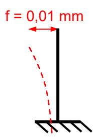

**Question 25.**  $C_{lim}$  = 1600 kNOm or à 50% de solides dans la boue,  $C_{bras}$  = 2800 kN.m donc, avec ce réglage du dispositif de sécurité, on va tout le temps relever les lames, voire arrêter le moteur.

11

**Question 26.** If y a 500 incréments par tour, donc  $K_{cod} = \frac{2\pi \, R_{poulie}}{500} = 2,26 * 10^{-3}$  m/incrément.

### **Question 27.**

**Question 28.** Un tour complet de bras dure 1/0,064 = 15,6 minutes, soit 15,6/2 = **7,8 minutes** entre deux passages de bras long.

### **Question 29.**

- Attente 10 s après détection du bras
- Descente de 2,5 m à 0,1 m/s : 2,5/0,1 = 25 s
- Attente 10 s (mesure de référence)
- Descente de 4 m à 0,1 m/s : 4/0,1 = 40 s
- Montée de 6,5 m à 0,2 m/s : 6,5/0,2 = 32,5 s

TOTAL : 10 + 25 + 10 + 40 + 32,5 = **117,5 s** soit quasiment **2 min** (1,96 min)

**Question 30.** 2 min < 7,8 min : il n'y a normalement aucun risque que le câble de sonde s'enroule dans un bras long.

**Question 31.** La réponse du système a un échelon correspond à une exponentielle amortie (tangente non nulle au départ de l'échelon, pas de dépassement de la valeur finale) : on peut bien modéliser le système par un ordre 1.

**Question 32.** En régime permanent,

∆Cbras = K x ∆U0 donc K = ∆Cbras/∆U0 = 600/10 = 60 kN.mV-1 .

Le système met environ 70 min pour passer de Cbras = 600 kN.m à Cbras = 600 + 0,63.600 = 978 kN.m, donc ≈ 70 min.

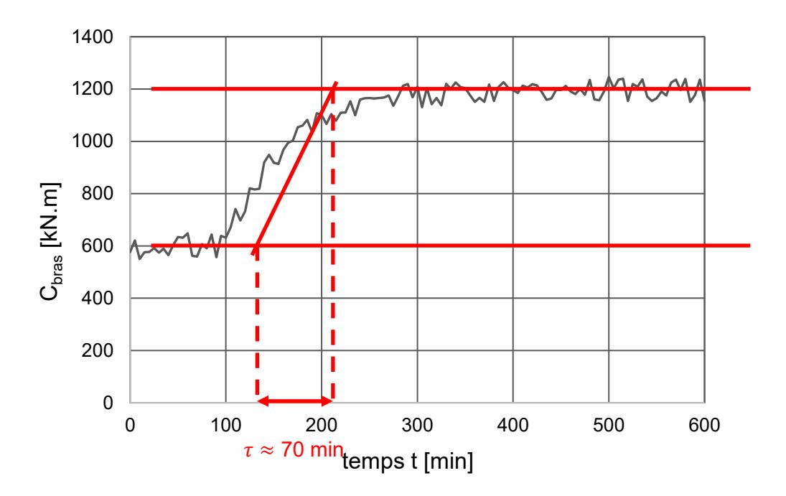

### **Question 33.**

- Le réglage 1 permet d'avoir de faibles dépassements de la valeur finale mais n'est pas précis (erreur statique non nulle en régime permanent).
- Le réglage 2 est précis mais présente des dépassements très importants.
- Le réglage 3 est précis, suffisamment rapide car, à chaque échelon de variation de pulpe, la réponse met un peu moins de 500 min à se stabiliser, et les dépassements sont bien inférieurs à 15% du couple consigne. C'est le meilleur réglage vis-à-vis des exigences de l'asservissement.

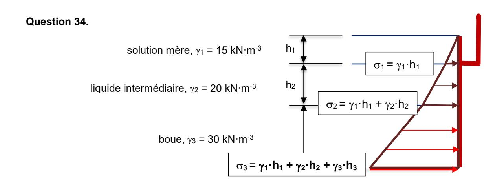

**Question 35.** Le poids volumique de la boue est 3. Plus la boue est dense, plus elle va pousser en pied de paroi.

**Question 36.** Le poids volumique de la boue est 3. Plus la boue est dense, plus elle va pousser sur le sol.

### **Question 37.**

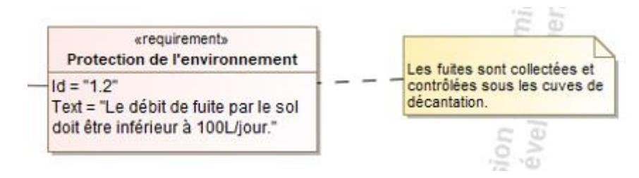

### **Question 38.**

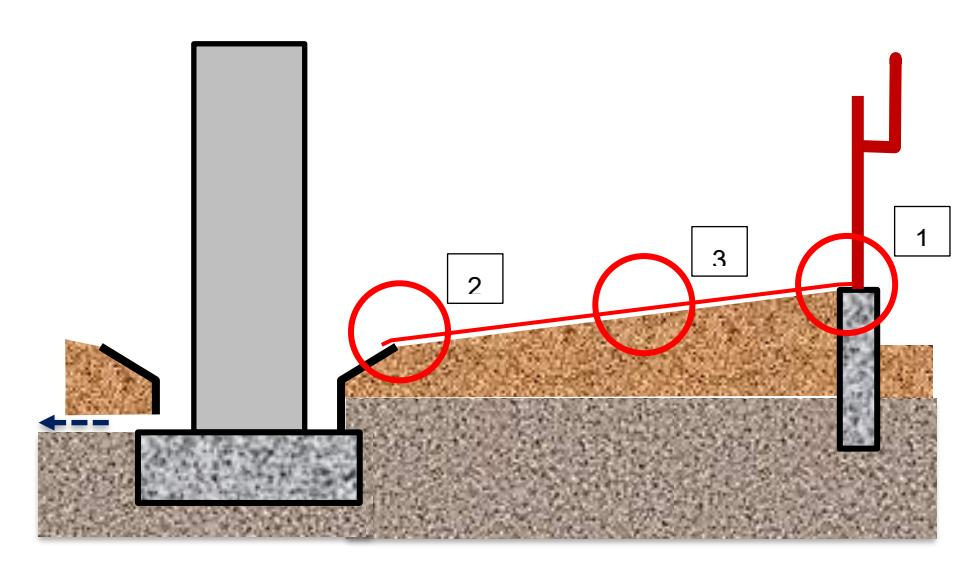

- 1- Fuites en pied de paroi métallique où la poussée horizontale des fluides est la plus importante (liaison métal/bâche). Mais aussi entre les plaques si elles ne sont pas bien assemblées.
- 2- Fuites entre la bâche et le système de collecte. La poussée verticale y est la plus importante.
- 3- Fuites entre les pans de bâches. Mais aussi par abrasion des bâches due au raclage des éléments solides dans la boue.

### **Question 39.**

### En phase de construction :

- assurer l'assemblage étanche des plaques de paroi : soudure, joints… ;
- assurer la jonction bâche/parois par pincement entre la paroi et le muret de béton ;
- souder les bâches entre elles (colle…) ;
- assurer la jonction bâche/système de collecte ;
- mettre en place un drainage pour collecter les eaux de fuite sous les cuves ;

### En service :

- s'assurer visuellement qu'il n'y a pas de fuites dans les zones extérieures accessibles ;
- contrôler le débit des eaux de drainage et agir en cas d'augmentation continue ;
- contrôler l'état des bâches posées au fond de la cuve.

### **Question 40.**

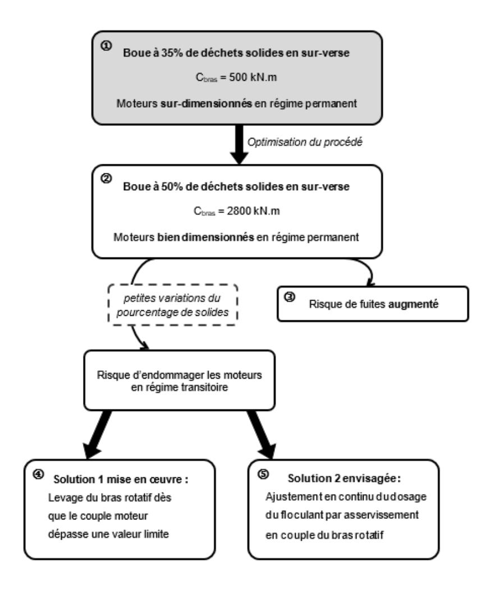

### **Question 41.**

|                           | Évaluation diagnostic                                                                                                                         | Évaluation formative                                                                                            | Évaluation sommative                                                                                                                                    | Évaluation certificative                                                  |
|---------------------------|-----------------------------------------------------------------------------------------------------------------------------------------------|-----------------------------------------------------------------------------------------------------------------|---------------------------------------------------------------------------------------------------------------------------------------------------------|---------------------------------------------------------------------------|
| Moment de l'évaluation | Début de séquence Début de séance Avant l'introduction de nouvelles notions                                                                   | Pendant une activité d'apprentissage                                                                         | A la fin de la séquence, lorsque les élèves sont prêts                                                                                               | A la fin d'un cycle, date définie par l'organisme certificatif         |
| But de l'évaluation    | Faire un état des lieux des connaissances des élèves pour adapter l'enseignement, cibler les points à approfondir avec les élèves | Permettre à l'élève de se situer dans l'apprentissage Valoriser les productions, encourager les élèves | Donner une photographie des acquis des élèves Ajuster son enseignement                                                                            | Déterminer si le candidat a le niveau requis pour un diplôme           |
| Forme de l'évaluation  | QCM individuels écrits ou assistés par logiciels (Plickers), questions réponses collectives                                          | Autoévaluation Grille d'apprentissage définie au préalable                                                | Etude individuelle ou non mobilisant les compétences visées sur un nouveau contexte, donnant lieu à un bilan (sous forme de note ou non) | Sujet individuel ou non, noté, ayant un impact sur la certification |

### **Questions 42 et 43.**

- 1. Trouver la vitesse de rotation des bras dans le SYSML fourni, déterminer le temps disponible pour le passage de la sonde (compétences 1 et 4)
- 2. À partir du SYSML, déterminer la distance à parcourir par la sonde lors d'un cycle de mesurage (compétence 1)
- 3. En déduire la vitesse nécessaire de la sonde lors de ce cycle en supposant la vitesse constante (compétence 4)
- 4. Déterminer la vitesse de rotation du moteur correspondante (compétence 4)
- 5. Déterminer l'intensité aux bornes du moteur correspondante (compétence 4)
- 6. Trouver les valeurs possibles de commande dans le SYSML, en déduire s'il est possible d'éviter les collisions (compétence 1)

**Question 44.** Plusieurs organisations possibles : mettre les élèves sur les supports utilisés en TP en s'assurant qu'ils passent sur l'un qu'ils n'ont pas encore fait, trouver un autre support qui se prête aux activités demandées… L'évaluation doit être en effectif réduit donc 3h maxi, validation des compétences notée ou non.

**Question 45.** Une partie mesurage sur le système, une autre modélisation multiphysique avec simulation de la loi entrée/sortie. Mener une campagne de mesurage avec des outils déjà utilisés, effectuer des simulations sur un modèle multiphysique complet, les élèves devant intégrer les valeurs mesurées pour déterminer le comportement du système. Calculs d'écarts à compléter.

# **D. Commentaires du jury**

### 1. Présentation du sujet

Le sujet s'appuie sur l'étude d'une cuve de décantation utilisée dans un processus d'obtention du nickel appelé hydrométallurgie, situé dans un site de Nouvelle-Calédonie. Ce procédé permet la production de nickel avec un impact écologique moindre par rapport au procédé historique.

Les questions sont réparties en huit parties indépendantes. Sur les sept premières parties, l'étude vise à améliorer le procédé actuel en augmentant la concentration du fluide traité, appelé floculant, pour obtenir un meilleur rendement. Il s'agit d'abord de valider les choix de moteurs permettant le fonctionnement de la cuve, puis de valider des améliorations du système, avec un dispositif de levage des bras en cas de résistance excessive et l'ajout en continu de floculant, asservi en fonction du profil acoustique relevé dans la cuve.

La dernière partie correspond à l'exploitation pédagogique du support et de son étude et vise à concevoir une évaluation avec une approche par compétences.

### 2. Analyse globale des résultats

Grâce aux huit parties qui composent le sujet, les différents champs des sciences industrielles de l'ingénieur sont abordés. Le jury constate que de plus en plus de candidats n'hésitent pas à traiter les parties de manière moins linéaire. Cependant, la linéarité se retrouve encore trop au sein des parties. Si le jury apprécie le recul des candidats qui apportent un avis critique sur les résultats parfois erronés qu'ils obtiennent, il insiste sur l'importance de continuer l'étude de la partie, la méthode de calcul étant valorisée même si le résultat final est faux.

La longueur du sujet permettait aux candidats de traiter sereinement toutes les parties et de soigner sa présentation. Un affichage des questions traitées, ainsi qu'une mise en avant du résultat obtenu permet une clarté indispensable aux postes visés.

### 3. Commentaires sur les réponses apportées et conseils aux futurs candidats

### Partie 1 : Mise en situation

Cette partie est constituée par une unique question, majoritairement bien traitée par les candidats, qui maitrisent la lecture des diagrammes SYSML.

### Partie 2 : Choix d'un moteur pour le bras rotatif en régime permanent

Cette partie a été bien traitée par les candidats. Les premières questions correspondaient à des applications numériques, des conversions d'unités ou l'utilisation de formules simples d'une faible difficulté. Le jury est tout de même surpris de la proportion importante de candidats n'arrivant pas à répondre à ces questions, se trompant parfois sur la valeur d'un périmètre. L'intégration nécessaire à la question 7 n'a été possible que pour un nombre trop limité de candidats. Enfin, le rendement est aussi très peu maitrisé.

### Partie 3 : Validation d'un choix de moteur en régime permanent

Cette partie s'appuie sur un modèle multiphysique. Elle a été traitée de manière très différente en fonction des spécialités présentées par les candidats. Le jury rappelle la nécessité d'une culture transversale, qui s'appuie sur les quatre spécialités, pour aborder les problématiques technologiques actuelles. Les modèles multiphysiques sont primordiaux dans l'enseignement de la spécialité SI et de la filière STI2D, leur maitrise est indispensable pour tout candidat au concours.

### Partie 4 : Analyse du dispositif de levage de sécurité

Cette partie fait appel à une relation mécanique simple et une application numérique. Les candidats ont trop souvent rencontré des difficultés sur ces deux points, la manipulation des unités et des puissances étant très souvent hasardeuse et entrainant des résultats dont l'ordre de grandeur même était faux. De plus, certains schémas des candidats montrent qu'ils ne maitrisent pas le contexte d'étude.

### Partie 5 : Mise en œuvre d'une solution d'ajustement en continu du dosage du floculant

Cette partie a été moins traitée que les autres. Le jury constate, comme pour les modèles multiphysiques, que la maitrise du langage Python est très dépendante des spécialités présentées et reste globalement très insuffisante. Les calculs cinématiques manquent de rigueur. La sous-partie correspondant à l'étude d'un asservissement est très peu traitée, et la qualité des réponses est faible. La lecture graphique d'une courbe est la question la moins bien traitée du sujet.

## Partie 6 : Limitation des fuites de la cuve de décantation en fonction de la densité de la boue Si les questions du début de cette partie ont été plutôt bien traitées, celles nécessitant un travail de rédaction l'ont été beaucoup moins. Trop peu de candidats ont fait la distinction entre les solutions possibles en phase de construction ou en service. De plus, la qualité de rédaction des candidats a globalement été insuffisante et n'a que très peu permis au jury d'apprécier les propositions, faute de soin et de clarté.

### Partie 7 : Conclusion et synthèse

Cette partie permettait aux candidats de montrer, quelles que soient les réponses précédentes, leur compréhension globale des enjeux de l'étude. Elle n'a été que peu traitée. Le jury conseille donc aux candidats de lire l'intégralité du sujet, d'en comprendre le contexte, ce qui leur permettra de répondre plus justement à plus de questions.

### Partie 8 : Exploitation pédagogique du support

Cette partie permettait aux candidats de concevoir un dispositif d'évaluation de compétences à la fois théoriques et pratiques. L'évaluation et ses formes diverses sont globalement bien maitrisées par les

candidats. Un nombre trop important de candidats n'a pas su allier une évaluation écrite et pratique des élèves. Quant à la description des activités envisagées, elle souffre une nouvelle fois de qualités rédactionnelles insuffisantes et est souvent trop sommaire pour permettre au jury de se projeter. Le lien entre les questions posées et les compétences visées n'est pas évident pour les candidats.

### 4. Conclusion

Le jury rappelle une nouvelle fois aux candidats l'importance de soigner la présentation de la copie, la qualité de la rédaction et la précision du vocabulaire. Le jury demande aux candidats de faire particulièrement attention au soin apporté et à la qualité de la rédaction. Les candidats doivent correctement repérer les questions et en cas d'absence de réponse, l'indiquer clairement sur la copie. Le jury conseille également de mettre les résultats en évidence, en les encadrant par exemple.

Il est important de connaître les unités des différentes grandeurs physiques pour avoir un regard critique sur l'homogénéité des relations et des résultats proposés. Le jury invite donc les candidats à traiter ces aspects avec plus de rigueur. Les résultats doivent être présentés sous forme littérale, et les applications numériques doivent aussi être réalisées avec rigueur avec un nombre significatif de chiffres après la virgule cohérent.

Les candidats doivent se présenter pour l'épreuve avec une calculatrice scientifique en état de marche. La rigueur mathématique fait partie des attendus des candidats aux concours de recrutement de professeurs de sciences industrielles de l'ingénieur. Les grandeurs vectorielles ou scalaires doivent être clairement identifiées et la résolution d'équations mathématiques maitrisée. Le jury recommande aux candidats d'apporter un soin particulier aux questions de conclusion de chacune des parties. Les écarts évalués doivent être clairement mis en évidence et commentés. La validation des performances se fait de façon justifiée vis-à-vis des critères du cahier des charges et des travaux réalisés dans la partie concernée. Par ailleurs, une lecture attentive et complète du sujet est nécessaire pour permettre d'exploiter au mieux les documents ressources mis à disposition.

Enfin, le jury insiste sur le fait que pour traiter cette épreuve transversale, les candidats doivent avoir un minimum de connaissances et de culture scientifique dans plusieurs domaines. Bien qu'une évolution soit constatée, ce point reste primordial pour des enseignants destinés à l'enseignement technologique dans sa globalité. Le jury conseille donc aux futurs candidats de travailler dans ce sens.

# **E. Résultats**

Les statistiques générales pour cette épreuve sont données ci-dessous.

### CAPET (IE)

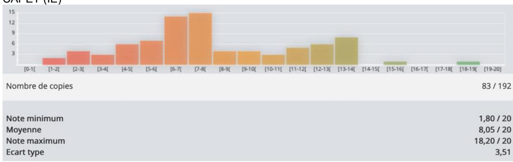

### CAFEP (IE)

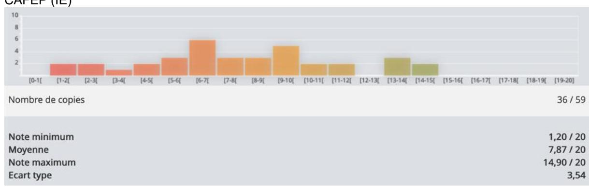

# **Étude d'un système, d'un procédé ou d'une organisation**

Ingénierie électrique

# **A. Présentation de l'épreuve**

Durée : 4 heures Coefficient 1

L'épreuve est spécifique à l'option choisie.

L'épreuve a pour but de vérifier que le candidat est capable de conduire une analyse critique de solutions technologiques et de mobiliser ses connaissances scientifiques et technologiques pour élaborer et exploiter les modèles de comportement permettant de quantifier les performances d'un système ou d'un processus lié à la spécialité et définir des solutions technologiques.

# **B. Sujet**

Le sujet est disponible en téléchargement sur le site du ministère à l'adresse : [https://media.devenirenseignant.gouv.fr/file/capet\\_externe/45/5/s2021\\_capet\\_externe\\_sii\\_electrique\\_2](https://media.devenirenseignant.gouv.fr/file/capet_externe/45/5/s2021_capet_externe_sii_electrique_2_1390455.pdf) [\\_1390455.pdf](https://media.devenirenseignant.gouv.fr/file/capet_externe/45/5/s2021_capet_externe_sii_electrique_2_1390455.pdf)

Une des solutions actuellement utilisée pour stocker l'énergie à grande échelle est la station de transfert d'énergie par pompage-turbinage (STEP) qui permet de stocker l'énergie électrique sous forme d'énergie potentielle. Le support de l'épreuve est une microcentrale qui associe une production d'énergie par panneaux solaires photovoltaïques et un système de pompage-turbinage d'eau.

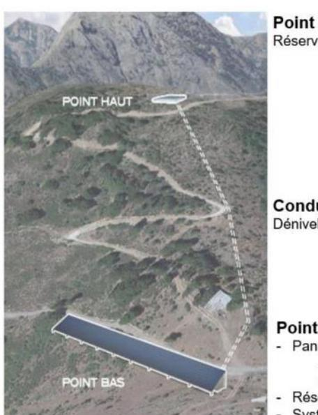

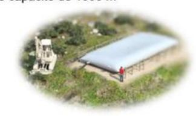

Cinq thèmes d'études indépendantes ont été proposés abordant les sujets suivants :

- *-* Partie A : pertinence du choix du procédé de stockage de l'énergie
- *-* Partie B : validation du dimensionnement du système de production de l'énergie
- *-* Partie C : choix et mise en œuvre du modulateur d'énergie associé au groupe motopompe
- *-* Partie D : validation du procédé de mesure de la quantité d'énergie stockée
- *-* Partie E : validation du procédé en termes de coût énergétique

# **C. Éléments de correction**

### **PARTIE A : pertinence du choix du procédé de stockage de l'énergie.**

*Question 1 : citer au moins deux avantages et deux inconvénients d'une la micro-STEP solaire et préciser dans quelle mesure elle peut répondre aux enjeux de la transition énergétique.*

Avantages : utilisation d'énergie renouvelable, stockage « propre ».

Inconvénients : lieu d'installation doit être approprié (dénivelé important), surface importante pour les panneaux photovoltaïques, investissement important.

*Question 2 : à partir du premier processus de l'ingénierie système présenté dans les documents techniques DT1 à DT3 et du diagramme de définition des blocs du document technique DT4, indiquer, pour chaque cas d'utilisation, la ou les solution(s) technologique(s) retenue(s).*

- 1°) Transformer l'énergie solaire en énergie électrique : panneaux solaires photovoltaïques.
- 2°) Stocker une partie de l'énergie … : réservoir haut ; motopompes.
- 3°) Transformer l'énergie stockée en énergie électrique : turbine + alternateur + conduite.
- 4°) Gérer efficacement l'utilisation de l'énergie produite : automate programmable + centrale de mesures.
- 5°) Adapter l'énergie pour la distribuer : onduleur

### **Phase de turbinage**

*Question 3 : indiquer, à partir de l'organigramme de pilotage du document technique DT5, les conditions de mise en service du turbinage.*

Il y a turbinage si la puissance produite par les PV est inférieure à la puissance consommée par la charge et si le volume du réservoir haut est supérieur à 5% du volume total.

*Question 4 : indiquer, à partir du diagramme de blocs internes partiel de la micro-STEP (figure 3), la forme de l'énergie (potentielle, électrique, cinétique, …) sur les liens repérés (1),(2) et (3).*

(1) : énergie cinétique ; (2) : énergie mécanique de rotation ; (3) : énergie électrique

*Question 5 : déterminer l'énergie potentielle, en kW·h, disponible lorsque le niveau d'eau dans le réservoir supérieur est maximal (90% du volume total).*

$$Ep = m.g.h$$
  $Ep = 0.9 \times 1000 \times 1000 \times 9.81 \times 130 = 114 7770 000 joules, soient 318,825 kW·h$ 

*Question 6 : déterminer, en kW·h, la quantité d'énergie électrique disponible. Comparer et commenter l'écart entre cette valeur et la consommation journalière moyenne du village.*

Eélec\_dipo = 318,825 x 0,78 = 248,68 kW.h soient 43% des besoins journalier du village.

### *Phase de pompage*

*Question 7 : Indiquer, à partir de l'organigramme de pilotage du document technique DT5, les conditions de mise en service du pompage.*

Il y a pompage si :

La puissance produite par les PV est > Puissance consommée par la charge et si le volume du réservoir haut est< à 95% de son volume total

*Question 8 : Indiquer la valeur du débit de la pompe et en déduire la durée totale nécessaire pour remplir totalement le réservoir supérieur.*

D'après les courbes du DT6, Qpompe = 160 m3 /h

$$T = \frac{V}{Q}$$
  $t = \frac{900}{160} = 5,625 \text{ h soit 5h et 37 min}$ 

*Question 9 : À partir des caractéristiques de la pompe données dans le document technique DT6, déterminer l'énergie électrique nécessaire au remplissage complet du réservoir supérieur si celle-ci fonctionne à son régime nominal. En déduire le rendement global du système de stockage ɳst avec :*

Sur la courbe du document DT7 : Pabs = 76 kW (ou 77 kW) d'où :

Eremplissage = 76 x 5,625 = 427,5 kW·h

$$\eta_{st} = \frac{248,68}{427,5} = 58,17\%$$

*Question 10 : Conclure quant aux performances et à l'intérêt de ce procédé de stockage par pompage.* Le procédé de stockage par pompage n'est pas très performant (rendement de 58%). La pompe n'est alimentée que grâce au surplus d'énergie produite par les panneaux photovoltaïques. La durée de remplissage de 5h 37 min ne permet pas un remplissage complet les journées peu ensoleillées. Le système de stockage ne sera efficace que durant les journées ensoleillées d'été.

Mais ce procédé est plus respectueux de l'environnement que le stockage par batterie.

### **PARTIE B : validation du dimensionnement du système de production de l'énergie.**

*Question 11 : déterminer, à partir des caractéristiques techniques du panneau photovoltaïque du document technique DT7, la superficie nécessaire pour atteindre la valeur de la puissance crête souhaitée. Comparer cette valeur à celle annoncée par le constructeur.*

Nombre de panneaux nécessaires : 250 000 W 320 = 782 panneaux

Dimensions du panneau : 1675 mm x 992 mm soit 1,66 m²

Superficie nécessaire : 782 x 1,66 = 1298.12 m² correspond bien à la superficie indiquée par le constructeur (1300 m²).

*Question 12 : à partir des caractéristiques techniques du panneau fournies dans le document technique DT7, indiquer les valeurs Isc et Voc (tension à vide entre les bornes 1 et 2) à renseigner dans le modèle d'une cellule (voir figure 5).*

Les cellules sont en série :

le courant dans une cellule est identique au courant fourni par le panneau : ISC\_cell = 9,76 A Les tensions s'ajoutent : VOC\_cell = VOC\_panneau = 40,96 = 0,683 V

*Question 13 : définir le nombre de panneaux Ns à connecter en série sur chaque entrée. En déduire la puissance MPPT, la tension MPPT et le courant MPPT au niveau de chaque entrée pour une irradiance de 1000 W/m². Commenter le choix de l'onduleur.*

60

Nombre total de panneaux : 782 (question 11) soient : 782 30 = 26 panneaux/entrée

60

PMPPT= 26 x 320 W = 8320 W par entrée soit 5 x 8320W = 41,6 kW par onduleur

VMPPT= 26 x 34,32 V = 892,32 V

IMPPT= 9,34 A

Ces valeurs sont inférieures aux valeurs maximales acceptables par l'onduleur donc celui-ci convient.

*Question 14 : à partir des valeurs relevées sur la figure 7 et des indications du DT7, déterminer la valeur de la puissance maximale (MPPT) pour une irradiance de 600 W∙m- ² et une température du panneau de 50°C. En déduire, dans ces conditions, la capacité du système à produire suffisamment d'énergie pour alimenter la charge et stocker l'eau.*

Pour une irradiance de 600 W/m² et une température de 25°C PMPPT= 140 kW (courbe de la figure 7). Pour une température de 50°C, la puissance chute de 10 % (voir DT7)

soit PMPPT= 140 x 0,9 = 126 kW.

Une chute de puissance de 50 %

### **PARTIE C : choix et mise en œuvre du modulateur d'énergie associé au groupe motopompe**

*Question 15 : Citer deux avantages dans l'utilisation d'un variateur de vitesse et indiquer les paramètres physiques que l'on peut contrôler grâce à ce modulateur d'énergie dans cette application.* L'entraînement électrique à vitesse variable permet :

- de contrôler un ou plusieurs paramètres comme la vitesse, le couple, la position etc,
- d'optimiser la consommation électrique (en réduisant la vitesse, la puissance absorbée par la pompe diminue),
- d'augmenter la fiabilité de l'installation (démarrages et arrêts de la pompe plus souples, réduction des contraintes mécaniques sur la pompe et les tuyauteries).

Dans notre application, nous pouvons contrôler le débit et la pression.

*Question 16 : À l'aide du document technique DT9, choisir le modèle et la puissance du variateur de vitesse de type ATV630 en admettant une surcharge de l'ordre de 150 % du courant nominal du moteur. Justifier les réponses.*

Pour une surcharge de 150 % (HD Heavy Duty) et une puissance utile du moteur de 90 kW alimenté sous 400 V, la référence est la suivante : ATV630C11N4 90 kW

*Question 17 : À l'aide du document technique DT10, déterminer la référence complète du disjoncteur à associer au variateur. Indiquer, en développant, les types de protection assurés par ce type d'appareil.* Pour le variateur de type ATV630CN11N4, le constructeur préconise l'utilisation d'un disjoncteur de type NSX250**N**MA220.

**N** : correspond au pouvoir de coupure ultime du disjoncteur ICU (ICC max variateur = 50 kA)

Ce disjoncteur possède uniquement un déclencheur magnétique MA (aucun réglage du courant thermique) pour une protection contre les courants de court-circuit avec un seuil de réglage à Irm = 2860A. Le variateur réalisera la protection thermique.

*Question 18 : À l'aide du document technique DT12, déterminer la valeur de réglage du paramètre Ith du variateur. Justifier votre réponse.*

→ Réglage du courant thermique : Ith = 0,2 à 1,1 In

$$\rightarrow In_{\text{moteur}} = \frac{Pu}{(\eta \times \sqrt{3} \times U \times \cos \phi)} = \frac{90000}{(0.942 \times \sqrt{3} \times 400 \times 0.86)} = 160.4 \text{ A}$$

→ In variateur = 170A (document technique DT9)

$$\rightarrow$$
 Ith =  $\frac{160,4}{170} \times In = 0,94 \times In$ 

*Question 19 : à l'aide des documents techniques DT11 à DT15, réaliser les schémas de puissance et de commande du variateur en complétant les documents réponses DR1 et DR2.* Voir DR1 et DR2

*Question 20 : à l'aide des documents techniques DT16 à DT19, réaliser le schéma de commande reliant le débitmètre, le capteur de pression, l'électrovanne et le pressostat aux modules d'entrées-sorties de l'automate en complétant le document réponse DR2.* Voir DR2

### **PARTIE D : validation du procédé de mesure de la quantité d'énergie stockée.**

*Question 21 : indiquer les raisons de la non-linéarité de la courbe réelle et déterminer, en valeur relative, le plus grand écart entre le réel et le modèle.*

La non-linéarité est due à la forme de la cuve (bords arrondis).

Pour H=90 cm, l'écart est de 40 m3 soit une erreur de 40 600 = 6,67% Question 22 : à partir de la caractéristique modélisée, déterminer la relation entre le volume en m³ et la hauteur en cm.

$$V = \frac{100}{16} \cdot H$$

D'après les caractéristiques de la figure 12 :

$$I_{\text{mes}} = \frac{16}{200} \cdot \text{H} + 4$$
 et  $N = \frac{10000}{16} \cdot I_{\text{mes}} - 2500$   
À la question 19 :  $V = \frac{100}{16} \cdot \text{H}$ 

D'où : V\_citerne = 0,125 x N

Question 24 : proposer un organigramme du programme à écrire dans le bloc fonction « Contrôler le volume ». Cet organigramme ferra apparaître les calculs nécessaires ainsi que les relations permettant de définir les valeurs des sorties en fonction de l'entrée.

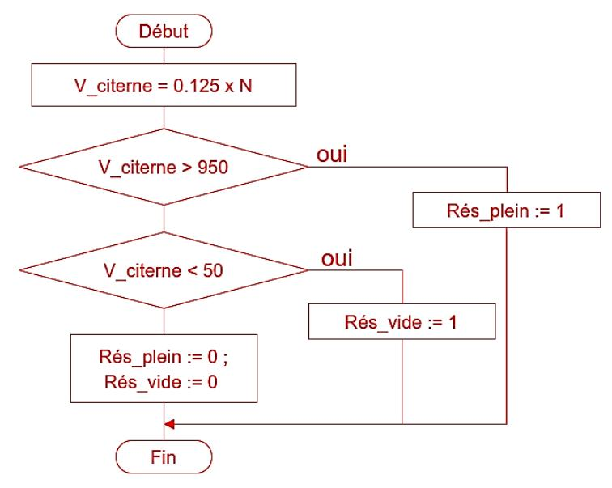

### PARTIE E : validation du procédé en termes de coût énergétique

Question 26 : déterminer le coût énergétique annuel du village avant l'installation de la micro-STEP solaire.

320 MW.h x 170 € = 54 400 €

Question 27 : déterminer, en  $MW \cdot h$ , la quantité d'énergie électrique annuelle  $E_{Stock}$  produite à partir du stockage de l'eau.

EStock= 390 MW·h x 0,25 x 0.5 = 48,75 MW·h

Question 28: après sa mise en service, déterminer la quantité d'énergie  $E_{STEP \to Charge}$  produite annuellement par la micro-STEP solaire et utilisée pour alimenter le village. En déduire celle achetée au fournisseur  $E_{r \to seau}$  ainsi que le coût énergétique annuel total du village.

 $E_{STEP \to Charge} = 390 \text{ MW} \cdot h \times 0.40 + 48.75 \text{ MW} \cdot h = 204.75 \text{ MW} \cdot h$ 

Eréseau = 320 -204,75 = 115,25 MW·h

Coût énergétique : 115,25 x 170 = 19592,20 €

Question 29 : en tenant compte de l'investissement et de la maintenance de l'installation, faire un bilan financier sur 25 ans, estimer le coût de revient du MW·h et conclure quant à l'intérêt d'une micro-STEP solaire.

Énergie revendue EPVRéseau = 0,35 x 390 = 136,5 MW.h

soit un gain : 136,5 x 100€ = 13650 €

Coût final en tenant compte de la revente : 19592,2 – 13650 = 5942,20 €/an

Sur 25 ans :

Dépenses investissement + entretien : 850000 + 10000 x 25 = 1100 000 €

Coût en énergie : 5942,20 x 25 = 148 555 € Pertes : 1100 000 + 148 555 = 1 248 555 €

Soit par kW.h : 1248555 320000∗25 = 0,16 €/kWh

Le coût ramené au kW.h est pratiquement égal au prix du marché.

L'intérêt est donc :

- développement durable

- régulation de l'énergie (palier le problème de l'intermittence des énergies renouvelables)

On peut prévoir que le développement de ce type d'installation entrainera une réduction du coût d'investissement. Ceci combiné à l'augmentation du coût de l'énergie ne peut que favoriser l'intérêt d'une micro-step solaire.

# **DOCUMENT RÉPONSE DR1**

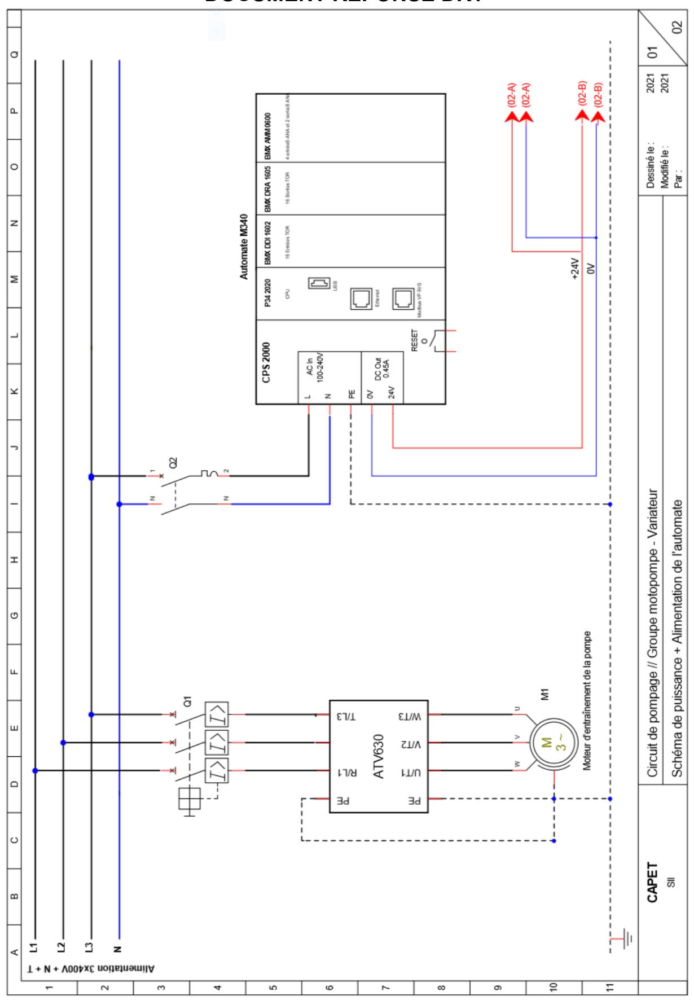

# **DOCUMENT RÉPONSE DR2**

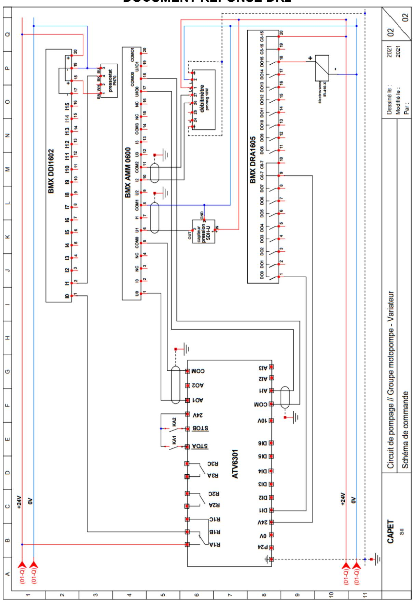

## **D. Commentaires du jury**

Le sujet propose une thématique classique du domaine du génie électrique.

Totalement indépendantes entre elles, chacune des parties traite un secteur particulier du domaine du génie électrique. Les questions au sein d'une même partie sont de difficulté croissante. Chaque candidat doit pouvoir traiter n'importe quelle partie et dans un ordre librement choisi.

Comme dans les sessions précédentes, la majorité des candidats aborde le sujet de manière linéaire en suivant le questionnement proposé mais en couvrant de façon inégale les différentes parties. Bien que l'ensemble des candidats ait traité l'ensemble du sujet, de nombreuses réponses n'ont pas été justifiées ou reprennent sans aucune explication des données issues de documentations techniques fournies. La présentation de certaines copies laisse à désirer, les candidats doivent impérativement faire des efforts pour proposer une copie propre et lisible.

Globalement, le jury considère qu'un peu plus de la moitié des candidats s'est préparée pour cette session mais certains ne maitrisent pas les bases de l'électrotechnique.

Le jury invite l'ensemble des candidats à acquérir des connaissances dans l'algorithmie et dans la réalisation de schémas électriques prenant appui sur de la documentation constructeur.

### - **Partie A : pertinence du choix du procédé de stockage de l'énergie**

Cette partie se décompose en 3 axes dans lesquels le candidat découvre et analyse le système de stockage d'énergie, calcule l'énergie stockée disponible ainsi que l'énergie nécessaire au système de pompage, et enfin, à partir de ces résultats, conclut sur les performances de l'installation.

100% des candidats ont traité cette partie, leur permettant de bien cerner le système et de traiter plus sereinement la suite du sujet. La plupart d'entre eux ont bien répondu aux premières questions mais certains ont rencontré des difficultés à calculer l'énergie potentielle.

Par contre, la conclusion finale a été souvent insuffisante.

Le jury conseille de prendre le temps de découvrir et d'analyser les documents fournis afin de cerner la ou les problématique(s) du sujet et de proposer une conclusion argumentée en s'appuyant sur les résultats obtenus.

Pour cette partie la moyenne ramenée sur 20 est de 11,5.

### - **Partie B : validation du dimensionnement du système de production de l'énergie**

Dans cette partie, le candidat est amené à valider le choix de la centrale solaire. À partir de la documentation technique d'un panneau solaire, il doit déterminer le nombre de panneaux nécessaire à la centrale, définir son modèle et justifier le choix de l'onduleur.

Pour finir, il est amené à vérifier la capacité de la centrale à produire suffisamment d'énergie dans des conditions dégradées (température, luminosité).

Même si quasiment tous les candidats (98%) ont traité cette partie, la plupart d'entre eux ont rencontré des difficultés à justifier le choix de l'onduleur.

Le jury déplore que certains candidats se limitent à donner des résultats sans réelle explication et à ne pas répondre entièrement aux questions lorsqu'il est demandé de conclure sur le choix d'un composant.

Pour cette partie la moyenne ramenée sur 20 est 08,8.

### - **Partie C : choix et mise en œuvre du modulateur d'énergie associé au groupe motopompe**

Dans cette partie, le candidat est amené à choisir le variateur de fréquence et sa protection, puis, à réaliser une partie du schéma électrique du circuit de pompage en montrant les interactions entre le variateur et l'automate.

Les candidats se sont limités à proposer une référence de composants parfois incomplète sans justification, sans indiquer clairement les critères de choix.

Malgré les documents constructeurs fournis, les candidats ont dans l'ensemble raté la partie schéma électrique. Ça a été un des deux points noirs du sujet et les notes en témoignent.

Pour cette partie la moyenne ramenée sur 20 est de 4,8

Pour autant, 98% des candidats ont traité cette partie.

Le jury s'interroge sur la faiblesse générale des candidats dans la réalisation de schémas électriques et conseille de consolider cet aspect en se familiarisant avec la documentation technique.

### - **Partie D : validation du procédé de mesure de la quantité d'énergie stockée**

Cette partie consiste à valider le procédé de mesure de la quantité d'énergie stockée.

Pour cela, il est proposé de mesurer le niveau d'eau du bassin et de la convertir en volume. On fournit aux candidats la caractéristique du volume en fonction de la hauteur.

Les candidats doivent traiter cette information via l'automate et programmer sa gestion et proposer un algorithme de traitement.

Ces éléments devaient leur permettre de conclure quant aux performances de la chaîne de mesure.

De nombreux candidats ont rencontré des difficultés à mettre en équation la chaîne de mesure et à proposer un algorithme qui respecte un langage approprié.

Cette partie est le deuxième gros point noir pour les candidats avec la partie schéma électrique précédente.

Les résultats sont très insuffisants.

Pour cette partie la moyenne ramenée sur 20 est de 4,5.

Il faut noter que 2 candidats ont obtenu la note (ramenée sur 20) maximum de 20.

Cette partie a été traitée par 91% des candidats.

Le jury déplore que les notions de base d'algorithmie ne soient pas maîtrisées et que certains candidats aient des difficultés quant à la maîtrise des outils mathématiques de base (écrire une équation du premier degré par exemple).

### - **Partie E : validation du procédé en termes de coût énergétique**

Cette dernière partie consiste à vérifier la rentabilité de cette installation sur 25 ans en déterminant le coût du kWh.

87% des candidats ont traité cette partie. Un chiffre un peu plus faible que les autres, peut-être parce que le sujet étant abordé de façon linéaire, certains en ont fait l'impasse par manque de temps.

Peut-on aussi imaginer que l'aspect financier les captivent moins ?

Les 2 premières questions ont globalement été correctement traitées. Par contre, les 2 dernières questions ont révélé beaucoup de faiblesse dans la capacité à structurer les réponses et à développer les arguments en s'appuyant sur les résultats obtenus.

Pour cette partie la moyenne ramenée sur 20 est de 09,5

En conclusion, le jury a été satisfait de constater que 87% des candidats ont traité l'ensemble du sujet. Il rappelle que le sujet est abordable.

Le jury conseille d'attacher une importance particulière à la qualité de la copie (soin, orthographe, syntaxe, qualité des schémas, etc.). Les réponses données doivent être toutes justifiées.

Il n'est pas concevable à ce niveau de concours que les candidats ne soient pas capables de résoudre une équation du premier degré. De même, il est décevant de constater que certains d'entre eux confondent les notions de puissance en régime continu et alternatif.

Les outils mathématiques de base et les lois fondamentales de l'électricité doivent être maitrisés.

Le jury constate que beaucoup de candidats ne sont pas à l'aise dans la réalisation de schémas électriques. Un candidat au CAPET doit être capable de câbler une entrée ou une sortie TORanalogique d'un automate industriel programmable, ainsi que la partie commande d'un variateur de fréquence. Rappelons, que par exemple, ces notions sont largement accessibles à un étudiant de BTS.

De plus, le jury rappelle l'importance du numérique dans l'épreuve. Les candidats doivent acquérir des connaissances dans la maitrise de l'algorithmie et de la programmation. Ces notions sont incontournables dans la pratique de leur futur métier d'enseignant.

Pour finir, le jury conseille aux candidats d'apporter un soin particulier aux questions de conclusion de chacune des parties. Cela leur permettrait de se démarquer.

# **E. Résultats**

Les statistiques générales pour cette épreuve sont données ci-dessous.

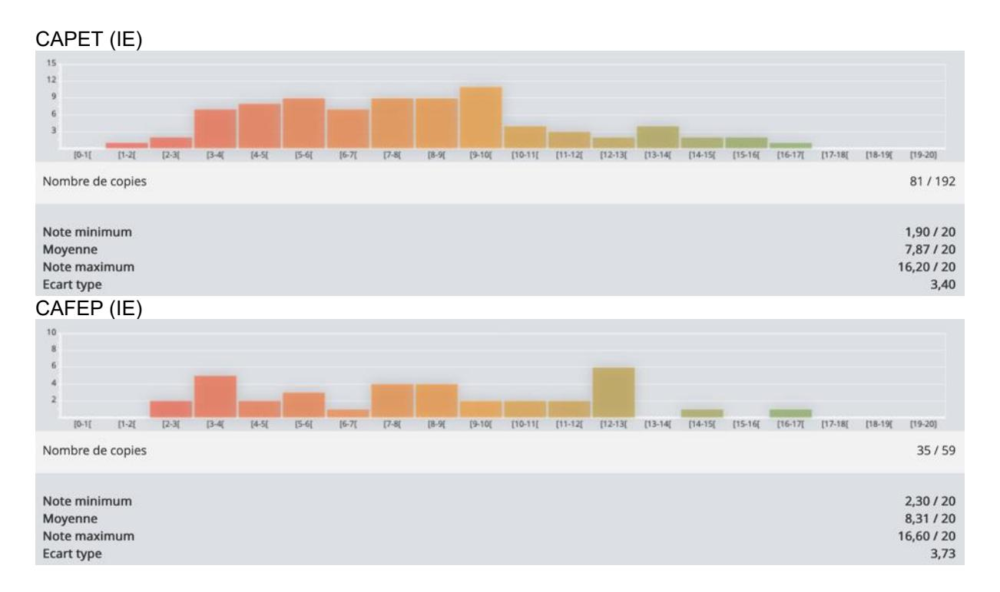

# **Épreuve de mise en situation professionnelle**

## **A. Présentation de l'épreuve**

Durée des travaux pratiques : 4 heures

Durée de la préparation de l'exposé : 1 heure

Durée de l'exposé : 30 minutes Durée de l'entretien : 30 minutes

Coefficient 4

10 points sont attribués à la première partie liée au travail pratique et 10 points à la seconde partie liée à la leçon.

L'épreuve prend appui sur les investigations et les analyses effectuées par le candidat pendant les quatre heures de travaux pratiques relatifs à un système pluritechnologique et comporte un exposé suivi d'un entretien avec les membres du jury. L'exploitation pédagogique attendue, directement liée aux activités pratiques réalisées, est relative aux enseignements de technologie du collège ou aux enseignements technologiques non spécifiques du cycle terminal « sciences et technologies de l'industrie et du développement durable (STI2D) » ou à l'enseignement des sciences de l'ingénieur du lycée général.

## **B. Commentaires du jury**

Le rapport de jury prend comme référence exclusive le règlement de concours en vigueur et ne fait pas de projections en termes de conseils aux candidats sur le règlement de concours qui serait applicable pour la session 2022, des changements quant à la définition des épreuves d'admission étant annoncés mais encore précisément connus au moment de l'écriture de ce rapport.

### **1. Présentation de l'épreuve**

La durée de cette épreuve est de six heures. Elle est scindée en trois temps :

- quatre heures de travaux pratiques sur un système pluri-technologiques ;
- une heure en loge pour concevoir une exploitation pédagogique et sa présentation ;
- une heure devant un jury organisée en 30 minutes maximum de présentation par le candidat de son exploitation pédagogique et 30 minutes maximum d'échanges.

Les deux parties, travaux pratiques et exploitation pédagogique, sont indépendantes et sont notées chacune sur dix points.

La séparation de l'évaluation des deux parties de l'épreuve permet de dissocier la réussite à la partie « travaux pratiques » de celle à la partie « exploitation pédagogique ».

Les supports utilisés, pour cette session, sont des systèmes pluri-technologiques actuels :

- robot collaboratif ;
- bras deux axes de contrôle par caméra ;
- banc de simulation de séisme ;
- système de ventilation double flux ;
- système de caméra auto-suiveuse ;
- nacelle de prise de vue ;
- robot humanoïde ;
- système de travelling ;
- banc d'étude sur la cohésion des sols ;

- banc d'essai de flexion ;
- robot haptique ;
- véhicule de mobilité urbaine.

Un tirage au sort du support est réalisé indépendamment de la spécialité du candidat pour l'épreuve de mise en situation professionnelle.

Le travail pratique proposé est construit pour être accessible à tous les candidats, quelle que soit son option d'inscription au concours. Les documents accompagnant le support fournissent une guidance qui permet aux candidats, quelle que soit leur connaissance du système, quelle que soit leur spécialité, de mobiliser leurs compétences scientifiques et pédagogiques.

Chaque support conduit à une exploitation pédagogique de niveau imposé en technologie au collège, en série STI2D (sciences et technologies de l'industrie et du développement durable) ou en spécialité sciences de l'ingénieur de la voie générale.

Les objectifs de formation pour l'exploitation pédagogique sont donnés aux candidats ainsi que le contexte de mise en œuvre de la séquence (effectifs, répartition horaire…)

Les compétences évaluées lors de cette épreuve sont les suivantes :

- analyser, mettre en œuvre un protocole expérimental, simuler et vérifier des performances ;
- exploiter des résultats, justifier des choix et des solutions ;
- présenter la structure et l'organisation d'une séquence pédagogique ;
- présenter de manière détaillée une partie significative d'une séance de formation constitutive de la séquence ;
- élaborer des documents de qualité pour présenter la séquence et la partie significative de la séance ;
- s'exprimer correctement à l'oral pour présenter la séquence et la partie significative d'une séance de formation.

Ces compétences sont évaluées, quels que soient les supports d'activité pratiques mis en œuvre. Les candidats disposent :

- d'un espace numérique personnel qu'ils conservent pendant les six heures de l'épreuve ;
- d'un poste informatique équipé des logiciels de bureautique et dédié aux activités pratiques ;
- de toutes les ressources numériques en lien avec le travail pratique (dont les programmes d'enseignement, les repères pour la formation et les guides d'accompagnement lorsqu'ils existent).

Le jury dispose d'une traçabilité des connexions sur le réseau permettant de suivre les sites consultés.

Pour la partie travaux pratiques, les postes de travail sont équipés, selon la nécessité des activités proposées, des matériels usuels de mesure des grandeurs physiques (oscilloscopes numériques, multimètres, dynamomètres, tachymètres, cartes d'acquisition associées à un ordinateur…). Cette liste n'est pas exhaustive.

### **2. Analyse globale des résultats**

Le jury tient à souligner la qualité de préparation de la majorité des candidats. Néanmoins, les attendus de l'épreuve et les modalités de mise en œuvre décrits au JORF et repris dans les rapports des jurys des années précédentes ne sont toujours pas connus de tous. Il s'avère extrêmement difficile de réussir les activités pratiques et l'exploitation pédagogiques si les objectifs spécifiques de ces deux parties de l'épreuve ne sont pas connus.

Les notions théoriques portant sur la didactique de la discipline et sur les différentes démarches pédagogiques associées sont régulièrement citées par les candidats. Elles sont rarement justifiées et parfois énoncées d'une façon inappropriée. Elles ne font que trop rarement l'objet d'une contextualisation ou d'une proposition concrète dans le cadre de la séquence présentée lors de la leçon.

Une proportion notable de candidats ne connaît pas les grands éléments de la réforme du lycée dont la première session du baccalauréat se déroule au moment du concours. Les programmes de technologie au collège et de la série STI2D et de la spécialité sciences de l'ingénieur du lycée général et technologique ainsi que les documents ressources pour faire la classe sont parfois inconnus des candidats. Bien que donnés, ces différents textes et documents nécessitent un temps important pour s'approprier leur économie. La méconnaissance de ceux-ci se révèle pénalisante pour construire une séquence et une séance pédagogique réaliste dans le temps imparti. Le jury a été également surpris que des candidats ne soient pas acculturés au socle commun de connaissances, de compétences et de culture ainsi qu'à l'évaluation par compétences.

Le nombre des exploitations pédagogiques portant sur le collège, la série STI2D et la spécialité SI a été équilibré sur l'ensemble de la session. Les candidats doivent être en mesure de produire des séquences et séances sur tous les niveaux d'enseignement afin de pouvoir répondre aux attentes du jury.

Le jury rappelle que les exploitations pédagogiques doivent s'appuyer sur les programmes en vigueur lors de la session du concours.

### **3. Commentaires du jury sur les réponses apportées par les candidats et conseils aux candidats**

Le jury a noté une prise en compte des remarques des années précédentes portant sur la concision de la présentation des activités pratiques et sur l'intérêt de mettre en regard l'étude réalisée sur le système du laboratoire et la séquence pédagogique demandée. Le jury invite les candidats à faire preuve d'une grande rigueur scientifique lors de la présentation des travaux réalisés et ne pas s'attacher à restituer l'intégralité (dans tous ses détails) des activités pratiques. Lors de l'exploitation pédagogique, les activités pratiques et leurs résultats ne sont pas encore suffisamment réinvestis, au niveau de la séquence demandée.

Le jury conseille d'organiser la présentation de la façon suivante :

- présentation du système (durée maximale cinq minutes) ;
- synthèse des activités menées en travaux pratiques (durée maximale cinq minutes) ;
- exploitation pédagogique (durée maximale vingt minutes).

Le manque de culture scientifique et technologique pénalise de nombreux candidats dans l'appropriation des supports pluri-technologiques. Il est impératif, pour espérer réussir l'épreuve de mise en situation professionnelle, de disposer de compétences et de connaissances scientifiques et technologiques avérées. Cette culture technologique ne se limite en aucun cas à un domaine disciplinaire unique. Les futurs professeurs de sciences industrielles de l'ingénieur se doivent d'avoir une vision transversale et globale de leur discipline et de conduire une veille technologique régulière.

Quelques candidats proposent des présentations (orales et écrites) très formatées, quelques fois hors du contexte des activités pratiques réalisées en amont, qui ne résistent pas aux questionnements du jury et mettent en évidence des lacunes. Le jury invite les candidats à, certes, maîtriser les attendus pédagogiques et didactiques de la discipline, mais surtout à être en capacité de les réinvestir de façon adaptée et pertinente. À titre d'exemples, les termes « formatif », « sommatif », « inductif »… doivent être utilisés à bon escient et dans un contexte adapté.

Les candidats les plus efficients font preuve d'autonomie et d'écoute lors des travaux pratiques. Ils prennent des initiatives dans la conception de leur séquence pédagogique. Ils mettent à profit l'ensemble des ressources numériques mises à leur disposition.

Enfin, le jury rappelle que le concours constitue la première étape de l'entrée dans le métier du professorat. Le candidat se doit donc d'adopter une posture et un positionnement exemplaires constitutifs de la mission d'enseignant. Le jury invite vivement les candidats à s'approprier le référentiel des compétences professionnelles des métiers du professorat et de l'éducation (arrêté du 1-7-2013 - J.O. du 18-7-2013).

### **Conseils aux candidats**

Le jury conseille aux candidats de :

- s'approprier les programmes de tous les niveaux énoncés dans la définition de l'épreuve ainsi que les documents ressources associés ;
- prendre connaissance du socle commun de connaissances, de compétences et de culture ;
- s'informer des évolutions des programmes et des enseignements en collège ;
- s'informer des pratiques pédagogiques, des modalités de fonctionnement et de l'organisation des horaires de tous les niveaux d'enseignement que peuvent assurer les professeurs de sciences industrielles de l'ingénieur ;
- se préparer à exploiter les résultats d'investigations et d'expérimentations en regard des contenus disciplinaires.
- s'informer sur les modalités des épreuves d'examen auxquelles ils préparent leurs futurs élèves.

### **Qualité des documents de présentation et expression orale**

Il est attendu des candidats une maîtrise des outils numériques pour l'enseignement afin de construire un document clair, lisible et adapté à la présentation de l'exposé.

Le jury est extrêmement attentif à la qualité de la syntaxe et de l'orthographe.

Les candidats s'expriment généralement correctement. La qualité de l'élocution et la clarté des propos sont indispensables aux métiers de l'enseignement.

### **Pour la partie travaux pratiques**

### **Organisation à suivre lors de l'épreuve**

Dans un premier temps, les candidats doivent prendre connaissance des compétences visées relatives à la séquence de formation à élaborer. Durant les quarante-cinq premières minutes, le travail demandé consiste à concevoir l'ingénierie pédagogique relatif à la séquence imposée (niveau, organisation temporelle et structurelle…). Ce premier temps est décontextualisé du système support de l'évaluation de l'épreuve de travaux pratiques.

À l'issue de ce premier temps, les candidats doivent rapidement mettre en œuvre et s'approprier le système. Des documents d'aide sous forme numérique leur sont fournis.

Les candidats réalisent des activités expérimentales et analysent des résultats afin de conclure sur les problématiques du sujet. Ces manipulations, mesures et interprétations, sont réalisées au niveau de compétences d'un master première année.

Les candidats doivent penser à garder des traces numériques de leurs résultats et de leurs travaux afin de les réinvestir dans une séquence adaptée au collège ou au lycée.

Lors de cette session, durant les quatre heures des activités pratiques, une heure et quinze minutes peuvent être consacrées à la conception de l'exploitation pédagogique présentée lors de la dernière partie de l'épreuve. Organisés en deux temps distincts, l'un en début de travaux pratiques pour 45 minutes et l'autre en fin de travaux pratiques pour 30 minutes, ces moments de travail permettent d'engager une réflexion portant sur l'ingénierie pédagogique demandée et de commencer l'élaboration

des documents pédagogiques attendus lors de l'exposé. Le temps d'ingénierie pédagogique ne nécessite pas de manipulation du système.

La connaissance préalable du système et des logiciels n'étant pas demandée, les membres de jury peuvent être sollicités par les candidats en cas de problème ou de difficultés liées à l'exploitation d'un logiciel ou d'un appareil de mesurage spécifique. Plus généralement, le jury est présent pour accompagner les candidats dans leur démarche.

### **Aptitude à mener un protocole expérimental**

La mise en œuvre des matériels de mesurage et d'acquisition ne suscite pas de difficultés particulières. Les membres du jury assurent l'accompagnement nécessaire afin que la spécificité d'un équipement ne constitue pas un obstacle à la réussite du candidat. On attend du candidat qu'il soit capable de proposer et de justifier des choix de protocoles expérimentaux.

### **Utilisation des modèles numériques**

Globalement, les candidats utilisent correctement les modèles numériques fournis. Le jury note cependant que de nombreux candidats manquent de recul et d'esprit critique dans l'interprétation des résultats de la simulation numérique et dans l'analyse des hypothèses utilisées lors de l'élaboration du modèle. Il est attendu des candidats une analyse pertinente des écarts entre les résultats fournis par la modélisation, les mesures issues du système réel à partir d'expérimentations et/ou les performances attendues indiquées dans le cahier des charges.

### **Pour l'exposé devant le jury**

### **Présentation du travail pratique**

Une présentation succincte du support, des travaux réalisés et des résultats obtenus permet de contextualiser la séquence et la séance qui seront présentées. Elle doit être réalisée avec toute la rigueur scientifique que le jury peut attendre d'un étudiant de Master 1re année qui se destine au métier d'enseignant. Le jury apprécie les présentations synthétiques mettant en évidence les points qui feront l'objet d'un réinvestissement dans la description de la séquence et de la séance. Afin de faciliter l'exposé, il est suggéré d'utiliser les outils adaptés à la production d'une présentation de qualité.

### **Description de la séquence**

Les candidats inscrivent leur développement pédagogique dans un contexte pédagogique donné dans le sujet. L'objectif de formation, une progression pédagogique dans laquelle peut s'inclure la séquence à développer, les programmes et les documents ressources pour faire la classe sont mis à disposition sur le répertoire numérique personnel du candidat.

Les candidats doivent structurer une séquence pédagogie dont la position dans la progression pédagogique de cycle est le plus souvent donné. Pour ce faire, les progressions didactiques publiées sur le site de référence EDUSCOL STI sont un point d'appui que les candidats ne peuvent ignorer.

Les hypothèses d'organisation de la pédagogie dans l'établissement doivent être précisées (par exemple 9 heures d'enseignement de I2D dont 6 heures en groupe à effectif réduit). Le positionnement de la séquence dans le plan de formation du cycle ou de l'année doit être précisé pendant la présentation.

Une séquence se compose de plusieurs séances. Il est demandé, pour chaque séance, de préciser les prérequis et les objectifs (compétences à faire acquérir, capacités et connaissances attendues), l'organisation de la classe, les systèmes utilisés, la durée, le nombre d'élèves, les modalités pédagogiques (cours, activités dirigées, activités pratiques, projet), les stratégies pédagogiques (déductif, inductif, différenciation pédagogique, démarche d'investigation, démarche de résolution de problème technique, pédagogie par projet, approche spiralaire…), les activités des élèves et les productions attendues. Les descriptions de la séquence et des séances devraient faire explicitement apparaître la prise en compte de la diversité des publics accueillis dans la classe.

Les phases de structuration des connaissances permettant la construction des connaissances des élèves et les différentes formes d'évaluations des élèves sont des parties intégrantes de la séquence et doivent reprendre les objectifs annoncés. Les modalités d'évaluation de ses connaissances et compétences doivent être présentées. Les différentes modalités d'enseignement (EPI, interdisciplinarité, concours scientifique et technique…) et les dispositifs d'accompagnement et de remédiation doivent être précisés.

### **Utilisation du numérique**

Le jury note qu'une majorité de candidats fait appel aux ressources et usages du numérique dans les activités proposées aux élèves. Néanmoins, le jury conseille aux candidats de bien identifier les points de leur séquence pédagogique pour lesquels l'usage du numérique apportera une réelle plus-value aux apprentissages des élèves. Si l'exploitation du numérique disciplinaire est souvent mise en œuvre par de nombreux candidats, peu d'entre eux proposent une séquence exploitant le numérique éducatif.

### **Réinvestissement des résultats de travaux pratiques**

L'objectif attendu de la leçon est une exploitation pédagogique en lien avec tout ou partie des activités pratiques réalisées. Celles-ci étant d'un niveau supérieur à la séquence demandée, il ne s'agit pas de faire, au travers de la séquence pédagogique, un compte-rendu de l'activité pratique réalisée, mais de s'appuyer sur les expérimentations pour en extraire des données et des activités à proposer aux élèves. Les candidats doivent, en dix minutes au maximum :

- présenter brièvement le support, la problématique et la démarche méthodologique proposée ;
- justifier le(s) lien(s) avec la séquence pédagogique, expliciter les résultats et les investigations qui seront réutilisées dans la séquence.

De plus, il est important que les candidats explicitent comment les adapter au niveau d'enseignement visé. Le jury ne se satisfait en aucun cas d'une exploitation brute des activités proposées dans la première partie de l'épreuve.

Les candidats peuvent aussi envisager l'utilisation d'autres systèmes présents dans les établissements, en complément du système étudié pendant la première partie de l'épreuve.

### **Réalisme de l'organisation de la classe**

Le jury attend des candidats qu'ils émettent des hypothèses réalistes sur les conditions d'enseignement. Leurs propositions doivent être pragmatiques afin que le jury puisse appréhender le scénario pédagogique envisagé.

### **Évaluation**

Le processus retenu par le candidat pour l'évaluation des compétences doit être clairement décrit (évaluation diagnostique, formative, sommative, certificative…) et justifié. Les critères d'évaluation doivent être explicités. Les modalités et les outils doivent être précisés. Si des remédiations ou des différenciations pédagogiques sont envisagées, elles doivent être explicitées.

Trop souvent, les candidats se contentent d'évoquer les processus d'évaluation sans pouvoir en expliquer réellement le déroulement, les modalités et surtout l'objectif en termes d'acquisition des compétences par les élèves.

### **Réactivité au questionnement**

Le jury attend de la concision et de la précision ainsi qu'une honnêteté intellectuelle dans les réponses formulées. Les réponses au questionnement doivent laisser transparaître un positionnement adapté aux attentes de l'Institution et une réelle appropriation des valeurs de la République ne se limitant pas à l'exposé des grands principes sans en démontrer le bienfondé pour les élèves.

Le candidat se doit d'être réactif sans chercher à éluder les questions ou à noyer le propos dans un discours pédagogique non maitrisé. Plus qu'une réponse exacte instantanée, le jury apprécie la capacité à argumenter, à expliquer et justifier une démarche ou un point de vue.

### **4. Conclusion**

L'épreuve de mise en situation professionnelle nécessite une préparation sérieuse et approfondie en amont de l'admissibilité. Cette préparation doit porter tout autant sur la partie « travaux pratiques » que sur la partie « exploitation pédagogique », car ces deux parties de l'épreuve sont complémentaires et indissociables. Les compétences nécessaires à la réussite de cette épreuve sont à acquérir et à développer notamment lors de stages en situation et de périodes d'observation ou d'enseignement. Elles sont complétées par une connaissance fine des référentiels et des documents ressources pour faire la classe. L'épreuve s'appuie sur la maîtrise disciplinaire des sciences industrielles de l'ingénieur. Le métier d'enseignant exige une exemplarité dans la tenue, dans la posture ainsi que dans le discours. L'épreuve de mise en situation professionnelle permet la valorisation de ces qualités.

# **C. Résultats**

Les résultats pour l'option IE sont les suivants :

|                                | CAPET | CAFEP |
|--------------------------------|-------|-------|
| Note maximale                  | 18,80 | 18,20 |
| Note minimale                  | 1,90  | 13,10 |
| Moyenne des candidats présents | 11,01 | 15,49 |
| Moyenne des candidats admis    | 12,91 | 15,97 |

# **Épreuve d'entretien à partir d'un dossier**

## **A. Présentation de l'épreuve**

Durée totale de l'épreuve : 1 heure (présentation : 30 minutes maximum, entretien avec le jury : 30 minutes)

Coefficient 2

L'épreuve est basée, dans l'option choisie, sur un entretien avec le jury à partir d'un dossier technique, scientifique et pédagogique réalisé par le candidat, suivi d'un entretien. Elle a pour but de vérifier que le candidat est capable de rechercher des supports pluritechnologiques de son enseignement dans le milieu économique et d'en extraire des exploitations pertinentes pour son enseignement au collège ou en lycée.

L'entretien qui succède à la présentation du candidat permet au jury d'approfondir les points qu'il juge utiles. Il permet en outre d'apprécier la capacité du candidat à prendre en compte les acquis et les besoins des élèves, à se représenter la diversité des conditions d'exercice de son métier futur, à en connaître de façon réfléchie le contexte dans ses différentes dimensions (classe, équipe éducative, établissement, institution scolaire, société) et les valeurs qui le portent, dont celles de la République. Les dossiers doivent être déposés au secrétariat du jury cinq jours francs avant le début des épreuves d'admission.

## **B. Commentaires du jury**

À compter de la session 2022, cette épreuve sera remplacée par l'épreuve « entretien avec le jury ».

Le jury constate que le caractère pluri technologique des supports choisis par les candidats est parfois absent et présente rarement un caractère innovant ; leur pertinence au regard des attendus de l'épreuve est parfois remise en question. De nombreux dossiers sont composés de documents commerciaux contenant ainsi des informations recueillies à partir de sites Internet ; la question des autorisations d'exploitation dans le cadre d'un concours est souvent éludée. De nombreux candidats ont fait part au jury de leur difficulté à accéder au cahier des charges des produits ou encore aux résultats d'essais conduits par l'entreprise. Le jury constate un manque un manque de discernement relatif aux éléments qu'il aurait été judicieux de recueillir.

En matière d'outil de description des systèmes, le jury a constaté que certains candidats mobilisent encore des outils anciens et que les diagrammes SYSML apparaissent mal maîtrisés tant dans leur rédaction que dans leur lecture/interprétation. Le jury regrette que les développements scientifiques et technologiques soient quasiment inexistants ; les représentations volumiques, les modèles multiphysiques et les simulations numériques associées sont trop souvent absents. Le jury constate que seule une minorité de candidats développe, même modestement, une analyse scientifique à partir du support choisi pour en faire des exploitations pédagogiques.

Pour l'essentiel, les activités pédagogiques proposées sont relatives à la filière STI2D et la technologie en cycle 4 ; la spécialité sciences de l'ingénieur du baccalauréat est rarement retenue. Le jury constate chez de nombreux candidats qu'une certaine confusion existe entre les démarches d'investigation, de résolution de problème et la démarche de projet ; notamment dans les interrelations entre celles-ci. Les activités envisagées apparaissent souvent déconnectées des objectifs pédagogiques ; cela se traduit par une juxtaposition d'intitulés de séquences ou de séances, sans intégration dans une véritable progression pédagogique et didactique. La dimension expérimentale est trop souvent occultée.

Certains candidats se contentent de lire le diaporama qu'ils projettent. La phase d'entretien met en avant le manque de pertinence des réponses aux questions. Ces réponses manquent souvent de précision et de concision et sont rarement étayées par une réflexion scientifique. Le jury constate une maîtrise insuffisante de la représentation normalisée des chaînes fonctionnelles, des schémas mécanique et cinématique, des algorigramme – algorithme, des diagrammes orthonormés.

Les stratégies de différenciation – remédiation pédagogique sont rarement développées, et quand elles le sont, restent superficielles ; il en est de même pour l'évaluation.

Le jury constate une grande disparité entre des candidats issus du milieu de l'entreprise qui présentent des compétences scientifiques et techniques affirmées mais peu de réflexion pédagogique et des candidats issus de l'Inspé qui disposent d'une réflexion pédagogique intéressante mais des compétences techniques et scientifiques tout juste suffisantes.

Concernant les valeurs de la République, si les meilleurs candidats savent faire preuve d'analyse réflexive, le jury regrette vivement qu'une majorité d'entre eux s'en remette à des poncifs et manquent de conviction quant aux dimensions éducatives qu'elles portent. Le respect des valeurs de la République est une obligation faite aux fonctionnaires qui ne saurait se réduire à la connaissance des principaux textes ; cela doit se traduire dans la façon qu'auront les futurs professeurs d'exercer leur service.

## **C. Résultats**

Les résultats pour l'option IE sont les suivants :

|                                | CAPET | CAFEP |
|--------------------------------|-------|-------|
| Note maximale                  | 20    | 19    |
| Note minimale                  | 1     | 5     |
| Moyenne des candidats présents | 9,47  | 12,75 |
| Moyenne des candidats admis    | 10,76 | 18,33 |

# **Rapport sur la transmission des valeurs et principes de la République**

Les valeurs de la République ont fait leur entrée dans le code de l'Éducation en 2005, à l'occasion de la Loi d'orientation et de programme sur l'avenir de l'école, dite loi Fillon. Le code de l'éducation précise depuis cette date que : « Outre la transmission des connaissances, la Nation fixe comme mission première à l'école de faire partager aux élèves les valeurs de la République. »

L'école doit promouvoir non seulement les valeurs de la République mais aussi celles du dialogue, de la réflexion, de la curiosité, de la preuve, de la mesure, de l'explicitation ainsi que celles de l'effort, de la politesse, de la tolérance ou encore de la solidarité. Elles sous-tendent la dignité de l'homme, la liberté, l'égalité, la solidarité, l'esprit de justice, le refus de toute forme de discrimination.

Lors des épreuves d'admission, le jury évalue la capacité du candidat à agir en agent du service public d'éducation, en vérifiant qu'il intègre dans l'organisation de son enseignement :

- la conception des apprentissages des élèves en fonction de leurs besoins personnels ;
- la prise en compte de la diversité des conditions d'exercice du métier et la connaissance réfléchie des contextes associés ;
- le fonctionnement des différentes entités éducatives existant au sein de la société et d'un EPLE;
- les valeurs portées par l'Éducation nationale, dont celles de la République.

Il s'agit d'évaluer la posture du candidat au regard de la transmission des valeurs et des principes de la République à l'école. La dimension civique de l'enseignement doit être explicite.

Le candidat doit prendre en compte ces exigences dans la conception des séquences pédagogiques présentées au jury. Il s'agit de faire acquérir, à l'élève, des compétences alliant des connaissances scientifiques et technologiques et des savoir-faire associés, mais également d'instaurer des comportements responsables et respectueux des valeurs républicaines.

Cet objectif exigeant induit une posture réflexive du candidat lors de la préparation et de la présentation d'une séquence pédagogique. En particulier, les stratégies pédagogiques proposées devront permettre d'atteindre l'objectif de formation visé dans le cadre de « l'école inclusive ». Il est indispensable de donner du sens aux enseignements en ne les déconnectant pas d'un contexte sociétal identifiable. Cela doit contribuer à convaincre les élèves du bien-fondé des valeurs républicaines et à se les approprier. L'éducation aux valeurs républicaines doit conduire à adopter des démarches pédagogiques spécifiques, variées et adaptées. Il s'agit en particulier de doter chaque futur citoyen d'une culture faisant de lui un acteur éclairé et responsable de l'usage des technologies et des enjeux éthiques associés. À dessein, il est nécessaire de lui faire acquérir des comportements fondateurs de sa réussite personnelle et le conduire à penser et construire son rapport au monde.

Les modalités pédagogiques déployées en sciences industrielles de l'ingénieur, sont nombreuses et sont autant d'opportunités offertes à l'enseignant pour apprendre aux élèves :

- à travailler en équipe et coopérer à la réussite d'un projet ;
- à assumer une responsabilité individuelle et collective ;
- à travailler en groupe à l'émergence et à la sélection d'idées issues d'un débat et donc favoriser le respect de l'altérité ;
- à développer des compétences relationnelles en lui permettant de savoir communiquer une idée personnelle ou porter la parole d'un groupe ;

- à comprendre les références et besoins divers qui ont conduit à la création d'objets ou de systèmes à partir de l'analyse des « modes », des normes, des lois… ;
- à différencier, par le déploiement de démarches rigoureuses, ce qui relève des sciences et de la connaissance de ce qui relève des opinions et des croyances. L'observation de systèmes réels, l'analyse de leur comportement, de la construction ou de l'utilisation de modèles multi physiques participent à cet objectif ;
- à observer les faits et situations divers suivant une approche systémique et rationnelle ;
- à adopter un positionnement citoyen assumé au sein de la société en ayant une connaissance approfondie de ses enjeux au sens du développement durable. L'impact environnemental, les coûts énergétiques, de transformation et de transport, la durée de vie des produits et leur recyclage, sont des marqueurs associés à privilégier ;
- à réfléchir collectivement à son environnement, aux usages sociaux des objets et aux conséquences induites ;
- à comprendre les enjeux sociétaux liés au respect de l'égalité républicaine entre hommes et femmes ;

…

Lors de l'épreuve, le jury a apprécié les postures de certains candidats quant aux valeurs dont l'école est porteuse et celles, intellectuelles et morales, qu'elle cherche à développer. Ces mêmes candidats ont fait preuve d'un sens de l'éthique professionnelle et de l'éthique de la responsabilité lors de l'exposé de leurs séquences d'enseignement et de leurs actions, au sein de la classe, envisagées en particulier dans leurs pratiques d'évaluation. La prise de risque pour quelques-uns d'entre eux lors des questions posées par les membres du jury pour adapter leurs enseignements aux réalités du terrain et garantir les apprentissages quelques soient les situations évoquées a montré qu'ils étaient porteurs des valeurs de l'école et de la République.

Cette déontologie professionnelle suppose au moins l'appropriation par le candidat des ressources et textes suivants :

- les droits et obligations du fonctionnaire présentés sur le portail de la fonction publique [\(https://www.fonction-publique.gouv.fr/droits-et-obligations\)](https://www.fonction-publique.gouv.fr/droits-et-obligations) ;
- les articles L 111-1 à L 111-4 et l'article L 442-1 du code de l'Éducation ;
- le vade-mecum « la laïcité à l'École » [\(https://eduscol.education.fr/1618/la-laicite-l-ecole\)](https://eduscol.education.fr/1618/la-laicite-l-ecole) ;
- le vade-mecum « Agir contre le racisme et l'antisémitisme » [\(https://eduscol.education.fr/1720/agir-contre-le-racisme-et-l-antisemitisme\)](https://eduscol.education.fr/1720/agir-contre-le-racisme-et-l-antisemitisme) ;
- « Qu'est-ce que la laïcité ? », Conseil des sages de la laïcité, janvier 2020 [\(https://www.education.gouv.fr/le-conseil-des-sages-de-la-laicite-41537\)](https://www.education.gouv.fr/le-conseil-des-sages-de-la-laicite-41537) ;
- le parcours magistère « faire vivre les valeurs de la République » [\(https://magistere.education.fr/f959\)](https://magistere.education.fr/f959) ;
- « L'idée républicaine aujourd'hui », Conseil des sages de la laïcité ;
- « La République à l'École », Inspection générale de l'éducation, du sport et de la recherche ;
- le site IH2EF (https://www.ih2ef.gouv.fr/laicite-et-services-publics).